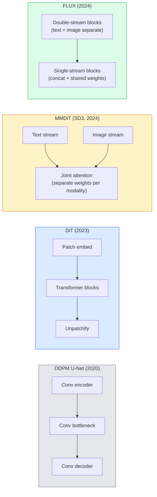

<!-- local-zh-machine-draft: English source is canonical; prose translated automatically, code/math preserved. -->

<a id="diffusion-transformers--rectified-flow"></a>

# Diffusion Transformers 与 Rectified Flow

> U-Net 并不是扩散的秘密。将其替换为 transformer，将噪声表替换为直线流，突然间您就拥有了 SD3、FLUX 和每个 2026 个文本到图像模型。

**类型：** 学习 + 构建
**语言：** Python
**先决条件：** 第 4 阶段第 10 课（扩散 DDPM）、第 4 阶段第 14 课 (ViT)、第 7 阶段第 02 课 (Self-Attention)
**时间：** ~75分钟

<a id="learning-objectives"></a>

## 学习目标

- Trace 从U-Net DDPM（第10课）到Diffusion的演变 Transformer（DiT）、MMDiT（SD3）和单+双流DiT（FLUX）
- 解释修正流：为什么噪声和数据之间的直线轨迹可以让模型以 20 步而不是 1000 步进行采样
- 实现一个微小的 DiT 块和一个整流流训练循环，两者都在 100 行以下
- 按架构、parameter 数量和许可区分模型变体（SD3、FLUX.1-dev、FLUX.1-schnell、Z-Image、Qwen-Image）

<a id="the-problem"></a>

## 问题

第 10 课使用 U-Net 降噪器构建了 DDPM。这个方案在 2020-2023 年占据主导地位：U-Net + beta 时间表 + 噪声预测损失。它产生了稳定扩散 1.5 和 2.1 以及 DALL-E 2。

2026 年最先进的文本到图像模型都已经超越了它。 Stable Diffusion 3、FLUX、SD4、Z-Image、Qwen-Image、Hunyuan-Image — 均不使用 U-Net。他们使用 Diffusion Transformers (DiT)。 SD3 和 FLUX 还将 DDPM 噪声表替换为整流流，从而拉直从噪声到数据的路径，并启用具有一致性或蒸馏变体的 1-4 步 inference。

这种转变很重要，因为这是基于扩散的图像生成变得可控、prompt 准确（SD3/SD4 解决文本渲染）和快速生产的原因。理解 DiT + 校正流程就是理解 2026 生成图像堆栈。

<a id="the-concept"></a>

## 概念

<a id="from-u-net-to-transformer"></a>

### 从U-Net到transformer



- **DiT**（Peebles & Xie，2023）——在潜在的 patches 上用类似 ViT 的 transformer 替换 U-Net。通过自适应层规范 (AdaLN) 进行调节。
- **MMDiT** (SD3, Esser et al., 2024) — 两个流，分别具有用于文本的 weights 和共享联合 attention 的 image tokens。
- **FLUX**（黑森林实验室，2024）——前 N 个块像 SD3 一样双流，后面的块连接并共享 weights（单流）以提高更高深度的效率。
- **Z-Image** (2025) — 6B parameters 的高效单流 DiT，挑战“不惜一切代价扩大规模”。

<a id="rectified-flow-in-one-paragraph"></a>

### 一段中修正的流程

DDPM 将前向过程定义为一个嘈杂的 SDE，其中 `x_t` 日益损坏。学习到的逆向问题是第二个 SDE，通过 1000 个小步骤解决。

整流流定义了干净数据和纯噪声之间的 **straight-line** 插值：

```
x_t = (1 - t) * x_0 + t * epsilon,     t in [0, 1]
```

训练网络来预测速度 `v_theta(x_t, t) = epsilon - x_0` — 沿着从干净数据到噪声的直线路径的前进方向 (`dx_t/dt`)。在 sampling 期间，您可以向后积分该速度以从噪声走向数据。所得的 ODE 更接近于直线，因此采样所需的积分步骤更少。

SD3 将此称为 ** 整流流匹配 **。 FLUX、Z-Image 和大多数 2026 型号使用相同的物镜。典型的 inference：20-30 个欧拉步骤（确定性）与旧 DDPM 机制中的 50+ DDIM 步骤。蒸馏/涡轮/schnell/LCM 变体将其减少到 1-4 个步骤。

<a id="adaln-conditioning"></a>

### AdaLN 调理

通过 ** 自适应层范数 ** 对时间步和类/文本进行条件限制：从条件向量中预测 `scale` 和 `shift` 并在 LayerNorm 之后应用它们。比 U-Net 中的 FiLM 式调制和每个现代 DiT 中的默认调制干净得多。

```
cond -> MLP -> (scale, shift, gate)
norm(x) * (1 + scale) + shift, then residual add * gate
```

<a id="text-encoders-in-sd3-and-flux"></a>

### SD3 和 FLUX 中的文本 encoders

- **SD3** 使用三个文本 encoders：两个 CLIP 型号 + T5-XXL。 Embeddings 连接并作为文本调节馈送到图像流。
- **FLUX** 使用 1 个 CLIP-L + T5-XXL。
- **Qwen-Image / Z-Image** 变体使用自己的内部文本 encoders 与其基础 LLMs 对齐。

文本 encoder 是 SD3/FLUX 认为 prompts 比 SD1.5 好得多的重要原因。仅 T5-XXL 就有 4.7B 参数。

<a id="classifier-free-guidance-still-holds"></a>

### 无分类器指导仍然有效

整流流量改变采样器，而不改变调节。无分类器指导（在训练期间以 10% 的概率丢弃文本，在 inference 上混合条件和无条件预测）与修正流的工作方式相同。大多数 2026 模型使用指导尺度 3.5-5 — 低于 SD1.5 的 7.5，因为整流流模型默认更严格地遵循 prompts。

<a id="consistency-turbo-schnell-lcm"></a>

### 一致性、Turbo、Schnell、LCM

同一想法有四个名称：将缓慢的多步模型提炼为快速的几步模型。

- **LCM（潜在一致性模型）** — 训练一名学生，一步步从任何中间 `x_t` 预测最终的 `x_0`。
- **SDXL Turbo / FLUX schnell** — 通过对抗扩散蒸馏训练的 1-4 步模型。
- **SD Turbo** — OpenAI 型适应潜在扩散的一致性模型。

任何新型号的生产服务均附带“全品质”checkpoint 和“turbo / schnell”变体。 Schnell（德语中的“快”，黑森林实验室的惯例）以 1-4 步运行，适合实时管道。

<a id="model-landscape-in-2026"></a>

### 2026年景观模型

| 模型 | 尺寸 | 建筑 | 许可证 |
|-------|------|--------------|---------|
| 稳定扩散3中 | 2B | MMDiT | SAI 社区 |
| 稳定扩散3.5大 | 8B | MMDiT | SAI 社区 |
| FLUX.1-dev | 12B | 双流 + 单流 DiT | 非商业性 |
| FLUX.1-施奈尔 | 12B | 同样，蒸馏的 | 阿帕奇2.0 |
| 通量.2 | — | 迭代通量.1 | 混合的 |
| Z-图像 | 6B | S3-DiT（可扩展单流） | 宽容的 |
| Qwen-图片 | 〜20B | DiT + Qwen 文本塔 | 阿帕奇2.0 |
| 浑源-Image-3.0 | ～80B | 迪特 | 研究 |
| SD4涡轮 | 3B | DiT + 蒸馏 | SAI商业 |

FLUX.1-schnell 是 2026 年开源默认版本。 Z-Image 是效率领先者。 FLUX.2 和 SD4 是当前的质量提示。

<a id="why-this-phase-shift-matters"></a>

### 为什么这种相移很重要

DDPM + U-Net 有效。 DiT + 整流流工作原理 ** 更好、更快，并且扩展更干净**。这一转变与 NLP 中从 RNNs 到 transformers 的转变类似：两种架构都解决了相同的问题，但 transformers 进行了扩展，现在占据主导地位。 2026 年每篇关于图像、视频或 3D 生成的论文都使用 DiT 形降噪器，并且通常使用校正流目标。 U-Net DDPM 现在主要用于教学（第 10 课）。

```figure
cv3-rectified-flow
```

<a id="build-it"></a>

## 动手实现

<a id="step-1-a-dit-block-with-adaln"></a>

### 第 1 步：带有 AdaLN 的 DiT 块

```python
import torch
import torch.nn as nn


class AdaLNZero(nn.Module):
    """
    Adaptive LayerNorm with a gate. Predicts (scale, shift, gate) from the conditioning.
    Init such that the whole block starts as identity ("zero init").
    """

    def __init__(self, dim, cond_dim):
        super().__init__()
        self.norm = nn.LayerNorm(dim, elementwise_affine=False)
        self.mlp = nn.Linear(cond_dim, dim * 3)
        nn.init.zeros_(self.mlp.weight)
        nn.init.zeros_(self.mlp.bias)

    def forward(self, x, cond):
        scale, shift, gate = self.mlp(cond).chunk(3, dim=-1)
        h = self.norm(x) * (1 + scale.unsqueeze(1)) + shift.unsqueeze(1)
        return h, gate.unsqueeze(1)


class DiTBlock(nn.Module):
    def __init__(self, dim=192, heads=3, mlp_ratio=4, cond_dim=192):
        super().__init__()
        self.adaln1 = AdaLNZero(dim, cond_dim)
        self.attn = nn.MultiheadAttention(dim, heads, batch_first=True)
        self.adaln2 = AdaLNZero(dim, cond_dim)
        self.mlp = nn.Sequential(
            nn.Linear(dim, dim * mlp_ratio),
            nn.GELU(),
            nn.Linear(dim * mlp_ratio, dim),
        )

    def forward(self, x, cond):
        h, gate1 = self.adaln1(x, cond)
        a, _ = self.attn(h, h, h, need_weights=False)
        x = x + gate1 * a
        h, gate2 = self.adaln2(x, cond)
        x = x + gate2 * self.mlp(h)
        return x
```

`AdaLNZero` 作为恒等映射启动，因为其 MLP weights 初始化为零。培训可以消除身份认同的障碍；这极大地稳定了深度 transformer diffusion models。

<a id="step-2-a-tiny-dit"></a>

### 第 2 步：一个小小的 DiT

```python
def timestep_embedding(t, dim):
    import math
    half = dim // 2
    freqs = torch.exp(-math.log(10000) * torch.arange(half, device=t.device) / half)
    args = t[:, None].float() * freqs[None]
    return torch.cat([args.sin(), args.cos()], dim=-1)


class TinyDiT(nn.Module):
    def __init__(self, image_size=16, patch_size=2, in_channels=3, dim=96, depth=4, heads=3):
        super().__init__()
        self.patch_size = patch_size
        self.num_patches = (image_size // patch_size) ** 2
        self.patch = nn.Conv2d(in_channels, dim, kernel_size=patch_size, stride=patch_size)
        self.pos = nn.Parameter(torch.zeros(1, self.num_patches, dim))
        self.time_mlp = nn.Sequential(
            nn.Linear(dim, dim * 2),
            nn.SiLU(),
            nn.Linear(dim * 2, dim),
        )
        self.blocks = nn.ModuleList([DiTBlock(dim, heads, cond_dim=dim) for _ in range(depth)])
        self.norm_out = nn.LayerNorm(dim, elementwise_affine=False)
        self.head = nn.Linear(dim, patch_size * patch_size * in_channels)

    def forward(self, x, t):
        n = x.size(0)
        x = self.patch(x)
        x = x.flatten(2).transpose(1, 2) + self.pos
        t_emb = self.time_mlp(timestep_embedding(t, self.pos.size(-1)))
        for blk in self.blocks:
            x = blk(x, t_emb)
        x = self.norm_out(x)
        x = self.head(x)
        return self._unpatchify(x, n)

    def _unpatchify(self, x, n):
        p = self.patch_size
        h = w = int(self.num_patches ** 0.5)
        x = x.view(n, h, w, p, p, -1).permute(0, 5, 1, 3, 2, 4).reshape(n, -1, h * p, w * p)
        return x
```

<a id="step-3-rectified-flow-training"></a>

### 第三步：纠正流程训练

```python
import torch.nn.functional as F

def rectified_flow_train_step(model, x0, optimizer, device):
    model.train()
    x0 = x0.to(device)
    n = x0.size(0)
    t = torch.rand(n, device=device)
    epsilon = torch.randn_like(x0)
    x_t = (1 - t[:, None, None, None]) * x0 + t[:, None, None, None] * epsilon

    target_velocity = epsilon - x0
    pred_velocity = model(x_t, t)

    loss = F.mse_loss(pred_velocity, target_velocity)
    optimizer.zero_grad()
    loss.backward()
    optimizer.step()
    return loss.item()
```

与 DDPM 的噪声预测损失（第 10 课）进行比较：相同的结构，不同的目标。我们没有预测噪声 `epsilon`，而是预测 **velocity** `epsilon - x_0`，它沿着直线插值从数据指向噪声。

<a id="step-4-euler-sampler"></a>

### 第四步：欧拉采样器

整流流是 ODE。欧拉方法是最简单的，对于训练有素的整流流模型来说，在 20 多个步骤中几乎与高阶求解器一样准确。

```python
@torch.no_grad()
def rectified_flow_sample(model, shape, steps=20, device="cpu"):
    model.eval()
    x = torch.randn(shape, device=device)
    dt = 1.0 / steps
    t = torch.ones(shape[0], device=device)
    for _ in range(steps):
        v = model(x, t)
        x = x - dt * v
        t = t - dt
    return x
```

20 步。在经过训练的模型上，这会生成与 1000 步 DDPM 相当的样本。

<a id="step-5-end-to-end-smoke-test"></a>

### 第5步：端到端冒烟测试

```python
import numpy as np

def synthetic_blobs(num=200, size=16, seed=0):
    rng = np.random.default_rng(seed)
    out = np.zeros((num, 3, size, size), dtype=np.float32)
    yy, xx = np.meshgrid(np.arange(size), np.arange(size), indexing="ij")
    for i in range(num):
        cx, cy = rng.uniform(4, size - 4, size=2)
        r = rng.uniform(2, 4)
        mask = (xx - cx) ** 2 + (yy - cy) ** 2 < r ** 2
        colour = rng.uniform(-1, 1, size=3)
        for c in range(3):
            out[i, c][mask] = colour[c]
    return torch.from_numpy(out)
```

使用修正后的流程在此训练 `TinyDiT`。经过 500 个步骤后，采样输出应该看起来像淡淡的颜色斑点。

<a id="use-it"></a>

## 实际应用

对于使用 FLUX / SD3 / Z-Image 生成真实图像，`diffusers` 为每个图像提供统一的 API：

```python
from diffusers import FluxPipeline, StableDiffusion3Pipeline
import torch

pipe = FluxPipeline.from_pretrained(
    "black-forest-labs/FLUX.1-schnell",
    torch_dtype=torch.bfloat16,
).to("cuda")

out = pipe(
    prompt="a golden retriever surfing a tsunami, hyperrealistic, studio lighting",
    guidance_scale=0.0,           # schnell was trained without CFG
    num_inference_steps=4,
    max_sequence_length=256,
).images[0]
out.save("surf.png")
```

三行。 `FLUX.1-schnell` 分四步。将模型 ID 替换为 `black-forest-labs/FLUX.1-dev`，使用 CFG 在 20-30 个步骤中获得更高的质量。

对于 SD3：

```python
pipe = StableDiffusion3Pipeline.from_pretrained(
    "stabilityai/stable-diffusion-3.5-large",
    torch_dtype=torch.bfloat16,
).to("cuda")
out = pipe(prompt, guidance_scale=3.5, num_inference_steps=28).images[0]
```

<a id="ship-it"></a>

## 交付成果

本课产生：

- `outputs/prompt-dit-model-picker.md` — 在给定质量、延迟和许可证限制的情况下，在 SD3、FLUX.1-dev、FLUX.1-schnell、Z-Image、SD4 Turbo 之间进行选择。
- `outputs/skill-rectified-flow-trainer.md` — 使用 AdaLN DiT 和 Euler sampling 编写修正流程的完整训练循环。

<a id="exercises"></a>

## 练习

1. **(Easy)** 在合成 blob 数据集上训练上面的 TinyDiT 500 个步骤。比较使用 10、20 和 50 欧拉步骤生成的样本。
2. **（中）** 通过将学习类 embedding 连接到时间 embedding（按颜色排列 10 个斑点“类”）来添加文本调节。使用 0、5 和 9 级进行采样并验证颜色匹配。
3. **（硬）** 计算从相同大小的网络的整流流和 DDPM 版本生成的样本之间的 Fréchet 距离（FID 代理），该网络在相同的数据上进行相同步数的训练。收敛速度更快的报告。

<a id="key-terms"></a>

## 关键术语

| 术语 | 人们怎么说 | 它实际上意味着什么 |
|------|----------------|----------------------|
| 迪特 | “扩散transformer” | Transformer，替代U-Net作为扩散降噪器；对修补后的潜在变量进行操作 |
| 阿达林 | “自适应层规范” | 在 LayerNorm 之后应用学习的比例、移位、门的时间步长/文本调节；每个现代 DiT 的标准 |
| MMDiT | “多模态 DiT (SD3)” | 用于共享联合 self-attention 的文本和 image tokens 的单独 weight 流 |
| 单码流/双码流 | “通量技巧” | 前 N 个块双流（每个 modality 单独的 weights），后面块单流（连续 + 共享 weights）以提高效率 |
| 整流流 | “直线噪声到数据” | 数据和噪声之间的线性插值； 网络预测速度； 需要更少的 ODE 步骤inference |
| 速度目标 | “epsilon - x_0” | 整流流中的回归目标；从干净数据到噪声的点 |
| CFG指导 | “无分类器指导” | 混合条件和无条件预测；仍用于整流流模型 |
| 施奈尔/涡轮/LCM | “1-4步蒸馏” | 从全质量模型中提炼出的小步变体；生产实时 |

<a id="further-reading"></a>

## 进一步阅读

- [可扩展 Diffusion Models 和 Transformers（Peebles & Xie，2023）](https://arxiv.org/abs/2212.09748) — DiT 论文
- [缩放整流流 Transformers（Esser 等人，SD3 论文）](https://arxiv.org/abs/2403.03206) — MMDiT 和大规模整流流
- [FLUX.1 model card 和技术报告（黑森林实验室）](https://huggingface.co/black-forest-labs/FLUX.1-dev) — 双+单流详细信息
- [Z-Image：高效图像生成基础模型 (2025)](https://arxiv.org/html/2511.22699v1) — 6B 的单流 DiT
- [E阐明扩散的设计空间（Karras 等人，2022）](https://arxiv.org/abs/2206.00364) — 每个扩散设计权衡的参考
- [潜在一致性模型（Luo et al., 2023）](https://arxiv.org/abs/2310.04378) — LCM-LoRA 如何为您提供 4 步 inference
