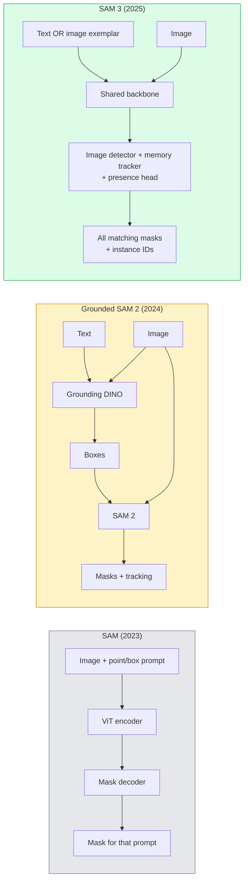

<!-- local-zh-machine-draft: English source is canonical; prose translated automatically, code/math preserved. -->

<a id="sam-3--open-vocabulary-segmentation"></a>

# SAM 3 与开放词表分割（Open-Vocabulary Segmentation）

> 为模型提供文本 prompt 和图像，并获取每个匹配对象的蒙版。 SAM 3 制作了一个 forward pass。

**类型：** 使用+构建
**语言：** Python
**先决条件：** 第 4 阶段第 07 课（U-Net）、第 4 阶段第 08 课（掩模 R-CNN）、第 4 阶段第 18 课（CLIP）
**时间：** ~60 分钟

<a id="learning-objectives"></a>

## 学习目标

- 区分 SAM（仅限视觉 prompts）、接地 SAM / SAM 2（探测器 + SAM）和 SAM 3（通过提示概念分割的原生文本 prompts）
- 解释 SAM 3 架构：共享主干 + 图像检测器 + 基于内存的视频跟踪器 + 存在头 + 解耦检测器-跟踪器设计
- 使用 Hugging Face `transformers` SAM 3 集成进行文本提示检测、分割和视频跟踪
- 根据延迟、概念复杂性和部署目标在 SAM 3、Grounded SAM 2、YOLO-World 和 SAM-MI 之间进行选择

<a id="the-problem"></a>

## 问题

2023 SAM 是仅视觉 prompt 的模型：您单击一个点或绘制一个框，它会返回一个蒙版。对于“给我这张照片中的所有橙子”，您需要一个探测器 (Grounding DINO) 来生成盒子，然后使用 SAM 来分割每个盒子。 Grounded SAM 将其变成了一条管道，但它是两个冻结模型的级联，不可避免地会出现错误累积。

SAM 3（Meta，2025 年 11 月，ICLR 2026）使级联崩溃。它接受简短的名词短语或图像样本 prompt，并在单个 forward pass 中返回所有匹配的掩码和实例 ID。即**即时概念分割（PCS）**。结合 2026 年 3 月的对象复用更新 (SAM 3.1)，它可以通过视频有效地跟踪同一概念的多个实例。

本课是关于它所代表的结构性转变。 2D seg、检测和文本图像 grounding 已合并为一个模型。生产问题不再是“我将哪个管道链接在一起”，而是“哪个提示模型端到端地处理我的用例”。

<a id="the-concept"></a>

## 概念

<a id="the-three-generations"></a>

### 三代人



<a id="promptable-concept-segmentation"></a>

### 及时的概念分割

“概念prompt”是一个简短的名词短语（`"yellow school bus"`、`"striped red umbrella"`、`"hand holding a mug"`）或图像范例。该模型为图像中与概念匹配的每个实例返回分段掩码，以及每个匹配的唯一实例 ID。

这与经典视觉 prompt SAM 在三个方面有所不同：

1. 无需针对每个实例进行提示 — 一个文本 prompt 返回所有匹配项。
2. Open-vocabulary — 这个概念可以是任何可以用自然语言描述的东西。
3. 一次返回多个实例，而不是每个 prompt 一个掩码。

<a id="key-architectural-pieces"></a>

### 关键建筑作品

- **共享主干** — 单个 ViT 处理图像。探测器头和基于内存的跟踪器都从中读取数据。
- **Presence head** — 预测图像中是否存在概念。解耦“这是这里吗？”来自“它在哪里？”。减少对不存在的概念的误报。
- **解耦检测器跟踪器** — 图像级检测和视频级跟踪具有单独的头，因此它们不会干扰。
- **内存库** — 跨帧存储每个实例 features 以进行视频跟踪（使用与 SAM 2 相同的机制）。

<a id="training-at-scale"></a>

### 大规模培训

SAM 3 接受过训练**400 万个独特的概念**由数据引擎生成，使用人工智能+人工审查迭代注释和纠正。 新的**SA-CO基准**包含 270K 个独特概念，比之前的基准大 50 倍。 SAM 3 在 SA-CO 上达到人类性能的 75-80%，并且在图像 + 视频 PCS 上使现有系统翻倍。

<a id="sam-31-object-multiplex"></a>

### SAM 3.1 对象多路复用

2026 年 3 月更新：**Object Multiplex** 引入了一种共享内存机制，用于同时联合跟踪同一概念的多个实例。以前，跟踪 N 个实例意味着 N 个独立的内存库。 Multiplex 通过按实例查询将其折叠到一个共享内存中。结果：在不牺牲准确性的情况下，多目标跟踪速度大幅加快。

<a id="where-grounded-sam-still-matters-in-2026"></a>

### 2026 年，接地 SAM 仍然很重要

- 当您需要交换特定的 open-vocabulary 探测器时（DINO-X、Florence-2）。
- 当 SAM 3 许可证（在 HF 上门控）成为阻碍者时。
- 当您需要对检测器阈值进行比 SAM 3 更强的控制时。
- 用于探测器组件的研究/消融工作。

模块化管道仍然占有一席之地。对于大多数制作工作，SAM 3 是更简单的答案。

<a id="yolo-world-vs-sam-3"></a>

### YOLO-World 与 SAM 3

- **YOLO-World** — 仅开放式 vocabulary 探测器（无面罩）。即时的。当您需要高帧率的盒子时最好。
- **SAM 3** — 完整分段+跟踪。速度较慢但输出更丰富。

产品划分：YOLO-World 用于快速检测管道（机器人导航、快速仪表板），SAM 3 用于任何需要掩模或跟踪的东西。

<a id="sam-mi-efficiency"></a>

### SAM-MI效率

SAM-MI (2025-2026) 解决了 SAM 的 decoder 瓶颈。主要想法：

- **稀疏点提示** — 使用一些精心挑选的点而不是密集的prompts；将 decoder 调用减少 96%。
- **浅掩模聚合** — 将粗略掩模预测合并为一个更清晰的掩模。
- **解耦掩模注入** — decoder接收预先计算的掩模features而不是重新运行。

结果：在开放式 vocabulary 基准测试中，比 Grounded-SAM 加速约 1.6 倍。

<a id="output-format-for-the-three-models"></a>

### 三种模型的输出格式

所有返回相同的一般结构（框+标签+分数+掩码+ID），这很有帮助——您的下游管道不必branch在哪个模型上运行。

```figure
cv3-open-vocab
```

<a id="build-it"></a>

## 动手实现

<a id="step-1-prompt-construction"></a>

### 步骤一：Prompt 搭建

构建一个帮助器，将用户句子转换为 SAM 3 概念 prompts 的列表。这是“用户输入的内容”与“模型消耗的内容”的边界。

```python
def split_concepts(sentence):
    """
    Heuristic splitter for multi-concept prompts.
    Returns list of short noun phrases.
    """
    for sep in [",", ";", "and", "or", "&"]:
        if sep in sentence:
            parts = [p.strip() for p in sentence.replace("and ", ",").split(",")]
            return [p for p in parts if p]
    return [sentence.strip()]

print(split_concepts("cats, dogs and balloons"))
```

SAM 3 接受 forward pass 的一个概念；对于多概念查询，循环或批处理它们。

<a id="step-2-post-processing-helpers"></a>

### 第 2 步：后处理助手

将 SAM 3 的原始输出转换为与我们的第 4 阶段第 16 课管道合同相匹配的干净检测列表。

```python
from dataclasses import dataclass
from typing import List

@dataclass
class ConceptDetection:
    concept: str
    instance_id: int
    box: tuple          # (x1, y1, x2, y2)
    score: float
    mask_rle: str       # run-length encoded


def rle_encode(binary_mask):
    flat = binary_mask.flatten().astype("uint8")
    runs = []
    prev, count = flat[0], 0
    for v in flat:
        if v == prev:
            count += 1
        else:
            runs.append((int(prev), count))
            prev, count = v, 1
    runs.append((int(prev), count))
    return ";".join(f"{v}x{c}" for v, c in runs)
```

即使对于许多高分辨率掩模，RLE 也能保持较小的响应有效负载。相同的格式适用于 SAM 2、SAM 3、接地 SAM 2。

<a id="step-3-a-unified-open-vocab-segmentation-interface"></a>

### 第三步：统一的开放词汇切分接口

将您拥有的任何后端（SAM 3、Grounded SAM 2、YOLO-World + SAM 2）包装在一个方法后面。当后端发生变化时，您的下游代码不会发生变化。

```python
from abc import ABC, abstractmethod
import numpy as np

class OpenVocabSeg(ABC):
    @abstractmethod
    def detect(self, image: np.ndarray, concept: str) -> List[ConceptDetection]:
        ...


class StubOpenVocabSeg(OpenVocabSeg):
    """
    Deterministic stub used for pipeline testing when real models are not loaded.
    """
    def detect(self, image, concept):
        h, w = image.shape[:2]
        return [
            ConceptDetection(
                concept=concept,
                instance_id=0,
                box=(w * 0.2, h * 0.3, w * 0.5, h * 0.8),
                score=0.89,
                mask_rle="0x100;1x50;0x200",
            ),
            ConceptDetection(
                concept=concept,
                instance_id=1,
                box=(w * 0.55, h * 0.25, w * 0.85, h * 0.75),
                score=0.74,
                mask_rle="0x80;1x40;0x220",
            ),
        ]
```

真正的`SAM3OpenVocabSeg`子类将包装`transformers.Sam3Model`和`Sam3Processor`。

<a id="step-4-hugging-face-sam-3-usage-reference"></a>

### 步骤4：Hugging Face SAM 3使用方法（参考）

对于实际模型，`transformers` 集成：

```python
from transformers import Sam3Processor, Sam3Model
import torch

processor = Sam3Processor.from_pretrained("facebook/sam3")
model = Sam3Model.from_pretrained("facebook/sam3").eval()

inputs = processor(images=pil_image, return_tensors="pt")
inputs = processor.set_text_prompt(inputs, "yellow school bus")

with torch.no_grad():
    outputs = model(**inputs)

masks = processor.post_process_masks(
    outputs.masks, inputs.original_sizes, inputs.reshaped_input_sizes
)
boxes = outputs.boxes
scores = outputs.scores
```

一个 prompt，一次调用中返回所有匹配项。

<a id="step-5-measure-what-grounded-sam-2-gave-you-for-free"></a>

### 第 5 步：测量 Grounded SAM 2 免费为您提供了什么

一个诚实的基准：在真实管道中用 SAM 3 替换 Grounded SAM 2 时会发生什么？

- 延迟：SAM 3节省了一个forward pass（无单独探测器）但模型本身较重；通常是网络中立或略有加速。
- 准确性：SAM 3 在稀有或组合概念（“条纹红伞”）方面明显更好。与常见的单词概念类似。
- 灵活性：接地 SAM 2 可让您更换探测器（DINO-X、Florence-2、Grounding DINO 1.5）； SAM 3 是整体式的。

结论：SAM 3 是 2026 年开放词汇段的默认值。当您需要探测器灵活性或不同的许可条款时，接地 SAM 2 仍然是正确的选择。

<a id="use-it"></a>

## 实际应用

生产部署模式：

- **实时注释** — SAM 3 + CVAT的标签为文本-prompt feature。注释者选择标签名称； SAM 3 预先标记每个匹配的实例。审查并改正。
- **视频分析** — 用于多对象跟踪的 SAM 3.1 对象复用；将帧馈送到基于内存的跟踪器。
- **Robotics** — 用于开放词汇操作的 SAM 3（“拿起红色杯子”）；作为 planning 原语运行。
- **医学成像** — SAM 3在医学概念上进行了微调；需要 HF 上的访问请求。

Ultralytics 将 SAM 3 封装在其 Python 封装中：

```python
from ultralytics import SAM

model = SAM("sam3.pt")
results = model(image_path, prompts="yellow school bus")
```

与 YOLO 和 SAM 2 相同的界面。

<a id="ship-it"></a>

## 交付成果

本课产生：

- `outputs/prompt-open-vocab-stack-picker.md` — prompt，根据延迟、概念复杂性和许可选择 SAM 3 / Grounded SAM 2 / YOLO-World / SAM-MI。
- `outputs/skill-concept-prompt-designer.md` — 一种将用户话语转化为格式良好的 SAM 3 概念 prompts（分割、消歧、回退）的技能。

<a id="exercises"></a>

## 练习

1. **（简单）** 使用您选择的概念 prompts 在 10 个图像上运行 SAM 3。在相同图像上与 SAM 2 + Grounding DINO 1.5 进行比较。报告每个模型错过了哪些概念。
2. **(Medium)** 在 SAM 3 之上构建“点击包含/点击排除”UI：文本 prompt 返回候选实例；用户点击会保留哪些点击算作积极点击。输出最终概念集为JSON。
3. **(硬)** 在自定义概念集（例如 5 种电子元件）上微调 SAM 3，每个概念集有 20 个标记图像。在相同测试集上与 zero-shot SAM 3 进行比较；测量掩模 IoU 的改善。

<a id="key-terms"></a>

## 关键术语

| 术语 | 人们怎么说 | 它实际上意味着什么 |
|------|----------------|----------------------|
| 打开-vocabulary分段 | “按文本分段” | 为自然语言描述的对象生成掩码，而不是固定的标签集 |
| 个人计算机系统 | 《及时的概念分割》 | SAM 3 的核心任务 - 给定名词短语或图像范例，分割所有匹配的实例 |
| 概念 prompt | 「文字输入」 | 简短的名词短语或图像范例；不是一个完整的句子 |
| 存在头 | “是这里吗？” | SAM 3 模块，用于在定位之前判断图像中是否存在该概念 |
| SA-CO | “SAM 3 基准测试” | 270K-概念开放-vocabulary细分基准；比之前的开放词汇基准大 50 倍 |
| 对象多路复用 | “SAM 3.1 更新” | 共享内存多目标跟踪；多个实例的快速联合跟踪 |
| 接地 SAM 2 | “模块化管道” | 探测器+SAM 2级联；当探测器交换很重要时仍然相关 |
| 萨米 | “高效 SAM 变体” | 掩模注入比接地 SAM 加速 1.6 倍 |

<a id="further-reading"></a>

## 进一步阅读

- [SAM 3：用概念分割任何内容 (arXiv 2511.16719)](https://arxiv.org/abs/2511.16719)
- [SAM 3.1 对象复用（Meta AI，2026 年 3 月）](https://ai.meta.com/blog/segment-anything-model-3/)
- [SAM 3 模型页面拥抱脸上](https://huggingface.co/facebook/sam3)
- [Grounded SAM 2教程(PyImageSearch)](https://pyimagesearch.com/2026/01/19/grounded-sam-2-from-open-set-detection-to-segmentation-and-tracking/)
- [Ultralytics SAM 3 文档](https://docs.ultralytics.com/models/sam-3/)
- [SAM3-I：指令感知 SAM (arXiv 2512.04585)](https://arxiv.org/abs/2512.04585)
