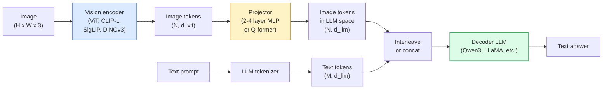

<!-- local-zh-machine-draft: English source is canonical; prose translated automatically, code/math preserved. -->

<a id="vision-language-models--the-vit-mlp-llm-pattern"></a>

# Vision-Language Models — ViT-MLP-LLM 模式

> 视觉 encoder 将图像转换为 tokens。 MLP 投影仪将这些 tokens 映射到 LLM 的 embedding 空间。语言模型为 rest。该模式 - ViT-MLP-LLM - 是 2026 年的每个生产 VLM。

**类型：** 学习 + 使用
**语言：** Python
**先决条件：** 第 4 阶段第 14 课 (ViT)、第 4 阶段第 18 课 (CLIP)、第 7 阶段第 02 课 (Self-Attention)
**时间：** ~75分钟

<a id="learning-objectives"></a>

## 学习目标

- 陈述 ViT-MLP-LLM 架构并解释三个组件各自的贡献
- 在 parameter 计数、上下文长度和基准性能上比较 Qwen3-VL、InternVL3.5、LLaVA-Next 和 GLM-4.6V
- 解释一下DeepStack：为什么多层ViT features收紧视觉语言alignment比单个最后一层feature更好
- 使用跨模态错误率 (CMER) 测量生产中的 VLM hallucination 并对信号采取行动

<a id="the-problem"></a>

## 问题

CLIP（第4阶段第18课）为您提供了图像和文本的shared embedding space，这足以用于zero-shot分类和检索。它无法回答“这张图片中有多少辆红色汽车？”因为 CLIP 不会生成文本——它只会对相似度进行评分。

Vision-Language Models (VLM) — Qwen3-VL、InternVL3.5、LLaVA-Next、GLM-4.6V — 将 CLIP 系列映像 encoder 连接到完整的语言模型。该模型看到图像和问题并生成答案。到 2026 年，开源 VLM 在多模式基准（MMMU、MMBench、DocVQA、ChartQA、MathVista、OSWorld）上将与 GPT-5 和 Gemini-2.5-Pro 竞争或击败。

三件套（ViT、投影仪、LLM）是标准配置。模型之间的差异在于哪个 ViT、哪个投影仪、哪个 LLM、训练数据和 alignment 配方。一旦理解了这个模式，更换任何组件都是机械的。

<a id="the-concept"></a>

## 概念

<a id="the-vit-mlp-llm-architecture"></a>

### ViT-MLP-LLM架构



1. **Vision encoder** — 预训练的 ViT（CLIP-L/14、SigLIP、DINOv3 或微调变体）。产生 patch tokens。
2. **Projector** — 一个小模块（2-4 层 MLP，或 Q-former），将视觉 tokens 映射到 LLM 的 embedding 维度。这是大部分 fine-tuning 发生的地方。
3. **LLM** — 仅 decoder 的语言模型（Qwen3、Llama、Mistral、GLM、InternLM）。依次读取视觉+文字tokens，生成文字。

原则上这三个部分都是可训练的。实际上，在投影仪训练时，视觉 encoder 和 LLM 大部分保持冻结状态——几十亿 parameters 的信号很便宜。

<a id="deepstack"></a>

### 深栈

Vanilla 投影仅使用最后一个 ViT 层。 DeepStack (Qwen3-VL) 从多个 ViT 深度采样 features 并将它们堆叠起来。更深的层承载高级语义；较浅的层携带细粒度的空间和纹理信息。将两者输入 LLM 可以缩小“图像包含什么”（语义）和“确切位置”（空间 grounding）之间的差距。

<a id="three-training-stages"></a>

### 三个训练阶段

现代 VLM 分阶段训练：

1. **Alignment** — 冻结 ViT 和 LLM。仅在图像标题对上训练投影仪。教投影仪将视觉空间映射到语言空间。
2. **预训练** — 解冻所有内容。在大规模交错图像文本数据（5 亿对以上）上进行训练。构建模型的视觉知识。
3. **指令调整** — 对策划的（图像、问题、答案）三元组进行微调。教授会话行为和任务格式。这就是将“视觉感知LM”转变为有用的助手的原因。

大多数 LoRA 使用小型标记数据集微调目标阶段 3。

<a id="model-family-comparison-early-2026"></a>

### 车型系列比较（2026 年初）

| 模型 | 参数 | 愿景 encoder | LLM | 上下文 | 优势 |
|-------|--------|----------------|-----|---------|-----------|
| Qwen3-VL-235B-A22B (MoE) | 235B（22B有源） | 定制 ViT + DeepStack | Q文3 | 256K | 通用SOTA，GUI agent |
| Qwen3-VL-30B-A3B (MoE) | 30B（3B有源） | 定制 ViT + DeepStack | Q文3 | 256K | 较小的 MoE 替代品 |
| Qwen3-VL-8B（致密） | 8B | 定制ViT | Q文3 | 128K | 生产密集默认 |
| 实习生VL3.5-38B | 38B | 实习生ViT-6B | Qwen3 + GPT-OSS | 128K | 强MMBench / MMVet |
| 实习生VL3.5-241B-A28B | 241B（28B有源） | 实习生ViT-6B | Q文3 | 128K | 与GPT-4o竞争 |
| LLaVA-Next 72B | 72B | 西格利普 | Llama-3 | 32K | 开放式，易于微调 |
| GLM-4.6V | 〜70B | 定制 | 广义线性模型 | 64K | 开源、强大的 OCR |
| 迷你CPM-V-2.6 | 8B | 西格利普 | 最小每千次展示费用 | 32K | 边缘友好 |

<a id="visual-agents"></a>

### 视觉agents

Qwen3-VL-235B 在 OSWorld 上达到全球最高性能 — OSWorld 是操作 GUI（桌面、移动、Web）的 **visual agents** 的基准。该模型看到屏幕截图，理解 UI，并发出操作（单击、键入、滚动）。与工具相结合，它可以关闭常见桌面任务的循环。这就是大多数 2026 年“AI PC”演示的幕后运行方式。

<a id="agentic-capabilities--rope-variants"></a>

### Agentic 功能 + RoPE 变体

当 ** 帧位于视频中时，VLM 需要知道 **。 Qwen3-VL从T-RoPE（时间旋转位置embeddings）演变为**基于文本的时间alignment** - 显式时间戳文本tokens交错与视频帧。该模型看到“`<timestamp 00:32>` 框架，prompt”并且可以推理时间关系。

<a id="the-alignment-problem"></a>

### alignment问题

爬网数据集中 12% 的图像文本对包含不完全基于图像的描述。经过这种训练的 VLM 会默默地学会产生幻觉——制造物体、误读数字、发明关系。在生产中，这是主要的故障模式。

Skywork.ai 引入了 ** 跨模态错误率 (CMER)** 来跟踪它：

```
CMER = fraction of outputs where the text confidence is high but the image-text similarity (via a CLIP-family checker) is low
```

高 CMER 意味着模特自信地说出与图像无关的事情。监控 CMER 并将其视为生产 KPI 可将部署中的 hallucination 率降低约 35%。诀窍不是“修复模型”，而是“将高 CMER 输出路由给人工审核”。

<a id="fine-tuning-with-lora--qlora"></a>

### Fine-tuning 与 LoRA / QLoRA

对于大多数团队来说，完整的 fine-tuning 70B VLM 是遥不可及的。 LoRA（排名 16-64）位于 attention + 投影仪层，或带有 4 位基础 weights 的 QLoRA，适合单个 A100 / H100。成本：5,000-50,000 个示例，100-5,000 美元的计算费用，2-10 小时的培训。

<a id="spatial-reasoning-is-still-weak"></a>

### 空间推理仍然薄弱

目前的 VLM 在空间推理基准（上下、左右、计数、距离）上得分为 50-60%。如果您的用例取决于“哪个对象位于哪个对象之上”，请进行大量验证 - 一般 VLM 性能低于人类。对于纯空间任务，比 VLM 更好的替代方案：专门的关键点/姿态估计器、深度模型或经过盒几何后处理的检测模型。

```figure
v4-vlm-projector
```

<a id="build-it"></a>

## 动手实现

<a id="step-1-the-projector"></a>

### 第一步：投影仪

您最常训练的部分。 2-4 层 MLP，带有 GELU。

```python
import torch
import torch.nn as nn


class Projector(nn.Module):
    def __init__(self, vit_dim=768, llm_dim=4096, hidden=4096):
        super().__init__()
        self.net = nn.Sequential(
            nn.Linear(vit_dim, hidden),
            nn.GELU(),
            nn.Linear(hidden, llm_dim),
        )

    def forward(self, x):
        return self.net(x)
```

输入是 `(N_patches, d_vit)` token tensor。输出为 `(N_patches, d_llm)`。 LLM 将每个输出行视为另一个 token。

<a id="step-2-assemble-vit-mlp-llm-end-to-end"></a>

### 步骤2：端到端组装ViT-MLP-LLM

最小 VLM 的 forward pass 的骨架。真实代码使用`transformers`；这是概念布局。

```python
class MinimalVLM(nn.Module):
    def __init__(self, vit, projector, llm, image_token_id):
        super().__init__()
        self.vit = vit
        self.projector = projector
        self.llm = llm
        self.image_token_id = image_token_id  # placeholder token in text prompt

    def forward(self, image, input_ids, attention_mask):
        # 1. vision features
        vision_tokens = self.vit(image)                     # (B, N_patches, d_vit)
        vision_embeds = self.projector(vision_tokens)       # (B, N_patches, d_llm)

        # 2. text embeddings
        text_embeds = self.llm.get_input_embeddings()(input_ids)  # (B, M, d_llm)

        # 3. replace image placeholder tokens with vision embeds
        merged = self._merge(text_embeds, vision_embeds, input_ids)

        # 4. run LLM
        return self.llm(inputs_embeds=merged, attention_mask=attention_mask)

    def _merge(self, text_embeds, vision_embeds, input_ids):
        out = text_embeds.clone()
        expected = vision_embeds.size(1)
        for b in range(input_ids.size(0)):
            positions = (input_ids[b] == self.image_token_id).nonzero(as_tuple=True)[0]
            if len(positions) != expected:
                raise ValueError(
                    f"batch item {b} has {len(positions)} image tokens but vision_embeds has {expected} patches."
                    " Every sample in the batch must be pre-padded to the same number of image placeholder tokens.")
            out[b, positions] = vision_embeds[b]
        return out
```

文本中的 `<image>` 占位符 token 被替换为真实图像 embeddings — 与 LLaVA、Qwen-VL 和 InternVL 使用相同的模式。

<a id="step-3-cmer-computation"></a>

### 步骤3：CMER计算

轻量级运行时检查。

```python
import torch.nn.functional as F


def cross_modal_error_rate(image_emb, text_emb, text_confidence, sim_threshold=0.25, conf_threshold=0.8):
    """
    image_emb, text_emb: embeddings of image and generated text (normalised internally)
    text_confidence:     mean per-token probability in [0, 1]
    Returns:             fraction of high-confidence outputs with low image-text alignment
    """
    image_emb = F.normalize(image_emb, dim=-1)
    text_emb = F.normalize(text_emb, dim=-1)
    sim = (image_emb * text_emb).sum(dim=-1)        # cosine similarity
    high_conf_low_sim = (text_confidence > conf_threshold) & (sim < sim_threshold)
    return high_conf_low_sim.float().mean().item()
```

将 CMER 视为生产 KPI。每个端点、每个 prompt 类型、每个客户进行监控。 CMER 上升表明模型开始对某些输入分布产生幻觉。

<a id="step-4-toy-vlm-classifier-runnable"></a>

### 第 4 步：玩具 VLM 分类器（可运行）

演示投影仪列车。假的“ViT features”进去；一个微小的 LLM 风格的 token 预测一个类。

```python
class ToyVLM(nn.Module):
    def __init__(self, vit_dim=32, llm_dim=64, num_classes=5):
        super().__init__()
        self.projector = Projector(vit_dim, llm_dim, hidden=64)
        self.head = nn.Linear(llm_dim, num_classes)

    def forward(self, vision_tokens):
        projected = self.projector(vision_tokens)
        pooled = projected.mean(dim=1)
        return self.head(pooled)
```

人们可以用不到 200 个步骤将其安装在合成（feature，类）对上 - 足以显示投影仪模式的工作原理。

<a id="use-it"></a>

## 实际应用

2026 年制作团队使用 VLM 的三种方式：

- **托管API** — OpenAI Vision、Anthropic Claude Vision、Google Gemini Vision。零基础设施、供应商风险。
- **开源自托管** — 通过 `transformers` 和 `vllm` 实现 Qwen3-VL 或 InternVL3.5。完全控制，更高的前期努力。
- **在域上微调** - 加载Qwen2.5-VL-7B或LLaVA-1.6-7B，LoRA在5k-50k自定义示例上，与`vllm`或`TGI`。

```python
from transformers import AutoProcessor, AutoModelForVision2Seq
import torch
from PIL import Image

model_id = "Qwen/Qwen3-VL-8B-Instruct"
processor = AutoProcessor.from_pretrained(model_id)
model = AutoModelForVision2Seq.from_pretrained(model_id, torch_dtype=torch.bfloat16, device_map="auto")

messages = [{
    "role": "user",
    "content": [
        {"type": "image", "image": Image.open("plot.png")},
        {"type": "text", "text": "What does this chart show?"},
    ],
}]
inputs = processor.apply_chat_template(messages, add_generation_prompt=True, tokenize=True, return_dict=True, return_tensors="pt").to("cuda")
generated = model.generate(**inputs, max_new_tokens=256)
answer = processor.decode(generated[0][inputs["input_ids"].shape[1]:], skip_special_tokens=True)
```

`apply_chat_template` 隐藏 `<image>` 占位符标记化；模型在内部处理合并。

<a id="ship-it"></a>

## 交付成果

本课产生：

- `outputs/prompt-vlm-selector.md` — 考虑到准确性、延迟、上下文长度和预算，选择 Qwen3-VL / InternVL3.5 / LLaVA-Next / API。
- `outputs/skill-cmer-monitor.md` — 发出代码来检测生产 VLM 端点，包括跨模式错误率、每个端点仪表板和警报阈值。

<a id="exercises"></a>

## 练习

1. **(Easy)** 通过任何打开的 VLM 在五个图像上运行三个 prompts（“这是什么？”、“计算对象”、“描述场景”）。手动将每个答案评分为正确/部分正确/幻觉。计算类似 CMER 的首次通过率。
2. **（中）** 使用 LoRA（排名 16）对带有标题的目标域的 500 个图像进行微调 Qwen2.5-VL-3B 或 LLaVA-1.6-7B。比较 zero-shot 与微调的 MMBench 式精度。
3. **(硬)** 用 DINOv3 替换 VLM 的映像 encoder，而不是其默认的 SigLIP/CLIP。仅重新训练投影仪（冻结 LLM + 冻结 DINOv3）。衡量密集预测任务（计数、空间推理）是否有所改善。

<a id="key-terms"></a>

## 关键术语

| 术语 | 人们怎么说 | 它实际上意味着什么 |
|------|----------------|----------------------|
| ViT-MLP-LLM | “VLM 模式” | 视觉encoder+投影仪+语言模型；每 2026 年 VLM |
| 投影仪 | 《桥》 | 2-4层MLP（或Q-former），将视觉tokens映射到LLM embedding空间 |
| 深栈 | “Qwen3-VL feature 技巧” | 多层 ViT features 堆叠而不是仅最后一层 |
| Image token | “<image> 占位符” | 文本流中的特殊 token 替换为投影视觉 embeddings |
| 希默尔 | “Hallucination 关键绩效指标” | 跨模式错误率；当文本置信度较高但图像文本相似度较低时较高 |
| 视觉agent | “点击的 VLM” | 使用 tool calls 的 VLM 操作 GUI（OSWorld、移动、Web） |
| Q-前体 | “固定计数 token 桥” | BLIP-2款式投影仪生产固定数量视觉查询tokens |
| Alignment / 预训练 / 指令调优 | “三个阶段” | 标准 VLM 训练流程 |

<a id="further-reading"></a>

## 进一步阅读

- [Qwen3-VL 技术报告 (arXiv 2511.21631)](https://arxiv.org/abs/2511.21631)
- [InternVL3.5推进开源Multimodal Models (arXiv 2508.18265)](https://arxiv.org/html/2508.18265v1)
- [LLLaVA-下一个系列](https://llava-vl.github.io/blog/2024-05-10-llava-next-stronger-llms/)
- [BentoML：最佳开源 VLM 2026](https://www.bentoml.com/blog/multimodal-ai-a-guide-to-open-source-vision-language-models)
- [MMMU：多学科多模式理解基准](https://mmmu-benchmark.github.io/)
- 制造业中的 [VLM（明天的机器人，2026 年 3 月）](https://www.roboticstomorrow.com/story/2026/03/when-machines-learn-to-see-like-experts-the-rise-of-vision-language-models-in-manufacturing/26335/)
