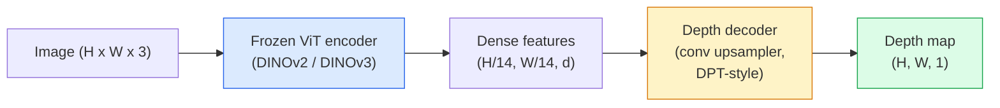

<!-- local-zh-machine-draft: English source is canonical; prose translated automatically, code/math preserved. -->

<a id="monocular-depth--geometry-estimation"></a>

# 单目深度和几何估计

> 深度图是单通道图像，其中每个像素都是距相机的距离。如果没有立体视觉或激光雷达，从一帧 RGB 图像中预测它过去是不可能的。到 2026 年，冻结的 ViT encoder 加上轻量头的精度将达到地面真实值的百分之几。

**类型：** 构建 + 使用
**语言：** Python
**先决条件：** 第 4 阶段第 14 课 (ViT)、第 4 阶段第 17 课（自监督视觉）、第 4 阶段第 07 课 (U-Net)
**时间：** ~60 分钟

<a id="learning-objectives"></a>

## 学习目标

- 区分相对深度和公制深度以及每个生产模型（MiDaS、Marigold、Depth Anything V3、ZoeDepth）解决的状态
- 使用 Depth Anything V3（DINOv2 主干）预测任意单图像的深度，无需 calibration
- 解释为什么单目深度在单个图像上起作用（透视线索、纹理 gradients、学习的先验）以及它无法恢复的内容（绝对比例、遮挡的几何形状）
- 使用深度图和针孔相机内在函数将 2D 检测提升为 3D 点

<a id="the-problem"></a>

## 问题

深度是 2D 计算机视觉中缺失的轴。给定 RGB，您就知道事物出现在图像平面中的位置；你不知道他们有多远。深度传感器（立体钻机、激光雷达、飞行时间）可以直接解决这个问题，但价格昂贵、脆弱且范围有限。

单目深度估计（从单个 RGB 帧预测深度）用于产生模糊、不可靠的输出。到 2026 年，大型预训练 encoders 改变了这一点：Depth Anything V3 使用冻结的 DINOv2 主干，并生成适用于室内、室外、医疗和卫星领域的深度图。 Marigold 将深度重新定义为条件扩散问题。 ZoeDepth 回归真实的公制距离。

深度也是 2D 检测和 3D 理解之间的桥梁：将检测到的框的像素乘以深度，然后将 2D 对象提升为 3D 点云。这是每个 AR 遮挡系统、每个避障管道以及每个“拿起杯子”机器人的核心。

<a id="the-concept"></a>

## 概念

<a id="relative-vs-metric-depth"></a>

### 相对深度与公制深度

- **相对深度** — 没有实际单位的有序 `z` 值。 “像素 A 比像素 B 更近，但距离比率并非以米为单位。”
- **公制深度** — 距相机的绝对距离（以米为单位）。要求模型已经了解图像线索和真实距离之间的统计关系。

MiDaS 和 Depth Anything V3 产生相对深度。万寿菊产生相对深度。 ZoeDepth、UniDepth 和 Metric3D 生成公制深度。公制模型对相机内部参数很敏感；相对模型则不然。

<a id="the-encoder-decoder-pattern"></a>

### encoder-decoder 图案



Depth Anything V3 冻结了 encoder 并仅训练 DPT 风格的 decoder。 encoder提供了丰富的features； decoder 将它们插值回图像分辨率并回归深度。

<a id="why-a-single-image-produces-depth-at-all"></a>

### 为什么单张图像能够产生深度

2D 图像包含许多与深度相关的单眼线索：

- **Perspective** — 3D 中的平行线在 2D 中会聚。
- **Texture gradient** — 远处的表面具有更小、更密集的纹理。
- **遮挡顺序** — 较近的物体遮挡较远的物体。
- **尺寸恒定性** — 已知物体（汽车、人类）给出大致比例。
- **大气透视** — 远处的物体在室外场景中显得更朦胧、更蓝。

ViT 经过数十亿张图像的训练，将这些线索内化。凭借足够的数据和强大的骨干网，单目深度无需任何明确的 3D 监督即可达到合理的精度。

<a id="what-monocular-depth-cannot-do"></a>

### 单眼深度不能做什么

- **绝对公制比例**，没有内在函数或场景中的已知对象。网络可以在不知道杯子距离是 1 m 还是 10 m 的情况下预测“杯子是勺子的两倍”。
- **遮挡几何** — 椅背不可见，无法可靠推断。
- **真正无纹理/反射表面** — 镜子、玻璃、均匀的墙壁。该网络报道的看似合理，但深度错误。

<a id="depth-anything-v3-in-2026"></a>

### 2026 年深度探索 V3

- 香草 DINOv2 ViT-L/14 为 encoder（冷冻）。
- DPT decoder。
- 对来自不同来源的姿势图像对进行训练（除了光度一致性之外不需要明确的深度监督）。
- 根据 ** 任意数量的视觉输入预测空间一致的几何形状，无论是否有已知的相机姿势**。
- 单目深度、任意视图几何、视觉渲染、相机姿态估计的 SOTA。

当您在 2026 年需要深度时，可以调用此模型。

<a id="marigold--diffusion-for-depth"></a>

### Marigold — 深度扩散

Marigold（Ke 等人，CVPR 2024）将深度估计重新定义为条件图像到图像扩散。调节：RGB。目标：深度图。使用预训练的 Stable Diffusion 2 U-Net 作为主干。输出深度图在对象边界处异常清晰。权衡：inference 比前馈模型慢（10-50 去噪步骤）。

<a id="intrinsics-and-the-pinhole-camera"></a>

### 本征和针孔相机

要将深度为 `d` 的像素 `(u, v)` 提升到相机坐标中的 3D 点 `(X, Y, Z)`：

```
fx, fy, cx, cy = camera intrinsics
X = (u - cx) * d / fx
Y = (v - cy) * d / fy
Z = d
```

内在函数来自 EXIF 元数据、calibration 模式或单目内在函数估计器（Perspective Fields、UniDepth）。如果没有内在函数，您仍然可以通过假设 60-70° FOV 和中等分辨率原理来渲染点云 - 可用于可视化，而不是用于测量。

<a id="evaluation"></a>

### Evaluation

两个标准指标：

- **AbsRel**（绝对相对误差）：`mean(|d_pred - d_gt| / d_gt)`。越低越好。量产型号为 0.05-0.1。
- **delta < 1.25**（阈值精度）：`max(d_pred/d_gt, d_gt/d_pred) < 1.25` 所在的像素分数。越高越好。 0.9+（SOTA）。

对于相对深度（Depth Anything V3、MiDaS），evaluation 使用两个指标的缩放和移位不变版本。

```figure
depth-sweep
```

<a id="build-it"></a>

## 动手实现

<a id="step-1-depth-metrics"></a>

### 第 1 步：深度指标

```python
import torch

def abs_rel_error(pred, target, mask=None):
    if mask is not None:
        pred = pred[mask]
        target = target[mask]
    return (torch.abs(pred - target) / target.clamp(min=1e-6)).mean().item()


def delta_accuracy(pred, target, threshold=1.25, mask=None):
    if mask is not None:
        pred = pred[mask]
        target = target[mask]
    ratio = torch.maximum(pred / target.clamp(min=1e-6), target / pred.clamp(min=1e-6))
    return (ratio < threshold).float().mean().item()
```

始终在 evaluation 之前屏蔽无效深度像素（零、NaN、饱和）。

<a id="step-2-scale-and-shift-alignment"></a>

### 步骤 2：缩放和平移 alignment

对于相对深度模型，在计算指标之前将预测与真实情况对齐。 `a * pred + b = target` 的最小二乘拟合：

```python
def align_scale_shift(pred, target, mask=None):
    if mask is not None:
        p = pred[mask]
        t = target[mask]
    else:
        p = pred.flatten()
        t = target.flatten()
    A = torch.stack([p, torch.ones_like(p)], dim=1)
    coeffs, *_ = torch.linalg.lstsq(A, t.unsqueeze(-1))
    a, b = coeffs[:2, 0]
    return a * pred + b
```

评估 MiDaS / Depth Anything 时，先运行 `align_scale_shift`，然后再运行 `abs_rel_error`。

<a id="step-3-lift-depth-to-a-point-cloud"></a>

### 步骤 3：将深度提升到点云

```python
import numpy as np

def depth_to_point_cloud(depth, intrinsics):
    H, W = depth.shape
    fx, fy, cx, cy = intrinsics
    v, u = np.meshgrid(np.arange(H), np.arange(W), indexing="ij")
    z = depth
    x = (u - cx) * z / fx
    y = (v - cy) * z / fy
    return np.stack([x, y, z], axis=-1)


depth = np.random.uniform(0.5, 4.0, (240, 320))
intr = (320.0, 320.0, 160.0, 120.0)
pc = depth_to_point_cloud(depth, intr)
print(f"point cloud shape: {pc.shape}  (H, W, 3)")
```

一种功能，每个 3D 提升的应用程序。将点云导出到 `.ply` 并在 MeshLab 或 CloudCompare 中打开。

<a id="step-4-smoke-test-with-a-synthetic-depth-scene"></a>

### 第 4 步：使用合成深度场景进行烟雾测试

```python
def synthetic_depth(size=96):
    yy, xx = np.meshgrid(np.arange(size), np.arange(size), indexing="ij")
    # Floor: linear gradient from near (top) to far (bottom)
    depth = 1.0 + (yy / size) * 4.0
    # Box in the middle: closer
    mask = (np.abs(xx - size / 2) < size / 6) & (np.abs(yy - size * 0.6) < size / 6)
    depth[mask] = 2.0
    return depth.astype(np.float32)


gt = torch.from_numpy(synthetic_depth(96))
pred = gt + 0.3 * torch.randn_like(gt)  # simulated prediction
aligned = align_scale_shift(pred, gt)
print(f"before align  absRel = {abs_rel_error(pred, gt):.3f}")
print(f"after align   absRel = {abs_rel_error(aligned, gt):.3f}")
```

<a id="step-5-depth-anything-v2-usage-reference"></a>

### 步骤5：Depth Anything V2用法（参考）

```python
import numpy as np
from transformers import pipeline
from PIL import Image

pipe = pipeline(task="depth-estimation", model="depth-anything/Depth-Anything-V2-Large-hf")

image = Image.open("street.jpg").convert("RGB")
out = pipe(image)
depth_np = np.array(out["depth"])
```

三行。 `out["depth"]`是PIL灰度图；转换为 numpy 进行数学计算。 Depth Anything 3（2025 年 11 月）不会通过此管道加载。它附带了自己的 `depth_anything_3` 包：`DepthAnything3.from_pretrained("depth-anything/DA3MONO-LARGE")` 加载相对单目模型，`model.inference(images).depth` 返回 `[N, H, W]` 深度数组。

<a id="use-it"></a>

## 实际应用

- **Depth Anything V3**（Meta AI / ByteDance，2024-2026）—相对深度的默认值。生产中最快的ViT-大型骨干模型。
- **Marigold**（ETH，2024）——最高视觉质量，慢 inference。
- **UniDepth**（ETH，2024）-带有相机内在估计的度量深度。
- **ZoeDepth**（英特尔，2023）—公制深度；老了，还是靠谱的。
- **MiDaS v3.1** — 传统但稳定；良好的比较基线。

典型的集成模式：

1. RGB 帧到达。
2. 深度模型产生深度图。
3. 检测器产生盒子。
4. 将盒子质心从深度提升到 3D；与点云合并（如果可用）。
5. 下游：AR 遮挡、路径 planning、物体大小估计、立体替换。

对于实时使用，Depth Anything V2 Small（INT8 量化）在消费类 GPU 上（518x518）可达到约 30 fps。

<a id="ship-it"></a>

## 交付成果

本课产生：

- `outputs/prompt-depth-model-picker.md` — 根据延迟、指标与相对需求和场景类型，在 Depth Anything V3、Marigold、UniDepth、MiDaS 之间进行选择。
- `outputs/skill-depth-to-pointcloud.md` — 一种通过正确的内在函数处理从深度图构建点云并导出到 `.ply` 的技能。

<a id="exercises"></a>

## 练习

1. **(简单)** 在桌面上的任意 10 个图像上运行 Depth Anything V2。将深度保存为灰度 PNG 并进行检查。找出一个预测深度看起来错误的物体，并解释单眼线索失败的原因。
2. **（中）** 给定来自 Depth Anything V2 的 RGB + 深度，提升到点云并使用 `open3d` 进行渲染。比较两个场景（室内/室外）并注意哪个看起来更可信。
3. **（硬）** 拍摄五对仅因已知物体的位置而不同的图像（例如，瓶子移近 30 厘米）。使用 UniDepth 预测两者的度量深度。报告预测距离增量与真实 30 厘米的距离。

<a id="key-terms"></a>

## 关键术语

| 术语 | 人们怎么说 | 它实际上意味着什么 |
|------|----------------|----------------------|
| 单眼深度 | “单幅图像深度” | 从一帧 RGB 图像进行深度估计，无立体或 LiDAR |
| 相对深度 | “有序深度” | 没有实际单位的有序 z 值 |
| 公制深度 | 《绝对距离》 | 深度以米为单位；需要 calibration 或经过度量监督训练的模型 |
| 绝对相对值 | “绝对相对误差” | 均值 |d_pred - d_gt| /d_gt;标准深度公制 |
| 增量精度 | “增量 < 1.25” | 预测值与真实值相差 25% 以内的像素分数 |
| 针孔相机 | "fx, fy, cx, cy" | 用于将（u，v，d）提升到（X，Y，Z）的相机模型 |
| DPT | 《密集预测Transformer》 | 基于卷积的 decoder 用于冻结 ViT encoders 的深度 |
| DINOv2骨干 | “它起作用的原因” | 自监督 features，无需深度标签即可跨域泛化 |

<a id="further-reading"></a>

## 进一步阅读

- [Depth Anything V3 纸页](https://depth-anything.github.io/) — SOTA 单目深度与 DINOv2 encoder
- [Marigold（Ke 等人，CVPR 2024）](https://marigoldmonodepth.github.io/) — 基于扩散的深度估计
- [UniDepth (Piccinelli et al., 2024)](https://arxiv.org/abs/2403.18913) — 具有内在函数的度量深度
- [MiDaS v3.1 (Intel ISL)](https://github.com/isl-org/MiDaS) — 规范的相对深度基线
- [DINOv3 博客文章（元）](https://ai.meta.com/blog/dinov3-self-supervised-vision-model/) — 提高深度精度的 encoder 系列
