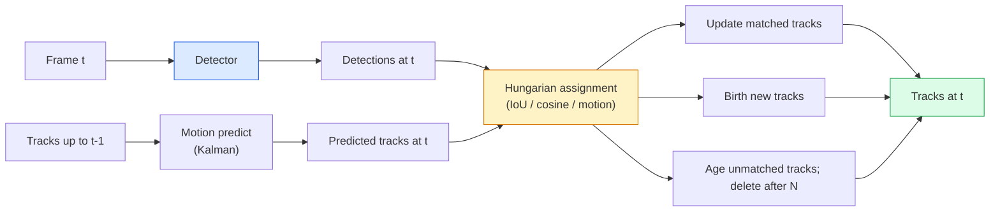

<!-- local-zh-machine-draft: English source is canonical; prose translated automatically, code/math preserved. -->

<a id="multi-object-tracking--video-memory"></a>

# 多目标跟踪与视频记忆

> 跟踪是检测加关联。检测每一帧。通过 ID 将此帧的检测与上一帧的轨迹进行匹配。

**类型：** 构建
**语言：** Python
**先决条件：** 第 4 阶段第 06 课（YOLO 检测）、第 4 阶段第 08 课（掩模 R-CNN）、第 4 阶段第 24 课（SAM 3）
**时间：** ~60 分钟

<a id="learning-objectives"></a>

## 学习目标

- 区分检测跟踪和基于查询的跟踪，并命名算法系列（SORT、DeepSORT、ByteTrack、BoT-SORT、SAM 2 内存跟踪器、SAM 3.1 对象复用）
- 从头开始实现 IoU + 匈牙利分配以实现经典的检测跟踪
- 解释 SAM 2 的内存库以及为什么它比基于 IoU 的关联更好地处理遮挡
- 阅读三个跟踪指标（MOTA、IDF1、HOTA）并选择对给定用例重要的一个

<a id="the-problem"></a>

## 问题

探测器会告诉您单个帧中物体的位置。跟踪器会告诉您帧 `t` 中的哪个检测与帧 `t-1` 中的检测是同一对象。如果没有它，您就无法计算穿过线的物体、跟踪球穿过遮挡物或知道“4 号车已在车道上停留 8 秒”。

跟踪对于每个面向视频的产品都至关重要：体育分析、监控、自动驾驶、医疗视频分析、野生动物监测、文字标记计数。核心构建块是共享的：每帧检测器、运动模型（卡尔曼滤波器或更丰富的东西）、关联步骤（IoU/余弦/学习 features 上的匈牙利算法）和轨迹生命周期（出生、更新、死亡）。

2026 年带来了两种新模式：**SAM 2 基于内存的跟踪**（feature-内存而不是运动模型关联）和 **SAM 3.1 对象多路复用**（许多人共享内存）相同概念的实例）。本课程首先介绍经典堆栈，然后介绍基于内存的方法。

<a id="the-concept"></a>

## 概念

<a id="tracking-by-detection"></a>

### 检测跟踪



2026 年你将遇到的每一款追踪器都是这个循环的变体。差异：

- **SORT** (2016)：卡尔曼滤波器 + IoU 匈牙利语。简单、快速、无外观模型。
- **DeepSORT** (2017)：SORT + 每个轨道基于 CNN 的外观 feature (ReID embedding)。更好地处理交叉路口。
- **ByteTrack** (2021)：将低置信度检测关联为第二阶段；不需要出现 features，但 MOT17 上表现最好。
- **BoT-SORT** (2022)：字节+相机运动补偿+ReID。
- **StrongSORT / OC-SORT** — ByteTrack 后代，具有更好的运动和外观。

<a id="kalman-filter-in-one-paragraph"></a>

### 一段中的卡尔曼滤波器

卡尔曼滤波器维护每个轨道的状态 `(x, y, w, h, dx, dy, dw, dh)` 和协方差。在每一帧，**使用恒速模型预测**的状态，然后**update**与匹配的检测。当预测不确定性较高时，更新更信任检测。这提供了平滑的轨迹以及通过短遮挡（1-5 帧）继续跟踪的能力。

每个经典跟踪器在运动预测步骤中都使用卡尔曼滤波器。

<a id="the-hungarian-algorithm"></a>

### 匈牙利算法

给定 `M x N` 成本矩阵（跟踪 x 检测），找到使总成本最小化的一对一分配。成本通常为`1 - IoU(track_bbox, detection_bbox)`或外观features的负值cosine similarity。运行时间为 O((M+N)^3)；对于 M、N 高达 ~1000，通过 `scipy.optimize.linear_sum_assignment` 在 Python 中已经足够快了。

<a id="bytetracks-key-idea"></a>

### ByteTrack 的核心思想

标准跟踪器会丢弃低置信度检测 (< 0.5)。 ByteTrack 将它们保留为 ** 第二阶段候选者 **：将轨迹与高置信度检测进行匹配后，未匹配的轨迹尝试使用稍微宽松的 IoU 阈值来匹配低置信度检测。恢复短暂遮挡，ID 在人群附近切换。

<a id="sam-2-memory-based-tracking"></a>

### SAM 2 基于内存的跟踪

SAM 2 通过保留每个实例时空 features 的 ** 内存库 ** 来处理视频。给定一帧上的 prompt（点击、框、文本），它将实例编码到内存中。在后续帧上，内存与新帧的 features 交叉参与，并且 decoder 为新帧中的同一实例生成掩码。

没有卡尔曼滤波器，没有匈牙利分配。该关联隐含在内存 attention 操作中。

优点：
- 对大型遮挡具有鲁棒性（内存在许多帧中携带实例标识）。
- 与 SAM 3 的文本 prompts 结合时打开-vocabulary。
- 无需单独的运动模型即可工作。

缺点：
- 对于多对象跟踪，比 ByteTrack 慢。
- 记忆库增长；限制context window。

<a id="sam-31-object-multiplex"></a>

### SAM 3.1 对象多路复用

先前的 SAM 2 / SAM 3 跟踪为每个实例保留一个单独的内存组。对于 50 个对象，50 个存储体。对象多路复用（2026 年 3 月）通过 ** 每实例查询 tokens** 将它们折叠到一个共享内存中。成本随实例数量呈次线性变化。

Multiplex 是 2026 年人群跟踪的新默认设置：音乐会人群、仓库工人、交通路口。

<a id="three-metrics-to-know"></a>

### 需要了解的三个指标

- **MOTA（多目标跟踪精度）** — 1 -（FN + FP + ID 开关）/ GT。按错误类型加权；合并检测和关联失败的单一指标。
- **IDF1 (ID F1)** — ID 精确率和召回率的调和平均值。特别关注每个地面实况轨迹随时间推移保持其 ID 的情况。对于 ID 切换敏感的任务，比 MOTA 更好。
- **HOTA（高阶跟踪精度）** — 分解为检测精度（DetA）和关联精度（AssA）。 2020年起的社区标准；最全面的。

对于监视（谁是谁）：IDF1 是您报告的内容。对于体育分析（计数传球）：HOTA。对于一般学术比较：HOTA。

```figure
cv3-track-assoc
```

<a id="build-it"></a>

## 动手实现

<a id="step-1-iou-based-cost-matrix"></a>

### 步骤1：基于IoU的成本矩阵

```python
import numpy as np


def bbox_iou(a, b):
    """
    a, b: (N, 4) arrays of [x1, y1, x2, y2].
    Returns (N_a, N_b) IoU matrix.
    """
    ax1, ay1, ax2, ay2 = a[:, 0], a[:, 1], a[:, 2], a[:, 3]
    bx1, by1, bx2, by2 = b[:, 0], b[:, 1], b[:, 2], b[:, 3]
    inter_x1 = np.maximum(ax1[:, None], bx1[None, :])
    inter_y1 = np.maximum(ay1[:, None], by1[None, :])
    inter_x2 = np.minimum(ax2[:, None], bx2[None, :])
    inter_y2 = np.minimum(ay2[:, None], by2[None, :])
    inter = np.clip(inter_x2 - inter_x1, 0, None) * np.clip(inter_y2 - inter_y1, 0, None)
    area_a = (ax2 - ax1) * (ay2 - ay1)
    area_b = (bx2 - bx1) * (by2 - by1)
    union = area_a[:, None] + area_b[None, :] - inter
    return inter / np.clip(union, 1e-8, None)
```

<a id="step-2-minimal-sort-style-tracker"></a>

### 第 2 步：最小 SORT 式跟踪器

为了简洁起见，省略了固定的恒速卡尔曼——我们在这里使用一个简单的 IoU 关联；在生产中，卡尔曼预测至关重要。 `sort` Python 软件包提供完整版本。

```python
from scipy.optimize import linear_sum_assignment


class Track:
    def __init__(self, tid, bbox, frame):
        self.id = tid
        self.bbox = bbox
        self.last_frame = frame
        self.hits = 1

    def update(self, bbox, frame):
        self.bbox = bbox
        self.last_frame = frame
        self.hits += 1


class SimpleTracker:
    def __init__(self, iou_threshold=0.3, max_age=5):
        self.tracks = []
        self.next_id = 1
        self.iou_threshold = iou_threshold
        self.max_age = max_age

    def step(self, detections, frame):
        if not self.tracks:
            for d in detections:
                self.tracks.append(Track(self.next_id, d, frame))
                self.next_id += 1
            return [(t.id, t.bbox) for t in self.tracks]

        track_boxes = np.array([t.bbox for t in self.tracks])
        det_boxes = np.array(detections) if len(detections) else np.empty((0, 4))

        iou = bbox_iou(track_boxes, det_boxes) if len(det_boxes) else np.zeros((len(track_boxes), 0))
        cost = 1 - iou
        cost[iou < self.iou_threshold] = 1e6

        matched_track = set()
        matched_det = set()
        if cost.size > 0:
            row, col = linear_sum_assignment(cost)
            for r, c in zip(row, col):
                if cost[r, c] < 1.0:
                    self.tracks[r].update(det_boxes[c], frame)
                    matched_track.add(r); matched_det.add(c)

        for i, d in enumerate(det_boxes):
            if i not in matched_det:
                self.tracks.append(Track(self.next_id, d, frame))
                self.next_id += 1

        self.tracks = [t for t in self.tracks if frame - t.last_frame <= self.max_age]
        return [(t.id, t.bbox) for t in self.tracks]
```

60 行。进行每帧检测，返回每帧轨道 ID。真实系统添加了卡尔曼预测、ByteTrack 的第二阶段重赛以及外观 features。

<a id="step-3-synthetic-trajectory-test"></a>

### 步骤3：合成轨迹测试

```python
def synthetic_frames(num_frames=20, num_objects=3, H=240, W=320, seed=0):
    rng = np.random.default_rng(seed)
    starts = rng.uniform(20, 200, size=(num_objects, 2))
    velocities = rng.uniform(-5, 5, size=(num_objects, 2))
    frames = []
    for f in range(num_frames):
        dets = []
        for i in range(num_objects):
            cx, cy = starts[i] + f * velocities[i]
            dets.append([cx - 10, cy - 10, cx + 10, cy + 10])
        frames.append(dets)
    return frames


tracker = SimpleTracker()
for f, dets in enumerate(synthetic_frames()):
    tracks = tracker.step(dets, f)
```

沿直线移动的三个物体应在所有 20 帧中保持其 ID。

<a id="step-4-id-switch-metric"></a>

### 步骤 4：ID 切换指标

```python
def count_id_switches(tracks_per_frame, gt_per_frame):
    """
    tracks_per_frame:  list of list of (track_id, bbox)
    gt_per_frame:      list of list of (gt_id, bbox)
    Returns number of ID switches.
    """
    prev_assignment = {}
    switches = 0
    for tracks, gts in zip(tracks_per_frame, gt_per_frame):
        if not tracks or not gts:
            continue
        t_boxes = np.array([b for _, b in tracks])
        g_boxes = np.array([b for _, b in gts])
        iou = bbox_iou(g_boxes, t_boxes)
        for g_idx, (gt_id, _) in enumerate(gts):
            j = iou[g_idx].argmax()
            if iou[g_idx, j] > 0.5:
                t_id = tracks[j][0]
                if gt_id in prev_assignment and prev_assignment[gt_id] != t_id:
                    switches += 1
                prev_assignment[gt_id] = t_id
    return switches
```

这是一个简化的 IDF1-adjacent 指标：计算真实对象更改其分配的预测轨迹 ID 的次数。真正的 MOTA / IDF1 / HOTA 工具位于 `py-motmetrics` 和 `TrackEval` 中。

<a id="use-it"></a>

## 实际应用

2026 年产量追踪：

- `ultralytics` — 内置 YOLOv8 + ByteTrack / BoT-SORT。 `results = model.track(source, tracker="bytetrack.yaml")`。默认。
- `supervision` (Roboflow) — ByteTrack 包装器和注释实用程序。
- SAM 2 / SAM 3.1 — 通过 `processor.track()` 基于内存的跟踪。
- 自定义堆栈：检测器（YOLOv8 / RT-DETR）+ `sort-tracker` / `OC-SORT` / `StrongSORT`。

采摘：

- 行人/汽车/箱子的速度超过 30 fps：**ByteTrack with ultralytics**。
- 人群中某一类的多个实例：**SAM 3.1 对象复用**。
- 具有可识别外观的严重遮挡：**DeepSORT / StrongSORT** (ReID features)。
- 运动/复杂交互：**BoT-SORT** 或学习跟踪器 (MOTRv3)。

<a id="ship-it"></a>

## 交付成果

本课产生：

- `outputs/prompt-tracker-picker.md` — 根据场景类型、遮挡模式和延迟预算选择 SORT / ByteTrack / BoT-SORT / SAM 2 / SAM 3.1。
- `outputs/skill-mot-evaluator.md` — 针对 MOTA / IDF1 / HOTA 针对地面真实轨迹编写完整的 evaluation harness。

<a id="exercises"></a>

## 练习

1. **(简单)** 使用 3、10 和 30 个对象运行上面的合成跟踪器。报告每种情况下的 ID 转换计数。确定简单的仅 IoU 关联从哪里开始失败。
2. **(中)** 在关联之前添加恒速卡尔曼预测步骤。表明短时间（2-3 帧）遮挡不再导致 ID 切换。
3. **（硬）** 集成 SAM 2 基于内存的跟踪器（通过 `transformers`）作为替代跟踪器后端。在 30 秒的人群片段上运行 SimpleTracker 和 SAM 2，比较 ID 转换计数，手动标记 5 个显着人物的真实 ID。

<a id="key-terms"></a>

## 关键术语

| 术语 | 人们怎么说 | 它实际上意味着什么 |
|------|----------------|----------------------|
| 检测跟踪 | “检测然后关联” | 每帧检测器 + IoU / 外观的匈牙利分配 |
| 卡尔曼滤波器 | 《运动预测》 | 线性动力学 + 协方差用于平滑轨迹预测和遮挡处理 |
| 匈牙利算法 | 《最优分配》 | 解决最小成本二分匹配问题； `scipy.optimize.linear_sum_assignment` |
| 字节跟踪 | “低置信度第二关” | 将不匹配的轨迹与低置信度检测重新匹配以恢复短遮挡 |
| 深度排序 | “排序+外观” | 添加ReID feature用于跨帧匹配；更好地保存身份证件 |
| 记忆库 | “SAM 2 技巧” | 跨帧存储的每实例时空 features； cross-attention 替换显式关联 |
| 对象多路复用 | “SAM 3.1 共享内存” | 具有每个实例查询的单个共享内存，用于快速多对象跟踪 |
| 和田 | “现代跟踪指标” | 分解为检测精度和关联精度；社区标准 |

<a id="further-reading"></a>

## 进一步阅读

- [SORT (Bewley et al., 2016)](https://arxiv.org/abs/1602.00763) — 最小的检测跟踪论文
- [DeepSORT（Wojke 等人，2017）](https://arxiv.org/abs/1703.07402) — 添加外观 feature
- [ByteTrack (Zhang et al., 2022)](https://arxiv.org/abs/2110.06864) — 低置信度第二遍
- [BoT-SORT（Aharon 等人，2022）](https://arxiv.org/abs/2206.14651) — 相机运动补偿
- [HOTA (Luiten et al., 2020)](https://arxiv.org/abs/2009.07736) — 分解跟踪指标
- [SAM 2 视频分割（Meta，2024）](https://ai.meta.com/sam2/) — 基于内存的跟踪器
- [SAM 3.1 对象复用（元，2026 年 3 月）](https://ai.meta.com/blog/segment-anything-model-3/)
