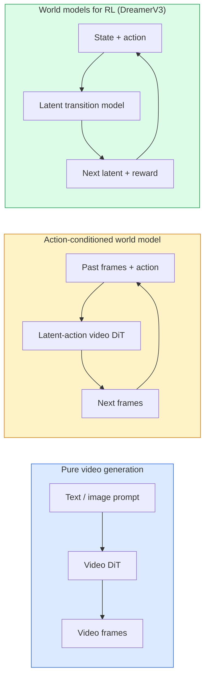

<!-- local-zh-machine-draft: English source is canonical; prose translated automatically, code/math preserved. -->

<a id="world-models--video-diffusion"></a>

# 世界模型与视频扩散

> 预测场景接下来几秒的视频模型是一个世界模拟器。条件是对动作的预测，你就拥有了一个学习的游戏引擎。

**类型：** 学习 + 构建
**语言：** Python
**先决条件：** 第 4 阶段第 10 课（扩散）、第 4 阶段第 12 课（视频理解）、第 4 阶段第 23 课（DiT + 整流流）
**时间：** ~75分钟

<a id="learning-objectives"></a>

## 学习目标

- 解释纯视频生成模型（Sora 2）和动作条件世界模型（Genie 3、DreamerV3）之间的区别
- 描述视频 DiT：时空 patches，3D 位置编码，联合 attention 跨越（T，H，W） tokens
- Trace 世界模型如何插入机器人技术：VLM 计划 → 视频模型模拟 → 逆动态发出动作
- 针对给定用例（创意视频、交互式模拟、自动驾驶合成）在 Sora 2、Genie 3、Runway GWM-1 Worlds、Wan-Video 和 HunyuanVideo 之间进行选择

<a id="the-problem"></a>

## 问题

视频生成和世界建模将于 2026 年融合。从某种意义上说，能够生成一分钟连贯视频的模型已经了解了世界如何运动：物体持久性、重力、因果关系、风格。如果您根据动作（向左走、开门）进行预测，视频模型就会成为可学习的模拟器，可以取代游戏引擎、驾驶模拟器或机器人环境。

赌注是具体的。 Genie 3 从单个图像生成可玩的环境。 Runway GWM-1 Worlds 合成了无限可探索的场景。 Sora 2 可以制作一分钟长的视频，具有同步音频和模拟物理效果。 NVIDIA Cosmos-Drive、Wayve Gaia-2 和 Tesla DrivingWorld 为自动驾驶车辆训练数据生成逼真的驾驶视频。世界模型范式正在悄然接管机器人技术的模拟到真实。

本课程是第四阶段的“大局”课程。它将图像生成、视频理解和 agentic 推理连接到主导研究正在走向的架构模式中。

<a id="the-concept"></a>

## 概念

<a id="three-families-of-world-modelling"></a>

### 世界建模的三个家族



- **Sora 2** 是基于 prompts 的纯视频生成。没有动作界面。您无法在 rollout 中“操纵”它。
- **Genie 3**、**GWM-1 世界**、**Mirage / Magica** 是动作条件世界模型。从观察到的视频推断潜在动作，然后根据动作对未来帧进行预测。交互式 - 您按下按键或移动摄像机，场景就会做出响应。
- **DreamerV3** 和经典的 RL 世界模型系列在 latent space 中进行预测，具有显式动作调节，并接受奖励信号训练。视觉效果较差；对于样本高效的 RL 更有用。

<a id="video-dit-architecture"></a>

### 视频 DiT 架构

```
Video latent:          (C, T, H, W)
Patchify (spatial):    grid of P_h x P_w patches per frame
Patchify (temporal):   group P_t frames into a temporal patch
Resulting tokens:      (T / P_t) * (H / P_h) * (W / P_w) tokens
```

位置编码是 3D：每个（t，h，w）坐标的旋转或学习的 embedding。 Attention 可以是：

- **全联合**——所有tokens参加所有tokens。 O(N^2) 与 N tokens。禁止长视频。
- **Divided** — 交替时间 attention（相同空间位置，跨时间：`(H*W) * T^2`）和空间 attention（相同时间步长，跨空间： `T * (H*W)^2`）。由 TimeSformer 和大多数视频 DiT 使用。
- **Window** — (t, h, w) 中的本地窗口。由Video Swin 使用。

每个 2026 年视频 diffusion model 都使用这三种模式之一加上 AdaLN 调节（第 23 课）和整流流。

<a id="conditioning-on-actions-latent-action-models"></a>

### 行动条件：潜在行动模型

Genie 通过有区别地预测一对连续帧之间的动作来学习每帧的 ** 潜在动作**。然后，模型的 decoder 以推断的潜在动作为条件，而不是以显式键盘按键为条件。在 inference 中，用户可以指定潜在动作（或从新的先验中采样），模型会生成与该动作一致的下一帧。

索拉完全跳过了动作界面。它的decoder从过去时空tokens预测下一个时空tokens。 Prompt 条件启动；没有什么能引导它进入中期。

<a id="physical-plausibility"></a>

### 物理合理性

Sora 2 的 2026 年版本明确宣传了 ** 物理合理性 **：weight、平衡、物体持久性、因果关系。由团队通过手工评分的合理性分数来衡量；与 Sora 1 相比，该模型在物体掉落、角色碰撞和故意失败（跳跃失败）方面有了明显改进。

合理性仍然是主要的故障模式。 2024-2025 年人们吃意大利面或用玻璃杯喝水的视频显示该模型缺乏持久的对象表示。 2026 款（Sora 2、Runway Gen-5、HunyuanVideo）减少但并未消除这些。

<a id="autonomous-driving-world-models"></a>

### 自动驾驶世界模型

驾驶世界模型生成以轨迹、边界框或导航地图为条件的真实道路场景。用途：

- **Cosmos-Drive-Dreams** (NVIDIA) — 生成用于 RL 训练的几分钟驾驶视频。
- **Gaia-2** (Wayve) — 策略 evaluation 的轨迹条件场景合成。
- **DrivingWorld** (Tesla) — 模拟不同的天气、一天中的时间、交通状况。
- **Vista**（字节跳动）——反应式驾驶场景合成。

它们取代了昂贵的真实世界数据收集，以收集极端情况——夜间行人乱穿马路、结冰的十字路口、不寻常的车辆类型——否则这些情况需要数百万英里的驾驶。

<a id="robotics-stack-vlm--video-model--inverse-dynamics"></a>

### 机器人堆栈：VLM + 视频模型 + 逆动力学

新兴的三组件机器人循环：

1. **VLM** 解析目标（“拿起红色杯子”），规划高级动作序列。
2. **视频生成模型** 模拟执行每个动作的样子 - 预测前面 N 帧的观察结果。
3. **逆动力学模型**提取产生这些观察结果的具体电机命令。

这取代了奖励塑造和样本密集型强化学习。世界模型发挥想象力；逆动力学关闭了驱动循环。 Genie Envisioner 是一个实例；许多研究小组正在集中研究这种结构。

<a id="evaluation"></a>

### Evaluation

- **视觉质量** — FVD（Fréchet 视频距离），用户研究。
- **Prompt alignment** — 每帧 CLIPScore，VQA 风格 evaluation。
- **物理合理性** — 在基准测试套件（Sora 2 的内部基准测试，VBench）上手动评级。
- **Controllability**（对于交互式世界模型）——动作→观察一致性；你能回到之前的状态吗？

<a id="model-landscape-in-2026"></a>

### 2026年景观模型

| 模型 | 使用 | Parameters | 输出 | 许可证 |
|-------|-----|------------|--------|---------|
| 索拉2 | 文本转视频、音频 | — | 1 分钟 1080p + 音频 | 仅限API |
| 跑道第五代 | 文本/图像转视频 | — | 10 秒剪辑 | API |
| GWM-1 世界跑道 | 互动世界 | — | 无限3D rollout | API |
| 精灵3 | 图像中的互动世界 | 11B+ | 可播放帧 | 研究预览 |
| 万视频2.1 | 打开文字转视频 | 14B | 高品质剪辑 | 非商业性 |
| 混源视频 | 打开文字转视频 | 13B | 10 秒剪辑 | 宽容的 |
| Cosmos / Cosmos-驱动器 | 自动驾驶模拟 | 7-14B | 驾驶场景 | 英伟达开放 |
| 魔法师/幻影2 | AI原生游戏引擎 | — | 可修改的世界 | 产品 |

```figure
v4-world-rollout
```

<a id="build-it"></a>

## 动手实现

<a id="step-1-3d-patchify-for-video"></a>

### 第 1 步：视频 3D 修补

```python
import torch
import torch.nn as nn


class VideoPatch3D(nn.Module):
    def __init__(self, in_channels=4, dim=64, patch_t=2, patch_h=2, patch_w=2):
        super().__init__()
        self.proj = nn.Conv3d(
            in_channels, dim,
            kernel_size=(patch_t, patch_h, patch_w),
            stride=(patch_t, patch_h, patch_w),
        )
        self.patch_t = patch_t
        self.patch_h = patch_h
        self.patch_w = patch_w

    def forward(self, x):
        # x: (N, C, T, H, W)
        x = self.proj(x)
        n, c, t, h, w = x.shape
        tokens = x.reshape(n, c, t * h * w).transpose(1, 2)
        return tokens, (t, h, w)
```

步幅等于内核的 3D 卷积充当时空补丁器。 `(T, H, W) -> (T/2, H/2, W/2)` tokens 的网格。

<a id="step-2-3d-rotary-position-encoding"></a>

### 步骤 2：3D 旋转位置编码

旋转位置 Embeddings (RoPE) 分别沿 `t`、`h`、`w` 轴应用：

```python
def rope_3d(tokens, t_dim, h_dim, w_dim, grid):
    """
    tokens: (N, T*H*W, D)
    grid: (T, H, W) sizes
    t_dim + h_dim + w_dim == D
    """
    T, H, W = grid
    n, seq, d = tokens.shape
    if t_dim + h_dim + w_dim != d:
        raise ValueError(f"t_dim+h_dim+w_dim ({t_dim}+{h_dim}+{w_dim}) must equal D={d}")
    assert seq == T * H * W
    t_idx = torch.arange(T, device=tokens.device).repeat_interleave(H * W)
    h_idx = torch.arange(H, device=tokens.device).repeat_interleave(W).repeat(T)
    w_idx = torch.arange(W, device=tokens.device).repeat(T * H)
    # Simplified: just scale channels by frequencies. Real RoPE rotates pairs.
    freqs_t = torch.exp(-torch.log(torch.tensor(10000.0)) * torch.arange(t_dim // 2, device=tokens.device) / (t_dim // 2))
    freqs_h = torch.exp(-torch.log(torch.tensor(10000.0)) * torch.arange(h_dim // 2, device=tokens.device) / (h_dim // 2))
    freqs_w = torch.exp(-torch.log(torch.tensor(10000.0)) * torch.arange(w_dim // 2, device=tokens.device) / (w_dim // 2))
    emb_t = torch.cat([torch.sin(t_idx[:, None] * freqs_t), torch.cos(t_idx[:, None] * freqs_t)], dim=-1)
    emb_h = torch.cat([torch.sin(h_idx[:, None] * freqs_h), torch.cos(h_idx[:, None] * freqs_h)], dim=-1)
    emb_w = torch.cat([torch.sin(w_idx[:, None] * freqs_w), torch.cos(w_idx[:, None] * freqs_w)], dim=-1)
    return tokens + torch.cat([emb_t, emb_h, emb_w], dim=-1)
```

简化的加法形式。 Real RoPE 以频率轮换配对通道；位置信息是相同的。

<a id="step-3-divided-attention-block"></a>

### 步骤3：划分attention区块

```python
class DividedAttentionBlock(nn.Module):
    def __init__(self, dim=64, heads=2):
        super().__init__()
        self.time_attn = nn.MultiheadAttention(dim, heads, batch_first=True)
        self.space_attn = nn.MultiheadAttention(dim, heads, batch_first=True)
        self.ln1 = nn.LayerNorm(dim)
        self.ln2 = nn.LayerNorm(dim)
        self.ln3 = nn.LayerNorm(dim)
        self.mlp = nn.Sequential(nn.Linear(dim, 4 * dim), nn.GELU(), nn.Linear(4 * dim, dim))

    def forward(self, x, grid):
        T, H, W = grid
        n, seq, d = x.shape
        # time attention: same (h, w), across t
        xt = x.view(n, T, H * W, d).permute(0, 2, 1, 3).reshape(n * H * W, T, d)
        a, _ = self.time_attn(self.ln1(xt), self.ln1(xt), self.ln1(xt), need_weights=False)
        xt = (xt + a).reshape(n, H * W, T, d).permute(0, 2, 1, 3).reshape(n, seq, d)
        # space attention: same t, across (h, w)
        xs = xt.view(n, T, H * W, d).reshape(n * T, H * W, d)
        a, _ = self.space_attn(self.ln2(xs), self.ln2(xs), self.ln2(xs), need_weights=False)
        xs = (xs + a).reshape(n, T, H * W, d).reshape(n, seq, d)
        xs = xs + self.mlp(self.ln3(xs))
        return xs
```

attention跨时间在各个空间位置内出现的时间；空间 attention 参与每个框架内的各个位置。两次 O(T^2 + (HW)^2) 运算，而不是一次 O((THW)^2)。这是 TimeSformer 和每个现代视频 DiT 的核心。

<a id="step-4-compose-a-tiny-video-dit"></a>

### 第四步：制作一个小视频 DiT

```python
class TinyVideoDiT(nn.Module):
    def __init__(self, in_channels=4, dim=64, depth=2, heads=2):
        super().__init__()
        self.patch = VideoPatch3D(in_channels=in_channels, dim=dim, patch_t=2, patch_h=2, patch_w=2)
        self.blocks = nn.ModuleList([DividedAttentionBlock(dim, heads) for _ in range(depth)])
        self.out = nn.Linear(dim, in_channels * 2 * 2 * 2)

    def forward(self, x):
        tokens, grid = self.patch(x)
        for blk in self.blocks:
            tokens = blk(tokens, grid)
        return self.out(tokens), grid
```

不是一个可用的视频生成器；每个部分形状正确的结构演示。

<a id="step-5-check-shapes"></a>

### 第 5 步：检查形状

```python
vid = torch.randn(1, 4, 8, 16, 16)  # (N, C, T, H, W)
model = TinyVideoDiT()
out, grid = model(vid)
print(f"input  {tuple(vid.shape)}")
print(f"tokens grid {grid}")
print(f"output {tuple(out.shape)}")
```

修补后预计为 `grid = (4, 8, 8)` 和 `out = (1, 256, 32)`；然后头部投射到每 token 时空 patches，准备好不打补丁回到视频中。

<a id="use-it"></a>

## 实际应用

2026 年生产访问模式：

- **Sora 2 API** (OpenAI) — 文本到视频、同步音频。溢价定价。
- **Runway Gen-5 / GWM-1** (跑道) — 图像到视频的交互式世界。
- **Wan-Video 2.1 / HunyuanVideo** — 开源自托管。
- **Cosmos / Cosmos-Drive** (NVIDIA) — 驾驶模拟打开 weights。
- **Genie 3** — 研究预览，请求访问。

要构建交互式世界模型演示：从 Wan-Video 开始以提高质量，然后在潜在动作适配器上分层以实现交互性。对于自动驾驶模拟：Cosmos-Drive 是 2026 年开放参考。

对于机器人技术来说，野外堆栈：

1. 语言目标 -> VLM (Qwen3-VL) -> 高层计划。
2. 计划 -> 潜在动作视频模型 -> 想象的 rollout。
3. Rollout -> 逆动力学模型 -> 低级动作。
4. 执行的操作 -> 观察反馈到步骤 1。

<a id="ship-it"></a>

## 交付成果

本课产生：

- `outputs/prompt-video-model-picker.md` — 在给定任务、许可证和延迟的情况下，在 Sora 2 / Runway / Wan / HunyuanVideo / Cosmos 之间进行选择。
- `outputs/skill-physical-plausibility-checks.md` — 一种定义自动检查（对象持久性、重力、连续性）的技能，可在发布前对任何生成的视频运行。

<a id="exercises"></a>

## 练习

1. **(Easy)** 计算 patch-t=2、patch-h=8 时 5 秒 360p 视频的 token 计数， patch-w=8。 attention 内存处于此大小的原因。
2. **（中）** 将上面分割的 attention 块交换为完整的联合 attention 块，并测量形状和 parameter 数量。解释为什么分割的attention对于真实的视频模型是必要的。
3. **(Hard)** 构建最小潜在动作视频模型：获取 (frame_t, action_t,frame_{t+1}) 三元组（任何简单的 2D）的数据集游戏），训练一个以动作 embeddings 为条件的小视频 DiT，并显示不同的动作产生不同的下一帧。

<a id="key-terms"></a>

## 关键术语

| 术语 | 人们怎么说 | 它实际上意味着什么 |
|------|----------------|----------------------|
| 世界模型 | 《学习模拟器》 | 预测给定状态和动作的未来观察结果的模型 |
| 视频剪辑 | “时空transformer” | 具有 3D 修补和分割功能的扩散 transformer attention |
| 潜在行动 | “推断控制” | 从帧对推断出潜在的离散或连续动作；用于调节下一帧的生成 |
| 已分attention | “先是时间，后是空间” | 每个块进行两次 attention 操作——跨时间然后跨空间——以保持 O(N^2) 的可管理性 |
| 物体持久性 | “事情保持真实” | 视频模型必须学习的场景属性；食品、玻璃器皿的经典失效模式 |
| FVD | “Fréchet视频距离” | 相当于 FID 的视频；主要视觉质量指标 |
| 逆动力学模型 | “观察到行动” | 给定(state, next state)，输出连接它们的动作；关闭机器人循环 |
| 宇宙驱动器 | “NVIDIA 驾驶模拟” | Open-weights RL自动驾驶世界模型和evaluation |

<a id="further-reading"></a>

## 进一步阅读

- [索拉技术报告(OpenAI)](https://openai.com/index/video-generation-models-as-world-simulators/)
- [Genie：生成交互环境（Bruce 等人，2024）](https://arxiv.org/abs/2402.15391) — 潜在动作世界模型
- [TimeSformer (Bertasius et al., 2021)](https://arxiv.org/abs/2102.05095) — 视频 transformers 的划分 attention
- [DreamerV3（Hafner 等人，2023）](https://arxiv.org/abs/2301.04104) — RL 的世界模型
- [Cosmos-Drive-Dreams（NVIDIA，2025）](https://research.nvidia.com/labs/toronto-ai/cosmos-drive-dreams/) — 驾驶世界模型
- [ 2026 年十大视频生成模型 (DataCamp)](https://www.datacamp.com/blog/top-video-generation-models)
- [从视频生成到世界模型 — 调查报告](https://github.com/ziqihuangg/Awesome-From-Video-Generation-to-World-Model/)
