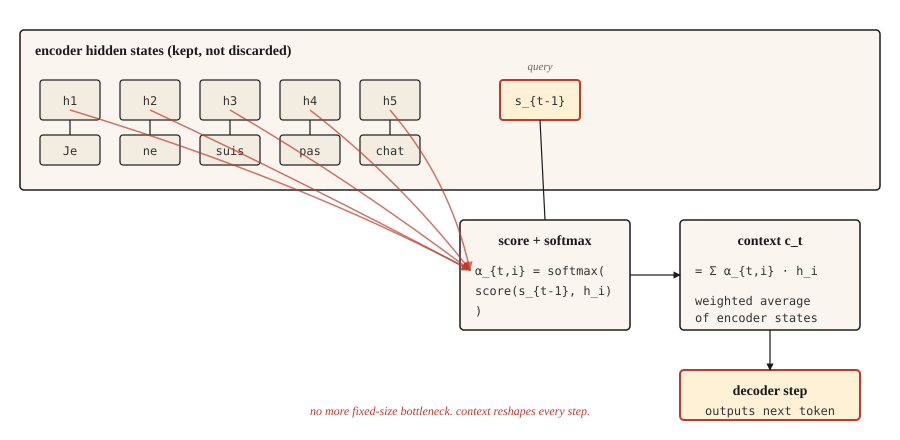

<!-- local-zh-machine-draft: English source is canonical; prose translated automatically, code/math preserved. -->

<a id="attention-mechanism--the-breakthrough"></a>

# Attention机制——突破

> decoder 不再眯着眼睛看压缩摘要，而是开始查看整个源代码。此后的所有内容都是 attention 加工程。

**类型：** 构建
**语言：** Python
**先决条件：** 第 5 阶段·09（序列到序列模型）
**时间：** ~45分钟

<a id="the-problem"></a>

## 问题

第九课以一次有计划的失败告终。在玩具复制任务上训练的 GRU encoder-decoder 从长度 5 时的 89% 准确率到长度 80 时的接近概率。原因是结构性的，而不是训练错误：encoder 收集的每一位信息都必须适合一个固定大小的隐藏状态，并且decoder 从未见过任何其他东西。

Bahdanau、Cho 和 Bengio 在 2014 年发布了一个三行修复程序。不要只给 decoder 最终的 encoder 状态，而是保留每个 encoder 状态。在每个 decoder 步骤，计算 encoder 状态的加权平均值，其中 weights 表示“decoder 需要查看 encoder 位置 `i` 的正确程度”现在？”该加权平均值是上下文，它会改变每个 decoder 步骤。

这就是整个想法。 Transformers 扩展了它。 Self-attention 将其应用于单个序列。多头 attention 并行运行。但2014年的版本已经突破了瓶颈，一旦有了它，转向transformers的关键是工程，而不是概念。

<a id="the-concept"></a>

## 概念



在每个 decoder 步骤 `t`：

1. 使用之前的decoder隐藏状态`s_{t-1}`作为**query**。
2. 针对每个 encoder 隐藏状态 `h_1, ..., h_T` 对其进行评分。每个 encoder 位置一个标量。
3. Softmax 得到 attention weights `α_{t,1}, ..., α_{t,T}` 的分数总和为 1。
4. 上下文向量 `c_t = Σ α_{t,i} * h_i`。 encoder 状态的加权平均值。
5. Decoder 采用 `c_t` 加上之前的输出 token，生成下一个 token。

加权平均值就是点。当decoder需要将“Je”翻译为“I”时，weights和encoder状态高于“Je”高而其他低。当需要“不”时，它 weights “pas”高。上下文向量重塑每个步骤。

<a id="shapes-the-thing-that-bites-everyone"></a>

## 形状（咬每个人的东西）

这是每个 attention 实现第一次出错的地方。慢慢读。

| 东西 | 形状 | 注释 |
|-------|-------|-------|
| Encoder 隐藏状态 `H` | `(T_enc, d_h)` | 如果是 BiLSTM，则 `d_h = 2 * d_hidden` |
| Decoder 隐藏状态 `s_{t-1}` | `(d_s,)` | 一个向量 |
| Attention 分数 `e_{t,i}` | 标量 | 每个 encoder 位置一个 |
| Attention weight `α_{t,i}` | 标量 | softmax 结束后全部 `i` |
| 上下文向量 `c_t` | `(d_h,)` | 与 encoder 状态形状相同 |

**Bahdanau（累加）分数。** `e_{t,i} = v_α^T * tanh(W_a * s_{t-1} + U_a * h_i)`。

- `s_{t-1}` 的形状为 `(d_s,)`，`h_i` 的形状为 `(d_h,)`。
- `W_a` 的形状为 `(d_attn, d_s)`。 `U_a` 的形状为 `(d_attn, d_h)`。
- tanh 内的总和的形状为 `(d_attn,)`。
- `v_α` 的形状为 `(d_attn,)`。与 `v_α` 的内积折叠为标量。 **这就是`v_α`所做的。** 这不是魔法。正是投影将 attention-dim 向量转换为标量分数。

**Luong（乘法）分数。** 三种变体：

- `dot`：`e_{t,i} = s_t^T * h_i`。需要 `d_s == d_h`。硬约束。如果您的 encoder 是双向的，请跳过。
- `general`：`e_{t,i} = s_t^T * W * h_i` 与 `W` 形状 `(d_s, d_h)`。删除等暗度约束。
- `concat`：本质上是 Bahdanau 形式。很少使用，因为前两种更便宜。

**一个Bahdanau / Luong陷阱值得命名。** Bahdanau使用`s_{t-1}`（decoder状态*before*生成当前单词）。 Luong 使用 `s_t`（* 之后的状态 *）。将它们混合起来会产生微妙的错误 gradients ，并且非常难以调试。选择一篇论文并遵守其惯例。

```figure
attention-heatmap
```

<a id="build-it"></a>

## 动手实现

<a id="step-1-additive-bahdanau-attention"></a>

### 第1步：添加剂（Bahdanau）attention

```python
import numpy as np


def additive_attention(decoder_state, encoder_states, W_a, U_a, v_a):
    projected_dec = W_a @ decoder_state
    projected_enc = encoder_states @ U_a.T
    combined = np.tanh(projected_enc + projected_dec)
    scores = combined @ v_a
    weights = softmax(scores)
    context = weights @ encoder_states
    return context, weights


def softmax(x):
    x = x - np.max(x)
    e = np.exp(x)
    return e / e.sum()
```

根据上表检查您的形状。 `encoder_states` 的形状为 `(T_enc, d_h)`。 `projected_enc` 的形状为 `(T_enc, d_attn)`。 `projected_dec` 具有形状 `(d_attn,)` 并进行广播。 `combined` 的形状为 `(T_enc, d_attn)`。 `scores` 的形状为 `(T_enc,)`。 `weights` 的形状为 `(T_enc,)`。 `context` 的形状为 `(d_h,)`。运送它。

<a id="step-2-luong-dot-and-general"></a>

### 第2步：Luong点和一般

```python
def dot_attention(decoder_state, encoder_states):
    scores = encoder_states @ decoder_state
    weights = softmax(scores)
    return weights @ encoder_states, weights


def general_attention(decoder_state, encoder_states, W):
    projected = W.T @ decoder_state
    scores = encoder_states @ projected
    weights = softmax(scores)
    return weights @ encoder_states, weights
```

每行三行。这就是Luong的论文落地的原因。大多数任务的准确性相同，代码却少得多。

<a id="step-3-a-worked-numerical-example"></a>

### 第 3 步：一个有效的数值示例

给定三个 encoder 状态（大致为“cat”、“sat”、“mat”）和一个与第一个最对齐的 decoder 状态，attention 分布集中在位置 0。如果 decoder 状态转变为与最后一个对齐， attention 移动到位置 2。上下文向量跟踪。

```python
H = np.array([
    [1.0, 0.0, 0.2],
    [0.5, 0.5, 0.1],
    [0.1, 0.9, 0.3],
])

s_close_to_cat = np.array([0.9, 0.1, 0.2])
ctx, w = dot_attention(s_close_to_cat, H)
print("weights:", w.round(3))
```

```
weights: [0.464 0.305 0.231]
```

第一排获胜。然后将 decoder 状态移近第三个 encoder 状态，并观察 weights 的变化。就是这样。 Attention 是显式的 alignment。

<a id="step-4-why-this-is-the-bridge-to-transformers"></a>

### 第四步：为什么这是通往transformers的桥梁

将上面的语言翻译成Q/K/V：

- **Query** = decoder 状态 `s_{t-1}`
- **Key** = encoder 状态（我们得分的依据）
- **Value** = encoder 状态（我们 weight 和总和）

在经典的attention中，键和值是同一件事。 Self-attention 将它们分开：您可以使用 K 和 V 的不同学习投影来查询序列本身。多头 attention 与不同的学习投影并行运行。 Transformers 多次堆叠整个舞台并掉落 RNNs。

数学是一样的。形状是一样的。从 Bahdanau attention 到缩放点积 attention 的教学跳跃主要是符号。

<a id="use-it"></a>

## 实际应用

PyTorch 和 TensorFlow 直接发货 attention。

```python
import torch
import torch.nn as nn

mha = nn.MultiheadAttention(embed_dim=128, num_heads=8, batch_first=True)
query = torch.randn(2, 5, 128)
key = torch.randn(2, 10, 128)
value = torch.randn(2, 10, 128)

output, weights = mha(query, key, value)
print(output.shape, weights.shape)
```

```
torch.Size([2, 5, 128]) torch.Size([2, 5, 10])
```

那是 transformer attention 层。查询批次为 5 个位置，键/值批次为 10 个位置，每个 128-dim，8 个头。 `output` 是新的上下文增强查询。 `weights` 是您可以可视化的 5x10 alignment 矩阵。

<a id="when-classical-attention-still-matters"></a>

### 当经典 attention 仍然重要时

- 教育学。单头、单层、基于 RNN 的版本使每个概念都可见。
- transformers 不适合的设备上序列任务。
- 2014-2017 年的任何论文。如果不了解 Bahdanau 的约定，您将会误读它。
- MT 中的细粒度 alignment 分析。即使在 transformer 模型上，原始 attention weights 也是一个可解释性工具，阅读它们需要知道它们是什么。

<a id="the-attention-weight-as-explanation-trap"></a>

### attention-weight-as-解释陷阱

Attention weights 看起来可以解释。它们是 weights，跨仓位之和为 1；你可以绘制它们； high 的意思是“看着这个”。评论家喜欢他们。

它们并不像看起来那样可以解释。 Jain 和 Wallace (2019) 表明，attention 分布可以被任意替代方案排列和替换，而无需更改某些任务的模型预测。在没有消融或反事实检查的情况下，切勿将 attention weights 作为推理证据。

<a id="ship-it"></a>

## 交付成果

另存为 `outputs/prompt-attention-shapes.md`：

```markdown
---
name: attention-shapes
description: Debug shape bugs in attention implementations.
phase: 5
lesson: 10
---

Given a broken attention implementation, you identify the shape mismatch. Output:

1. Which matrix has the wrong shape. Name the tensor.
2. What its shape should be, derived from (d_s, d_h, d_attn, T_enc, T_dec, batch_size).
3. One-line fix. Transpose, reshape, or project.
4. A test to catch regressions. Typically: assert `output.shape == (batch, T_dec, d_h)` and `weights.shape == (batch, T_dec, T_enc)` and `weights.sum(dim=-1) close to 1`.

Refuse to recommend fixes that silently broadcast. Broadcast-hiding bugs surface later as silent accuracy degradation, the worst kind of attention bug.

For Bahdanau confusion, insist the decoder input is `s_{t-1}` (pre-step state). For Luong, `s_t` (post-step state). For dot-product, flag dimension mismatch between query and key as the most common first-time error.
```

<a id="exercises"></a>

## 练习

1. **Easy.** 实现 `softmax` 屏蔽，以便在 encoder 中填充 tokens 得到 attention weight零。对具有可变长度序列的批次进行测试。
2. **Medium.** 将多头 attention 添加到 Luong `general` 表格中。将 `d_h` 拆分为 `n_heads` 组，每个头运行 attention，连接。验证单头外壳是否与您之前的实施相匹配。
3. **Hard.** 与 Bahdanau attention 一起在第 09 课的玩具复制任务上训练 GRU encoder-decoder。绘制准确性与序列长度的关系图。与 no-attention 基线进行比较。您应该看到间隙随着长度的增加而变宽，确认 attention 消除了瓶颈。

<a id="key-terms"></a>

## 关键术语

| 术语 | 人们怎么说 | 它实际上意味着什么 |
|------|-----------------|-----------------------|
| Attention | 看东西 | 值序列的加权平均值，weights 根据查询键相似度计算。 |
| 查询、键、值 | QKV | 三个投影：Q 询问，K 是要匹配的内容，V 是要返回的内容。 |
| 添加剂 attention | 巴赫达瑙 | 前馈分数：`v^T tanh(W q + U k)`。 |
| 乘法 attention | 良点/一般 | 分数为 `q^T k` 或 `q^T W k`。更便宜，大多数任务的准确性相同。 |
| Alignment矩阵 | 漂亮的图画 | Attention weights 作为 `(T_dec, T_enc)` 网格。阅读它以了解模型关注的内容。 |

<a id="further-reading"></a>

## 进一步阅读

- [Bahdanau，Cho，Bengio (2014)。通过联合学习对齐和翻译的神经机器翻译](https://arxiv.org/abs/1409.0473) — 论文。
- [Luong、Pham、Manning (2015)。基于 Attention 的神经机器翻译的有效方法](https://arxiv.org/abs/1508.04025) — 三种评分变体及其比较。
- [Jain 和华莱士 (2019)。 Attention 不是 Explanation](https://arxiv.org/abs/1902.10186) — 可解释性警告。
- [深入学习深度学习 - Bahdanau Attention](https://d2l.ai/chapter_attention-mechanisms-and-transformers/bahdanau-attention.html) - 使用 PyTorch 进行可运行演练。
