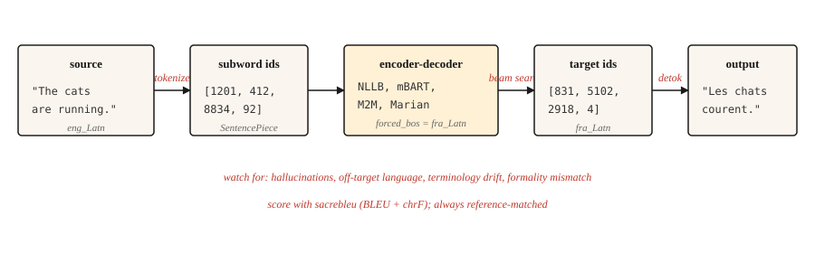

<!-- local-zh-machine-draft: English source is canonical; prose translated automatically, code/math preserved. -->

<a id="machine-translation"></a>

# 机器翻译

> 翻译是三十年来为 NLP 研究付费的任务，并且现在仍在继续付费。

**类型：** 构建
**语言：** Python
**先决条件：** 第 5·10 阶段（Attention 机制）、第 5·04 阶段（GloVe、FastText、Subword）
**时间：** ~75分钟

<a id="the-problem"></a>

## 问题

模型读取一种语言的句子并生成另一种语言的句子。长度各不相同。词序不同。一些源单词映射到多个目标单词，反之亦然。习语拒绝一对一的映射。 “我想你”的法语是“tu me manques”——字面意思是“我缺少你”。没有字级 alignment 能够幸存下来。

机器翻译是迫使 NLP 发明 encoder-decoders、attention、transformers 以及最终整个 LLM 范式的任务。每向前迈出一步都是因为翻译质量是可衡量的，而人与机器之间的差距是顽固的。

本课跳过历史课，讲授 2026 年的工作流程：预训练的多语言 encoder-decoder（NLLB-200 或 mBART）、子字 tokenization、波束搜索、BLEU 和 chrF evaluation 以及少数失败仍然未捕获而交付生产的模式。

<a id="the-concept"></a>

## 概念



现代 MT 是在并行文本上训练的 transformer encoder-decoder。 encoder 以其语言的 tokenization 读取源代码。 decoder 使用 encoder 通过 cross-attention 的输出生成目标，一次一个子字（第 10 课）。解码使用波束搜索来避免贪婪解码陷阱。输出被去标记、去真实化，并根据参考进行评分。

三种操作选择可提高现实世界的机器翻译质量。

- **Tokenizer.** SentencePiece BPE 在混合语言语料库上进行训练。跨语言共享 vocabulary 是在 NLLB 中启用 zero-shot 对的原因。
- **型号尺寸。** NLLB-200 distilled 600M 适合笔记本电脑。 NLLB-200 3.3B 是已发布的生产默认值。 54.5B是研究上限。
- **Decoding.** 一般内容的波束宽度 4-5。长度惩罚以避免输出太短。当您需要术语一致性时进行受限解码。

```figure
seq2seq-alignment
```

<a id="build-it"></a>

## 动手实现

<a id="step-1-a-pretrained-mt-call"></a>

### 第 1 步：预训练的 MT 调用

```python
from transformers import AutoTokenizer, AutoModelForSeq2SeqLM

model_id = "facebook/nllb-200-distilled-600M"
tok = AutoTokenizer.from_pretrained(model_id, src_lang="eng_Latn")
model = AutoModelForSeq2SeqLM.from_pretrained(model_id)

src = "The cats are running."
inputs = tok(src, return_tensors="pt")

out = model.generate(
    **inputs,
    forced_bos_token_id=tok.convert_tokens_to_ids("fra_Latn"),
    num_beams=5,
    length_penalty=1.0,
    max_new_tokens=64,
)
print(tok.batch_decode(out, skip_special_tokens=True)[0])
```

```text
Les chats courent.
```

这里有三件事很重要。 `src_lang` 告诉 tokenizer 要应用哪个脚本和分段。 `forced_bos_token_id` 告诉 decoder 要生成哪种语言。两者都是 NLLB 特有的技巧； mBART 和 M2M-100 使用各自的约定，并且不可互换。

<a id="step-2-bleu-and-chrf"></a>

### 第 2 步：BLEU 和 chrF

BLEU 测量输出和参考之间的 n 元重叠。四个参考 n 元语法大小 (1-4)、精度的几何平均值、输出过短的简洁性损失。分数为 [0、100]。常用。解释起来令人沮丧：30 BLEU 是“可用”； 40是“好”； 50是“例外”； 1 BLEU 以下的差异是噪声。

chrF 衡量字符级 F 分数。对形态丰富的语言更加敏感，其中 BLEU 会低估匹配数。经常与 BLEU 一起报道。

```python
import sacrebleu

hypotheses = ["Les chats courent."]
references = [["Les chats courent."]]

bleu = sacrebleu.corpus_bleu(hypotheses, references)
chrf = sacrebleu.corpus_chrf(hypotheses, references)
print(f"BLEU: {bleu.score:.1f}  chrF: {chrf.score:.1f}")
```

始终使用 `sacrebleu`。它对 tokenization 进行标准化，因此论文之间的分数具有可比性。滚动您自己的 BLEU 计算就是产生误导性基准的原因。

<a id="the-three-tier-evaluation-hierarchy-2026"></a>

### 三层 evaluation 层次结构 (2026)

现代 MT evaluation 使用三个互补的公制系列。运送至少两个。

- **Heuristic**（BLEU，chrF）。快速、基于参考、可解释、对释义不敏感。用于遗留比较和回归检测。
- **已学习**（COMET、BLEURT、BERTScore）。根据人类判断训练的神经模型；比较翻译与原文和参考文献的语义相似性。自 2023 年以来，COMET 与 MT 研究的关联度最高，并且是质量至关重要的 2026 年生产默认值。
- **LLM-as-judge**（免参考）。 Prompt 一个大型模型，用于对翻译的流畅性、充分性、语气、文化适当性进行评分。当评分标准设计良好时，GPT-4 作为判断者在约 80% 的情况下与人类协议相匹配。用于不存在参考的开放式内容。

实用的 2026 堆栈：用于 BLEU 和 chrF 的 `sacrebleu`，用于 COMET 的 `unbabel-comet`，以及用于最终面向人的信号的提示 LLM。在信任生产数据之前，根据 50-100 个人工标记的示例校准每个指标。

无参考指标（COMET-QE、BLEURT-QE、LLM-as-judge）让您可以在没有参考的情况下评估翻译，这对于不存在参考翻译的长尾语言对很重要。

<a id="step-3-what-breaks-in-production"></a>

### 第 3 步：生产中发生了什么故障

上面的工作管道将在 80% 的时间里顺利翻译，而在剩下的 20% 的时间里默默地失败。命名的故障模式：

- **Hallucination.** 模型发明了源中不存在的内容。常见于陌生域vocabulary。症状：输出流畅，但声称事实来源未说明。缓解措施：对领域术语进行受限解码、对受监管内容进行人工审查、监控输出的时间比输入长得多。
- ** 脱靶生成。** 模型翻译成错误的语言。令人惊讶的是，NLLB 在稀有语言对上很容易出现这种情况。缓解措施：验证 `forced_bos_token_id` 并始终在输出时使用语言 ID 模型检查进行解码。
- **术语漂移。** “注册”在文档 1 中变为“s'inscrire”，在文档 2 中变为“créer un compte”。对于 UI 文本和面向用户的字符串，一致性比原始质量更重要。缓解措施：词汇表限制的解码或后期编辑词典。
- **形式不匹配。** 法语“tu”与“vous”，日语礼貌级别。该模型会选择训练中更常见的形式。对于面向客户的内容，这通常是错误的。缓解措施：如果模型支持 prompt 前缀，并带有形式 token，或者在仅形式语料库上微调小模型。
- ** 短输入时的长度爆炸。** 非常短的输入句子通常会产生过长的翻译，因为长度损失从低于 ~5 源 tokens 的悬崖下降。缓解措施：硬最大长度上限与源长度成正比。

<a id="step-4-fine-tuning-for-a-domain"></a>

### 步骤 4：域的 fine-tuning

预训练模型是多面手。法律、医学或游戏对话翻译可从域并行数据上的 fine-tuning 中获益匪浅。菜谱并不奇特：

```python
from transformers import Trainer, TrainingArguments
from datasets import Dataset

pairs = [
    {"src": "The defendant pleaded guilty.", "tgt": "L'accusé a plaidé coupable."},
]

ds = Dataset.from_list(pairs)


def preprocess(ex):
    return tok(
        ex["src"],
        text_target=ex["tgt"],
        truncation=True,
        max_length=128,
        padding="max_length",
    )


ds = ds.map(preprocess, remove_columns=["src", "tgt"])

args = TrainingArguments(output_dir="out", per_device_train_batch_size=4, num_train_epochs=3, learning_rate=3e-5)
Trainer(model=model, args=args, train_dataset=ds).train()
```

几千个高质量的并行示例击败了几十万个嘈杂的网络抓取示例。训练数据的质量是最大的生产杠杆。

<a id="use-it"></a>

## 实际应用

2026 年 MT 的生产堆栈：

| 应用场景 | 推荐起点 |
|---------|---------------------------|
| 任意对任意，200 种语言 | `facebook/nllb-200-distilled-600M`（笔记本电脑）或 `nllb-200-3.3B`（生产） |
| 以英语为中心，高品质，50 种语言 | `facebook/mbart-large-50-many-to-many-mmt` |
| 短版，便宜 inference，英语-法语/德语/西班牙语 | 赫尔辛基-NLP/玛丽安模型 |
| 延迟关键的浏览器端 | ONNX 量化的 Marian (~50 MB) |
| 最高品质，愿意付费 | GPT-4 / Claude / Gemini 带翻译 prompts |

截至 2026 年，LLMs 现在在多种语言对上的性能优于专用 MT 模型，特别是在惯用内容和长上下文方面。权衡是每 token 成本和延迟。当上下文长度、风格一致性或通过提示进行的领域适应比吞吐量更重要时，请选择 LLM。

<a id="ship-it"></a>

## 交付成果

另存为`outputs/skill-mt-evaluator.md`：

```markdown
---
name: mt-evaluator
description: Evaluate a machine translation output for shipping.
version: 1.0.0
phase: 5
lesson: 11
tags: [nlp, translation, evaluation]
---

Given a source text and a candidate translation, output:

1. Automatic score estimate. BLEU and chrF ranges you would expect. State whether a reference is available.
2. Five-point human-verifiable check list: (a) content preservation (no hallucinations), (b) correct language, (c) register / formality match, (d) terminology consistency with glossary if provided, (e) no truncation or length explosion.
3. One domain-specific issue to probe. E.g., for legal: named entities and statute citations. For medical: drug names and dosages. For UI: placeholder variables `{name}`.
4. Confidence flag. "Ship" / "Ship with review" / "Do not ship". Tie to the severity of issues found in step 2.

Refuse to ship a translation without a language-ID check on output. Refuse to evaluate without a reference unless the user explicitly opts in to reference-free scoring (COMET-QE, BLEURT-QE). Flag any content over 1000 tokens as likely needing chunked translation.
```

<a id="exercises"></a>

## 练习

1. **Easy.** 使用 `nllb-200-distilled-600M` 将 5 句英文段落翻译成法语，然后再翻译回英语。测量往返行程与原始行程的接近程度。您应该看到语义保留与单词选择漂移。
2. **Medium.** 使用 `fasttext lid.176` 或 `langdetect` 对翻译输出实施语言 ID 检查。集成到 MT 调用中，以便在返回之前捕获偏离目标的生成。
3. **Hard.** 在您选择的 5,000 对域语料库上微调 `nllb-200-distilled-600M`。在 fine-tuning 之前和之后测量保留集上的 BLEU。报告哪些句子有所进步，哪些句子有所退化。

<a id="key-terms"></a>

## 关键术语

| 术语 | 人们怎么说 | 它实际上意味着什么 |
|------|-----------------|-----------------------|
| 蓝线 | 翻译分数 | N 元语法精度与简洁性损失。 [0，100]。 |
| chrF | 性格F值 | 角色级 F 分数。对形态丰富的语言更加敏感。 |
| 神经机器翻译 | 神经机器翻译 | Transformer encoder-decoder 在并行文本上进行训练。 2017 年以上默认值。 |
| NLLB | 没有语言落后 | Meta 的 200 种语言 MT 模型系列。 |
| 受限解码 | 受控输出 | 强制特定的 tokens 或 n 元词出现/不出现在输出中。 |
| Hallucination | 发明内容 | 源不支持的模型输出。 |

<a id="further-reading"></a>

## 进一步阅读

- [Costa-jussà 等人。 （2022）。不遗余力：扩展以人为中心的机器翻译](https://arxiv.org/abs/2207.04672) — NLLB 论文。
- [Post (2018)。呼吁明确报告 BLEU 分数](https://aclanthology.org/W18-6319/) — 为什么 `sacrebleu` 是报告 BLEU 的唯一正确方法。
- [Popović (2015)。 chrF：自动 MT 的字符 n 元语法 F 分数 evaluation](https://aclanthology.org/W15-3049/) — chrF 论文。
- [Hugging Face MT 指南](https://huggingface.co/docs/transformers/tasks/translation) — 实用的 fine-tuning 演练。
