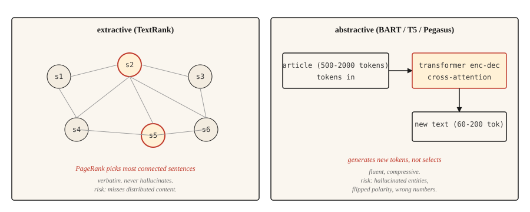

<!-- local-zh-machine-draft: English source is canonical; prose translated automatically, code/math preserved. -->

<a id="text-summarization"></a>

# 文本摘要

> 提取系统会告诉您文件内容。抽象系统告诉你作者的意思。不同的任务，不同的陷阱。

**类型：** 构建
**语言：** Python
**先决条件：** 第 5 阶段·02（BoW + TF-IDF）、第 5 阶段·11（机器翻译）
**时间：** ~75分钟

<a id="the-problem"></a>

## 问题

一篇 2,000 字的新闻文章出现在您的 Feed 中。你需要 120 个单词来表达它。您可以从文章中挑选三个最重要的句子（摘要），也可以用自己的话重写内容（摘要）。两者都称为总结。它们是完全不同的问题。

提取摘要是一个排序问题。对每个句子进行评分，返回顶部-`k`。输出始终符合语法，因为它是逐字提升的。风险在于缺少分布在整个文章中的内容。

抽象概括是一个生成问题。 transformer 根据输入生成新文本。输出流畅且压缩，但可能会产生源中没有的事实。风险在于自信的捏造。

本课程构建了两者，以及每个人都拥有的故障模式。

<a id="the-concept"></a>

## 概念



**Extractive.** 将文章视为一个图，其中节点是句子，边是相似之处。在图表上运行 PageRank（或类似的东西），根据句子与其他内容的连接程度对句子进行评分。得分最高的句子是摘要。规范的实现是 **TextRank**（Mihalcea 和 Tarau，2004）。

**Abstractive.** 在文档摘要对上微调 transformer encoder-decoder（BART、T5、Pegasus）。在 inference，模型读取文档并通过 cross-attention 生成摘要 token-by-token。 Pegasus 特别使用间隙句子 pretraining 目标，使其在摘要方面表现出色，而无需太多 fine-tuning。

Evaluation 和 **ROUGE**（Gisting Evaluation 的面向召回的替补研究）。 ROUGE-1 和 ROUGE-2 得分一元组和二元组重叠。 ROUGE-L 计算最长公共子序列。越高越好，但 40 ROUGE-L 为“良好”，50 为“特殊”。每篇论文都报道了这三点。使用`rouge-score`包。

```figure
summarize-collapse
```

<a id="build-it"></a>

## 动手实现

<a id="step-1-textrank-extractive"></a>

### 第 1 步：TextRank（提取）

```python
import math
import re
from collections import Counter


def sentence_split(text):
    return re.split(r"(?<=[.!?])\s+", text.strip())


def similarity(s1, s2):
    w1 = Counter(s1.lower().split())
    w2 = Counter(s2.lower().split())
    intersection = sum((w1 & w2).values())
    denom = math.log(len(w1) + 1) + math.log(len(w2) + 1)
    if denom == 0:
        return 0.0
    return intersection / denom


def textrank(text, top_k=3, damping=0.85, iterations=50, epsilon=1e-4):
    sentences = sentence_split(text)
    n = len(sentences)
    if n <= top_k:
        return sentences

    sim = [[0.0] * n for _ in range(n)]
    for i in range(n):
        for j in range(n):
            if i != j:
                sim[i][j] = similarity(sentences[i], sentences[j])

    scores = [1.0] * n
    for _ in range(iterations):
        new_scores = [1 - damping] * n
        for i in range(n):
            total_out = sum(sim[i]) or 1e-9
            for j in range(n):
                if sim[i][j] > 0:
                    new_scores[j] += damping * sim[i][j] / total_out * scores[i]
        if max(abs(s - ns) for s, ns in zip(scores, new_scores)) < epsilon:
            scores = new_scores
            break
        scores = new_scores

    ranked = sorted(range(n), key=lambda k: scores[k], reverse=True)[:top_k]
    ranked.sort()
    return [sentences[i] for i in ranked]
```

有两件事值得命名。相似度函数使用对数归一化单词重叠，这是原始的 TextRank 变体。 TF-IDF 向量的余弦也有效。阻尼因子 0.85 和迭代次数是 PageRank 默认值。

<a id="step-2-abstractive-with-bart"></a>

### 第 2 步：使用 BART 进行抽象

```python
from transformers import pipeline

summarizer = pipeline("summarization", model="facebook/bart-large-cnn")

article = """(long news article text)"""

summary = summarizer(article, max_length=120, min_length=60, do_sample=False)
print(summary[0]["summary_text"])
```

BART-large-CNN 在 CNN/DailyMail 语料库上进行了微调。它可以立即生成新闻风格的摘要。对于其他领域（科学论文、对话、法律），请使用相应的 Pegasus checkpoint 或对目标数据进行微调。

<a id="step-3-rouge-evaluation"></a>

### 步骤3：ROUGE evaluation

```python
from rouge_score import rouge_scorer

scorer = rouge_scorer.RougeScorer(["rouge1", "rouge2", "rougeL"], use_stemmer=True)
scores = scorer.score(reference_summary, generated_summary)
print({k: round(v.fmeasure, 3) for k, v in scores.items()})
```

始终使用词干提取。如果没有它，“running”和“run”将被视为不同的单词，并且 ROUGE 会被低估。

<a id="beyond-rouge-2026-summarization-eval"></a>

### 超越ROUGE（2026年总结评估）

ROUGE 二十年来一直是主要的摘要指标，但到 2026 年，它本身还不够。对 NLG 论文的大规模荟萃分析显示：

- **BERTScore**（上下文 embedding 相似性）在 2023 年取得进展，现在在大多数摘要论文中与 ROUGE 一起报告。
- **BARTScore** 将 evaluation 视为生成：根据预训练的 BART 在给定源的情况下分配摘要的可能性来对摘要进行评分。
- **MoverScore**（地球移动者相对于上下文 embeddings 的距离）在 2025 年摘要基准中排名第一，因为它比 ROUGE 更好地捕获了语义重叠。
- **FactCC** 和 **QA 基于的忠诚度** 在 2021-2023 年很常见，现在经常被替换**G-Eval**（一条 GPT-4 prompt 链，用于对 chain-of-thought 推理的连贯性、一致性、流畅性、相关性进行评分）。
- 当评分细则设计良好时，**G-Eval** 和类似的 LLM 判断方法大约 80% 的时间与人类判断相匹配。

生产推荐：报告 ROUGE-L 用于遗留比较，BERTScore 用于语义重叠，G-Eval 用于连贯性和真实性。根据 50-100 个人工标记的摘要进行校准。

<a id="step-4-the-factuality-problem"></a>

### 第四步：事实问题

抽象摘要容易出现 hallucination。提取摘要的 hallucination 风险要低得多，因为输出是从源中逐字提取的，尽管如果源句子脱离上下文、过时或乱序引用，它们仍然可能会产生误导。这是生产系统仍然更喜欢提取方法来获取与合规性相关的内容的最大原因。

Hallucination 类型命名：

- **Entity swap.** 来源说“John Smith”。摘要说“约翰·布朗”。
- **数字漂移。** 来源说“25,000”。摘要说“2500万”。
- **极性翻转。** 消息人士称“拒绝了该提议”。摘要说“接受了要约”。
- **事实发明。** 来源没有提及CEO。摘要称首席执行官已批准。

Evaluation 有效的方法：

- **FactCC.** 根据源句和摘要句之间的蕴涵训练的二元分类器。预测事实/非事实。
- **QA 基于事实性。** 向 QA 模型提出问题，其答案在源中。如果摘要支持不同的答案，请标记。
- **实体级 F1.** 比较源与摘要中的命名实体。仅出现在摘要中的实体是可疑的。

对于任何面向用户且真实性很重要的内容（新闻、医疗、法律、金融），提取是更安全的默认设置。摘要需要在循环中进行事实性检查。

<a id="use-it"></a>

## 实际应用

2026 年堆栈：

| 应用场景 | 推荐 |
|---------|-------------|
| 新闻，3-5 句摘要，英语 | `facebook/bart-large-cnn` |
| 科学论文 | `google/pegasus-pubmed` 或经过调谐的 T5 |
| 多文档、长格式 | 任何具有 32k+ 上下文的 LLM，都会出现提示 |
| 对话总结 | `philschmid/bart-large-cnn-samsum` |
| 抽取式、低 hallucination 施工风险 | TextRank 或 `sumy` 的 LSA / LexRank |

当计算不受限制时，具有长上下文的 LLMs 在 2026 年通常会击败专用模型。权衡是成本和可重复性；专门的模型提供更一致的输出。

<a id="ship-it"></a>

## 交付成果

另存为`outputs/skill-summary-picker.md`：

```markdown
---
name: summary-picker
description: Pick extractive or abstractive, named library, factuality check.
version: 1.0.0
phase: 5
lesson: 12
tags: [nlp, summarization]
---

Given a task (document type, compliance requirement, length, compute budget), output:

1. Approach. Extractive or abstractive. Explain in one sentence why.
2. Starting model / library. Name it. `sumy.TextRankSummarizer`, `facebook/bart-large-cnn`, `google/pegasus-pubmed`, or an LLM prompt.
3. Evaluation plan. ROUGE-1, ROUGE-2, ROUGE-L (use rouge-score with stemming). Plus factuality check if abstractive.
4. One failure mode to probe. Entity swap is the most common in abstractive news summarization; flag samples where source entities do not appear in summary.

Refuse abstractive summarization for medical, legal, financial, or regulated content without a factuality gate. Flag input over the model's context window as needing chunked map-reduce summarization (not just truncation).
```

<a id="exercises"></a>

## 练习

1. **Easy.** 对 5 篇新闻文章运行 TextRank。将前 3 个句子与参考摘要进行比较。测量 ROUGE-L。您应该在 CNN/DailyMail 风格的文章上看到 30-45 ROUGE-L。
2. **Medium.** 实现实体级事实性：从源和摘要中提取命名实体（spaCy），计算摘要中源实体的召回率以及摘要实体相对于源的精度。高准确率和低召回率意味着安全但简洁；低精度意味着幻觉实体。
3. **Hard.** 将 BART-large-CNN 与 50 上的 LLM（Claude 或 GPT-4）进行比较CNN/DailyMail 文章。报告 ROUGE-L、真实性（按实体 F1）以及每个摘要的成本。记录每个人获胜的地方。

<a id="key-terms"></a>

## 关键术语

| 术语 | 人们怎么说 | 它实际上意味着什么 |
|------|-----------------|-----------------------|
| 萃取 | 选句子 | 从源中逐字返回句子。从来不会产生幻觉。 |
| 抽象的 | 重写 | 根据源生成新文本。会产生幻觉。 |
| ROUGE | 摘要指标 | 系统输出和参考之间的 N-gram / LCS 重叠。 |
| 文本排名 | 基于图的提取 | 句子相似度图上的 PageRank。 |
| 事实性 | 是吗？ | 摘要声明是否得到来源的支持。 |
| Hallucination | 虚构的内容 | 摘要中的内容来源不支持。 |

<a id="further-reading"></a>

## 进一步阅读

- [Mihalcea 和 Tarau (2004)。 TextRank：将秩序带入文本](https://aclanthology.org/W04-3252/) — 摘录的规范论文。
- [Lewis 等人。 （2019）。 BART：去噪序列到序列预训练](https://arxiv.org/abs/1910.13461) — BART 论文。
- [Zhang 等人。 （2019）。 PEGASUS：使用提取的间隙句子进行预训练](https://arxiv.org/abs/1912.08777) - Pegasus 和间隙句子目标。
- [Lin (2004)。 ROUGE：自动 Evaluation 总结包 ](https://aclanthology.org/W04-1013/) — ROUGE 纸。
- [Maynez 等人。 （2020）。论抽象概括中的忠实性和真实性](https://arxiv.org/abs/2005.00661)——真实性景观论文。
