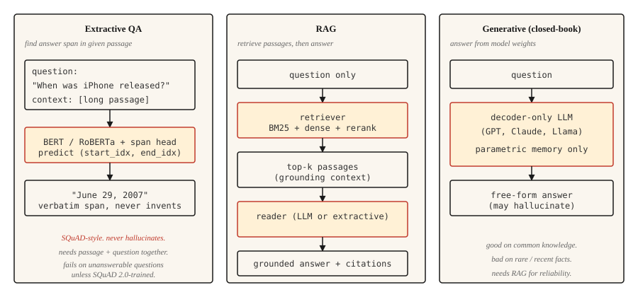

<!-- local-zh-machine-draft: English source is canonical; prose translated automatically, code/math preserved. -->

<a id="question-answering-systems"></a>

# 问答系统

> 三个系统塑造了现代质量保证。提取发现的跨度。检索增强将它们扎根于文档中。生成式产生答案。每个现代人工智能助手都是这三者的混合体。

**类型：** 构建
**语言：** Python
**先决条件：** 第 5·11 阶段（机器翻译）、第 5·10 阶段（Attention 机制）
**时间：** ~75分钟

<a id="the-problem"></a>

## 问题

用户输入“第一部 iPhone 何时发布？”并预计“2007 年 6 月 29 日”。不是“苹果的历史悠久而多样”。不是“2007”，孤立地坐着，没有判决。直接、接地气、正确的答案。

在过去十年中，三种架构主导了 QA。

- **Extractive QA.** 给定一个问题和已知包含答案的段落，找到该段落中答案范围的开始和结束索引。 SQuAD 是规范基准。
- **开放域QA.** 未给出该段落。首先检索相关段落，然后提取或生成答案。这是当今每个 RAG 管道的基石。
- **生成/闭卷QA.** 大型语言模型从其参数存储器中给出答案。没有检索。 inference 最快，事实最不可靠。

2026 年的趋势是混合的：检索最好的几个段落，然后 prompt 一个生成模型来基于这些段落进行回答。那就是RAG，第14课涉及了一半深度的检索。本课程构建了 QA 部分。

<a id="the-concept"></a>

## 概念



**Extractive.** 将问题和段落与 transformer（BERT 系列）一起编码。训练两个头来预测答案的开始和结束 token 索引。有效头寸损失为 cross-entropy。输出是段落的跨度。从不产生幻觉（通过建构），从不处理文章无法回答的问题（通过建构）。

**检索增强（RAG）。** 两个阶段。首先，检索器从语料库中查找顶部 `k` 的段落。其次，读者（提取式或生成式）使用这些段落给出答案。检索器和阅读器的分离让每个人都能独立训练和评估。现代的RAG经常在它们之间添加一个reranker。

**Generative.** A decoder-仅限 LLM（GPT、Claude、Llama）答案从weights得知。没有检索步骤。在常识方面表现出色，在罕见或最近的事实方面表现则很糟糕。 hallucination 速率与 pretraining 数据中的事实频率成反比。

```figure
qa-span
```

<a id="build-it"></a>

## 动手实现

<a id="step-1-extractive-qa-with-a-pretrained-model"></a>

### 第 1 步：使用预训练模型进行提取式 QA

```python
from transformers import pipeline

qa = pipeline("question-answering", model="deepset/roberta-base-squad2")

passage = (
    "Apple Inc. released the first iPhone on June 29, 2007. "
    "The device was announced by Steve Jobs at Macworld in January 2007."
)
question = "When was the first iPhone released?"

answer = qa(question=question, context=passage)
print(answer)
```

```python
{'score': 0.98, 'start': 57, 'end': 70, 'answer': 'June 29, 2007'}
```

`deepset/roberta-base-squad2`接受了SQuAD 2.0的培训，其中包括无法回答的问题。默认情况下，即使模型的空分数获胜，`question-answering` 管道也会返回最高得分范围 - 它会自动返回空答案 *not*。要获得明确的“无答案”行为，请将 `handle_impossible_answer=True` 传递给管道调用：然后，仅当空分数超过每个跨度分数时，管道才返回空答案。无论哪种方式，请始终检查 `score` 字段。

<a id="step-2-a-retrieval-augmented-pipeline-sketch"></a>

### 步骤 2：检索增强管道（草图）

```python
from sentence_transformers import SentenceTransformer
import numpy as np

encoder = SentenceTransformer("sentence-transformers/all-MiniLM-L6-v2")

corpus = [
    "Apple Inc. released the first iPhone on June 29, 2007.",
    "Macworld 2007 featured the iPhone announcement by Steve Jobs.",
    "Android launched in 2008 as Google's mobile operating system.",
    "The first iPod was released in 2001.",
]
corpus_embeddings = encoder.encode(corpus, normalize_embeddings=True)


def retrieve(question, top_k=2):
    q_emb = encoder.encode([question], normalize_embeddings=True)
    sims = (corpus_embeddings @ q_emb.T).squeeze()
    order = np.argsort(-sims)[:top_k]
    return [corpus[i] for i in order]


def answer(question):
    passages = retrieve(question, top_k=2)
    combined = " ".join(passages)
    return qa(question=question, context=combined)


print(answer("When was the first iPhone released?"))
```

两级管道。密集检索器（Sentence-BERT）通过语义相似度查找相关段落。提取式阅读器 (RoBERTa-SQuAD) 从组合的顶部段落中提取答案范围。适用于小型语料库。对于百万文档语料库，请使用 FAISS 或 vector database。

<a id="step-3-generative-with-rag"></a>

### 步骤3：用RAG生成

```python
def rag_generate(question, llm):
    passages = retrieve(question, top_k=3)
    prompt = f"""Context:
{chr(10).join('- ' + p for p in passages)}

Question: {question}

Answer using only the context above. If the context does not contain the answer, say "I don't know."
"""
    return llm(prompt)
```

prompt 模式很重要。与天真的提示相比，明确告诉模型在上下文中接地并在上下文不充分时返回“我不知道”，可以将 hallucination 率降低 40-60%。更复杂的模式添加了引用、置信度分数和结构化提取。

<a id="step-4-evaluation-that-reflects-the-real-world"></a>

### 步骤4：反映现实世界的evaluation

SQuAD 使用 **Exact Match (EM)** 和 **token 级 F1**。 EM 是 normalization（小写、去掉标点符号、删除文章）之后的严格匹配 — 要么预测完全匹配，要么得分 0。F1 是在预测和参考之间的 token 重叠上计算的，并给出部分信用。两个信用不足的释义：“June 29, 2007”与“June 29th, 2007”通常得到 0 EM（序数破坏 normalization），但仍然从重叠的 tokens 中获得大量 F1。

对于生产质量检查：

- **答案准确性**（LLM判断或人工判断，因为指标不捕获语义等价性）。
- **引用准确性。** 引用的段落实际上支持答案吗？自动检查生成的引文和检索到的段落之间的字符串匹配很简单。
- **拒绝 calibration.** 当答案不在检索到的段落中时，系统是否正确地说“我不知道”？测量错误置信率。
- **检索召回。** 在评估阅读器之前，测量检索器是否获得正确的通道进入顶部-`k`。读者无法修复缺失的段落。

<a id="ragas-the-2026-production-eval-framework"></a>

### RAGAS：2026 年生产评估框架

`RAGAS` 专为 RAG 系统打造，是 2026 年默认发货的系统。它无需黄金参考即可获得四个维度的评分：

- **Faithativity.** 答案中的每个主张是否都来自检索到的上下文？通过基于 NLI 的蕴涵来衡量。您的主要 hallucination 指标。
- **答案相关性。** 答案是否解决了问题？通过从答案中生成假设问题并与真实问题进行比较来衡量。
- **Context precision.** 在检索到的块中，哪些部分实际上是相关的？低精度 = prompt 中的噪声。
- **上下文召回。** 检索到的集合是否包含所有需要的信息？低召回率=读者无法成功。

无参考评分可让您评估实时生产流量，而无需策划黄金答案。对于精确匹配指标无用的开放式问题，将 LLM 作为法官置于顶部。

`pip install ragas`。插入您的检索器 + 阅读器。每个查询获取四个标量。回归警报。

<a id="use-it"></a>

## 实际应用

2026 年堆栈。

| 应用场景 | 推荐 |
|---------|-------------|
| 给定段落，找到答案范围 | `deepset/roberta-base-squad2` |
| 在固定语料库上，闭卷不可接受 | RAG：密集检索器+LLM阅读器 |
| 通过文档存储实时 | RAG 与混合（BM25 + 密集）猎犬 + reranker（第 14 课） |
| 对话式 QA（后续问题） | LLM 每回合有对话历史 + RAG |
| 高度真实、受监管的领域 | 对权威语料库进行提取；永远不会单独产生 |

提取式 QA 在 2026 年不再流行，因为 RAG 和 LLMs 可以处理更多案例。它仍然适用于需要字面引用的环境：法律研究、监管合规、审计工具。

<a id="ship-it"></a>

## 交付成果

另存为`outputs/skill-qa-architect.md`：

```markdown
---
name: qa-architect
description: Choose QA architecture, retrieval strategy, and evaluation plan.
version: 1.0.0
phase: 5
lesson: 13
tags: [nlp, qa, rag]
---

Given requirements (corpus size, question type, factuality constraint, latency budget), output:

1. Architecture. Extractive, RAG with extractive reader, RAG with generative reader, or closed-book LLM. One-sentence reason.
2. Retriever. None, BM25, dense (name the encoder), or hybrid.
3. Reader. SQuAD-tuned model, LLM by name, or "domain-fine-tuned DistilBERT."
4. Evaluation. EM + F1 for extractive benchmarks; answer accuracy + citation accuracy + refusal calibration for production. Name what you are measuring and how you are measuring it.

Refuse closed-book LLM answers for regulatory or compliance-sensitive questions. Refuse any QA system without a retrieval-recall baseline (you cannot evaluate the reader without knowing the retriever surfaced the right passage). Flag questions that require multi-hop reasoning as needing specialized multi-hop retrievers like HotpotQA-trained systems.
```

<a id="exercises"></a>

## 练习

1. **Easy.** 在 10 个维基百科段落上设置上述 SQuAD 提取管道。手工制作 10 个问题。测量答案正确的频率。如果段落和问题清晰，您应该会看到 7-9 是正确的。
2. **Medium.** 添加拒绝分类器。当最高检索分数低于阈值（例如 0.3 余弦）时，返回“我不知道”而不是致电读者。调整保留集的阈值。
3. **Hard.** 在您选择的 10,000 个文档语料库上构建 RAG 管道。使用 RRF 融合实现 hybrid retrieval （BM25 + 密集）（参见第 14 课）。测量使用和不使用混合步骤的答案准确性。记录哪些问题类型最受益。

<a id="key-terms"></a>

## 关键术语

| 术语 | 人们怎么说 | 它实际上意味着什么 |
|------|-----------------|-----------------------|
| 提取式质量保证 | 找到答案跨度 | 预测给定段落中答案的开始和结束索引。 |
| 开放域质量检查 | 对语料库进行质量检查 | 没有给定段落；必须检索然后回答。 |
| RAG | 检索然后生成 | 检索增强一代。检索器+读取器管道。 |
| 小队 | 规范基准 | 斯坦福问答数据集。 EM + F1 指标。 |
| Hallucination | 编造的答案 | 检索到的上下文不支持读取器输出。 |
| 拒绝 calibration | 知道什么时候该闭嘴 | 当无法回答时，系统正确地说“我不知道”。 |

<a id="further-reading"></a>

## 进一步阅读

- [Rajpurkar 等人。 （2016）。 SQuAD：100,000 多个文本机器理解问题](https://arxiv.org/abs/1606.05250) — 基准论文。
- [Karpukhin 等人。 （2020）。开放域的密集通道检索 QA](https://arxiv.org/abs/2004.04906) — DPR，用于 QA 的规范密集检索器。
- [Lewis 等人。 （2020）。知识密集型 NLP 任务的检索增强生成](https://arxiv.org/abs/2005.11401) — 这篇名为 RAG 的论文。
- [Gao 等人。 （2023）。大型语言模型的检索增强生成：调查](https://arxiv.org/abs/2312.10997) — 综合 RAG 调查。
