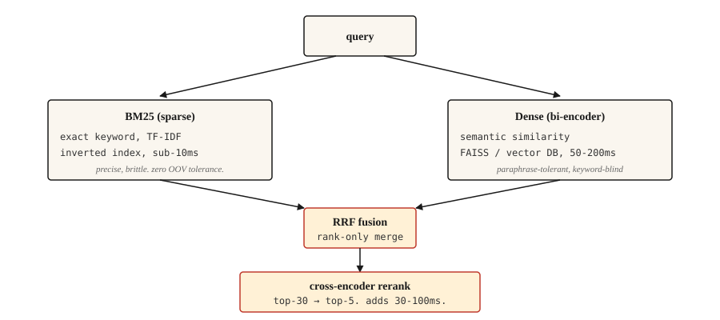

<!-- local-zh-machine-draft: English source is canonical; prose translated automatically, code/math preserved. -->

<a id="information-retrieval-and-search"></a>

# 信息检索与搜索

> BM25 很精确，但很脆弱。 Dense 撒下了广泛的网，但错过了关键词。混合动力是 2026 年的默认选择。其他一切都在调整。

**类型：** 构建
**语言：** Python
**先决条件：** 第 5 阶段·02 (BoW + TF-IDF)、第 5 阶段·04 (GloVe、FastText、Subword)
**时间：** ~75分钟

<a id="the-problem"></a>

## 问题

用户输入“如果有人为了钱而撒谎会发生什么”，并期望找到实际涵盖该内容的法规：“IPC 第 420 条”。关键字搜索完全错过了它（没有共享 vocabulary）。如果 embeddings 未接受过法律文本的培训，则 semantic search 会错过它。真正的搜索必须处理这两个问题。

IR 是每个 RAG 系统、每个搜索栏、每个文档站点的模糊查找下的管道。在生产环境中运行的 2026 架构并不是单一的方法。它是一系列互补的方法，每一种方法都可以弥补前一种方法的失败。

本课程构建每个部分并命名每个部分遇到的失败。

<a id="the-concept"></a>

## 概念



四层。选择您需要的。

1. **稀疏检索（BM25）。** 在exact matches上快速、精确，语义上很糟糕。运行倒排索引。对数百万个文档的每次查询不到 10 毫秒。为您提供法规参考、产品代码、错误消息、命名实体。
2. **Dense retrieval.** 将查询和文档编码为向量。最近邻搜索。捕获释义和语义相似性。错过相差一个字符的精确关键字匹配。使用 FAISS 或矢量数据库进行每次查询需要 50-200 毫秒。
3. **Fusion.** 将稀疏和密集的排序列表合并。 Reciprocal Rank Fusion (RRF) 是简单的默认值，因为它忽略原始分数（以不同的比例存在）并且仅使用排名位置。当您知道一个信号在您的域中占主导地位时，加权融合是一种选择。
4. **Cross-encoder 重新排名。** 从融合中取得前 30 名。运行交叉encoder（查询+文档一起，对每一对进行评分）。保持前5名。每对 Cross-encoders 比 bi-encoders 慢，但准确得多。您只需将它们运行在前 30 名即可摊销。

三向检索（BM25 + 密集 + 学习稀疏，如 SPLADE）在 2026 年基准测试中优于双向，但需要学习稀疏索引的基础设施。对于大多数团队来说，双向加交叉 encoder 重新排名是最佳选择。

```figure
gx-hybrid-retrieval
```

<a id="build-it"></a>

## 动手实现

<a id="step-1-bm25-from-scratch"></a>

### 步骤1：从头开始BM25

```python
import math
import re
from collections import Counter

TOKEN_RE = re.compile(r"[a-z0-9]+")


def tokenize(text):
    return TOKEN_RE.findall(text.lower())


class BM25:
    def __init__(self, corpus, k1=1.5, b=0.75):
        if not corpus:
            raise ValueError("corpus must not be empty")
        self.corpus = [tokenize(d) for d in corpus]
        self.k1 = k1
        self.b = b
        self.n_docs = len(self.corpus)
        self.avg_dl = sum(len(d) for d in self.corpus) / self.n_docs
        self.df = Counter()
        for doc in self.corpus:
            for term in set(doc):
                self.df[term] += 1

    def idf(self, term):
        n = self.df.get(term, 0)
        return math.log(1 + (self.n_docs - n + 0.5) / (n + 0.5))

    def score(self, query, doc_idx):
        q_tokens = tokenize(query)
        doc = self.corpus[doc_idx]
        dl = len(doc)
        freq = Counter(doc)
        score = 0.0
        for term in q_tokens:
            f = freq.get(term, 0)
            if f == 0:
                continue
            numerator = f * (self.k1 + 1)
            denominator = f + self.k1 * (1 - self.b + self.b * dl / self.avg_dl)
            score += self.idf(term) * numerator / denominator
        return score

    def rank(self, query, top_k=10):
        scored = [(self.score(query, i), i) for i in range(self.n_docs)]
        scored.sort(reverse=True)
        return scored[:top_k]
```

两个parameters值得了解。 `k1=1.5` 控制频率 saturation；越高意味着术语重复越多 weight。 `b=0.75` 控制长度 normalization; 0 忽略文档长度，1 完全标准化。默认值是 Robertson 在原始论文中的建议，很少需要调整。

<a id="step-2-dense-retrieval-with-a-bi-encoder"></a>

### 步骤2：dense retrieval与双encoder

```python
from sentence_transformers import SentenceTransformer
import numpy as np


def build_dense_index(corpus, model_id="sentence-transformers/all-MiniLM-L6-v2"):
    encoder = SentenceTransformer(model_id)
    embeddings = encoder.encode(corpus, normalize_embeddings=True)
    return encoder, embeddings


def dense_search(encoder, embeddings, query, top_k=10):
    q_emb = encoder.encode([query], normalize_embeddings=True)
    sims = (embeddings @ q_emb.T).flatten()
    order = np.argsort(-sims)[:top_k]
    return [(float(sims[i]), int(i)) for i in order]
```

L2 归一化 embeddings，因此点积等于余弦。 `all-MiniLM-L6-v2` 为 384 维，速度快且强大，足以满足大多数英语检索的需要。对于多语言工作，请使用 `paraphrase-multilingual-MiniLM-L12-v2`。为了获得最高精度，`bge-large-en-v1.5` 或 `e5-large-v2`。

<a id="step-3-reciprocal-rank-fusion"></a>

### 步骤3：Reciprocal Rank Fusion

```python
def reciprocal_rank_fusion(rankings, k=60):
    scores = {}
    for ranking in rankings:
        for rank, (_, doc_idx) in enumerate(ranking):
            scores[doc_idx] = scores.get(doc_idx, 0.0) + 1.0 / (k + rank + 1)
    fused = sorted(scores.items(), key=lambda x: x[1], reverse=True)
    return [(score, doc_idx) for doc_idx, score in fused]
```

`k=60` 常数来自原始 RRF 论文。较高的 `k` 会拉平等级差异的贡献；较低的 `k` 使顶级排名占据主导地位。 60 是已发布的默认值，很少需要调整。

<a id="step-4-hybrid-search--rerank"></a>

### 第4步：混合搜索+重新排名

```python
from sentence_transformers import CrossEncoder

reranker = CrossEncoder("cross-encoder/ms-marco-MiniLM-L-6-v2")


def hybrid_search(query, bm25, encoder, dense_embeddings, corpus, top_k=5, pool_size=30, reranker=reranker):
    sparse_ranking = bm25.rank(query, top_k=pool_size)
    dense_ranking = dense_search(encoder, dense_embeddings, query, top_k=pool_size)
    fused = reciprocal_rank_fusion([sparse_ranking, dense_ranking])[:pool_size]

    pairs = [(query, corpus[doc_idx]) for _, doc_idx in fused]
    scores = reranker.predict(pairs)
    reranked = sorted(zip(scores, [doc_idx for _, doc_idx in fused]), reverse=True)
    return reranked[:top_k]
```

三个阶段组成。 BM25 查找词汇匹配。 Dense 发现语义匹配。 RRF合并两个排名，不需要分数calibration。 Cross-encoder 使用查询文档对一起对前 30 名进行重新评分，这捕获了 bi-encoder 错过的细粒度相关性。保持前5名。

<a id="step-5-evaluation"></a>

### 步骤5：evaluation

| 公制 | 含义 |
|--------|---------|
| Recall@k | 在存在正确文档的查询中，它出现在 top-k 中的频率是多少？ |
| MRR（平均倒数排名） | 第一个相关文档的平均 1/等级。 |
| nDCG@k | 考虑相关性等级，而不仅仅是二元相关/不相关。 |

具体来说，对于RAG，检索器的**Recall@k**是最重要的数字。如果正确的段落不在检索到的集中，您的读者无法回答。

调试提示：对于失败的查询，区分稀疏和密集排名。如果一个找到了正确的文档，而另一个没有找到，则说明 vocabulary 不匹配（修复：添加缺失的一半）或语义模糊（修复：更好的 embeddings 或 reranker）。

<a id="use-it"></a>

## 实际应用

2026 年堆栈：

| 规模 | 堆栈 |
|-------|-------|
| 1k-100k 文档 | 内存中 BM25 + `all-MiniLM-L6-v2` embeddings + RRF。没有单独的数据库。 |
| 100k-10M 文档 | FAISS 或 pgvector 用于密集 + Elasticsearch / OpenSearch 用于 BM25。并行运行。 |
| 超过 1000 万个文档 | Qdrant / Weaviate / Vespa / Milvus 具有混合支持。 Cross-encoder 重新排名前 30。 |
| 最优质的前沿 | 三路（BM25 + 密集 + SPLADE）+ ColBERT 后期交互重排序 |

无论您选择什么，预算为 evaluation。在对端到端 RAG 准确性进行基准测试之前对检索召回进行基准测试。读者无法修复检索器错过的内容。

<a id="the-hard-won-lessons-from-2026-production-rag"></a>

### 2026年生产的来之不易的教训 RAG

- **80% 的 RAG 失败 trace 摄取和 chunking，而不是模型。** 团队花费数周时间交换 LLMs 和调整prompts 而检索每三个查询都会悄悄返回错误的上下文。首先修复 chunking。
- **Chunking 策略比块大小更重要。** 固定大小的拆分会破坏表、代码和嵌套标头。句子感知是默认的；基于 chunking 的语义或 LLM 可以为技术文档和产品手册带来回报。
- **Parent-doc 模式。** 检索小“子”块以提高精度。当出现来自同一父节的多个子节时，交换父块以保留上下文。这可以持续提高答案质量，而无需重新培训。
- **k_rerank=3 通常是最佳的。** 过去的每个额外块都会增加 token 成本和生成延迟，而不会提高答案质量。如果 k=8 对您来说仍然比 k=3 更好，则 reranker 表现不佳。
- **HyDE / 查询扩展。** 从查询生成假设答案，嵌入该答案，检索。弥合短问题和长文档之间的措辞差距。免费精准提升，无需培训。
- ** 8K 以下的上下文预算 tokens.** 持续达到该限制意味着 reranker 阈值太宽松。
- **版本一切。** Prompts，chunking规则，embedding模型，reranker。任何偏差都会悄悄破坏答案质量。 CI 在用户看到它们之前就对忠实度、上下文精确度和未回答问题率块回归进行门控。
- ** 三向检索（BM25 + 密集 + 学习稀疏，如 SPLADE）在 2026 基准测试中优于双向 **，特别是对于将专有名词与语义混合的查询。当基础设施支持 SPLADE 索引时发布它。

适当的检索设计可以减少hallucinations根据 2026 年行业测量，减少 70-90%。 最多RAG性能提升来自更好的检索，而不是模型fine-tuning。

<a id="ship-it"></a>

## 交付成果

另存为 `outputs/skill-retrieval-picker.md`：

```markdown
---
name: retrieval-picker
description: Pick a retrieval stack for a given corpus and query pattern.
version: 1.0.0
phase: 5
lesson: 14
tags: [nlp, retrieval, rag, search]
---

Given requirements (corpus size, query pattern, latency budget, quality bar, infra constraints), output:

1. Stack. BM25 only, dense only, hybrid (BM25 + dense + RRF), hybrid + cross-encoder rerank, or three-way (BM25 + dense + learned-sparse).
2. Dense encoder. Name the specific model. Match to language(s), domain, and context length.
3. Reranker. Name the specific cross-encoder model if used. Flag that rerank adds 30-100ms latency on top-30.
4. Evaluation plan. Recall@10 is the primary retriever metric. MRR for multi-answer. Baseline first, incremental improvements measured against it.

Refuse to recommend dense-only for corpora with named entities, error codes, or product SKUs unless the user has evidence dense handles exact matches. Refuse to skip reranking for high-stakes retrieval (legal, medical) where the final top-5 decides the user's answer.
```

<a id="exercises"></a>

## 练习

1. **Easy.** 在 500 个文档的语料库上实现上述 `hybrid_search`。测试 20 个查询。比较仅 BM25、仅密集和混合之间的召回率为 5。
2. **Medium.** 添加MRR计算。对于具有已知正确文档的每个测试查询，在 BM25、密集和混合排名中查找正确文档的排名。报告每个的 MRR。
3. **Hard.** 使用 MultipleNegativesRankingLoss 在您的域上微调密集的 encoder （句子 Transformers）。从 500 个查询-文档对构建训练集。比较微调前和微调后的召回率。

<a id="key-terms"></a>

## 关键术语

| 术语 | 人们怎么说 | 它实际上意味着什么 |
|------|-----------------|-----------------------|
| BM25 | 关键词搜索 | 霍加狓 BM25。按词频、IDF 和长度对文档进行评分。 |
| Dense retrieval | 矢量搜索 | 将查询+文档编码为向量，找到最近的邻居。 |
| 双encoder | Embedding型号 | 独立编码查询和文档。查询时速度快。 |
| 交叉-encoder | Reranker型号 | 将查询 + 文档编码在一起。缓慢但准确。 |
| RRF | 等级融合 | 通过对 `1/(k + rank)` 求和来合并两个排名。 |
| Recall@k | 检索指标 | 相关文档位于 top-k 中的查询比例。 |

<a id="further-reading"></a>

## 进一步阅读

- [罗伯特森和萨拉戈萨（2009）。概率相关性框架：BM25 和 Beyond](https://www.staff.city.ac.uk/~sbrp622/papers/foundations_bm25_review.pdf) — 最终的 BM25 处理。
- [Karpukhin 等人。 （2020）。开放域的密集通道检索 QA](https://arxiv.org/abs/2004.04906) — DPR，规范的双 encoder。
- [Formal 等人。 （2021）。 SPLADE：稀疏词汇和扩展模型](https://arxiv.org/abs/2107.05720)——学习稀疏检索器，缩小了与密集检索器的差距。
- [Cormack、Clarke、Büttcher (2009)。 Reciprocal Rank Fusion 优于 Condorcet 和个人排名学习方法](https://plg.uwaterloo.ca/~gvcormac/cormacksigir09-rrf.pdf) — RRF 论文。
- [Khattab 和 Zaharia (2020)。 ColBERT：高效且有效的段落搜索](https://arxiv.org/abs/2004.12832) — 后期交互检索。
