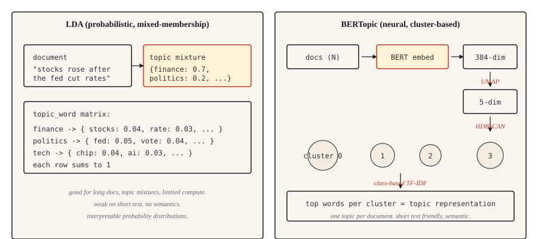

<!-- local-zh-machine-draft: English source is canonical; prose translated automatically, code/math preserved. -->

<a id="topic-modeling--lda-and-bertopic"></a>

# 主题建模 — LDA 和 BERTopic

> LDA：文档是主题的混合，主题是单词的分布。 BERTopic：embedding空间中的文档簇，簇就是主题。相同的目标，不同的分解。

**类型：** 了解
**语言：** Python
**先决条件：** 第 5 阶段·02 (BoW + TF-IDF)、第 5 阶段·03 (Word2Vec)
**时间：** ~45分钟

<a id="the-problem"></a>

## 问题

您有 10,000 个客户支持票证、50,000 篇新闻文章或 200,000 条推文。您需要在不阅读该集合的情况下了解该集合的内容。您没有标记类别。你甚至不知道有多少类别。

主题建模在没有监督的情况下回答了这个问题。给它一个语料库，获取一小组连贯的主题，并为每个文档获取这些主题的分布。

两个算法系列占主导地位。 LDA (2003) 将每个文档视为潜在主题的混合，并将每个主题视为单词的分布。 Inference 是贝叶斯。它仍然在生产中提供，您需要混合成员主题分配和可解释的单词级概率分布。

BERTopic (2020) 使用 BERT 对文档进行编码，使用 UMAP 降维，使用 HDBSCAN 进行聚类，并通过基于类的 TF-IDF 提取主题词。它在短文本、社交媒体以及任何语义相似性比单词重叠更重要的领域中获胜。一份文档有一个主题，这是长篇内容的限制。

本课程为两者建立直觉，并为给定语料库选择哪一个。

<a id="the-concept"></a>

## 概念



**LDA生成故事。** 每个主题都是单词的分布。每个文档都是主题的混合体。要在文档中生成单词，请从文档的混合中采样主题，然后从该主题的分布中采样单词。 Inference 逆转了这一点：给定观察到的单词，推断每个文档的主题分布和每个主题的单词分布。折叠吉布斯 sampling 或变分贝叶斯进行数学计算。

关键 LDA 输出：

- `doc_topic`：矩阵`(n_docs, n_topics)`，每行总和为1（文档的主题混合）。
- `topic_word`：矩阵`(n_topics, vocab_size)`，每行总和为1（主题的词分布）。

**BER主题管道.**

1. 使用句子 transformer 对每个文档进行编码（例如，`all-MiniLM-L6-v2`）。 384 维向量。
2. 使用 UMAP 将维度降低至约 5 维。 BERT embeddings 的亮度太高，不适合聚类。
3. 使用 HDBSCAN 进行集群。基于密度，产生可变大小的簇和“异常值”标签。
4. 对于每个集群，在集群的文档上计算基于类的 TF-IDF 以提取热门单词。

输出是每个文档一个主题（加上 -1 异常值标签）。 （可选）通过 HDBSCAN 的概率向量进行软隶属度。

```figure
topic-drift
```

<a id="build-it"></a>

## 动手实现

<a id="step-1-lda-via-scikit-learn"></a>

### 步骤1：通过scikit-learn进行LDA

```python
from sklearn.feature_extraction.text import CountVectorizer
from sklearn.decomposition import LatentDirichletAllocation
import numpy as np


def fit_lda(documents, n_topics=5, max_features=1000):
    cv = CountVectorizer(
        max_features=max_features,
        stop_words="english",
        min_df=2,
        max_df=0.9,
    )
    X = cv.fit_transform(documents)
    lda = LatentDirichletAllocation(
        n_components=n_topics,
        random_state=42,
        max_iter=50,
        learning_method="online",
    )
    doc_topic = lda.fit_transform(X)
    feature_names = cv.get_feature_names_out()
    return lda, cv, doc_topic, feature_names


def print_top_words(lda, feature_names, n_top=10):
    for idx, topic in enumerate(lda.components_):
        top_idx = np.argsort(-topic)[:n_top]
        words = [feature_names[i] for i in top_idx]
        print(f"topic {idx}: {' '.join(words)}")
```

注意：删除了停用词，min_df 和 max_df 过滤罕见和普遍存在的术语，CountVectorizer（不是 TfidfVectorizer），因为 LDA 需要原始计数。

<a id="step-2-bertopic-production"></a>

### 第 2 步：BERTopic（生产）

```python
from bertopic import BERTopic

topic_model = BERTopic(
    embedding_model="sentence-transformers/all-MiniLM-L6-v2",
    min_topic_size=15,
    verbose=True,
)

topics, probs = topic_model.fit_transform(documents)
info = topic_model.get_topic_info()
print(info.head(20))
valid_topics = info[info["Topic"] != -1]["Topic"].tolist()
for topic_id in valid_topics[:5]:
    print(f"topic {topic_id}: {topic_model.get_topic(topic_id)[:10]}")
```

`Topic != -1` 上的过滤器会删除 BERTopic 的异常值桶（文档 HDBSCAN 无法聚类）。 `min_topic_size` 控制HDBSCAN的最小簇大小； BERTopic 的库默认值为 10。本示例根据课程规模将其明确设置为 15。对于超过 10,000 个文档的语料库，增加到 50 或 100 个。

<a id="step-3-evaluation"></a>

### 步骤3：evaluation

两种方法都输出主题词。问题是这些词是否连贯。

- **主题连贯性 (c_v).** 在滑动窗口上下文中组合顶部单词对的 NPMI（标准化逐点互信息），将分数聚合为主题向量，并通过 cosine similarity 比较这些向量。越高越好。将 `gensim.models.CoherenceModel` 与 `coherence="c_v"` 一起使用。
- **主题多样性。** 所有主题的热门单词中唯一单词的比例。越高越好（主题不重叠）。
- **定性检查。** 阅读每个主题的顶部单词。他们命名的是真实的东西吗？人类的判断仍然是最后一道防线。

<a id="when-to-pick-which"></a>

## 什么时候选择哪个

| 情况 | 挑选 |
|-----------|------|
| 短文本（推文、评论、标题） | BER主题 |
| 主题混合的长文档 | LDA |
| 无 GPU / 有限计算 | LDA 或 NMF |
| 需要文档级多主题分布 | LDA |
| LLM 主题标签集成 | BERTopic（直接支持） |
| 资源受限的边缘部署 | LDA |
| 最大语义连贯性 | BER主题 |

最大的实际考虑因素是文档长度。 BERT embeddings 截断； LDA 计算任何长度的工作量。对于长于 embedding 模型上下文的文档，可以使用块 + 聚合或使用 LDA。

<a id="use-it"></a>

## 实际应用

2026 年堆栈：

- **BERTopic.** 短文本和语义重要的任何内容的默认值。
- **`gensim.models.LdaModel`.** 用于生产的经典LDA，成熟，经过实战检验。
- **`sklearn.decomposition.LatentDirichletAllocation`.** 用于实验的 Easy LDA。
- **NMF.** 非负矩阵分解。 LDA 的快速替代方案，短文本质量可比。
- **Top2Vec.** 与 BERTopic 类似的设计。社区较小，但在某些基准上表现良好。
- **FASTopic.** 在非常大的语料库上比 BERTopic 更新、更快。
- **LLM 基于标记。** 运行任何聚类，然后 prompt 一个模型来命名每个聚类。

<a id="ship-it"></a>

## 交付成果

另存为`outputs/skill-topic-picker.md`：

```markdown
---
name: topic-picker
description: Pick LDA or BERTopic for a corpus. Specify library, knobs, evaluation.
version: 1.0.0
phase: 5
lesson: 15
tags: [nlp, topic-modeling]
---

Given a corpus description (document count, avg length, domain, language, compute budget), output:

1. Algorithm. LDA / NMF / BERTopic / Top2Vec / FASTopic. One-sentence reason.
2. Configuration. Number of topics: `recommended = max(5, round(sqrt(n_docs)))`, clamped to 200 for corpora under 40,000 docs; permit >200 only when the corpus is genuinely large (>40k) and note the increased compute cost. `min_df` / `max_df` filters and embedding model for neural approaches also belong here.
3. Evaluation. Topic coherence (c_v) via `gensim.models.CoherenceModel`, topic diversity, and a 20-sample human read.
4. Failure mode to probe. For LDA, "junk topics" absorbing stopwords and frequent terms. For BERTopic, the -1 outlier cluster swallowing ambiguous documents.

Refuse BERTopic on documents longer than the embedding model's context window without a chunking strategy. Refuse LDA on very short text (tweets, reviews under 10 tokens) as coherence collapses. Flag any n_topics choice below 5 as likely wrong; flag >200 on corpora under 40k docs as likely over-splitting.
```

<a id="exercises"></a>

## 练习

1. **Easy.** 在 20 个新闻组数据集上用 5 个主题拟合 LDA。打印每个主题的前 10 个单词。手动标记每个主题。算法是否找到了真正的类别？
2. **Medium.** 将 BERTopic 拟合到相同的 20 个新闻组子集中。将找到的主题数量、热门词和定性一致性与 LDA 进行比较。哪个更清晰地呈现真实类别？
3. **Hard.** 计算语料库上 LDA 和 BERTopic 的 c_v 一致性。每个运行 5、10、20、50 个主题。情节连贯性与主题数量。报告哪种方法在主题数量上更稳定。

<a id="key-terms"></a>

## 关键术语

| 术语 | 人们怎么说 | 它实际上意味着什么 |
|------|-----------------|-----------------------|
| 主题 | 语料库是关于的一件事 | 单词 (LDA) 或相似文档簇 (BERTopic) 的概率分布。 |
| 混合会员制 | 文档有多个主题 | LDA 为每个文档分配所有主题的分布。 |
| 乌玛普 | 降维 | 保留局部结构的流形学习；用于 BERTopic。 |
| HDBS扫描 | 密度聚类 | 查找可变大小的簇；为异常值生成“噪声”标签 (-1)。 |
| c_v 一致性 | 主题质量指标 | 滑动窗口内热门主题词的平均逐点互信息。 |

<a id="further-reading"></a>

## 进一步阅读

- [Blei, Ng, Jordan (2003)。潜在狄利克雷分配](https://www.jmlr.org/papers/volume3/blei03a/blei03a.pdf) — LDA 论文。
- [Grootendorst (2022)。 BERTopic：使用基于类的 TF-IDF 过程进行神经主题建模](https://arxiv.org/abs/2203.05794) — BERTopic 论文。
- [罗德，两者，欣内堡 (2015)。 探索主题连贯性测量的空间](https://svn.aksw.org/papers/2015/WSDM_Topic_Evaluation/public.pdf)— 介绍 c 的论文_v 和朋友们。
- [BER主题文档](https://maartengr.github.io/BERTopic/) — 生产参考。优秀的例子。
