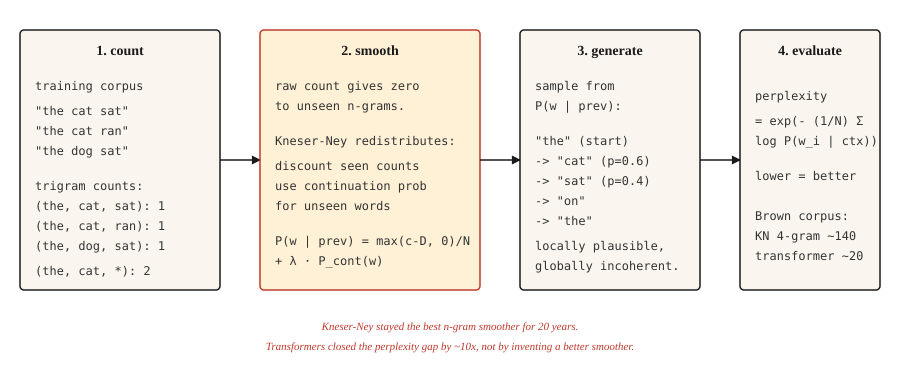

<!-- local-zh-machine-draft: English source is canonical; prose translated automatically, code/math preserved. -->

<a id="text-generation-before-transformers--n-gram-language-models"></a>

# Transformers 之前的文本生成 — N-gram 语言模型

> 如果某个词令人惊讶，则该模型很糟糕。 Perplexity 惊喜号码。平滑使其保持有限。

**类型：** 构建
**语言：** Python
**先决条件：** 第 5 阶段·01（文本处理）、第 2 阶段·14（朴素贝叶斯）
**时间：** ~45分钟

<a id="the-problem"></a>

## 问题

在 transformers 之前、RNNs 之前、单词 embeddings 之前，语言模型通过计算下一个单词跟随前一个 `n-1` 单词的频率来预测下一个单词。数“猫”→“坐”47次，“猫”→“跳”12次，“猫”→“冰箱”0次。标准化以获得概率分布。

那是一个 n-gram 语言模型。从 1980 年到 2015 年，它运行着每一个语音识别器、每一个拼写检查器和每一个基于短语的机器翻译系统。当你需要廉价的设备上语言建模时，它仍然可以运行。

有趣的问题是如何处理看不见的 n 元语法。基于原始计数的模型将零概率分配给它没有见过的任何事物，这是灾难性的，因为句子很长，而且几乎每个长句子都包含至少一个未见过的序列。五十年的平滑研究解决了这个问题。克尼瑟-内伊平滑就是其结果，现代深度学习继承了其经验传统。

<a id="the-concept"></a>

## 概念



<a id="the-prediction-game"></a>

### 预测游戏

在任何这种机器出现之前，一项实验定义了语言模型是什么。覆盖英语句子的下一个字母。请某人猜，一次猜一个，直到猜对为止。写下猜测数。重复数百个字母。

猜测计数并不是琐事。它们是文本的无损重新编码：将计数序列交给第二个相同的猜测者，他们可以重建每个字母，因为在每个位置他们确切地知道哪个猜测最先出现。您可以用更少的符号重新编码的消息，每个符号携带的信息更少，因此猜测计数统计数据为英语的熵设置了上限。

香农 (Shannon) 在 1951 年进行了这项研究，并得到了一个至今仍主导该领域的数字。 27 个符号的字母表（26 个字母加空格）每个字母可以携带 `log2(27) ≈ 4.75` 位。人类猜测 100 个字母的上下文，每个字母的位数在 0.6 到 1.3 位之间。英语大约有四分之三是强迫动作。在任何模型学习之前，必须测量模型必须学习的结构。

此后的每个语言模型都是这个游戏的机械玩家，本课中的每个 evaluation 数字都是游戏得分：

- **Cross-entropy loss** 是模型每个符号所需的平均位数。训练 LM 实际上就是最小化它在猜谜游戏中的得分。
- **Perplexity** 是 `2^bits`（或 `e^nats`）：猜测后模型仍然面临的分支因子。统一猜测27个符号为perplexity 27；每个字母 1 位的播放器有 perplexity 2。
- **上下文长度是玩家的记忆。** 三元模型使用两个 tokens 的记忆。 transformer 与 100K tokens 玩同样的游戏。规则从未改变；球员变得更好了。

一个单位切换到跟踪：游戏中每个字母的分数（以位为单位）（`log2`），而下面的 n 元语法公式为 nats 中的每个单词分数 token（自然对数） - 并且因为 nats 中的 perplexity `e^H` 等于 `2^H`以比特为单位，两个视图是不同单位的相同测量。

```figure
prediction-game
```

**N-克概率：** `P(w_i | w_{i-n+1}, ..., w_{i-1})`。修复 `n`（通常为三元组 3 个，4 元组 4 个）。根据计数计算：

```text
P(w | context) = count(context, w) / count(context)
```

**零计数问题。** 训练中未见过的任何 n-gram 概率为零。 2007 年对 Brown 语料库的一项研究发现，即使是 4 克模型，也有 30% 的 4 克模型在训练中未见。如果不进行平滑处理，则无法对任何真实文本进行评估。

**平滑方法，按复杂程度排列：**

1. **Laplace（加一）。** 每次计数加 1。简单，但在罕见事件上却很糟糕。
2. **Good-Turing.** 根据频率的频率将概率质量从高频事件重新分配给看不见的事件。
3. **Interpolation.** 结合n-gram、(n-1)-gram等，用可调weights进行估计。
4. **Backoff.** 如果 n-gram 的计数为零，则回退到 (n-1)-gram。卡茨退避使这一点正常化。
5. **绝对折扣。** 从所有计数中减去固定折扣`D`，重新分配给看不见的。
6. **Kneser-Ney.** 绝对折扣加上低阶模型的巧妙选择：使用 * 连续概率 * （单词出现在多少个上下文中）而不是原始频率。

克内瑟-内伊的见解是深刻的。 “旧金山”是一个常见的二元组。 Unigram“Francisco”主要出现在“San”之后。朴素的绝对折扣给出了“Francisco”较高的一元概率（因为计数很高）。 Kneser-Ney 注意到“Francisco”仅出现在一种上下文中，并相应降低了其连续概率。结果：以“Francisco”结尾的新颖二元组获得适当的低概率。

**Evaluation：perplexity.** 保留测试集上每个单词的平均负对数似然指数。越低越好。 perplexity 为 100 意味着模型很混乱，因为它会在 100 个单词中进行统一选择。

```text
perplexity = exp(- (1/N) * Σ log P(w_i | context_i))
```

```figure
ngram-backoff
```

<a id="build-it"></a>

## 动手实现

<a id="step-1-trigram-counts"></a>

### 第 1 步：卦数

```python
from collections import Counter, defaultdict


def train_ngram(corpus_tokens, n=3):
    ngrams = Counter()
    contexts = Counter()
    for sentence in corpus_tokens:
        padded = ["<s>"] * (n - 1) + sentence + ["</s>"]
        for i in range(len(padded) - n + 1):
            ctx = tuple(padded[i:i + n - 1])
            word = padded[i + n - 1]
            ngrams[ctx + (word,)] += 1
            contexts[ctx] += 1
    return ngrams, contexts


def raw_probability(ngrams, contexts, context, word):
    ctx = tuple(context)
    if contexts.get(ctx, 0) == 0:
        return 0.0
    return ngrams.get(ctx + (word,), 0) / contexts[ctx]
```

输入是标记化句子的列表。输出是 n 元语法计数和上下文计数。 `<s>` 和 `</s>` 是句子边界。

<a id="step-2-laplace-smoothing"></a>

### 步骤 2：拉普拉斯平滑

```python
def laplace_probability(ngrams, contexts, vocab_size, context, word):
    ctx = tuple(context)
    numerator = ngrams.get(ctx + (word,), 0) + 1
    denominator = contexts.get(ctx, 0) + vocab_size
    return numerator / denominator
```

每次计数加 1。平滑但过度分配未见过的事件的质量，也会损害罕见的已知事件。

<a id="step-3-kneser-ney-bigram-interpolated"></a>

### 步骤 3：Kneser-Ney（二元组，插值）

```python
def kneser_ney_bigram_model(corpus_tokens, discount=0.75):
    unigrams = Counter()
    bigrams = Counter()
    unigram_contexts = defaultdict(set)

    for sentence in corpus_tokens:
        padded = ["<s>"] + sentence + ["</s>"]
        for i, w in enumerate(padded):
            unigrams[w] += 1
            if i > 0:
                prev = padded[i - 1]
                bigrams[(prev, w)] += 1
                unigram_contexts[w].add(prev)

    total_unique_bigrams = sum(len(ctx_set) for ctx_set in unigram_contexts.values())
    continuation_prob = {
        w: len(ctx_set) / total_unique_bigrams for w, ctx_set in unigram_contexts.items()
    }

    context_totals = Counter()
    for (prev, w), count in bigrams.items():
        context_totals[prev] += count

    unique_follow = defaultdict(set)
    for (prev, w) in bigrams:
        unique_follow[prev].add(w)

    def prob(prev, w):
        count = bigrams.get((prev, w), 0)
        denom = context_totals.get(prev, 0)
        if denom == 0:
            return continuation_prob.get(w, 1e-9)
        first_term = max(count - discount, 0) / denom
        lambda_prev = discount * len(unique_follow[prev]) / denom
        return first_term + lambda_prev * continuation_prob.get(w, 1e-9)

    return prob
```

三个活动部件。 `continuation_prob` 捕获“这个词出现在多少个不同的上下文中？” （Kneser-Ney 创新）。 `lambda_prev` 是折扣释放的质量，用于 weight 回退。最终概率是贴现主项加上加权连续项。

<a id="step-4-generating-text-with-sampling"></a>

### 第四步：用sampling生成文本

```python
import random


def generate(prob_fn, vocab, prefix, max_len=30, seed=0):
    rng = random.Random(seed)
    tokens = list(prefix)
    for _ in range(max_len):
        candidates = [(w, prob_fn(tokens[-1], w)) for w in vocab]
        total = sum(p for _, p in candidates)
        r = rng.random() * total
        acc = 0.0
        for w, p in candidates:
            acc += p
            if r <= acc:
                tokens.append(w)
                break
        if tokens[-1] == "</s>":
            break
    return tokens
```

Sampling 与概率成正比。每个种子总是给出不同的输出。对于类似波束搜索的输出，在每一步选择 argmax（贪婪）并添加一个小的随机旋钮 (temperature)。

<a id="step-5-perplexity"></a>

### 步骤5：perplexity

```python
import math


def perplexity(prob_fn, sentences):
    total_log_prob = 0.0
    total_tokens = 0
    for sentence in sentences:
        padded = ["<s>"] + sentence + ["</s>"]
        for i in range(1, len(padded)):
            p = prob_fn(padded[i - 1], padded[i])
            total_log_prob += math.log(max(p, 1e-12))
            total_tokens += 1
    return math.exp(-total_log_prob / total_tokens)
```

越低越好。对于 Brown 语料库，经过精心调整的 4 克 KN 模型的 perplexity 的得分约为 140。transformer LM 在同一测试集上的得分为 15-30。差距约为10倍。这种差距就是这个领域继续发展的原因。

<a id="use-it"></a>

## 实际应用

- **经典NLP教学。** 最清晰的接触平滑、MLE，以及perplexity 你能得到。
- **KenLM.** 生产n-gram库。在低延迟很重要的语音和 MT 系统中用作重新记录器。
- ** 设备上自动完成。** 键盘中的 Trigram 模型。仍然。
- **Baselines.** 在声明你的神经 LM 良好之前，始终计算一个 n-gram LM perplexity。如果你的 transformer 没有大幅击败 KN，那就是出了问题。

<a id="ship-it"></a>

## 交付成果

另存为 `outputs/prompt-lm-baseline.md`：

```markdown
---
name: lm-baseline
description: Build a reproducible n-gram language model baseline before training a neural LM.
phase: 5
lesson: 16
---

Given a corpus and target use (next-word prediction, rescoring, perplexity baseline), output:

1. N-gram order. Trigram for general English, 4-gram if corpus is large, 5-gram for speech rescoring.
2. Smoothing. Modified Kneser-Ney is the default; Laplace only for teaching.
3. Library. `kenlm` for production, `nltk.lm` for teaching, roll your own only to learn.
4. Evaluation. Held-out perplexity with consistent tokenization between train and test sets.

Refuse to report perplexity computed with different tokenization between systems being compared — perplexity numbers are comparable only under identical tokenization. Flag OOV rate in test set; KN handles OOV poorly unless you reserve a special <UNK> token during training.
```

<a id="exercises"></a>

## 练习

1. **Easy.** 在 1,000 个句子的莎士比亚语料库上训练 trigram LM。生成 20 个句子。它们在局部上是合理的，但在全局上却是不连贯的。这是规范的演示。
2. **Medium.** 在保留的莎士比亚拆分上为您的 KN 模型实施 perplexity。与拉普拉斯进行比较。您应该看到 KN 比 perplexity 低 30-50%。
3. **Hard.** 构建一个 trigram 拼写校正器：给定一个拼写错误的单词及其上下文，生成更正并根据 LM 下的上下文概率进行排名。对 Birkbeck 拼写语料库（公共）进行评估。

<a id="key-terms"></a>

## 关键术语

| 术语 | 人们怎么说 | 它实际上意味着什么 |
|------|-----------------|-----------------------|
| N-gram | 词序 | `n` 连续 tokens 的序列。 |
| 平滑 | 避免零 | 重新分配概率质量，使未见过的事件获得非零概率。 |
| Perplexity | LM质量指标 | `exp(-average log-prob)` 关于保留的数据。越低越好。 |
| 退避 | 回退到较短的上下文 | 如果三元组计数为零，则使用二元组。卡茨退避正式化了这一点。 |
| 克内瑟-内伊 | n 元模型的最佳平滑 | 低阶模型的绝对贴现+连续概率。 |
| 延续概率 | KN 特定 | `P(w)` 按 `w` 出现的上下文数量加权，而不是按原始计数。 |
| 文本熵 | 每个符号的信息 | 在给定上下文的情况下对下一个符号进行编码所需的平均比特数。 Shannon 在 1951 年对包含最多 100 个上下文字母的印刷英语进行了估计：0.6-1.3 位/字母，在任何模型存在之前进行测量。 |

<a id="further-reading"></a>

## 进一步阅读

- [香农（1951）。印刷英语的预测和熵](https://www.princeton.edu/~wbialek/rome/refs/shannon_51.pdf) - 猜谜游戏实验，定义了每种语言模型仍在优化的目标。
- [Jurafsky 和 Martin — 语音和语言处理，第 3 章（2026 年草案）](https://web.stanford.edu/~jurafsky/slp3/3.pdf) — n-gram LM 和平滑的规范处理。
- [Chen 和古德曼 (1998)。 An Empirical Study of Smoothing Techniques for Language Modeling](https://dash.harvard.edu/handle/1/25104739) — 这篇论文将 Kneser-Ney 确定为最佳 n 元语法平滑器。
- [Kneser 和 Ney (1995)。 M-gram 语言建模的改进后退](https://ieeexplore.ieee.org/document/479394) — 原始 KN 论文。
- [KenLM](https://kheafield.com/code/kenlm/) - 快速生产 n-gram LM，在 2026 年仍用于延迟敏感的应用程序。
