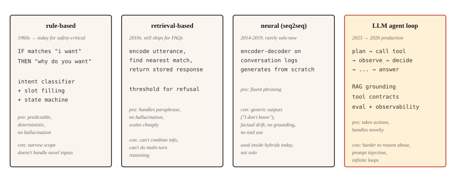

<!-- local-zh-machine-draft: English source is canonical; prose translated automatically, code/math preserved. -->

<a id="chatbots--rule-based-to-neural-to-llm-agents"></a>

# 聊天机器人——从规则系统到神经网络，再到 LLM Agents

> ELIZA 回复了模式匹配。 DialogFlow 映射意图。 GPT 从 weights 回复。 Claude 运行工具并验证。每个时代都解决了前一个时代最严重的失败。

**类型：** 了解
**语言：** Python
**先决条件：** 第 5·13 阶段（问答）、第 5·14 阶段（信息检索）
**时间：** ~75分钟

<a id="the-problem"></a>

## 问题

用户说“我想更改航班”。系统必须弄清楚他们想要什么、缺少哪些信息、如何获取信息以及如何完成操作。然后用户说“等等，如果我取消怎么办？”系统必须记住上下文、切换任务并保存状态。

对于机器学习系统来说，对话是很困难的。输入是开放式的。输出必须在多圈内保持一致。系统可能需要对世界采取行动（更改航班、充值卡）。每个错误的步骤对用户来说都是可见的。

聊天机器人架构已经经历了四种范式，每一种范式的引入都是因为前一种范式的失败太过明显。本课将按顺序介绍它们。 2026 年的生产前景是后两者的混合体。

<a id="the-concept"></a>

## 概念



<a id="the-scripted-half-century-1950-2001"></a>

### 脚本化的半个世纪，1950-2001

第一个范式并没有持续五年。持续了五十年。了解它的弧线很重要，因为其中的每个系统都是同一台机器——匹配输入、发出预设响应、更新一点状态——而向该机器添加规则五十年来从未产生过一般情况。这个上限就是范式二到四存在的原因。

**1950.** 图灵回避了“机器能思考吗？”通过提出操作性替代方案：如果审讯者无法通过电传打字机区分机器和人，那么这个哲学问题就毫无意义了。在该领域有名字之前，对话就成为该领域的基准。

**1956.** 这个名字由此而来——达特茅斯的一个夏季研讨会创造了“人工智能”，其猜想是每一个 feature 的智能“原则上都可以如此精确地描述，以至于可以制造一台机器来模拟它”。该提案预算两个月内取得实质性进展。

**1966.** ELIZA 提供您在步骤 1 中构建的反射技巧：分解规则从输入中提取片段，重组规则将它们作为问题回显。总共大约 200 种模式，零状态，零理解——而且用户无论如何都会吐露心声。魏森鲍姆在他职业生涯的 rest 中度过了他的职业生涯，他对所用的机器如此之少感到震惊。

**1972.** PARRY 是在斯坦福大学构建的用于模拟偏执狂的模型，它添加了 ELIZA 所缺乏的部分：内部状态。恐惧、愤怒和不信任的数字变量在脚本接下来触发的每个回合和门上都会更新，因此相同的输入会根据迄今为止的对话产生不同的响应。在盲态转录测试中，精神科医生偶然将 PARRY 与人类患者区分开来。它是角色调节的直接祖先 - system prompt 作为三个浮点数实现。同年，这两个机器人通过阿帕网互相攻击：治疗师脚本采访偏执状态机，这是网络上的第一次机器人对机器人对话。

**1995.** ALICE 使用 AIML（一种用于模式模板对的 XML 方言）缩放 ELIZA 配方。大约 40,000 个手写类别，三项洛布纳奖获得者。它证明了基于规则的系统的缩放法则：更多的规则购买覆盖范围，而不是通用性。每条规则都是必须有人维护的责任。

**2001.** SmarterChild 将菜谱呈现在 3000 万即时通讯用户面前，并添加后端查找（天气、股票、电影时间），并将其拼接到模板中。眯着眼睛一看，是穿着 2001 年服装的 tool calling：解析意图，调用服务，将结果呈现到回复中。

五十年，一套机制，规则不断提升。该范例的结束并不是因为有人反驳了它，而是因为手写状态机的维护成本随着覆盖范围的增加而线性增长，而用户的期望随着他们上周看到的内容而增长。

```figure
chatbot-lineage
```

** 基于规则（ELIZA、AIML、DialogFlow）。** 手动编写的模式匹配用户输入并生成响应。意图分类器路由到预定义的流。槽填充状态机收集所需的信息。在其设计的狭窄范围内表现出色。在它之外立即失败。仍然在不容忍 hallucination 的安全关键领域（银行身份验证、航空公司预订）中发货。

** 基于检索。** FAQ 式系统。对每一对（话语、响应）进行编码。在运行时，对用户的消息进行编码并检索最近的存储响应。想想Zendesk的经典“类似文章”feature。处理释义比处理规则更好。没有生成，所以没有hallucination。

**Neural (seq2seq).** Encoder-decoder 在对话日志上进行训练。从头开始生成响应。流畅，但容易出现通用输出（“我不知道”）和事实偏差。从不可靠地谈论主题。这就是谷歌、Facebook 和微软在 2016 年至 2019 年的聊天机器人都令人失望的原因。

**LLM agents.** 封装在循环中的语言模型，用于计划、调用工具和验证结果。不是一个带有长 prompt 的聊天机器人。 An agent loop：计划→调用工具→观察结果→决定下一步。检索优先 grounding (RAG) 可以防止它产生幻觉。 Tool calls让它实际做事。这是2026年的架构。

这四种范式不是顺序替换的。 2026 年生产的聊天机器人将通过所有四个路径：基于规则的身份验证和破坏性操作、常见问题解答检索、自然措辞的神经生成、LLM agent 用于模糊的开放式查询。

<a id="build-it"></a>

## 动手实现

<a id="step-1-rule-based-pattern-matching"></a>

### 第 1 步：基于规则的模式匹配

```python
import re


class RulePattern:
    def __init__(self, pattern, response_template):
        self.regex = re.compile(pattern, re.IGNORECASE)
        self.template = response_template


PATTERNS = [
    RulePattern(r"my name is (\w+)", "Nice to meet you, {0}."),
    RulePattern(r"i (need|want) (.+)", "Why do you {0} {1}?"),
    RulePattern(r"i feel (.+)", "Why do you feel {0}?"),
    RulePattern(r"(.*)", "Tell me more about that."),
]


def rule_based_respond(user_input):
    for pattern in PATTERNS:
        m = pattern.regex.match(user_input.strip())
        if m:
            return pattern.template.format(*m.groups())
    return "I don't understand."
```

ELIZA 共 20 行。反思技巧（“我感到悲伤”→“你为什么感到悲伤”）是 Weizenbaum 1966 年的经典心理治疗师演示。仍然具有启发性。

<a id="step-2-retrieval-based-faq"></a>

### 第 2 步：基于检索（常见问题解答）

此说明性片段需要 `pip install sentence-transformers`（拉动火炬）。本课程的可运行 `code/main.py` 使用 stdlib Jaccard 相似性，因此本课程运行时无需外部依赖项。

```python
from sentence_transformers import SentenceTransformer
import numpy as np


FAQ = [
    ("how do i reset my password", "Go to Settings > Security > Reset Password."),
    ("how do i cancel my order", "Go to Orders, find the order, click Cancel."),
    ("what is your return policy", "30-day returns on unused items, original packaging."),
]


encoder = SentenceTransformer("sentence-transformers/all-MiniLM-L6-v2")
faq_questions = [q for q, _ in FAQ]
faq_embeddings = encoder.encode(faq_questions, normalize_embeddings=True)


def faq_respond(user_input, threshold=0.5):
    q_emb = encoder.encode([user_input], normalize_embeddings=True)[0]
    sims = faq_embeddings @ q_emb
    best = int(np.argmax(sims))
    if sims[best] < threshold:
        return None
    return FAQ[best][1]
```

基于阈值的拒绝是关键的设计选择。如果最佳匹配不够接近，则返回 `None` 并让系统升级。

<a id="step-3-neural-generation-baseline"></a>

### 第 3 步：神经生成（基线）

使用小型指令调整 encoder-decoder (FLAN-T5) 或微调对话模型。到 2026 年，它本身将无法使用（矛盾、偏离主题、胡说八道），但可以在混合系统中进行自然措辞。 DialoGPT 风格的 decoder-only 模型需要显式的回合分隔符和 EOS 处理来产生连贯的回复； FLAN-T5 text2text 管道开箱即用，用于教学示例。

```python
from transformers import pipeline

chatbot = pipeline("text2text-generation", model="google/flan-t5-small")

response = chatbot("Respond politely to: Hi there!", max_new_tokens=40)
print(response[0]["generated_text"])
```

<a id="step-4-llm-agent-loop"></a>

### 步骤4：LLM agent loop

2026年生产形状：

```python
def agent_loop(user_message, tools, llm, max_steps=5):
    history = [{"role": "user", "content": user_message}]
    for _ in range(max_steps):
        response = llm(history, tools=tools)
        tool_call = response.get("tool_call")
        if tool_call:
            tool_name = tool_call.get("name")
            args = tool_call.get("arguments")
            if not isinstance(tool_name, str) or tool_name not in tools:
                history.append({"role": "assistant", "tool_call": tool_call})
                history.append({"role": "tool", "name": str(tool_name), "content": f"error: unknown tool {tool_name!r}"})
                continue
            if not isinstance(args, dict):
                history.append({"role": "assistant", "tool_call": tool_call})
                history.append({"role": "tool", "name": tool_name, "content": f"error: arguments must be a dict, got {type(args).__name__}"})
                continue
            fn = tools[tool_name]
            result = fn(**args)
            history.append({"role": "assistant", "tool_call": tool_call})
            history.append({"role": "tool", "name": tool_name, "content": result})
        else:
            return response["content"]
    return "I could not complete the task in the step budget."
```

三件事要命名。工具是 LLM 可以调用的可调用函数。当 LLM 返回最终答案而不是 tool call 时，循环终止。步骤预算可防止在不明确的任务上出现无限循环。

实际生产添加：检索优先 grounding（在每次 LLM 调用之前注入相关文档）、guardrails（拒绝未经确认的破坏性操作）、observability（记录每个步骤）和 evaluations（自动检查agent 行为保持符合规范）。

<a id="step-5-hybrid-routing"></a>

### 步骤5：混合路由

```python
def hybrid_chat(user_input):
    if is_destructive_action(user_input):
        return structured_flow(user_input)

    faq_answer = faq_respond(user_input, threshold=0.6)
    if faq_answer:
        return faq_answer

    return agent_loop(user_input, tools, llm)


def is_destructive_action(text):
    danger_words = ["delete", "cancel", "charge", "refund", "transfer"]
    return any(w in text.lower() for w in danger_words)
```

模式：针对任何破坏性事物的确定性规则，针对预设常见问题解答的检索，针对其他所有内容的 LLM agents。这就是 2026 年客户支持系统中提供的内容。

<a id="use-it"></a>

## 实际应用

2026 年堆栈：

| 应用场景 | 建筑 |
|---------|---------------|
| 预订、支付、认证 | 基于规则的状态机+槽填充 |
| 客户支持常见问题解答 | 检索精选答案 |
| 开放式帮助聊天 | LLM agent 与 RAG + tool calls |
| 内部工具/IDE助手 | LLM agent 与 tool calls（搜索、读取、写入） |
| 同伴/角色聊天机器人 | 使用角色 system prompt 调整 LLM，知识检索 |

在生产中始终使用混合路由。没有单一的架构能够很好地处理每个请求。路由层本身通常是一个小型意图分类器。

<a id="failure-modes-that-still-ship"></a>

## 仍然存在的故障模式

- **自信捏造。** LLM agent 声称它完成了一项实际上没有完成的操作。缓解措施：验证结果，记录 tool calls，永远不要让 LLM 声称在没有成功工具返回的情况下完成了某些操作。
- **Prompt injection.** 用户插入覆盖 system prompt 的文本。 LLM01 在 2025 年 LLM 应用程序的 OWASP 前 10 名中排名。两种风格：直接注入（粘贴到聊天中）和间接注入（隐藏在 agent 读取的文档、电子邮件或工具输出中）。

  攻击率因场景而异。在一般工具使用和编码基准测试中，前沿模型的测量成功率范围约为 0.5-8.5%。特定的高风险设置（针对 AI coding agents、易受攻击的 orchestration 的自适应攻击）已达到约 84%。生产 CVE 包括 EchoLeak（CVE-2025-32711、CVSS 9.3）——Microsoft 365 Copilot 中的一个零点击数据泄露缺陷，由攻击者控制的电子邮件触发。

  缓解措施：在整个循环中将用户输入视为不可信；消毒前tool calls；将工具输出与主 prompt 隔离；使用计划-验证-执行 (PVE) 模式，其中 agent 首先进行计划，然后在执行之前根据该计划验证每个操作（这会阻止工具注入新的计划外操作）；要求用户确认破坏性行为；将最小权限应用于工具范围。

  再多的 prompt engineering 也无法完全消除这种风险。需要外部运行时防御层（LLM Guard、白名单验证、语义异常检测）。
- **范围蔓延。** Agent偏离任务，因为tool call返回切向相关信息。 缓解措施：范围狭窄tool contracts; 保留system prompt专注； 添加evaluations为脱任务率。
- **无限循环。** Agent 不断调用同一个工具。缓解措施：逐步预算、工具调用重复数据删除、LLM 判断“我们是否取得进展”。
- **Context window 精疲力尽。** 长时间的对话会导致最早的对话断章取义。缓解措施：总结较旧的回合，通过相似性检索相关的过去回合，或使用长上下文模型。

<a id="ship-it"></a>

## 交付成果

另存为 `outputs/skill-chatbot-architect.md`：

```markdown
---
name: chatbot-architect
description: Design a chatbot stack for a given use case.
version: 1.0.0
phase: 5
lesson: 17
tags: [nlp, agents, chatbot]
---

Given a product context (user need, compliance constraints, available tools, data volume), output:

1. Architecture. Rule-based, retrieval, neural, LLM agent, or hybrid (specify which paths go where).
2. LLM choice if applicable. Name the model family (Claude, GPT-4, Llama-3.1, Mixtral). Match to tool-use quality and cost.
3. Grounding strategy. RAG sources, retrieval method (see lesson 14), tool contracts.
4. Evaluation plan. Task success rate, tool-call correctness, off-task rate, hallucination rate on held-out dialogs.

Refuse to recommend a pure-LLM agent for any destructive action (payments, account deletion, data modification) without a structured confirmation flow. Refuse to skip the prompt-injection audit if the agent has write access to anything.
```

<a id="exercises"></a>

## 练习

1. **Easy.** 使用咖啡店订购机器人的 10 种模式实现上述基于规则的响应。测试边缘情况：双重订单、修改、取消、意图不明确。
2. **Medium.** 构建混合常见问题解答 + LLM 后备。 SaaS 产品的 50 个固定常见问题解答条目，LLM 通过文档站点进行检索的后备。衡量 100 个真实支持问题的拒绝率和准确性。
3. **Hard.** 使用三个工具（搜索、读取用户数据、发送电子邮件）实现上述 agent loop。运行 evaluation 并进行 50 个测试场景，包括 prompt injection 尝试。报告任务失败率、任务失败率以及任何注入成功率。

<a id="key-terms"></a>

## 关键术语

| 术语 | 人们怎么说 | 它实际上意味着什么 |
|------|-----------------|-----------------------|
| 意图 | 用户想要什么 | 分类标签（book_flight，重置_password）。路由到处理程序。 |
| 插槽 | 一条信息 | Parameter 机器人需要（日期、目的地）。槽位填充是询问的顺序。 |
| RAG | 检索加生成 | 检索相关文档，然后接地 LLM 的响应。 |
| Tool call | 函数调用 | LLM 发出带有名称+参数的结构化调用。运行时执行，返回结果。 |
| Agent loop | 计划、行动、验证 | 运行 LLM 的控制器与 tool calls 交错调用，直到任务完成。 |
| Prompt injection | 用户攻击prompt | 尝试覆盖 system prompt 的恶意输入。 |

<a id="further-reading"></a>

## 进一步阅读

- [图灵（1950）。计算机器与智能](https://academic.oup.com/mind/article/LIX/236/433/986238)——这篇论文使对话成为该领域的基准。
- [Weizenbaum (1966)。 ELIZA — 用于研究自然语言通信的计算机程序](https://web.stanford.edu/class/cs124/p36-weizenabaum.pdf) — 原始的基于规则的聊天机器人论文。
- [科尔比，韦伯，希尔夫（1971）。人工偏执](https://doi.org/10.1016/0004-3702(71)90002-6) - PARRY 的情感变量架构，第一个有状态的聊天机器人。
- [Thoppilan 等人。 （2022）。 LaMDA：对话应用程序的语言模型](https://arxiv.org/abs/2201.08239) - Google 最新的神经聊天机器人论文，就在 LLM agents 接管之前。
- [Yao 等人。 （2022）。 ReAct：在语言模型中协同推理和行动](https://arxiv.org/abs/2210.03629) - 命名 agent loop 模式的论文。
- [Anthropic 关于构建有效 agents](https://www.anthropic.com/research/building-effective-agents) 的指南 - 2024 年生产指南在 2026 年仍然有效。
- [Gresshake 等人。 （2023）。不是您注册的内容：使用 Indirect Prompt Injection](https://arxiv.org/abs/2302.12173) 破坏真实世界的 LLM-集成应用程序 — prompt 注入论文。
- [OWASP LLM 应用程序 2025 年前 10 名 — LLM01 Prompt Injection](https://genai.owasp.org/llmrisk/llm01-prompt-injection/) — 该排名使 prompt injection 成为顶级安全产品关心。
- [AWS — 保护 Amazon Bedrock Agents 免受 Indirect Prompt Injections](https://aws.amazon.com/blogs/machine-learning/securing-amazon-bedrock-agents-a-guide-to-safeguarding-against-indirect-prompt-injections/) — 实用的 orchestration 层防御，包括计划-验证-执行和用户确认流程。
- [EchoLeak (CVE-2025-32711)](https://www.vectra.ai/topics/prompt-injection) — 来自 indirect prompt injection 的规范零点击数据泄露 CVE。为什么写访问 agents 需要运行时防御的参考案例。
