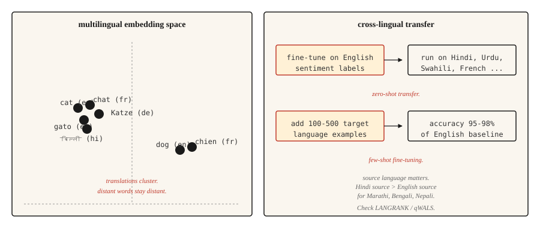

<!-- local-zh-machine-draft: English source is canonical; prose translated automatically, code/math preserved. -->

<a id="multilingual-nlp"></a>

# 多语言自然语言处理

> 一种模型，100 多种语言，其中大多数语言的训练数据为零。跨语言迁移是 2020 年代的实用奇迹。

**类型：** 了解
**语言：** Python
**先决条件：** 第 5 阶段·04（GloVe、FastText、Subword）、第 5 阶段·11（机器翻译）
**时间：** ~45分钟

<a id="the-problem"></a>

## 问题

英语有数十亿个带标签的例子。乌尔都语有数千种。迈蒂利几乎没有。任何为全球受众服务的实用 NLP 系统都必须在不存在特定任务训练数据的长尾语言上工作。

多语言模型通过同时在多种语言上训练一个模型来解决这个问题。共享表示使模型能够将在高资源语言中学到的技能转移到低资源语言中。根据英语情绪分析对模型进行微调，它可以对乌尔都语产生令人惊讶的良好情绪预测。这就是 zero-shot 跨语言传输，它重塑了 NLP 走向世界的方式。

本课程列出了权衡、规范模型，以及让刚接触多语言工作的团队做出的一个决定：选择一种源语言进行迁移。

<a id="the-concept"></a>

## 概念



**Shared vocabulary.** 多语言模型使用 SentencePiece 或 WordPiece tokenizer 训练所有目标语言的文本。 vocabulary 是共享的：相同的子词单元在相关语言中表示相同的语素。英语和意大利语中的 `anti-` 得到相同的 token。

**共享表示。** 在多种语言的掩码语言模型上进行预训练的 transformer 可以了解到不同语言中语义相似的句子会产生相似的隐藏状态。 mBERT、XLM-R 和 NLLB 都体现了这一点。 Embeddings 英语中的“cat”聚集在法语中的“chat”和西班牙语中的“gato”附近，整个句子 embeddings 也是如此。

**Zero-shot 传输。** 在一种语言（通常是英语）的标记数据上微调模型。在 inference 上，在模型支持的任何其他语言上运行它。不需要目标语言标签。对于类型相关的语言，结果较强，而对于相距较远的语言，结果较弱。

**Few-shot fine-tuning.** 添加 100-500 个目标语言的标记示例。分类任务的准确率跃升至英语基线的 95-98%。这是多语言 NLP 中最具成本效益的杠杆。

<a id="the-models"></a>

## 型号

| 模型 | 年份 | 覆盖范围 | 注释 |
|-------|------|----------|-------|
| mBERT | 2018 | 104种语言 | 在维基百科上接受过培训。第一个实用的多语言 LM。资源匮乏，能力薄弱。 |
| XLM-R | 2019 | 100种语言 | 在 CommonCrawl（比维基百科大得多）上接受过培训。设置跨语言基线。底座270M，大型550M。 |
| XLM-V | 2023 | 100种语言 | XLM-R 与 1M-token vocabulary（对比 250k）。资源匮乏时效果更好。 |
| mT5 | 2020 | 101 种语言 | 用于多语言生成的 T5 架构。 |
| NLLB-200 | 2022 | 200种语言 | Meta的翻译模型；包括 55 种低资源语言。 |
| 绽放 | 2022 | 46 种语言 + 13 种编程 | 打开 176B LLM 接受多语言培训。 |
| 绫23 | 2024 | 23种语言 | Cohere 的多语言 LLM。精通阿拉伯语、印地语、斯瓦希里语。 |

按用例选择。分类与 XLM-R-base 作为正常默认值配合良好。生成任务需要 mT5 或 NLLB，具体取决于翻译与开放生成。 LLM 风格的工作与 Aya-23 或 Claude 使用明确的多语言提示进行配对。

<a id="the-source-language-decision-2026-research"></a>

## 源语言决定（2026 年研究）

大多数团队默认使用英语作为 fine-tuning 源。最近的研究（2026）表明这通常是错误的。

语言相似性比原始语料库大小更好地预测传输质量。对于斯拉夫目标，德语或俄语常常胜过英语。对于印度语目标，印地语通常胜过英语。 **qWALS** 相似性度量（2026 年，基于世界语言结构地图集 features）对此进行了量化。 **LANGRANK**（Lin 等人，ACL 2019）是一种独立的早期方法，根据语言相似性、语料库大小和遗传相关性的组合对候选源语言进行排名。

实用规则：如果您的目标语言有类型上接近的高资源亲戚，请先在该语言上尝试 fine-tuning，然后与英语微调进行比较。

```figure
n5-crosslingual-bridge
```

<a id="build-it"></a>

## 动手实现

<a id="step-1-zero-shot-cross-lingual-classification"></a>

### 步骤1：zero-shot跨语言分类

```python
from transformers import AutoTokenizer, AutoModelForSequenceClassification
import torch

tok = AutoTokenizer.from_pretrained("joeddav/xlm-roberta-large-xnli")
model = AutoModelForSequenceClassification.from_pretrained("joeddav/xlm-roberta-large-xnli")


def classify(text, candidate_labels, hypothesis_template="This text is about {}."):
    scores = {}
    for label in candidate_labels:
        hypothesis = hypothesis_template.format(label)
        inputs = tok(text, hypothesis, return_tensors="pt", truncation=True)
        with torch.no_grad():
            logits = model(**inputs).logits[0]
        entail_score = torch.softmax(logits, dim=-1)[2].item()
        scores[label] = entail_score
    return dict(sorted(scores.items(), key=lambda x: -x[1]))


print(classify("I love this product!", ["positive", "negative", "neutral"]))
print(classify("मुझे यह उत्पाद पसंद है!", ["positive", "negative", "neutral"]))
print(classify("J'adore ce produit !", ["positive", "negative", "neutral"]))
```

一种型号，三种语言，同API。 XLM-R 在 NLI 数据上进行训练，通过蕴涵技巧很好地进行分类。

<a id="step-2-multilingual-embedding-space"></a>

### 第二步：多语言embedding空间

```python
from sentence_transformers import SentenceTransformer
import numpy as np

model = SentenceTransformer("sentence-transformers/paraphrase-multilingual-MiniLM-L12-v2")

pairs = [
    ("The cat is sleeping.", "Le chat dort."),
    ("The cat is sleeping.", "El gato está durmiendo."),
    ("The cat is sleeping.", "Die Katze schläft."),
    ("The cat is sleeping.", "The dog is barking."),
]

for eng, other in pairs:
    emb_eng = model.encode([eng], normalize_embeddings=True)[0]
    emb_other = model.encode([other], normalize_embeddings=True)[0]
    sim = float(np.dot(emb_eng, emb_other))
    print(f"  {eng!r} <-> {other!r}: cos={sim:.3f}")
```

翻译靠近 embedding 空间。另一个英语句子更进一步。这就是跨语言检索、聚类和相似性发挥作用的原因。

<a id="step-3-few-shot-fine-tuning-strategy"></a>

### 第三步：few-shot fine-tuning 策略

```python
from transformers import TrainingArguments, Trainer
from datasets import Dataset


def few_shot_finetune(base_model, base_tokenizer, examples):
    ds = Dataset.from_list(examples)

    def tokenize_fn(ex):
        out = base_tokenizer(ex["text"], truncation=True, max_length=128)
        out["labels"] = ex["label"]
        return out

    ds = ds.map(tokenize_fn)
    args = TrainingArguments(
        output_dir="out",
        per_device_train_batch_size=8,
        num_train_epochs=5,
        learning_rate=2e-5,
        save_strategy="no",
    )
    trainer = Trainer(model=base_model, args=args, train_dataset=ds)
    trainer.train()
    return base_model
```

对于 100-500 个目标语言示例，`num_train_epochs=5` 和 `learning_rate=2e-5` 是安全默认值。较高的 learning rates 会导致多语言 alignment 崩溃，并且您会得到纯英文模型。

<a id="evaluation-that-actually-works"></a>

## Evaluation 实际有效

- ** 保留集的每种语言准确性。** 未聚合。聚合隐藏了长尾。
- **针对单语言基线的基准。** 对于拥有足够数据的语言，从头开始训练的单语言模型有时会击败多语言模型。测试。
- **实体级测试。** 目标语言中的命名实体。对于远离拉丁语的脚本，多语言模型通常具有较弱的 tokenization。
- **跨语言一致性。** 两种语言中相同的含义应该产生相同的预测。测量间隙。

<a id="use-it"></a>

## 实际应用

2026 年堆栈：

| 任务 | 推荐 |
|-----|-------------|
| 分类，100种语言 | XLM-R-base (~270M) 微调 |
| Zero-shot 文本分类 | `joeddav/xlm-roberta-large-xnli` |
| 多语言句子 embeddings | `sentence-transformers/paraphrase-multilingual-MiniLM-L12-v2` |
| 翻译，200 种语言 | `facebook/nllb-200-distilled-600M`（见第11课） |
| 生成式多语言 | Claude、GPT-4、Aya-23、mT5-XXL |
| 低资源语言 NLP | XLM-V 或相关高资源语言的特定领域微调 |

如果性能很重要，请始终为目标语言的 fine-tuning 做好预算。 Zero-shot 是一个起点，而不是最终答案。

<a id="the-tokenization-tax-what-goes-wrong-for-low-resource-languages"></a>

### tokenization 税（低资源语言出了什么问题）

多语言模型在所有语言中共享一个 tokenizer。 vocabulary 是在英语、法语、西班牙语、汉语、德语为主的语料库上训练的。对于主流语言之外的任何语言，三种税收会悄然复合：

- **生育税。** 低资源语言文本的每个单词标记为 tokens 的数量远多于英语。印地语句子可能需要相当于英语句子的 tokens 的 3-5 倍。这 3-5 倍会消耗您的 context window、训练效率和延迟。
- **Variant 恢复税。** 每个拼写错误、变音符号变体、Unicode normalization 不匹配或大小写变化都会成为 embedding 空间中的冷启动无关序列。该模型无法学习母语人士认为显而易见的拼写对应关系。
- **容量溢出税。** 税 1 和 2 消耗上下文位置、层深度和 embedding 维度。实际推理中剩下的内容系统地小于高资源语言从同一模型中获得的内容。

实际症状：您的模型在印地语上正常训练，损失曲线看起来正确，评估 perplexity 看起来合理，而生产输出则略有错误。形态学在句子中间崩溃了。罕见的变化将无法恢复。 **您无法通过数据扩展来摆脱损坏的tokenizer.**

缓解措施：选择对您的目标语言具有良好覆盖率的 tokenizer（XLM-V 的 1M-token vocabulary 是直接修复）；在训练前验证 tokenization 对保留的目标文本的生育力；对真正的长尾脚本使用字节级回退（SentencePiece `byte_fallback=True`、GPT-2 样式字节级 BPE），这样就不会出现 OOV。

<a id="ship-it"></a>

## 交付成果

另存为`outputs/skill-multilingual-picker.md`：

```markdown
---
name: multilingual-picker
description: Pick source language, target model, and evaluation plan for a multilingual NLP task.
version: 1.0.0
phase: 5
lesson: 18
tags: [nlp, multilingual, cross-lingual]
---

Given requirements (target languages, task type, available labeled data per language), output:

1. Source language for fine-tuning. Default English; check LANGRANK or qWALS if target language has a typologically close high-resource language.
2. Base model. XLM-R (classification), mT5 (generation), NLLB (translation), Aya-23 (generative LLM).
3. Few-shot budget. Start with 100-500 target-language examples if available. Zero-shot only if labeling is infeasible.
4. Evaluation plan. Per-language accuracy (not aggregate), cross-lingual consistency, entity-level F1 on non-Latin scripts.

Refuse to ship a multilingual model without per-language evaluation — aggregate metrics hide long-tail failures. Flag scripts with low tokenization coverage (Amharic, Tigrinya, many African languages) as needing a model with byte-fallback (SentencePiece with byte_fallback=True, or byte-level tokenizer like GPT-2).
```

<a id="exercises"></a>

## 练习

1. **Easy.** 对英语、法语、印地语和阿拉伯语中每种语言的 10 个句子运行 zero-shot 分类管道。报告每项的准确性。你应该看到浓烈的法语、得体的印地语和多变的阿拉伯语。
2. **Medium.** 使用 `paraphrase-multilingual-MiniLM-L12-v2` 在小型混合语言语料库上构建跨语言检索器。以英文查询，检索任何语言的文档。衡量召回率@5。
3. **Hard.** 比较英语源和印地语源 fine-tuning 的印地语分类任务。在两种制度下使用 few-shot fine-tuning 的 500 个目标语言示例。报告哪个来源的印地语准确性更高以及提高了多少。这是 LANGRANK 论文的缩影。

<a id="key-terms"></a>

## 关键术语

| 术语 | 人们怎么说 | 它实际上意味着什么 |
|------|-----------------|-----------------------|
| 多语言模型 | 一种模型，多种语言 | 跨语言共享 vocabulary 和 parameters。 |
| 跨语言传输 | 使用一种语言进行训练，使用另一种语言进行运行 | 对源进行微调，在没有目标语言标签的情况下对目标进行评估。 |
| Zero-shot | 没有目标语言标签 | 在目标语言上无需 fine-tuning 进行传输。 |
| Few-shot | 小目标标签 | 用于 fine-tuning 的 100-500 个目标语言示例。 |
| mBERT | 第一个多语言LM | 维基百科上预训练的 104 种语言 BERT。 |
| XLM-R | 标准跨语言基线 | RoBERTa 在 CommonCrawl 上预训练了 100 种语言。 |
| NLLB | Meta 的 200 种语言 MT | 没有语言落后。包括 55 种低资源语言。 |

<a id="further-reading"></a>

## 进一步阅读

- [Conneau 等人。 （2019）。大规模无监督跨语言表示学习](https://arxiv.org/abs/1911.02116) — XLM-R 论文。
- [皮雷、施林格、加勒特 (2019)。 多语言为何是多语言BERT？](https://arxiv.org/abs/1906.01502)——开启跨语言迁移研究线的分析论文。
- [Costa-jussà 等人。 （2022）。不遗余力](https://arxiv.org/abs/2207.04672) — NLLB-200 论文。
- [Üstün 等人。 （2024）。 Aya 模型：指令微调开放获取多语言语言模型](https://arxiv.org/abs/2402.07827) — Aya，Cohere 的多语言 LLM。
- [语言相似性预测跨语言 Transfer Learning 性能 (2026)](https://www.mdpi.com/2504-4990/8/3/65) — qWALS / LANGRANK 源语言论文。
