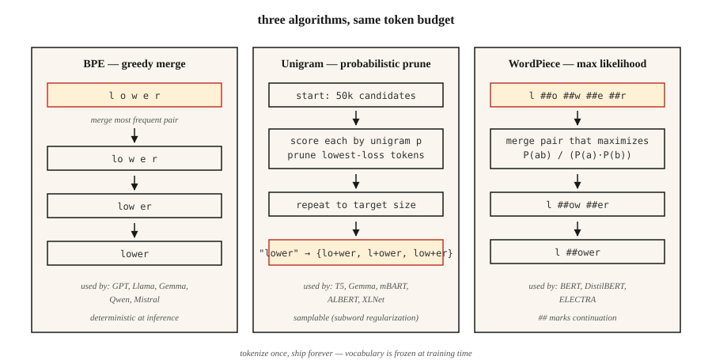

<!-- local-zh-machine-draft: English source is canonical; prose translated automatically, code/math preserved. -->

<a id="subword-tokenization--bpe-wordpiece-unigram-sentencepiece"></a>

# 子词 Tokenization——BPE、WordPiece、Unigram、SentencePiece

> 单词 tokenizers 被看不见的单词噎住了。字符 tokenizers 放大序列长度。子字 tokenizers 分割了差异。每台现代 LLM 都配备一个。

**类型：** 了解
**语言：** Python
**先决条件：** 第 5 阶段·01（文本处理）、第 5 阶段·04（GloVe / FastText / Subword）
**时间：** ~60 分钟

<a id="the-problem"></a>

## 问题

您的 vocabulary 有 50,000 个单词。用户输入“不可标记化”。您的 tokenizer 返回 `[UNK]`。该模型现在没有关于该词的信号。更糟糕的是：语料库中第 90% 的文档有 40 个稀有单词，这意味着每个文档丢失了 40 位信息。

子字 tokenization 解决了这个问题。常用字保留单个tokens。生僻单词分解为有意义的片段：`untokenizable` → `un`、`token`、`izable`。训练数据涵盖了一切，因为任何字符串最终都是字节序列。

2026 年的每个前沿 LLM 都采用三种算法之一（BPE、Unigram、WordPiece），包装在三个库之一（tiktoken、SentencePiece、HF Tokenizers）中。如果不选择一个语言模型，就无法发布它。

<a id="the-concept"></a>

## 概念



**BPE（字节对编码）。** 以字符级 vocabulary 开始。计算每个相邻的对。将最频繁的对合并到新的 token 中。重复此操作，直到达到目标 vocabulary 大小。主导算法：GPT-2/3/4、Llama、Gemma、Qwen2、Mistral。

**字节级 BPE.** 相同的算法，但使用原始字节（256 个基本 tokens）而不是 Unicode 字符。保证零 `[UNK]` tokens — 任何字节序列编码。 GPT-2使用50,257个tokens（256字节+ 50,000个合并+ 1个特殊）。

**Unigram.** 从一个巨大的 vocabulary 开始。为每个 token 分配一元概率。迭代地修剪 tokens，其删除最少会增加语料库对数似然。 inference 处的概率：可以对 tokenizations 进行采样（通过子字正则化对 data augmentation 有用）。由 T5、mBART、ALBERT、XLNet、Gemma 使用。

**WordPiece.** 合并对，以最大化训练语料库的可能性而不是原始频率。由 BERT、DistilBERT、ELECTRA 使用。

**SentencePiece vs tiktoken.** SentencePiece 是 *trains* vocabularies 的库（BPE 或 Unigram）直接在原始 Unicode 文本上，将空格编码为 `▁`。 tiktoken是OpenAI的快速*encoder*对抗预建的vocabularies；它不训练。

经验法则：

- **训练新的vocabulary：** SentencePiece（多语言，无预tokenization）或HF Tokenizers。
- **Fast inference 对抗 GPT 词汇：** tiktoken（cl100k_base，o200k_base）。
- **Both：** HF Tokenizers — 一个库，培训 + 服务。

```figure
bpe-merge
```

<a id="build-it"></a>

## 动手实现

<a id="step-1-bpe-from-scratch"></a>

### 步骤1：从头开始BPE

参见 `code/main.py`。循环：

```python
def train_bpe(corpus, num_merges):
    vocab = {tuple(word) + ("</w>",): count for word, count in corpus.items()}
    merges = []
    for _ in range(num_merges):
        pairs = Counter()
        for symbols, freq in vocab.items():
            for a, b in zip(symbols, symbols[1:]):
                pairs[(a, b)] += freq
        if not pairs:
            break
        best = pairs.most_common(1)[0][0]
        merges.append(best)
        vocab = apply_merge(vocab, best)
    return merges
```

算法编码的三个事实。 `</w>` 标记单词结尾，因此“low”（后缀）和“lower”（前缀）保持不同。频率加权使高频对更早获胜。合并列表是有序的 - inference 按训练顺序应用合并。

<a id="step-2-encode-with-the-learned-merges"></a>

### 第 2 步：使用学习到的合并进行编码

```python
def encode_bpe(word, merges):
    symbols = list(word) + ["</w>"]
    for a, b in merges:
        i = 0
        while i < len(symbols) - 1:
            if symbols[i] == a and symbols[i + 1] == b:
                symbols = symbols[:i] + [a + b] + symbols[i + 2:]
            else:
                i += 1
    return symbols
```

朴素 O(n·|合并|）。生产实现（tiktoken，HF Tokenizers）使用带有优先级队列的合并排名查找，并以接近线性的时间运行。

<a id="step-3-sentencepiece-in-practice"></a>

### 步骤3：实践中的SentencePiece

```python
import sentencepiece as spm

spm.SentencePieceTrainer.train(
    input="corpus.txt",
    model_prefix="my_tokenizer",
    vocab_size=8000,
    model_type="bpe",          # or "unigram"
    character_coverage=0.9995, # lower for CJK (e.g. 0.9995 for English, 0.995 for Japanese)
    normalization_rule_name="nmt_nfkc",
)

sp = spm.SentencePieceProcessor(model_file="my_tokenizer.model")
print(sp.encode("untokenizable", out_type=str))
# ['▁un', 'token', 'izable']
```

注意：不需要预 tokenization，空格编码为 `▁`，`character_coverage` 控制如何保留罕见字符与映射到 `<unk>`。

<a id="step-4-tiktoken-for-openai-compatible-vocabs"></a>

### 步骤4：OpenAI兼容词汇的tiktoken

```python
import tiktoken
enc = tiktoken.get_encoding("o200k_base")
print(enc.encode("untokenizable"))        # [127340, 101028]
print(len(enc.encode("Hello, world!")))   # 4
```

仅编码。快速（Rust 后端）。 Exact match 和 GPT-4/5 tokenization 用于字节计数、成本估算、上下文窗口预算。

<a id="pitfalls-that-still-ship-in-2026"></a>

## 2026 年仍然存在的陷阱

- **Tokenizer 漂移。** 针对词汇 A 进行训练，针对词汇 B 进行部署。Token ID 不同；模型输出垃圾。检查 CI 中的 `tokenizer.json` 哈希值。
- **空白歧义。** BPE“hello”与“hello”产生不同的tokens。始终明确指定 `add_special_tokens` 和 `add_prefix_space`。
- **多语言欠训练。** 英语为主的语料库生成 vocabularies，将非拉丁文字拆分为 5-10 倍的 tokens。同样的 prompt 在 GPT-3.5 上的日语/阿拉伯语成本要高出 5-10 倍。 o200k_base 部分修复了此问题。
- **Emoji 拆分。** 单个表情符号可以占用 5 个 tokens。 Checkpoint 预算上下文时的表情符号处理。

<a id="use-it"></a>

## 实际应用

2026 年堆栈：

| 情况 | 挑选 |
|-----------|------|
| 从头开始训练单语模型 | HF Tokenizers (BPE) |
| 训练多语言模型 | SentencePiece（一元，`character_coverage=0.9995`） |
| 服务于OpenAI兼容API | tiktoken（`o200k_base` 为 GPT-4+） |
| 特定领域的词汇（代码、数学、蛋白质） | 在域语料库上训练自定义 BPE，与基本词汇合并 |
| Edge inference，小型号 | Unigram（vocabularies 越小效果越好） |

Vocabulary 大小是缩放决定，而不是常数。粗略启发式：<1B 参数为 32k，1-10B 为 50-100k，多语言/前沿为 200k+。

<a id="ship-it"></a>

## 交付成果

另存为 `outputs/skill-bpe-vs-wordpiece.md`：

```markdown
---
name: tokenizer-picker
description: Pick tokenizer algorithm, vocab size, library for a given corpus and deployment target.
version: 1.0.0
phase: 5
lesson: 19
tags: [nlp, tokenization]
---

Given a corpus (size, languages, domain) and deployment target (training from scratch / fine-tuning / API-compatible inference), output:

1. Algorithm. BPE, Unigram, or WordPiece. One-sentence reason.
2. Library. SentencePiece, HF Tokenizers, or tiktoken. Reason.
3. Vocab size. Rounded to nearest 1k. Reason tied to model size and language coverage.
4. Coverage settings. `character_coverage`, `byte_fallback`, special-token list.
5. Validation plan. Average tokens-per-word on held-out set, OOV rate, compression ratio, round-trip decode equality.

Refuse to train a character-coverage <0.995 tokenizer on corpora with rare-script content. Refuse to ship a vocab without a frozen `tokenizer.json` hash check in CI. Flag any monolingual tokenizer under 16k vocab as likely under-spec.
```

<a id="exercises"></a>

## 练习

1. **Easy.** 在 `code/main.py` 的小型语料库上训练 500 个合并 BPE。对三个保留的单词进行编码。有多少个恰好生产了 1 token 与 >1 token？
2. **Medium.** 比较 token 计数 `cl100k_base`、`o200k_base` 和 SentencePiece 之间的 100 个英语维基百科句子BPE 你用 vocab=32k 训练。报告每个的压缩比。
3. **Hard.** 使用 BPE、Unigram 和 WordPiece 训练相同的语料库。在小型情感分类器上使用每个分类器时测量下游准确性。该选择是否使指针移动超过 1 个点 F1？

<a id="key-terms"></a>

## 关键术语

| 术语 | 人们怎么说 | 它实际上意味着什么 |
|------|-----------------|-----------------------|
| BPE | 字节对编码 | 贪婪地合并最常见的字符对，直到达到目标词汇量。 |
| 字节级 BPE | 没有未知的tokens | BPE 超过原始 256 字节； GPT-2 / Llama 使用此。 |
| 一元语法 | 概率tokenizer | 使用对数似然从大型候选集中进行修剪； T5，杰玛使用。 |
| SentencePiece | 空白一号 | 在原始文本上训练 BPE/Unigram 的库；空格编码为 `▁`。 |
| 抖音 | 最快的那个 | OpenAI 的 Rust 支持的 BPE encoder 用于预建词汇。没有培训。 |
| 合并列表 | 神奇的数字 | `(a, b) → ab` 的有序列表合并； inference 按顺序申请。 |
| 字符覆盖率 | 有多稀有才算太稀有？ | tokenizer 必须覆盖训练语料库中的字符分数；典型值约为 0.9995。 |

<a id="further-reading"></a>

## 进一步阅读

- [Sennrich、Haddow、Birch (2015)。带有子词单元的生僻词的神经机器翻译](https://arxiv.org/abs/1508.07909) — BPE 论文。
- [Kudo (2018)。使用 Unigram 语言模型进行子词正则化](https://arxiv.org/abs/1804.10959) — Unigram 论文。
- [Kudo，理查森（2018）。 SentencePiece：一个简单且与语言无关的子字 tokenizer](https://arxiv.org/abs/1808.06226) — 库。
- [Hugging Face — tokenizers](https://huggingface.co/docs/transformers/tokenizer_summary) 的摘要 — 简明参考。
- [OpenAI tiktoken repo](https://github.com/openai/tiktoken) — 食谱 + 编码列表。
