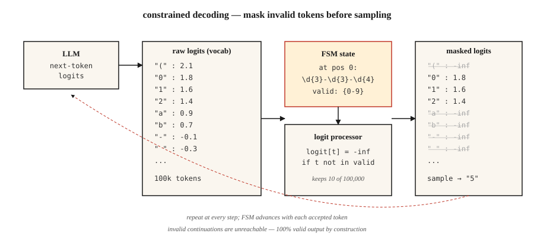

<!-- local-zh-machine-draft: English source is canonical; prose translated automatically, code/math preserved. -->

<a id="structured-outputs--constrained-decoding"></a>

# Structured Outputs & 约束解码

> 向 LLM 询问 JSON。大部分时间获取JSON。在生产中，“大多数”就是问题。约束解码通过编辑 sampling 之前的 logits 将“大多数”变成“总是”。

**类型：** 构建
**语言：** Python
**先决条件：** 第 5·17 阶段（聊天机器人）、第 5·19 阶段（子字 Tokenization）
**时间：** ~60 分钟

<a id="the-problem"></a>

## 问题

分类器 prompts 和 LLM：“返回{正、负、中性}之一。”该模型返回“情绪是积极的 - 该评论非常有利，因为客户明确表示他们......”。你的解析器崩溃了。您的分类器的 F1 是 0.0。

自由形式生成不是合同。这是一个建议。生产系统需要合同。

2026 年存在三层。

1. **Prompting.** 好好问一下。 “仅返回 JSON 对象。”在前沿型号上工作约 80%，在小型型号上工作较少。
2. **Native structured output APIs.** OpenAI `response_format`、Anthropic 工具使用， Gemini JSON 模式。可靠于支持的模式。供应商锁定。
3. **约束解码。** 在每个生成步骤修改 logits，以便模型 * 不能 * 发出无效的 tokens。施工时 100% 有效。适用于任何本地模型。

本课程为这三者建立直觉，并指出何时该接触哪一个。

<a id="the-concept"></a>

## 概念



** 约束解码的工作原理。** 在每个生成步骤中，LLM 在整个 vocabulary (~100k tokens) 上生成一个 logit 向量。 *logit 处理器* 位于模型和采样器之间。它计算给定目标语法中的当前位置（JSON 架构、正则表达式、上下文无关语法）哪些 tokens 是有效的，并将所有无效 tokens 的 logits 设置为负无穷大。其余 logits 上的 softmax 仅将概率质量放在有效的延续上。

2026年实施：

- **Outlines.** 将 JSON 模式或正则表达式编译为有限状态机。每个 token 都会获得一次 O(1) valid-next-token 查找。基于 FSM，因此递归模式需要扁平化。
- **XGrammar / llguidance.** 上下文无关语法引擎。处理递归 JSON 模式。接近于零的解码开销。 OpenAI 在 2025 年 structured output 实施中给予了指导。
- **vLLM引导解码。**内置`guided_json`、`guided_regex`、`guided_choice`、`guided_grammar`通过Outlines、XGrammar 或 lm-format-enforcer 后端。
- **Instructor.** 基于 Pydantic 的任何 LLM 的包装器。验证失败时重试。跨提供商，但不修改 logits — 它依赖于重试 + 结构化输出感知 prompts。

<a id="the-counterintuitive-result"></a>

### 违反直觉的结果

约束解码通常是*快点*比不受约束的一代。 有两个原因。 首先，它缩小了下一个-token搜索空间。 二、巧妙的实现跳过token完全为被迫而产生tokens（脚手架就像`{"name": "`— 每个字节都已确定）。

<a id="the-pitfall-that-costs-you"></a>

### 让你付出代价的陷阱

现场顺序很重要。将 `answer` 放在 `reasoning` 之前，并将模型 commits 放在它思考之前的答案中。 JSON 有效。答案是错误的。没有验证捕获它。

```json
// BAD
{"answer": "yes", "reasoning": "because ..."}

// GOOD
{"reasoning": "... therefore ...", "answer": "yes"}
```

架构字段顺序是逻辑，而不是格式。

```figure
constrained-decoder
```

<a id="build-it"></a>

## 动手实现

<a id="step-1-regex-constrained-generation-from-scratch"></a>

### 第 1 步：从头开始进行正则表达式约束生成

有关独立 FSM 实现，请参阅 `code/main.py`。 30行核心思想：

```python
def mask_logits(logits, valid_token_ids):
    mask = [float("-inf")] * len(logits)
    for tid in valid_token_ids:
        mask[tid] = logits[tid]
    return mask


def generate_constrained(model, tokenizer, prompt, fsm):
    ids = tokenizer.encode(prompt)
    state = fsm.initial_state
    while not fsm.is_accept(state):
        logits = model.next_token_logits(ids)
        valid = fsm.valid_tokens(state, tokenizer)
        logits = mask_logits(logits, valid)
        tok = sample(logits)
        ids.append(tok)
        state = fsm.transition(state, tok)
    return tokenizer.decode(ids)
```

FSM 跟踪到目前为止我们已经满足了语法的哪些部分。 `valid_tokens(state, tokenizer)` 计算 vocabulary tokens 可以在不离开接受路径的情况下推进 FSM。

<a id="step-2-outlines-for-json-schema"></a>

### 步骤 2：JSON 架构的概要

```python
from pydantic import BaseModel
from typing import Literal
import outlines


class Review(BaseModel):
    sentiment: Literal["positive", "negative", "neutral"]
    confidence: float
    evidence_span: str


model = outlines.models.transformers("meta-llama/Llama-3.2-3B-Instruct")
generator = outlines.generate.json(model, Review)

result = generator("Classify: 'The wait staff was attentive and the food arrived hot.'")
print(result)
# Review(sentiment='positive', confidence=0.93, evidence_span='attentive ... hot')
```

零验证错误。曾经。 FSM 使无效输出无法访问。

<a id="step-3-instructor-for-provider-agnostic-pydantic"></a>

### 第 3 步：与提供商无关的 Pydantic 的讲师

```python
import instructor
from anthropic import Anthropic
from pydantic import BaseModel, Field


class Invoice(BaseModel):
    vendor: str
    total_usd: float = Field(ge=0)
    line_items: list[str]


client = instructor.from_anthropic(Anthropic())
invoice = client.messages.create(
    model="claude-opus-4-7",
    max_tokens=1024,
    response_model=Invoice,
    messages=[{"role": "user", "content": "Extract from: 'Acme Corp $420. Widget, Gizmo.'"}],
)
```

机制不同。教练不碰logits。它将模式格式化为 prompt，解析输出，并在验证失败时重试（默认 3 次）。与任何提供商合作。重试会增加延迟和成本。跨提供商的可移植性是卖点。

<a id="step-4-native-vendor-apis"></a>

### 步骤4：原生厂商APIs

```python
from openai import OpenAI

client = OpenAI()
response = client.responses.create(
    model="gpt-5",
    input=[{"role": "user", "content": "Classify: 'The food was cold.'"}],
    text={"format": {"type": "json_schema", "name": "sentiment",
          "schema": {"type": "object", "required": ["sentiment"],
                     "properties": {"sentiment": {"type": "string",
                                                  "enum": ["positive", "negative", "neutral"]}}}}},
)
print(response.output_parsed)
```

服务器端受限解码。与受支持模式的 Outlines 的可靠性相当。没有本地模型管理。将您锁定到供应商。

<a id="pitfalls"></a>

## 陷阱

- **递归模式。**轮廓将递归展平到固定深度。 Tree-structured outputs（嵌套注释，AST）需要XGrammar或llguidance（基于CFG）。
- **Huge enums.** 10,000-option enum 编译缓慢或超时。切换到检索器：首先预测前 k 个候选者，并限制这些候选者。
- **语法太严格。** 强制 `date: "YYYY-MM-DD"` 正则表达式，并且模型无法输出缺失日期的 `"unknown"`。模型通过发明一个日期来补偿。允许 `null` 或哨兵。
- **过早的承诺。** 请参阅上面的现场订单陷阱。永远把推理放在第一位。
- **Vendor JSON 模式，无 schema。** 纯 JSON 模式仅保证有效的 JSON，无效的 * 供您使用案例*。始终提供完整的架构。

<a id="use-it"></a>

## 实际应用

2026 年堆栈：

| 情况 | 挑选 |
|-----------|------|
| OpenAI/Anthropic/Google 模型，简单架构 | 原生厂商 structured output |
| 任何提供者、Pydantic 工作流程都可以容忍重试 | 导师 |
| 本地模型，需要100%的有效性，扁平模式 | 概要（FSM） |
| 局部模型、递归模式 | X语法或指导 |
| 自托管 inference 服务器 | vLLM引导解码 |
| 可接受重试的批处理 | 教练+最便宜的型号 |

<a id="ship-it"></a>

## 交付成果

另存为`outputs/skill-structured-output-picker.md`：

```markdown
---
name: structured-output-picker
description: Choose a structured output approach, schema design, and validation plan.
version: 1.0.0
phase: 5
lesson: 20
tags: [nlp, llm, structured-output]
---

Given a use case (provider, latency budget, schema complexity, failure tolerance), output:

1. Mechanism. Native vendor structured output, Instructor retries, Outlines FSM, or XGrammar CFG. One-sentence reason.
2. Schema design. Field order (reasoning first, answer last), nullable fields for "unknown", enum vs regex, required fields.
3. Failure strategy. Max retries, fallback model, graceful `null` handling, out-of-distribution refusal.
4. Validation plan. Schema compliance rate (target 100%), semantic validity (LLM-judge), field-coverage rate, latency p50/p99.

Refuse any design that puts `answer` or `decision` before reasoning fields. Refuse to use bare JSON mode without a schema. Flag recursive schemas behind an FSM-only library.
```

<a id="exercises"></a>

## 练习

1. **Easy.** Prompt 一个小型开放式 weights 模型（例如 Llama-3.2-3B），无约束解码`Review(sentiment, confidence, evidence_span)`。测量 100 条评论中解析为有效 JSON 的分数。
2. **Medium.** 与 Outlines JSON 模式相同的语料库。比较合规率、延迟和语义准确性。
3. **Hard.** 从头开始为电话号码实现正则表达式约束的 decoder (`\d{3}-\d{3}-\d{4}`)。验证 1000 个样本的 0 个无效输出。

<a id="key-terms"></a>

## 关键术语

| 术语 | 人们怎么说 | 它实际上意味着什么 |
|------|-----------------|-----------------------|
| 受限解码 | 强制有效输出 | 每个生成步骤的掩码无效 - token logits。 |
| 逻辑处理器 | 限制的东西 | 功能：`(logits, state) -> masked_logits`。 |
| 有限状态机 | 有限状态机 | 编译语法表示； O(1) 有效的下一个 token 查找。 |
| CFG | 上下文无关语法 | 处理递归的语法；比 FSM 更慢但更具表现力。 |
| 架构字段顺序 | 有关系吗？ | 是 — 第一个字段 commits；始终将推理放在答案之前。 |
| 引导解码 | vLLM 的名称 | 相同的概念，集成到 inference 服务器中。 |
| JSON模式 | OpenAI的早期版本 | 保证 JSON 语法；不保证模式匹配。 |

<a id="further-reading"></a>

## 进一步阅读

- [威拉德，卢夫（2023）。 LLMs](https://arxiv.org/abs/2307.09702) 的高效引导生成 — Outlines 论文。
- [X语法论文 (2024)](https://arxiv.org/abs/2411.15100) — 基于快速 CFG 的约束解码。
- [vLLM — Structured Outputs](https://docs.vllm.ai/en/latest/features/structured_outputs.html) — inference 服务器集成。
- [OpenAI — Structured Outputs 指南](https://platform.openai.com/docs/guides/structured-outputs) — API 参考 + 陷阱。
- [讲师库](https://python.useinstructor.com/) — Pydantic + 跨提供商重试。
- [JSONSchemaBench (2025)](https://arxiv.org/abs/2501.10868) — 对 6 个约束解码框架进行基准测试。
