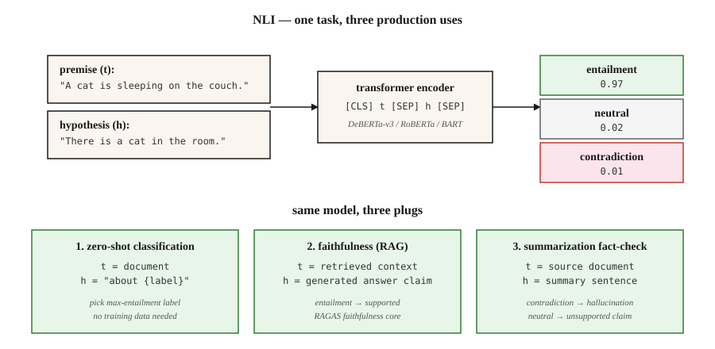

<!-- local-zh-machine-draft: English source is canonical; prose translated automatically, code/math preserved. -->

<a id="natural-language-inference--textual-entailment"></a>

# 自然语言 Inference — 文本蕴涵

> “t 蕴含 h”意味着人类阅读 t 会得出 h 为真的结论。 NLI 是预测蕴涵/矛盾/中性的任务。表面钻孔，生产承重。

**类型：** 了解
**语言：** Python
**先决条件：** 第 5·05 阶段（情感分析）、第 5·13 阶段（问答）
**时间：** ~60 分钟

<a id="the-problem"></a>

## 问题

您构建了一个摘要器。它产生了一个摘要。您如何知道摘要不包含 hallucination？

您构建了一个聊天机器人。它回答“是”。您如何知道检索到的段落支持答案？

您需要按主题对 10,000 篇新闻文章进行分类。您没有培训标签。您可以重复使用模型吗？

所有三个问题都归结为自然语言 Inference。 NLI 问：给定一个前提 `t` 和一个假设 `h`，`h` 是否蕴涵 `t`，是矛盾的，还是中立的（不相关）？

- **Hallucination 检查：** `t` = 源文档，`h` = 摘要声明。不是蕴含 = hallucination。
- **Grounded QA：** `t` = 检索到的段落，`h` = 生成的答案。不是蕴涵=捏造。
- **Zero-shot 分类：** `t` = 文档，`h` = 文字标签（“这是关于体育”）。蕴涵 = 预测标签。

一项任务，三种生产用途。这就是为什么每个 RAG evaluation 框架在底层都附带一个 NLI 模型。

<a id="the-concept"></a>

## 概念



**三个标签。**

- **Entailment.** `t` → `h`。 “猫在垫子上”意味着“有一只猫”。
- **矛盾.** `t` → Ø`h`。 “猫在垫子上”与“没有猫”相矛盾。
- **Neutral.** 无论如何都没有 inference。 “猫在垫子上”与“猫饿了”是中性的。

**不是逻辑蕴涵。** NLI是*natural*语言inference——典型的人类读者会推断出的，而不是严格的逻辑。在 NLI 中，“约翰遛狗”意味着“约翰有一只狗”，但严格的一阶逻辑只有在将占有公理化时才会承认这一点。

**Datasets.**

- **SNLI**（2015）。 570k 个人工注释对，以图像标题为前提。领域狭窄。
- **MultiNLI**（2017）。 10 个流派的 433,000 对。 2026年标准训练语料库。
- **ANLI**（2019）。对抗性 NLI。人类编写了专门用来打破现有模型的示例。更难。
- **DocNLI，ConTRoL** (2020–21)。文档长度的前提。测试多跳和远程 inference。

**架构。** A transformer encoder（BERT，RoBERTa，DeBERTa）读取`[CLS] premise [SEP] hypothesis [SEP]`。 `[CLS]` 表示形式馈送 3 路 softmax。在 MNLI 上进行训练，在保留的基准上进行评估，在分布对上获得 90% 以上的准确率。

**Zero-shot via NLI.** 给定一个文档和候选标签，将每个标签变成一个假设（“这篇文章是关于体育的”）。计算每个的蕴含概率。选择最大值。这就是 Hugging Face 的 `zero-shot-classification` 管道背后的机制。

```figure
nli-router
```

<a id="build-it"></a>

## 动手实现

<a id="step-1-run-a-pretrained-nli-model"></a>

### 第 1 步：运行预训练的 NLI 模型

```python
from transformers import pipeline

nli = pipeline("text-classification",
               model="facebook/bart-large-mnli",
               top_k=None)  # return all labels; replaces deprecated return_all_scores=True

premise = "The cat is sleeping on the couch."
hypothesis = "There is a cat in the room."

result = nli({"text": premise, "text_pair": hypothesis})[0]
print(result)
# [{'label': 'entailment', 'score': 0.97},
#  {'label': 'neutral', 'score': 0.02},
#  {'label': 'contradiction', 'score': 0.01}]
```

对于生产 NLI，`facebook/bart-large-mnli` 和 `MoritzLaurer/DeBERTa-v3-large-mnli-fever-anli-ling-wanli` 是开放的默认值。 DeBERTa-v3 在排行榜上名列前茅。

<a id="step-2-zero-shot-classification"></a>

### 步骤2：zero-shot分类

```python
zs = pipeline("zero-shot-classification", model="facebook/bart-large-mnli")

text = "The stock market rallied after the central bank cut interest rates."
labels = ["finance", "sports", "politics", "technology"]

result = zs(text, candidate_labels=labels)
print(result)
# {'labels': ['finance', 'politics', 'technology', 'sports'],
#  'scores': [0.92, 0.05, 0.02, 0.01]}
```

模板是“这个示例是关于 {label}”。默认情况下。使用 `hypothesis_template` 进行定制。无需训练数据。没有 fine-tuning。开箱即用。

<a id="step-3-faithfulness-check-for-rag"></a>

### 步骤3：RAG的可信度检查

```python
def is_faithful(answer, context, threshold=0.5):
    result = nli({"text": context, "text_pair": answer})[0]
    entail = next(s for s in result if s["label"] == "entailment")
    return entail["score"] > threshold
```

这是RAGAS忠诚的核心。将生成的答案拆分为原子声明。根据检索到的上下文检查每个声明。报告所需的分数。

<a id="step-4-hand-rolled-nli-classifier-conceptual"></a>

### 第 4 步：手卷 NLI 分类器（概念）

请参阅 `code/main.py` 了解仅 stdlib 的玩具：通过词汇重叠 + 否定检测来比较前提和假设。与 transformer 模型不具有竞争力 - 但它显示了任务的形状：两个文本输入，3 路标签输出，损失 = cross-entropy 优于 `{entail, contradict, neutral}`。

<a id="pitfalls"></a>

## 陷阱

- **H仅限假设的快捷方式。** 模型可以仅根据假设在 SNLI 上以大约 60% 的速度预测标签，因为“没有”、“没有人”、“从不”与矛盾相关。用于检测标签泄漏的强大基线。
- **词法重叠启发式。** 子序列启发式（“每个子序列都蕴含”）通过SNLI，但未通过HANS/ANLI。使用对抗性基准。
- **文档长度退化。** 单句 NLI 模型在文档长度前提下下降 20+ F1。使用 DocNLI 训练的模型来处理长上下文。
- **Zero-shot 模板敏感性。**“这个示例是关于{label}”与“{label}”与“主题是{label}”可以将准确性提高10+点。调整模板。
- **域名不匹配。** MNLI 进行通用英语培训。法律、医学和科学文本需要特定领域的 NLI 模型（例如 SciNLI、MedNLI）。

<a id="use-it"></a>

## 实际应用

2026 年堆栈：

| 应用场景 | 模型 |
|---------|-------|
| 通用 NLI | `MoritzLaurer/DeBERTa-v3-large-mnli-fever-anli-ling-wanli` |
| 快/边缘 | `cross-encoder/nli-deberta-v3-base` |
| Zero-shot分类（轻量级） | `facebook/bart-large-mnli` |
| 文档级 NLI | `MoritzLaurer/DeBERTa-v3-large-mnli-fever-anli-ling-wanli` |
| 多语言 | `MoritzLaurer/multilingual-MiniLMv2-L6-mnli-xnli` |
| Hallucination RAG 中的检测 | RAGAS / DeepEval 内的 NLI 层 |

2026 年元模式：NLI 是文本理解的胶带。每当你需要“A 支持 B 吗？”或“A 与 B 相矛盾吗？” — 在拨打另一个 LLM 电话之前先拨打 NLI。

<a id="ship-it"></a>

## 交付成果

另存为`outputs/skill-nli-picker.md`：

```markdown
---
name: nli-picker
description: Pick an NLI model, label template, and evaluation setup for a classification / faithfulness / zero-shot task.
version: 1.0.0
phase: 5
lesson: 21
tags: [nlp, nli, zero-shot]
---

Given a use case (faithfulness check, zero-shot classification, document-level inference), output:

1. Model. Named NLI checkpoint. Reason tied to domain, length, language.
2. Template (if zero-shot). Verbalization pattern. Example.
3. Threshold. Entailment cutoff for the decision rule. Reason based on calibration.
4. Evaluation. Accuracy on held-out labeled set, hypothesis-only baseline, adversarial subset.

Refuse to ship zero-shot classification without a 100-example labeled sanity check. Refuse to use a sentence-level NLI model on document-length premises. Flag any claim that NLI solves hallucination — it reduces it; it does not eliminate it.
```

<a id="exercises"></a>

## 练习

1. **Easy.** 在涵盖所有三个类别的 20 个手工制作的（前提、假设、标签）三元组上运行 `facebook/bart-large-mnli`。测量精度。添加对抗性的“后续启发式”陷阱（“我没有吃蛋糕”与“我吃了蛋糕”），看看它是否破裂。
2. **Medium.** 将 zero-shot 模板 `"This text is about {label}"` 与 100 AG 新闻标题上的 `"The topic is {label}"` 和 `"{label}"` 进行比较。报告准确度波动。
3. **Hard.** 构建 RAG 忠实性检查器：原子声明分解 + 每个声明的 NLI。使用黄金上下文评估 50 个 RAG 生成的答案。测量假阳性率和假阴性率与手工标签的比较。

<a id="key-terms"></a>

## 关键术语

| 术语 | 人们怎么说 | 它实际上意味着什么 |
|------|-----------------|-----------------------|
| 自然语言学 | 自然语言 Inference | 前提-假设关系的三向分类。 |
| 即时通讯 | 识别文本蕴含 | NLI 的旧名称；同样的任务。 |
| 蕴涵 | “t 意味着 h” | 给定 t，典型的读者会得出结论 h 为真。 |
| 矛盾 | “t 排除 h” | 给定 t，典型的读者会得出结论 h 是假的。 |
| 中性 | “未定” | 无论哪种方式，从 t 到 h 都没有 inference。 |
| Zero-shot分类 | NLI 作为分类器 | 将标签描述为假设，选择最大蕴涵。 |
| 忠诚 | 答案是否支持？ | NLI 结束（检索上下文，生成答案）。 |

<a id="further-reading"></a>

## 进一步阅读

- [Bowman 等人。 （2015）。用于学习自然语言的大型注释语料库 inference](https://arxiv.org/abs/1508.05326) — SNLI。
- [Williams、Nangia、鲍曼 (2017)。通过 Inference](https://arxiv.org/abs/1704.05426) 进行句子理解的广泛覆盖挑战语料库 — MultiNLI。
- [Nie 等人。 （2019）。对抗性 NLI](https://arxiv.org/abs/1910.14599) — ANLI 基准。
- [Yin，Hay，Roth（2019）。基准测试 Zero-shot 文本分类](https://arxiv.org/abs/1909.00161) — NLI 作为分类器。
- [He 等人。 （2021）。 DeBERTa：解码增强型 BERT 与解开的 Attention](https://arxiv.org/abs/2006.03654) — 2026 年 NLI 主力。
