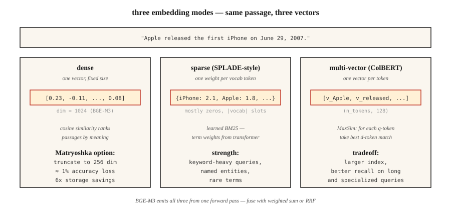

<!-- local-zh-machine-draft: English source is canonical; prose translated automatically, code/math preserved. -->

<a id="embedding-models--the-2026-deep-dive"></a>

# Embedding 模型 — 2026 年深度剖析

> Word2Vec 为您提供了每个单词的向量。现代 embedding 模型为您提供每个段落的向量、跨语言、稀疏、密集和多向量视图，其大小适合您的索引。选择错误，您的 RAG 检索到错误的内容。

**类型：** 了解
**语言：** Python
**先决条件：** 阶段 5·03 (Word2Vec)、阶段 5·14（信息检索）
**时间：** ~60 分钟

<a id="the-problem"></a>

## 问题

您的 RAG 系统在 40% 的时间内检索到错误的段落。罪魁祸首很少是 vector database 或 prompt。它是 embedding 型号。

在 2026 年选择 embedding 意味着跨五个轴进行拾取：

1. **密集 vs 稀疏 vs 多向量。** 每段一个向量，或每个 token 一个向量，或稀疏加权词袋。
2. **语言覆盖率。** 单语英语模型仍然在纯英语任务中获胜。当语料库混合时，多语言模型会获胜。
3. **Context length.** 512 tokens vs 8,192 vs 32,768 — 实际有效容量通常是广告最大容量的 60-70%。
4. **Dimension 预算。** 3,072 个全精度浮点数 = 每个向量 12 KB。如果向量为 100M，存储费用为 1,300 美元/月。俄罗斯套娃截断将其削减了 4 倍。
5. **Open 与托管。** Open-weight 表示您控制堆栈和数据。托管意味着您可以用控制权换取始终最新的内容。

本课程列出了权衡的名称，以便您可以选择证据，而不是上个季度流行的内容。

<a id="the-concept"></a>

## 概念



**Dense embeddings.** 每段一个向量（通常为 384-3,072 维）。 Cosine similarity 按语义接近度对段落进行排名。 OpenAI `text-embedding-3-large`，BGE-M3 密集模式，Voyage-3。默认选择。

**稀疏 embeddings.** SPLADE 样式。 transformer 为每个词汇 token 预测 weight，然后将其中大部分归零。结果是大小的稀疏向量 |词汇|。捕获词汇匹配（如 BM25），但使用学习术语 weights。擅长关键词密集型查询。

**多向量（后期交互）。** ColBERTv2，Jina-ColBERT。每个 token 一个向量。使用MaxSim评分：对于每个查询token，找到最相似的文档token，将分数相加。存储和评分成本更高，但在长查询和特定领域语料库方面胜出。

**BGE-M3：同时三个。** 单模型同时输出密集、稀疏和多向量表示。每个都可以独立查询；分数通过加权和融合。当您需要 checkpoint 的灵活性时，默认为 2026。

**Matryoshka 表示学习。** 经过训练，向量的前 N 维形成一个有用的独立 embedding。将 1,536 维向量截断为 256 维，并支付约 1% 的精度即可节省 6 倍的存储空间。由 OpenAI text-3、Cohere v4、Voyage-4、Jina v5、Gemini Embedding 2、Nomic v1.5+ 支持。

<a id="the-mteb-leaderboard-tells-a-partial-story"></a>

### MTEB 排行榜讲述了部分故事

海量文本 Embedding 基准 — 发布时 (2022 年) 涵盖 8 个任务类型的 56 个任务，在 MTEB v2 中扩展到 100 多个任务。 2026年初，Gemini Embedding 2 检索率最高（67.71 MTEB-R）。 Cohere embed-v4 领先于总体（65.2 MTEB）。 BGE-M3领先开放-weight多语言（63.0）。排行榜是必要的，但还不够——始终以您的领域为基准。

<a id="the-three-tier-pattern"></a>

### 三层模式

| 应用场景 | 图案 |
|----------|---------|
| 快速首过 | 密集双encoder（BGE-M3，text-3-small） |
| 召回率提升 | 稀疏（SPLADE、BGE-M3稀疏）+RRF熔断器 |
| 前 50 名精度 | 多向量（ColBERTv2）或交叉 encoder reranker |

大多数生产堆栈都使用这三种。

```figure
gx-matryoshka
```

<a id="build-it"></a>

## 动手实现

<a id="step-1-baseline--dense-embeddings-with-sentence-bert"></a>

### 第 1 步：基线 — 密集 embeddings 和 Sentence-BERT

```python
from sentence_transformers import SentenceTransformer
import numpy as np

encoder = SentenceTransformer("BAAI/bge-small-en-v1.5")
corpus = [
    "The first iPhone launched in 2007.",
    "Apple released the iPod in 2001.",
    "Android is an operating system from Google.",
]
emb = encoder.encode(corpus, normalize_embeddings=True)

query = "When was the iPhone released?"
q_emb = encoder.encode([query], normalize_embeddings=True)[0]
scores = emb @ q_emb
print(sorted(enumerate(scores), key=lambda x: -x[1]))
```

`normalize_embeddings=True` 使点积等于 cosine similarity。始终设置它。

<a id="step-2-matryoshka-truncation"></a>

### 第2步：俄罗斯套娃截断

```python
def truncate(vectors, dim):
    out = vectors[:, :dim]
    return out / np.linalg.norm(out, axis=1, keepdims=True)

emb_256 = truncate(emb, 256)
emb_128 = truncate(emb, 128)
```

截断后重新标准化。 Nomic v1.5、OpenAI text-3 和 Voyage-4 经过训练，因此前几个级别是无损的。非俄罗斯套娃模型（原句子-BERT）在截断时会急剧退化。

<a id="step-3-bge-m3-multi-functionality"></a>

### 步骤3：BGE-M3多功能

```python
from FlagEmbedding import BGEM3FlagModel

model = BGEM3FlagModel("BAAI/bge-m3", use_fp16=True)

output = model.encode(
    corpus,
    return_dense=True,
    return_sparse=True,
    return_colbert_vecs=True,
)
# output["dense_vecs"]:    (n_docs, 1024)
# output["lexical_weights"]: list of dict {token_id: weight}
# output["colbert_vecs"]:  list of (n_tokens, 1024) arrays
```

三个索引，一个inference调用。分数融合：

```python
dense_score = ... # cosine over dense_vecs
sparse_score = model.compute_lexical_matching_score(q_lex, d_lex)
colbert_score = model.colbert_score(q_col, d_col)
final = 0.4 * dense_score + 0.2 * sparse_score + 0.4 * colbert_score
```

调整您的域上的 weights。

<a id="step-4-mteb-eval-on-a-custom-task"></a>

### 第 4 步：对自定义任务进行 MTEB 评估

```python
from mteb import MTEB

tasks = ["ArguAna", "SciFact", "NFCorpus"]
evaluation = MTEB(tasks=tasks)
results = evaluation.run(encoder, output_folder="./mteb-results")
```

在 *representative* 子集上运行候选模型。不要仅仅相信排行榜排名——您的域名很重要。

<a id="step-5-hand-rolled-cosine-from-scratch"></a>

### 第5步：从头开始手卷余弦

参见 `code/main.py`。平均哈希技巧 embeddings（仅限 stdlib）。与 transformer embeddings 不竞争，但显示形状：标记化 → 向量 → 标准化 → 点积。

<a id="pitfalls"></a>

## 陷阱

- **查询和文档的模型相同。** 某些模型（Voyage、Jina-ColBERT）使用非对称编码——查询和文档通过不同的路径。请务必检查 model card。
- **缺少前缀。** `bge-*` 模型需要在查询前添加 `"Represent this sentence for searching relevant passages: "`。如果忘记了，记忆差距为 3-5 分。
- ** 过度修剪俄罗斯套娃。** 1,536 → 256 通常是安全的。 1,536 → 64 不是。在您的 eval set 上进行验证。
- **Context truncation.** 大多数模型会默默地截断超过其最大长度的输入。长文档需要 chunking（参见第 23 课）。
- **忽略延迟尾部。** MTEB 分数隐藏 p99 延迟。 600M 模型可能比 335M 模型高出 2 个百分点，但每次查询的成本却高出 3 倍。

<a id="use-it"></a>

## 实际应用

2026 年堆栈：

| 情况 | 挑选 |
|-----------|------|
| 纯英文，快速，API | `text-embedding-3-large` 或 `voyage-3-large` |
| 打开-weight，英文 | `BAAI/bge-large-en-v1.5` |
| 打开-weight，多语言 | `BAAI/bge-m3` 或 `Qwen3-Embedding-8B` |
| 长上下文 (32k+) | Voyage-3-large、Cohere 嵌入-v4、Qwen3-Embedding-8B |
| CPU-仅部署 | Nomic Embed v2（137M 参数，MoE） |
| 存储受限 | 俄罗斯套娃-截断 + int8 quantization |
| 关键词密集型查询 | 添加 SPLADE 稀疏、RRF 熔断与密集 |

2026 模式：从 BGE-M3 或 text-3-large 开始，使用 MTEB 评估您的领域，如果特定领域的模型获胜超过 3 分，则交换。

<a id="ship-it"></a>

## 交付成果

另存为`outputs/skill-embedding-picker.md`：

```markdown
---
name: embedding-picker
description: Pick embedding model, dimension, and retrieval mode for a given corpus and deployment.
version: 1.0.0
phase: 5
lesson: 22
tags: [nlp, embeddings, retrieval]
---

Given a corpus (size, languages, domain, avg length), deployment target (cloud / edge / on-prem), latency budget, and storage budget, output:

1. Model. Named checkpoint or API. One-sentence reason.
2. Dimension. Full / Matryoshka-truncated / int8-quantized. Reason tied to storage budget.
3. Mode. Dense / sparse / multi-vector / hybrid. Reason.
4. Query prefix / template if required by the model card.
5. Evaluation plan. MTEB tasks relevant to domain + held-out domain eval with nDCG@10.

Refuse recommendations that truncate Matryoshka to <64 dims without domain validation. Refuse ColBERTv2 for corpora under 10k passages (overhead not justified). Flag long-document corpora (>8k tokens) routed to models with 512-token windows.
```

<a id="exercises"></a>

## 练习

1. **Easy.** 使用 `bge-small-en-v1.5` 在全暗 (384) 处编码 100 个句子，然后在 Matryoshka 128 处编码。测量 10 个查询的 MRR 下降。
2. **Medium.** 在您的域中的 500 个段落上比较 BGE-M3 密集、稀疏和 colbert。哪个在recall@10 上获胜？ RRF 融合能否击败最好的单一模式？
3. **Hard.** 在跨前 2 个域任务的三个候选模型上运行 MTEB。报告 MTEB 分数、100 个查询批次的 p99 延迟以及 $/1M 查询。选择帕累托最优的一个。

<a id="key-terms"></a>

## 关键术语

| 术语 | 人们怎么说 | 它实际上意味着什么 |
|------|-----------------|-----------------------|
| 密集embedding | 向量 | 每个文本一个固定大小的向量。 Cosine similarity 进行排名。 |
| 稀疏embedding | 了解到BM25 | 每个词汇一个 weight token；大部分为零；端到端训练。 |
| 多向量 | ColBERT 风格 | 每个 token 一个向量； MaxSim 评分；索引越大，召回率越好。 |
| 俄罗斯套娃 | 俄罗斯套娃把戏 | 前 N 个维度本身就是一个有效的较小的 embedding。 |
| MTEB | 基准 | 海量文本 Embedding 基准测试 — 发布时有 56 个任务，v2 中有 100 多个任务。 |
| 贝尔 | 检索基准 | 18 zero-shot 检索任务；经常被引用为跨域稳健性。 |
| 非对称编码 | 查询≠文档路径 | 模型对查询和文档使用不同的投影。 |

<a id="further-reading"></a>

## 进一步阅读

- [Reimers，Gurevych（2019）。句子-BERT](https://arxiv.org/abs/1908.10084) — bi-encoder 论文。
- [Muennighoff 等人。 （2022）。 MTEB：海量文本 Embedding Benchmark](https://arxiv.org/abs/2210.07316) — 排行榜论文。
- [Chen 等人。 （2024）。 BGE-M3：多语言、多功能、多粒度](https://arxiv.org/abs/2402.03216)——统一的三模模型。
- [Kusupati 等人。 （2022）。 Matryoshka 表示学习](https://arxiv.org/abs/2205.13147) — 维度阶梯训练目标。
- [Santhanam 等人。 （2022）。 ColBERTv2：通过轻量级后期交互进行有效且高效的检索](https://arxiv.org/abs/2112.01488) — 生产中的后期交互。
- [MTEB Hugging Face 排行榜](https://huggingface.co/spaces/mteb/leaderboard) — 实时排名。
