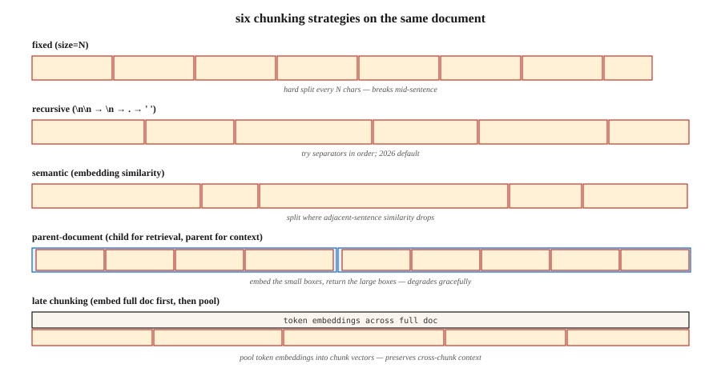

<!-- local-zh-machine-draft: English source is canonical; prose translated automatically, code/math preserved. -->

<a id="chunking-strategies-for-rag"></a>

# 面向 RAG 的 Chunking 策略

> Chunking 配置对检索质量的影响与 embedding 模型 (Vectara NAACL 2025) 的选择一样大。如果 chunking 错了，再多的重新排名也救不了你。

**类型：** 构建
**语言：** Python
**先决条件：** 第 5·14 阶段（信息检索）、第 5·22 阶段（Embedding 型号）
**时间：** ~60 分钟

<a id="the-problem"></a>

## 问题

您将一份 50 页的合同放入 RAG 系统中。用户问：“终止条款是什么？”检索器返回封面页。为什么？因为模型是在 512-token 块上进行训练的，并且终止子句位于 20 页中，跨分页符分割，没有本地关键字将其与查询绑定。

解决办法不是“购买更好的 embedding 型号”。修复程序为 chunking。有多大？重叠？去哪里分？与周围环境有关？

2026 年 2 月的基准测试显示出令人惊讶的结果：

- Vectara 2026 年的研究：递归 512-token chunking 击败语义 chunking 69% → 54% 准确率。
- SPLADE + Mistral-8B 关于自然问题：重叠提供了零可衡量的好处。
- 上下文悬崖：响应质量在 2,500 tokens 上下文附近急剧下降。

“显而易见”的答案（语义 chunking，20% 重叠，1000 tokens）通常是错误的。本课程构建了六种策略的直觉，并告诉您何时采取哪些策略。

<a id="the-concept"></a>

## 概念



**修复了 chunking.** 每 N 个字符或 tokens 分割。最简单的基线。半句中断。压缩性好，一致性差。

**递归.** LangChain的`RecursiveCharacterTextSplitter`。首先尝试在 `\n\n` 上进行拆分，然后是 `\n`，然后是 `.`，然后是空格。干净利落地落回来。 2026 年默认值。

**Semantic.** 嵌入每个句子。计算相邻句子之间的 cosine similarity。当相似度低于阈值时进行分割。保持主题连贯性。慢点;有时会产生微小的 40-token 片段，从而影响检索。

**Sentence.** 在句子边界上分割。每个块一个句子或一个包含 N 个句子的窗口。以一小部分成本匹配语义 chunking 高达约 5k tokens。

**Parent-document.** 存储较小的子块以供检索 * 和 * 较大的父块用于上下文。由孩子检索；返回父级。优雅地降级：坏的子块仍然返回合理的父块。

**Late chunking (2024).** 首先将整个文档嵌入 token 级别，然后将 token embeddings 池化到块中embeddings。保留跨块上下文。适用于长上下文嵌入器（BGE-M3、Jina v3）。更高的计算能力。

**上下文检索（Anthropic，2024）。** 在每个块前面加上 LLM 生成的文档中位置的摘要（“此块是终止子句的第 3.2 节...”）。 Anthropic 自己的基准测试中检索提高了 35-50%。索引成本昂贵。

<a id="the-rule-that-beats-every-default"></a>

### 击败所有默认规则的规则

将块大小与查询类型相匹配：

| 查询类型 | 块大小 |
|------------|-----------|
| Factoid（“首席执行官叫什么名字？”） | 256-512 tokens |
| 分析/多跳 | 512-1024 tokens |
| 全节理解 | 1024-2048 tokens |

NVIDIA 的 2026 年基准。该块应该足够大以包含答案和本地上下文，也足够小以使检索器的 top-K 返回关注答案而不是上下文噪音。

```figure
n5-chunk-cuts
```

<a id="build-it"></a>

## 动手实现

<a id="step-1-fixed-and-recursive-chunking"></a>

### 步骤1：固定递归chunking

```python
def chunk_fixed(text, size=512, overlap=0):
    step = size - overlap
    return [text[i:i + size] for i in range(0, len(text), step)]


def chunk_recursive(text, size=512, seps=("\n\n", "\n", ". ", " ")):
    if len(text) <= size:
        return [text]
    for sep in seps:
        if sep not in text:
            continue
        parts = text.split(sep)
        chunks = []
        buf = ""
        for p in parts:
            if len(p) > size:
                if buf:
                    chunks.append(buf)
                    buf = ""
                chunks.extend(chunk_recursive(p, size=size, seps=seps[1:] or (" ",)))
                continue
            candidate = buf + sep + p if buf else p
            if len(candidate) <= size:
                buf = candidate
            else:
                if buf:
                    chunks.append(buf)
                buf = p
        if buf:
            chunks.append(buf)
        return [c for c in chunks if c.strip()]
    return chunk_fixed(text, size)
```

<a id="step-2-semantic-chunking"></a>

### 步骤2：语义chunking

```python
def chunk_semantic(text, encoder, threshold=0.6, min_chars=200, max_chars=2048):
    sentences = split_sentences(text)
    if not sentences:
        return []
    embs = encoder.encode(sentences, normalize_embeddings=True)
    chunks = [[sentences[0]]]
    for i in range(1, len(sentences)):
        sim = float(embs[i] @ embs[i - 1])
        current_len = sum(len(s) for s in chunks[-1])
        if sim < threshold and current_len >= min_chars:
            chunks.append([sentences[i]])
        else:
            chunks[-1].append(sentences[i])

    result = []
    for group in chunks:
        text_group = " ".join(group)
        if len(text_group) > max_chars:
            result.extend(chunk_recursive(text_group, size=max_chars))
        else:
            result.append(text_group)
    return result
```

在您的域上调整 `threshold`。太高→碎片。太低→一大块。

<a id="step-3-parent-document"></a>

### 第 3 步：父文档

```python
def chunk_parent_child(text, parent_size=2048, child_size=256):
    parents = chunk_recursive(text, size=parent_size)
    mapping = []
    for p_idx, parent in enumerate(parents):
        children = chunk_recursive(parent, size=child_size)
        for child in children:
            mapping.append({"child": child, "parent_idx": p_idx, "parent": parent})
    return mapping


def retrieve_parent(child_query, mapping, encoder, top_k=3):
    child_embs = encoder.encode([m["child"] for m in mapping], normalize_embeddings=True)
    q_emb = encoder.encode([child_query], normalize_embeddings=True)[0]
    scores = child_embs @ q_emb
    top = np.argsort(-scores)[:top_k]
    seen, parents = set(), []
    for i in top:
        if mapping[i]["parent_idx"] not in seen:
            parents.append(mapping[i]["parent"])
            seen.add(mapping[i]["parent_idx"])
    return parents
```

关键见解：对父母进行重复数据删除。多个孩子可以映射到同一个父母；返回全部会浪费上下文。

<a id="step-4-contextual-retrieval-anthropic-pattern"></a>

### 步骤4：上下文检索（Anthropic模式）

```python
def contextualize_chunks(document, chunks, llm):
    context_prompts = [
        f"""<document>{document}</document>
Here is the chunk to situate: <chunk>{c}</chunk>
Write 50-100 words placing this chunk in the document's context."""
        for c in chunks
    ]
    contexts = llm.batch(context_prompts)
    return [f"{ctx}\n\n{c}" for ctx, c in zip(contexts, chunks)]
```

对上下文块建立索引。在查询时，检索受益于额外的周围信号。

<a id="step-5-evaluate"></a>

### 第五步：评估

```python
def recall_at_k(queries, corpus_chunks, encoder, k=5):
    chunk_embs = encoder.encode(corpus_chunks, normalize_embeddings=True)
    hits = 0
    for q_text, gold_idxs in queries:
        q_emb = encoder.encode([q_text], normalize_embeddings=True)[0]
        top = np.argsort(-(chunk_embs @ q_emb))[:k]
        if any(i in gold_idxs for i in top):
            hits += 1
    return hits / len(queries)
```

始终进行基准测试。您的语料库的“最佳”策略可能与任何博客文章都不匹配。

<a id="pitfalls"></a>

## 陷阱

- **Chunking 仅在事实查询上进行评估。** 多跳查询揭示了截然不同的获胜者。使用查询类型分层eval set。
- **语义 chunking 没有最小大小。** 生成 40-token 损害检索的片段。始终强制执行 `min_tokens`。
- ** 重叠作为货物崇拜。** 2026 年的研究发现重叠通常带来零收益并使指数成本加倍。衡量，不要假设。
- **没有最小/最大强制。** 5 tokens 或 5000 tokens 的块都会中断检索。夹钳。
- **跨文档 chunking.** 切勿让一个块跨越两个文档。始终按文档分块，然后合并。

<a id="use-it"></a>

## 实际应用

2026 年堆栈：

| 情况 | 策略 |
|-----------|----------|
| 首次构建，未知语料库 | 递归，512 tokens，无重叠 |
| 事实问答 | 递归，256-512 tokens |
| 分析/多跳 | 递归，512-1024 tokens + 父文档 |
| 大量交叉引用（合同、文件） | 迟到的 chunking 或上下文检索 |
| 对话/对话语料库 | 转弯级别块 + 演讲者元数据 |
| 简短的话语（推文、评论） | 一份文档 = 一大块 |

从递归512开始。在50个查询eval set上测量recall@5。从那里调。

<a id="ship-it"></a>

## 交付成果

另存为 `outputs/skill-chunker.md`：

```markdown
---
name: chunker
description: Pick a chunking strategy, size, and overlap for a given corpus and query distribution.
version: 1.0.0
phase: 5
lesson: 23
tags: [nlp, rag, chunking]
---

Given a corpus (document types, avg length, domain) and query distribution (factoid / analytical / multi-hop), output:

1. Strategy. Recursive / sentence / semantic / parent-document / late / contextual. Reason.
2. Chunk size. Token count. Reason tied to query type.
3. Overlap. Default 0; justify if >0.
4. Min/max enforcement. `min_tokens`, `max_tokens` guards.
5. Evaluation plan. Recall@5 on 50-query stratified eval set (factoid, analytical, multi-hop).

Refuse any chunking strategy without min/max chunk size enforcement. Refuse overlap above 20% without an ablation showing it helps. Flag semantic chunking recommendations without a min-token floor.
```

<a id="exercises"></a>

## 练习

1. **Easy.** 使用固定(512, 0)、递归(512, 0) 和递归(512, 100) 对一份 20 页文档进行分块。比较块计数和边界质量。
2. **Medium.** 在 5 个文档上构建 30 个查询 eval set。测量递归、语义和父文档的recall@5。哪个赢了？与博客文章相符吗？
3. **Hard.** 实现上下文检索。测量相对于基线递归的 MRR 改进。报告索引成本（LLM 调用）与准确性增益。

<a id="key-terms"></a>

## 关键术语

| 术语 | 人们怎么说 | 它实际上意味着什么 |
|------|-----------------|-----------------------|
| 块 | 文档的一部分 | 嵌入、索引和检索的子文档单元。 |
| 重叠 | 安全裕度 | N tokens 相邻块之间共享；在 2026 年基准测试中通常毫无用处。 |
| 语义 chunking | 智能chunking | 在相邻句子 embedding 相似度下降的地方进行分割。 |
| 父文档 | 两级检索 | 找回小孩子，找回大父母。 |
| 已晚chunking | embedding 之后的块 | 在 token 级别嵌入完整文档，池化到块向量中。 |
| 上下文检索 | Anthropic的绝招 | LLM 生成的摘要在索引之前添加到每个块之前。 |
| 上下文悬崖 | 2500-token 墙 | 在 RAG 中（2026 年 1 月），在 2.5k 上下文 tokens 左右观察到质量下降。 |

<a id="further-reading"></a>

## 进一步阅读

- [Yepes 等人。 / LangChain — 递归字符分割文档](https://python.langchain.com/docs/how_to/recursive_text_splitter/) — 生产中的默认值。
- [Vectara（2024，NAACL 2025）。 Chunking 配置分析](https://arxiv.org/abs/2410.13070) — chunking 与 embedding 选择一样重要。
- [Jina AI - 长上下文 Embedding 模型中的最新 Chunking (2024)](https://jina.ai/news/late-chunking-in-long-context-embedding-models/) - 最新的 chunking 论文。
- [Anthropic — 上下文检索](https://www.anthropic.com/news/contextual-retrieval) — 使用 LLM 生成的上下文前缀将检索改进 35-50%。
- [NVIDIA 2026 块大小基准 — Premai 摘要](https://blog.premai.io/rag-chunking-strategies-the-2026-benchmark-guide/) — 按查询类型划分的块大小。
