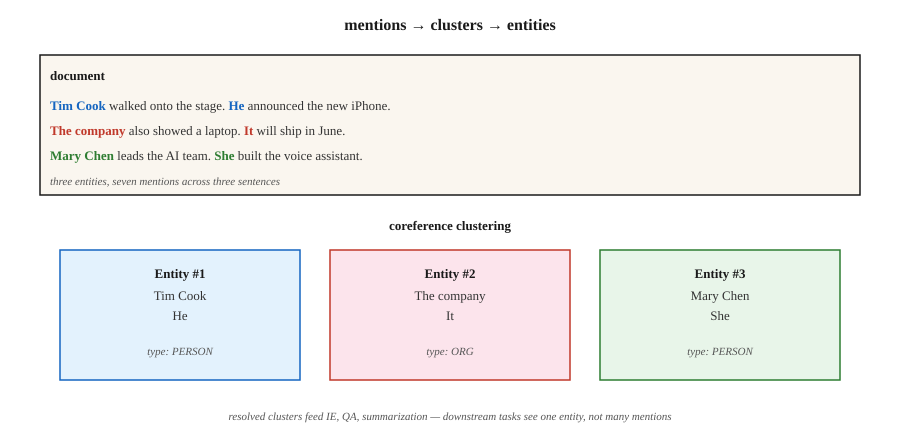

<!-- local-zh-machine-draft: English source is canonical; prose translated automatically, code/math preserved. -->

<a id="coreference-resolution"></a>

# 共指消解

> “她打电话给他。他没有接听。医生正在吃午饭。”三个人提到了两个人，但没有人被点名。共指解析可以找出谁是谁。

**类型：** 了解
**语言：** Python
**先决条件：** 第 5 阶段·06（NER）、第 5 阶段·07（POS 和解析）
**时间：** ~60 分钟

<a id="the-problem"></a>

## 问题

从 300 字的文章中提取所有提及 Apple Inc. 的内容。当文章说“苹果”时就很容易了。当它说“公司”、“他们”、“库比蒂诺的科技巨头”或“乔布斯的公司”时，很难。如果不将这些提及解析为同一实体，您的 NER 管道会错过 60-80% 的提及。

共指解析将引用同一现实世界实体的每个表达式链接到一个簇中。它是表面级 NLP（NER、解析）和下游语义（IE、​​QA、摘要、KG）之间的粘合剂。

为什么它在 2026 年很重要：

- 摘要：“首席执行官宣布……”与“蒂姆·库克宣布……”——摘要应提及首席执行官的名字。
- 问题回答：“她给谁打电话了？”需要解决“她”。
- 信息提取：将“PER1 创立苹果”和“乔布斯创立苹果”作为单独条目的知识图是错误的。
- 多文档 IE：合并有关同一事件的文章之间的提及是跨文档共指。

<a id="the-concept"></a>

## 概念



**任务。** 输入：一个文档。输出：提及（跨度）的聚类，其中每个聚类指一个实体。

**提及类型.**

- **命名实体.**“蒂姆·库克”
- **Nominal.**“CEO”、“公司”
- **Pronominal.** “他”，“她”，“他们”，“它”
- **Apposit.**“蒂姆·库克，苹果公司首席执行官，”

**Architectures.**

1. **基于规则（Hobbs，1978）。** 使用语法规则的基于句法树的代词解析。良好的基线。令人惊讶的是，在代词上很难被击败。
2. **提及对分类器。** 对于每对提及（m_i，m_j），预测它们是否 corefer。通过传递闭包进行聚类。 2016 年之前的标准。
3. **Mention-ranking.** 对于每次提及，对候选先行词进行排名（包括“无先行词”）。选择顶部。
4. **基于Span的端到端（Lee等人，2017）。** Transformer encoder。枚举长度上限内的所有候选跨度。预测提及分数。预测每个跨度的先行概率。贪婪地集群。现代的默认设置。
5. **Generative (2024+).** Prompt 和 LLM：“列出本文中的每个代词及其先行词。”适用于简单的案例，但适用于长文档和罕见的参考对象。

**evaluation 指标。** 五个标准指标（MUC、B³、CEAF、BLANC、LEA），因为没有单个指标可以捕获集群质量。将前三个的平均值报告为 CoNLL F1。 2026 年 CoNLL-2012 的最新技术：~83 F1。

**已知硬壳.**

- 参考前面介绍的页面的实体的明确描述。
- 桥接照应（“轮子”→前面提到的汽车）。
- 中文和日文等语言中的零回指。
- Cataphora（指代词前的代词）：“当 **she** 走进来时，玛丽微笑了。”

```figure
coref-links
```

<a id="build-it"></a>

## 动手实现

<a id="step-1-pretrained-neural-coreference-allennlp--spacy-experimental"></a>

### 步骤1：预训练神经共指（AllenNLP / spaCy-实验）

```python
import spacy
nlp = spacy.load("en_coreference_web_trf")   # experimental model
doc = nlp("Apple announced new products. The company said they would ship soon.")
for cluster in doc._.coref_clusters:
    print(cluster, "->", [m.text for m in cluster])
```

在较长的文档中，您会得到类似以下内容的内容：
- 集群1：[苹果公司，他们]
- 集群2：[新产品]

<a id="step-2-rule-based-pronoun-resolver-teaching"></a>

### 步骤2：基于规则的代词解析器（教学）

有关仅 stdlib 的实现，请参阅 `code/main.py`：

1. 摘录提到：命名实体（大写的跨度）、代词（字典查找）、明确的描述（“X”）。
2. 对于每个代词，查看之前 K 次提及的内容并通过以下方式对它们进行评分：
   - 性别/数字一致（启发式）
   - 新近度（越接近获胜）
   - 句法角色（主语优先）
3. 链接得分最高的先行词。

与神经模型没有竞争力。但它显示了搜索空间以及端到端模型必须做出的决策。

<a id="step-3-using-llms-for-coreference"></a>

### 步骤3：使用LLMs进行共指

```python
prompt = f"""Text: {text}

List every pronoun and noun phrase that refers to a person or company.
Cluster them by what they refer to. Output JSON:
[{{"entity": "Apple", "mentions": ["Apple", "the company", "it"]}}, ...]
"""
```

两种值得关注的故障模式。首先，LLMs 过度合并（“他”和“她”指的是两个不同的人）。其次，LLMs 默默地删除长文档中的提及。始终通过跨度偏移检查进行验证。

<a id="step-4-evaluation"></a>

### 步骤4：evaluation

标准 conll-2012 脚本计算 MUC、B³、CEAF-φ4 并报告平均值。对于内部评估，从跨度级精确率开始，并在带注释的测试集上调用，然后添加提及链接 F1。

<a id="pitfalls"></a>

## 陷阱

- **单例爆炸。** 有些系统将每个提及报告为自己的集群。 B3 是宽松的。 MUC对此进行了惩罚。始终检查所有三个指标。
- ** 长上下文中的代词。** 在超过 2,000 个 tokens 的文档上，性能下降约 15 F1。小心地切块。
- **性别假设。** 硬编码的性别规则违反了非二元参照物、组织、动物。使用学习模型或中性评分。
- **LLM 在长文档上发生漂移。** 单个 API 调用无法可靠地聚集 50 多个段落中的提及。使用滑动窗口+合并。

<a id="use-it"></a>

## 实际应用

2026 年堆栈：

| 情况 | 挑选 |
|-----------|------|
| 英文，单一文件 | `en_coreference_web_trf`（spaCy-实验）或 AllenNLP 神经 coref |
| 多语言 | SpanBERT / XLM-R 在 OntoNotes 或多语言 CoNLL 上进行训练 |
| 跨文档事件 coref | 专门的端到端模型（2025-26 SOTA） |
| 快速 LLM 基线 | GPT-4o / Claude，带结构化输出 coref prompt |
| 生产对话系统 | 基于规则的回退+神经初级+关键槽位的手动审查 |

2026 年发布的集成模式：首先运行 NER，运行 coref，将 coref 集群合并到 NER 实体中。下游任务看到每个集群一个实体，而不是每次提及一个实体。

<a id="ship-it"></a>

## 交付成果

另存为 `outputs/skill-coref-picker.md`：

```markdown
---
name: coref-picker
description: Pick a coreference approach, evaluation plan, and integration strategy.
version: 1.0.0
phase: 5
lesson: 24
tags: [nlp, coref, information-extraction]
---

Given a use case (single-doc / multi-doc, domain, language), output:

1. Approach. Rule-based / neural span-based / LLM-prompted / hybrid. One-sentence reason.
2. Model. Named checkpoint if neural.
3. Integration. Order of operations: tokenize → NER → coref → downstream task.
4. Evaluation. CoNLL F1 (MUC + B³ + CEAF-φ4 average) on held-out set + manual cluster review on 20 documents.

Refuse LLM-only coref for documents over 2,000 tokens without sliding-window merge. Refuse any pipeline that runs coref without a mention-level precision-recall report. Flag gender-heuristic systems deployed in demographically diverse text.
```

<a id="exercises"></a>

## 练习

1. **Easy.** 在 `code/main.py` 中对 5 个手工制作的段落运行基于规则的解析器。根据真实情况测量提及链接的准确性。
2. **Medium.** 在新闻文章上使用预训练的神经 coref 模型。将聚类与您自己的手动注释进行比较。哪里失败了？
3. **Hard.** 构建 coref 增强的 NER 管道：首先进行 NER，然后通过 coref 集群进行合并。衡量 100 篇文章的实体覆盖率与仅 NER 的改进情况。

<a id="key-terms"></a>

## 关键术语

| 术语 | 人们怎么说 | 它实际上意味着什么 |
|------|-----------------|-----------------------|
| 提及 | 参考 | 指代实体（名称、代词、名词短语）的一段文本。 |
| 前因 | “它”指的是什么 | 前面提到的一个与后面一个相关。 |
| 集群 | 实体的提及 | 全部提及同一现实世界实体的一组提及。 |
| 回指 | 向后参考 | 后面提到的内容指的是前面的内容（“他”→“约翰”）。 |
| 卡塔弗拉 | 前向参考 | 前面提到的是后来的（“当他到达时，约翰......”）。 |
| 桥接 | 隐式引用 | “我买了一辆车。轮子坏了。” （那辆车的轮子。） |
| CoNLL F1 | 排行榜上的数量 | MUC、B³、CEAF-φ4 F1 分数的平均值。 |

<a id="further-reading"></a>

## 进一步阅读

- [Jurafsky & Martin，SLP3 Ch。 26 — 共指解析和实体链接](https://web.stanford.edu/~jurafsky/slp3/26.pdf) — 规范教科书章节。
- [Lee 等人。 （2017）。端到端神经共指解析](https://arxiv.org/abs/1707.07045) — 基于跨度的端到端。
- [Joshi 等人。 （2020）。 SpanBERT](https://arxiv.org/abs/1907.10529) — pretraining 改进了 coref。
- [Pradhan 等人。 （2012）。 CoNLL-2012 共享任务](https://aclanthology.org/W12-4501/) — 基准。
- [霍布斯（1978）。解析代词参考](https://www.sciencedirect.com/science/article/pii/0024384178900064) — 基于规则的经典。
