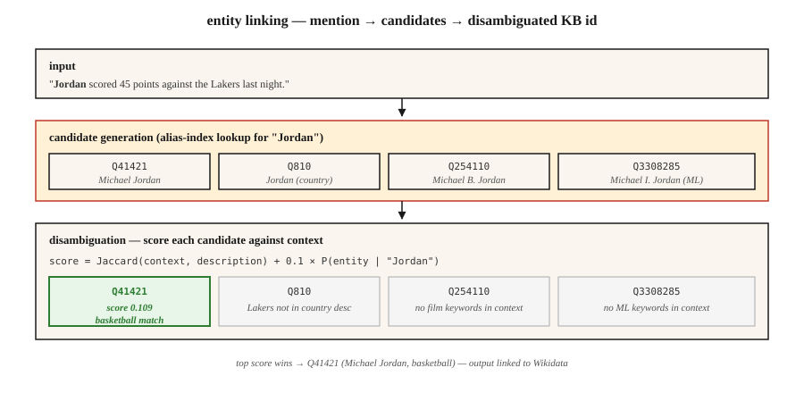

<!-- local-zh-machine-draft: English source is canonical; prose translated automatically, code/math preserved. -->

<a id="entity-linking--disambiguation"></a>

# 实体链接和消歧

> NER 找到了“巴黎”。实体链接决定：法国巴黎？帕丽斯·希尔顿？巴黎、德克萨斯？帕里斯（特洛伊王子）？如果没有链接，您的知识图谱就会变得模糊不清。

**类型：** 构建
**语言：** Python
**先决条件：** 阶段 5 · 06 (NER)、阶段 5 · 24（共指解析）
**时间：** ~60 分钟

<a id="the-problem"></a>

## 问题

一句话写道：“乔丹击败了媒体。”您的 NER 将“Jordan”标记为 PERSON。好的。但是*哪个*乔丹？

- 迈克尔·乔丹（篮球）？
- 迈克尔·B·乔丹 (actor)？
- Michael I. Jordan（伯克利 ML 教授——是的，这种混淆在 ML 论文中确实存在）？
- 约旦（国家）？
- 乔丹（希伯来名字）？

实体链接 (EL) 将每个提及解析为知识库中的唯一条目：Wikidata、Wikipedia、DBpedia 或您的域知识库。两个子任务：

1. **候选生成。** 给定“Jordan”，哪些知识库条目是合理的？
2. **Disambiguation.** 根据上下文，哪一个候选人是正确的？

这两个步骤都是可以学习的。两者都是基准测试。组合管道十年来一直保持稳定——变化的是消歧器的质量。

<a id="the-concept"></a>

## 概念



**候选生成。** 给定提及表面形式（“Jordan”），在别名索引中查找候选。维基百科别名词典涵盖了大多数命名实体：“JFK”→ 约翰·肯尼迪、杰奎琳·肯尼迪、肯尼迪机场、肯尼迪（电影）。典型索引每次提及都会返回 10-30 个候选者。

**消歧：三种方法。**

1. **先验 + 上下文（Milne & Witten，2008）。** `P(entity | mention) × context-similarity(entity, text)`。效果好，速度快，无需培训。
2. **Embedding 基于（ESS / REL / Blink）。** 编码提及+上下文。对每个候选人的描述进行编码。选择最大余弦。 2020-2024 年默认值。
3. **Generative（GENRE，2021；基于 LLM，2023+）。** 解码实体的规范名称 token-by-token。受限于有效实体名称字典树，因此保证输出是有效的知识库 ID。

**端到端与管道。** 现代模型（ELQ、BLINK、ExtEnD、GENRE）一次性运行 NER + 候选生成 + 消歧。管道系统在生产中仍然占主导地位，因为您可以更换组件。

<a id="the-two-measurements"></a>

### 两次测量

- **提及召回（候选生成）。** 黄金分数提及正确的 KB 条目出现在候选列表中的位置。整个管道的地板。
- **消歧准确度 / F1.** 给定正确的候选者，top-1 正确的频率。

始终报告两者。一个在 80% 的候选召回率上具有 99% 歧义消除的系统是一个 80% 的管道。

```figure
gx-entity-linking
```

<a id="build-it"></a>

## 动手实现

<a id="step-1-build-an-alias-index-from-wikipedia-redirects"></a>

### 第 1 步：根据 Wikipedia 重定向构建别名索引

```python
alias_to_entities = {
    "jordan": ["Q41421 (Michael Jordan)", "Q810 (Jordan, country)", "Q254110 (Michael B. Jordan)"],
    "paris":  ["Q90 (Paris, France)", "Q663094 (Paris, Texas)", "Q55411 (Paris Hilton)"],
    "apple":  ["Q312 (Apple Inc.)", "Q89 (apple, fruit)"],
}
```

维基百科别名数据：~18M（别名、实体）对。从维基数据转储下载。存储为倒排索引。

<a id="step-2-context-based-disambiguation"></a>

### 步骤 2：基于上下文的消歧

```python
def disambiguate(mention, context, alias_index, entity_desc):
    candidates = alias_index.get(mention.lower(), [])
    if not candidates:
        return None, 0.0
    context_words = set(tokenize(context))
    best, best_score = None, -1
    for entity_id in candidates:
        desc_words = set(tokenize(entity_desc[entity_id]))
        union = len(context_words | desc_words)
        score = len(context_words & desc_words) / union if union else 0.0
        if score > best_score:
            best, best_score = entity_id, score
    return best, best_score
```

Jaccard 重叠是一个玩具。在 embeddings 上替换为 cosine similarity（有关 transformer 版本，请参阅 `code/main.py` 步骤 2）。

<a id="step-3-embedding-based-blink-style"></a>

### 步骤3：基于embedding（BLINK式）

```python
from sentence_transformers import SentenceTransformer
encoder = SentenceTransformer("sentence-transformers/all-MiniLM-L6-v2")

def embed_mention(text, mention_span):
    start, end = mention_span
    marked = f"{text[:start]} [MENTION] {text[start:end]} [/MENTION] {text[end:]}"
    return encoder.encode([marked], normalize_embeddings=True)[0]

def embed_entity(entity_id, description):
    return encoder.encode([f"{entity_id}: {description}"], normalize_embeddings=True)[0]
```

在索引时，将每个 KB 实体嵌入一次。在查询时，嵌入提及+上下文一次，针对候选池进行点积，选择最大值。

<a id="step-4-generative-entity-linking-concept"></a>

### 步骤 4：生成实体链接（概念）

GENRE 逐个字符地解码实体的维基百科标题。受限解码（参见第 20 课）确保只能输出有效的标题。与 KB 支持的 trie 紧密集成。现代后代是 REL-GEN 和 LLM 提示的 EL，带有 structured output。

```python
prompt = f"""Text: {text}
Mention: {mention}
List the best Wikipedia title for this mention.
Respond with JSON: {{"title": "..."}}"""
```

与白名单（Outlines `choice`）相结合，这是 2026 年发货的最简单的 EL 管道。

<a id="step-5-evaluate-on-aida-conll"></a>

### 第5步：在AIDA-CoNLL上进行评估

AIDA-CoNLL 是标准 EL 基准：1,393 篇路透社文章、34k 次提及、维基百科实体。报告 KB 内准确度 (`P@1`) 和 KB 外 NIL 检测率。

<a id="pitfalls"></a>

## 陷阱

- **NIL 处理。** 一些提及不在知识库中（新兴实体、晦涩难懂的人）。系统必须预测 NIL，而不是猜测错误的实体。单独测量。
- **提及边界错误。** 上游 NER 错过部分跨度（“Bank of America”标记为“Bank”）。 EL 召回率下降。
- **流行度偏差。** 训练有素的系统过度预测频繁的实体。 ML 论文中提到“Michael I. Jordan”通常会与篮球乔丹联系起来。
- **跨语言 EL.** 将中文文本中的提及映射到英文维基百科实体。需要多语言 encoder 或翻译步骤。
- **KB 陈旧性。** 新公司、事件、人物不在去年的维基百科转储中。生产管道需要刷新循环。

<a id="use-it"></a>

## 实际应用

2026 年堆栈：

| 情况 | 挑选 |
|-----------|------|
| 通用英语+维基百科 | 闪烁或相对 |
| 跨语言，KB = 维基百科 | 流派 |
| LLM-友好，每天很少提及 | Prompt Claude/GPT-4 带候选列表 + 约束 JSON |
| 特定领域的知识库（医学、法律） | 自定义 BERT，具有 KB 感知检索 + 对域 AIDA 样式集进行微调 |
| 极低延迟 | 仅先验精确匹配（Milne-Witten 基线） |
| 研究SOTA | 类型/扩展/生成 LLM-EL |

2026 年发布的生产模式：NER → coref → 每次提及时的 EL → 将集群折叠为每个集群一个规范实体。输出：文档中每个实体一个 KB ID，而不是每次提及一个 KB ID。

<a id="ship-it"></a>

## 交付成果

另存为 `outputs/skill-entity-linker.md`：

```markdown
---
name: entity-linker
description: Design an entity linking pipeline — KB, candidate generator, disambiguator, evaluation.
version: 1.0.0
phase: 5
lesson: 25
tags: [nlp, entity-linking, knowledge-graph]
---

Given a use case (domain KB, language, volume, latency budget), output:

1. Knowledge base. Wikidata / Wikipedia / custom KB. Version date. Refresh cadence.
2. Candidate generator. Alias-index, embedding, or hybrid. Target mention recall @ K.
3. Disambiguator. Prior + context, embedding-based, generative, or LLM-prompted.
4. NIL strategy. Threshold on top score, classifier, or explicit NIL candidate.
5. Evaluation. Mention recall @ 30, top-1 accuracy, NIL-detection F1 on held-out set.

Refuse any EL pipeline without a mention-recall baseline (you cannot evaluate a disambiguator without knowing candidate gen surfaced the right entity). Refuse any pipeline using LLM-prompted EL without constrained output to valid KB ids. Flag systems where popularity bias affects minority entities (e.g. name-clashes) without domain fine-tuning.
```

<a id="exercises"></a>

## 练习

1. **Easy.** 在 `code/main.py` 中针对 10 个不明确的提及（巴黎、约旦、苹果）实现先验+上下文消歧器。手动标记正确的实体。测量精度。
2. **Medium.** 用句子 transformer 编码 50 个不明确的提及。嵌入每个候选人的描述。将基于 embedding 的消歧与 Jaccard 上下文重叠进行比较。
3. **Hard.** 构建 1k 实体域知识库（例如您公司的员工+产品）。端到端实施 NER + EL。测量 100 个保留句子的精确度和召回率。

<a id="key-terms"></a>

## 关键术语

| 术语 | 人们怎么说 | 它实际上意味着什么 |
|------|-----------------|-----------------------|
| 实体链接 (EL) | 链接到维基百科 | 将提及映射到唯一的知识库条目。 |
| 候选人一代 | 会是谁呢？ | 返回看似合理的知识库条目的候选列表以供提及。 |
| 消歧义 | 选择正确的一个 | 根据上下文对候选人进行评分，选出获胜者。 |
| 别名索引 | 查找表 | 从表面形式→候选实体进行映射。 |
| 零 | 不在知识库中 | 明确预测没有 KB 条目匹配。 |
| 知识库 | 知识库 | Wikidata、Wikipedia、DBpedia 或您的域知识库。 |
| AIDA-CoNLL | 基准 | 1,393 篇带有黄金实体链接的路透社文章。 |

<a id="further-reading"></a>

## 进一步阅读

- [米尔恩·维滕（2008）。 学习与维基百科链接](https://researchcommons.waikato.ac.nz/entities/publication/b9a0b520-abc5-47c5-a86a-da6c579893ab)——基本的先验+上下文方法。
- [Wu 等人。 （2020）。 Zero-shot 实体链接与密集实体检索 (BLINK)](https://arxiv.org/abs/1911.03814) — 基于 embedding 的主力。
- [曹德等人。 （2021）。 Autoregressive 实体检索 (GENRE)](https://arxiv.org/abs/2010.00904) — 具有约束解码的生成 EL。
- [Hoffart 等人。 （2011）。文本中命名实体的鲁棒消歧 (AIDA)](https://www.aclweb.org/anthology/D11-1072.pdf) — 基准论文。
- [REL：站在巨人肩膀上的实体链接器（2020）](https://arxiv.org/abs/2006.01969) - 开放生产堆栈。
