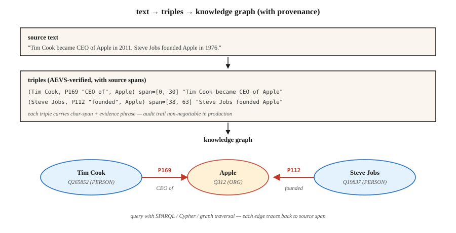

<!-- local-zh-machine-draft: English source is canonical; prose translated automatically, code/math preserved. -->

<a id="relation-extraction--knowledge-graph-construction"></a>

# 关系抽取与知识图谱构建

> NER 找到了实体。实体链接锚定了它们。关系提取找到它们之间的边缘。知识图是节点、边及其来源的总和。

**类型：** 构建
**语言：** Python
**先决条件：** 第 5·06 阶段（NER）、第 5·25 阶段（实体链接）
**时间：** ~60 分钟

<a id="the-problem"></a>

## 问题

一位分析师写道：“蒂姆·库克于 2011 年成为苹果公司首席执行官。”四个事实：

- `(Tim Cook, role, CEO)`
- `(Tim Cook, employer, Apple)`
- `(Tim Cook, start_date, 2011)`
- `(Apple, type, Organization)`

关系提取 (RE) 将自由文本转换为结构化三元组 `(subject, relation, object)`。聚合整个语料库，你就得到了一个知识图。聚合和查询，您就有了 RAG、分析或合规性审计的推理基础。

2026题：LLMs 热情提取关系。太热情了。他们产生了源文本不支持的三元组的幻觉。如果没有出处，你就无法区分真正的三元组和可信的虚构故事。 2026 年的答案是 AEVS 式的锚定和验证管道。

<a id="the-concept"></a>

## 概念



**三重形式。** `(subject_entity, relation_type, object_entity)`。关系来自封闭本体（Wikidata 属性、FIBO、UMLS）或开放集（OpenIE 风格，任何事物都可以）。

**三种提取方式。**

1. **基于规则/模式。** 赫斯特模式：“X 如 Y”→ `(Y, isA, X)`。加上手工制作的正则表达式。脆弱、精确、可解释。
2. **监督分类器。** 给定句子中的两个实体提及，从固定集合中预测关系。接受过 TACRED、ACE、KBP 培训。标准 2015–2022。
3. **Generative LLM.** Prompt 发出三元组的模型。开箱即用。需要出处，或者产生看似合理的垃圾的幻觉。

**AVS（锚点提取验证补充，2026）。** 当前的 hallucination 缓解框架：

- **Anchor.** 识别每个实体范围和关系短语范围的确切位置。
- **Extract.** 生成链接到锚跨度的三元组。
- **Verify.** 将每个三元组元素与源文本匹配；拒绝任何不支持的事情。
- **Supplement.** 覆盖通道确保不会丢失锚定跨度。

Hallucinations 大幅下跌。需要更多计算，但可审计。

**开放与封闭的权衡。**

- **封闭本体。** 固定属性列表（例如，维基数据的 11,000 多个属性）。可预测的。可查询。很难发明。
- **Open IE.** 任何口头短语都成为关系。回忆度高。精度低。查询起来很乱。

生产知识图谱通常混合使用：打开 IE 进行发现，然后将关系规范化到封闭的本体上，然后再合并到主图中。

```figure
relation-triples
```

<a id="build-it"></a>

## 动手实现

<a id="step-1-pattern-based-extraction"></a>

### 步骤一：基于模式的提取

```python
PATTERNS = [
    (r"(?P<s>[A-Z]\w+) (?:is|was) (?:a|an|the) (?P<o>[A-Z]?\w+)", "isA"),
    (r"(?P<s>[A-Z]\w+) (?:is|was) born in (?P<o>\w+)", "bornIn"),
    (r"(?P<s>[A-Z]\w+) works? (?:at|for) (?P<o>[A-Z]\w+)", "worksAt"),
    (r"(?P<s>[A-Z]\w+) founded (?P<o>[A-Z]\w+)", "founded"),
]
```

有关完整的玩具提取器，请参阅 `code/main.py`。赫斯特模式仍然在特定领域的管道中提供，因为它们是可调试的。

<a id="step-2-supervised-relation-classification"></a>

### 步骤2：有监督关系分类

```python
from transformers import AutoTokenizer, AutoModelForSequenceClassification

tok = AutoTokenizer.from_pretrained("Babelscape/rebel-large")
model = AutoModelForSequenceClassification.from_pretrained("Babelscape/rebel-large")

text = "Tim Cook was born in Alabama. He later became CEO of Apple."
encoded = tok(text, return_tensors="pt", truncation=True)
output = model.generate(**encoded, max_length=200)
triples = tok.batch_decode(output, skip_special_tokens=False)
```

REBEL 是一个 seq2seq 关系提取器：文本输入，三元组输出，已经在维基数据属性 ids 中。对远程监控数据进行微调。标准开放-weights 基线。

<a id="step-3-llm-prompted-extraction-with-anchoring"></a>

### 步骤 3：LLM 提示的锚定提取

```python
prompt = f"""Extract (subject, relation, object) triples from the text.
For each triple, include the exact character span in the source text.

Text: {text}

Output JSON:
[{{"subject": {{"text": "...", "span": [start, end]}},
   "relation": "...",
   "object": {{"text": "...", "span": [start, end]}}}}, ...]

Only include triples fully supported by the text. No inference beyond what is stated.
"""
```

根据源验证每个返回的范围。拒绝任何 `text[start:end] != triple_entity` 的内容。这是最小形式的 AEVS“验证”步骤。

<a id="step-4-canonicalize-onto-a-closed-ontology"></a>

### 步骤 4：规范化为封闭本体

```python
RELATION_MAP = {
    "is the CEO of": "P169",       # "chief executive officer"
    "was born in":   "P19",         # "place of birth"
    "founded":        "P112",       # "founded by" (inverted subject/object)
    "works at":       "P108",       # "employer"
}


def canonicalize(relation):
    rel_low = relation.lower().strip()
    if rel_low in RELATION_MAP:
        return RELATION_MAP[rel_low]
    return None   # drop unmapped open relations or route to manual review
```

规范化通常占工程工作的 60-80%。预算。

<a id="step-5-build-a-small-graph-and-query"></a>

### 第 5 步：构建小图并查询

```python
triples = extract(text)
graph = {}
for s, r, o in triples:
    graph.setdefault(s, []).append((r, o))


def neighbors(node, relation=None):
    return [(r, o) for r, o in graph.get(node, []) if relation is None or r == relation]


print(neighbors("Tim Cook", relation="P108"))    # -> [(P108, Apple)]
```

这是每个 RAG-over-KG 系统的原子。使用 RDF 三元组存储（Blazegraph、Virtuoso）、属性图（Neo4j）或矢量增强图存储对其进行扩展。

<a id="pitfalls"></a>

## 陷阱

- ** RE.** 之前的参考“他创立了苹果”——RE 需要知道“他”是谁。首先运行 coref（第 24 课）。
- **实体规范化。**“Apple Inc”和“Apple”必须解析到同一节点。首先是实体链接（第 25 课）。
- **H幻觉三元组。** LLMs 发出文本不支持的三元组。强制跨度验证。
- **关系规范化漂移。** 开放式IE关系不一致（“出生于”、“来自”、“是土生土长的”）。折叠为规范 ID 或图表不可查询。
- **时间错误。**“蒂姆·库克是苹果公司的首席执行官”——现在正确，2005年错误。许多关系都是有时间限制的。使用限定符（维基数据中的 `P580` 开始时间、`P582` 结束时间）。
- **域名不匹配。** REBEL 在维基百科上训练。法律、医学和科学文本通常需要领域微调的 RE 模型。

<a id="use-it"></a>

## 实际应用

2026 年堆栈：

| 情况 | 挑选 |
|-----------|------|
| 快速生产，通用领域 | REBEL 或 LlamaPred 与维基数据规范化 |
| 特定领域（生物医学、法律） | SciREX 式领域微调 + 自定义本体 |
| LLM 提示、审核的输出 | AEVS流程：锚定→提取→验证→补充 |
| 高容量新闻 IE | 基于模式+监督混合 |
| 从头开始构建 KG | 打开IE+手动规范化通行证 |
| 颞叶KG | 带限定符的摘录（开始/结束时间、时间点） |

集成模式：NER→coref→实体链接→关系提取→本体映射→图加载。每个阶段都是一个潜在的质量门。

<a id="ship-it"></a>

## 交付成果

另存为`outputs/skill-re-designer.md`：

```markdown
---
name: re-designer
description: Design a relation extraction pipeline with provenance and canonicalization.
version: 1.0.0
phase: 5
lesson: 26
tags: [nlp, relation-extraction, knowledge-graph]
---

Given a corpus (domain, language, volume) and downstream use (KG-RAG, analytics, compliance), output:

1. Extractor. Pattern-based / supervised / LLM / AEVS hybrid. Reason tied to precision vs recall target.
2. Ontology. Closed property list (Wikidata / domain) or open IE with canonicalization pass.
3. Provenance. Every triple carries source char-span + doc id. Non-negotiable for audit.
4. Merge strategy. Canonical entity id + relation id + temporal qualifiers; dedup policy.
5. Evaluation. Precision / recall on 200 hand-labelled triples + hallucination-rate on LLM-extracted sample.

Refuse any LLM-based RE pipeline without span verification (source provenance). Refuse open-IE output flowing into a production graph without canonicalization. Flag pipelines with no temporal qualifier on time-bounded relations (employer, spouse, position).
```

<a id="exercises"></a>

## 练习

1. **Easy.** 在 `code/main.py` 中对 5 个新闻文章句子运行模式提取器。手动检查精度。
2. **Medium.** 在相同的句子上使用 REBEL（或小的 LLM）。比较三元组。哪种提取器精度更高？更高的召回率？
3. **Hard.** 构建 AEVS 管道：使用 LLM 提取 + 根据源验证跨度。在 50 个维基百科风格的句子的验证步骤之前和之后测量 hallucination 率。

<a id="key-terms"></a>

## 关键术语

| 术语 | 人们怎么说 | 它实际上意味着什么 |
|------|-----------------|-----------------------|
| 三重 | 主体-关系-客体 | `(s, r, o)` 元组，KG 的原子单位。 |
| 打开IE | 提取任何东西 | 打开-vocabulary关系短语；召回率高，准确率低。 |
| 封闭本体 | 固定模式 | 关系类型的有界集（Wikidata、UMLS、FIBO）。 |
| 规范化 | 一切正常化 | 将表面名称/关系映射到规范 ID。 |
| AEVS | 接地引出 | 锚定-提取-验证-补充管道（2026）。 |
| 出处 | 真实来源链接 | 每个三元组都带有一个 doc id + char-span 到其源。 |
| 远程监管 | 廉价标签 | 将文本与现有知识图谱对齐以创建训练数据。 |

<a id="further-reading"></a>

## 进一步阅读

- [Mintz 等人。 （2009）。无标记数据的关系提取的远程监督](https://www.aclweb.org/anthology/P09-1113.pdf) - 远程监督论文。
- [Huguet Cabot，纳维利（2021）。 REBEL：通过端到端语言生成进行关系提取](https://aclanthology.org/2021.findings-emnlp.204.pdf) — seq2seq RE 主力。
- [Wadden 等人。 （2019）。使用上下文化跨度表示进行实体、关系和事件提取 (DyGIE++)](https://arxiv.org/abs/1909.03546) — 联合 IE。
- [AVS — 锚-提取-验证-补充框架](https://www.mdpi.com/2073-431X/15/3/178) — 2026 hallucination-缓解设计。
- [Wikidata SPARQL 教程](https://www.wikidata.org/wiki/Wikidata:SPARQL_tutorial) — 规范图查询。
