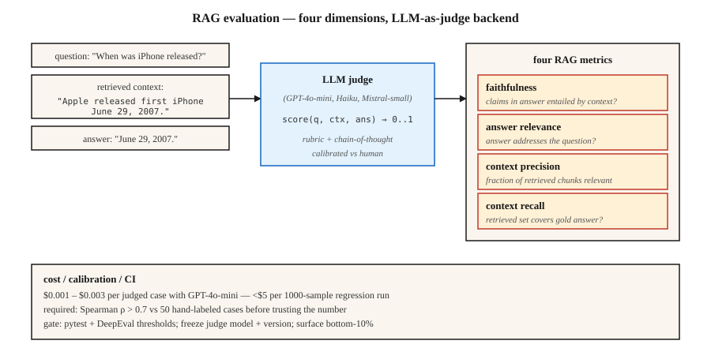

<!-- local-zh-machine-draft: English source is canonical; prose translated automatically, code/math preserved. -->

<a id="llm-evaluation--ragas-deepeval-g-eval"></a>

# LLM Evaluation — RAGAS、DeepEval、G-Eval

> 精确匹配和 F1 缺少语义等价性。人工审核无法扩展。 LLM-as-judge 是生产答案 - 有足够的 calibration 来信任该号码。

**类型：** 构建
**语言：** Python
**先决条件：** 第 5·13 阶段（问答）、第 5·14 阶段（信息检索）
**时间：** ~75分钟

<a id="the-problem"></a>

## 问题

您的 RAG 系统回答：“2007 年 6 月 29 日。”
黄金参考是：“2007 年 6 月 29 日”。
Exact Match 得分 0。F1 得分 ~75%。人类得分为 100%。

现在乘以 10,000 个测试用例。再次乘以检索器、chunking、prompt 或模型的每次更改。您需要一个能够理解含义、大规模运行、不会在回归问题上撒谎并能显示正确的故障模式的评估器。

2026 有三个框架解决了这个问题。

- **RAGAS.** 检索增强生成评估。四个 RAG 指标（忠诚度、答案相关性、上下文精确度、上下文回忆），带有 NLI + LLM 判断后端。研究支持，轻量级。
- **DeepEval.** Pytest 为 LLMs。 G-Eval，任务完成情况，hallucination，偏差指标。 CI/CD 原生。
- **G-Eval.** 方法（和 DeepEval 指标）：LLM-as-judge with chain-of-thought，自定义标准，0-1 分数。

这三个人都依靠 LLM 作为判断。本课程构建了对该方法及其周围信任层的直觉。

<a id="the-concept"></a>

## 概念



**LLM-as-judge.** 将静态指标替换为 LLM，该指标对给定评分标准的输出进行评分。给定 `(query, context, answer)`、prompt，法官 LLM：“忠诚度得分 0-1。”返回分数。

为什么有效：LLMs 以极小的成本来近似人类的判断。 GPT-4o-mini 每个评分案例的价格约为 0.003 美元，可以以低于 5 美元的价格运行 1000 个样本回归评估。

为什么它默默地失败：

1. **法官偏见。** 法官更喜欢较长的答案、来自自己模型系列的答案、与 prompt 风格相匹配的答案。
2. **JSON 解析失败。** 坏 JSON → NaN 分数→默默地从聚合中排除。 RAGAS 用户知道这种痛苦。具有 try/ except + 显式失败模式的门。
3. **模型版本漂移。** 升级判断会更改每个指标。冻结判断型号+版本。

**RAG 四.**

| 公制 | 问题 | 后端 |
|--------|----------|---------|
| 忠诚 | 答案中的每个主张是否都来自检索到的上下文？ | 基于 NLI 的蕴涵 |
| 回答相关性 | 答案是否解决了问题？ | 根据答案生成假设问题；与真实问题进行比较 |
| 上下文精度 | 在检索到的块中，哪一部分是相关的？ | LLM-判断 |
| 情境回忆 | 检索是否返回了所需的一切？ | LLM-判断金答案 |

**G-Eval.** 定义自定义标准：“答案是否引用了正确的来源？”该框架自动扩展为 chain-of-thought evaluation 步骤，然后得分 0-1。适用于 RAGAS 未涵盖的特定领域质量维度。

**Calibration.** 在与人类标签建立相关性之前，切勿相信原始评判分数。运行 100 个手工标记的示例。情节法官与人类。计算 Spearman rho。如果 rho < 0.7，则您的判断标准需要改进。

```figure
n5-judge-gauge
```

<a id="build-it"></a>

## 动手实现

<a id="step-1-faithfulness-with-nli-ragas-style"></a>

### 第 1 步：忠实于 NLI（RAGAS 式）

```python
from typing import Callable
from transformers import pipeline

nli = pipeline("text-classification",
               model="MoritzLaurer/DeBERTa-v3-large-mnli-fever-anli-ling-wanli",
               top_k=None)

# `llm` is any callable: prompt str -> generated str.
# Example: llm = lambda p: client.messages.create(model="claude-haiku-4-5", ...).content[0].text
LLM = Callable[[str], str]


def atomic_claims(answer: str, llm: LLM) -> list[str]:
    prompt = f"""Break this answer into simple factual claims (one per line):
{answer}
"""
    return llm(prompt).splitlines()


def faithfulness(answer: str, context: str, llm: LLM) -> float:
    claims = atomic_claims(answer, llm)
    if not claims:
        return 0.0
    supported = 0
    for claim in claims:
        result = nli({"text": context, "text_pair": claim})[0]
        entail = next((s for s in result if s["label"] == "entailment"), None)
        if entail and entail["score"] > 0.5:
            supported += 1
    return supported / len(claims)
```

将答案分解为原子声明。 NLI 根据检索到的上下文检查每个声明。忠诚度=支持的分数。

<a id="step-2-answer-relevance"></a>

### 第二步：回答相关性

```python
import numpy as np
from sentence_transformers import SentenceTransformer

# encoder: any model implementing .encode(texts, normalize_embeddings=True) -> ndarray
# e.g., encoder = SentenceTransformer("BAAI/bge-small-en-v1.5")

def answer_relevance(question: str, answer: str, encoder, llm: LLM, n: int = 3) -> float:
    prompt = f"Write {n} questions this answer could be the answer to:\n{answer}"
    generated = [line for line in llm(prompt).splitlines() if line.strip()][:n]
    if not generated:
        return 0.0
    q_emb = np.asarray(encoder.encode([question], normalize_embeddings=True)[0])
    g_embs = np.asarray(encoder.encode(generated, normalize_embeddings=True))
    sims = [float(q_emb @ g_emb) for g_emb in g_embs]
    return sum(sims) / len(sims)
```

如果答案暗示的问题与提出的问题不同，相关性就会下降。

<a id="step-3-g-eval-custom-metric"></a>

### 第 3 步：G-Eval 自定义指标

```python
from deepeval.metrics import GEval
from deepeval.test_case import LLMTestCaseParams, LLMTestCase

metric = GEval(
    name="Correctness",
    criteria="The answer should be factually accurate and match the expected output.",
    evaluation_steps=[
        "Read the expected output.",
        "Read the actual output.",
        "List factual claims in the actual output.",
        "For each claim, mark supported or unsupported by the expected output.",
        "Return score = fraction supported.",
    ],
    evaluation_params=[LLMTestCaseParams.INPUT, LLMTestCaseParams.ACTUAL_OUTPUT, LLMTestCaseParams.EXPECTED_OUTPUT],
)

test = LLMTestCase(input="When was the first iPhone released?",
                   actual_output="June 29th, 2007.",
                   expected_output="June 29, 2007.")
metric.measure(test)
print(metric.score, metric.reason)
```

evaluation 步骤是标题。显式步骤比隐式“分数 0-1”prompts 更稳定。

<a id="step-4-ci-gate"></a>

### 第4步：CI门

```python
import deepeval
from deepeval.metrics import FaithfulnessMetric, ContextualRelevancyMetric


def test_rag_system():
    cases = load_regression_cases()
    faith = FaithfulnessMetric(threshold=0.85)
    rel = ContextualRelevancyMetric(threshold=0.7)
    for case in cases:
        faith.measure(case)
        assert faith.score >= 0.85, f"faithfulness regression on {case.id}"
        rel.measure(case)
        assert rel.score >= 0.7, f"relevancy regression on {case.id}"
```

作为 pytest 文件发送。在每个 PR 上运行。块回归上的合并。

<a id="step-5-toy-eval-from-scratch"></a>

### 第 5 步：从头开始玩具评估

参见 `code/main.py`。仅标准库近似的忠实性（答案声明与上下文的重叠）和相关性（答案 tokens 与问题 tokens 的重叠）。不是生产。显示形状。

<a id="pitfalls"></a>

## 陷阱

- **No calibration.** 与人类标签相关性为 0.3 的判断是噪声。发货前需要运行 calibration。
- **Self-evaluation.** 使用相同的LLM来生成和判断分数会膨胀10-20%。为法官使用不同的模型系列。
- **成对判断中的位置偏差。** 法官更喜欢第一个选项。始终随机化顺序并运行两者。
- **原始聚合隐藏故障。** 平均分 0.85 通常隐藏 5% 的灾难性故障。始终检查底部分位数。
- **黄金数据集 rot.** 随时间漂移的未版本 eval sets 打破了纵向比较。用每次更改标记数据集。
- **LLM 成本。** 在规模上，判断调用主导成本。使用满足 calibration 阈值的最便宜的型号。 GPT-4o-mini、Claude Haiku、Mistral-小。

<a id="use-it"></a>

## 实际应用

2026 年堆栈：

| 应用场景 | 框架 |
|---------|-----------|
| RAG质量监控 | RAGAS（4 个指标） |
| CI/CD 回归门 | 深度评估 + pytest |
| 自定义域标准 | DeepEval 中的 G-Eval |
| 在线实时流量监控 | RAGAS 具有无参考模式 |
| Human-in-the-loop抽查 | 带注释 UI 的 LangSmith 或 Phoenix |
| 红队/安全评估 | Promptfoo + DeepEval |

典型堆栈：用于监控的 RAGAS、用于 CI 的 DeepEval、用于新维度的 G-Eval。运行所有三个；他们不同意是有用的。

<a id="ship-it"></a>

## 交付成果

另存为`outputs/skill-eval-architect.md`：

```markdown
---
name: eval-architect
description: Design an LLM evaluation plan with calibrated judge and CI gates.
version: 1.0.0
phase: 5
lesson: 27
tags: [nlp, evaluation, rag]
---

Given a use case (RAG / agent / generative task), output:

1. Metrics. Faithfulness / relevance / context-precision / context-recall + any custom G-Eval metrics with criteria.
2. Judge model. Named model + version, rationale for cost vs accuracy.
3. Calibration. Hand-labeled set size, target Spearman rho vs human > 0.7.
4. Dataset versioning. Tag strategy, change log, stratification.
5. CI gate. Thresholds per metric, regression-window logic, bottom-quantile alert.

Refuse to rely on a judge untested against ≥50 human-labeled examples. Refuse self-evaluation (same model generates + judges). Refuse aggregate-only reporting without bottom-10% surfacing. Flag any pipeline where judge upgrade lands without parallel baseline eval.
```

<a id="exercises"></a>

## 练习

1. **Easy.** 在已知 hallucinations 的 10 个 RAG 示例上使用 RAGAS。验证忠实度指标是否捕获了每一项。
2. **Medium.** 手动标记 50 个 QA 答案 0-1 以确保正确性。使用 G-Eval 评分。测量法官和人类之间的 Spearman rho。
3. **Hard.** 使用 DeepEval 构建 pytest CI 门。故意让猎犬回归。验证门是否出现故障。通过对最低 10% 的阈值检查添加底部分位数警报。

<a id="key-terms"></a>

## 关键术语

| 术语 | 人们怎么说 | 它实际上意味着什么 |
|------|-----------------|-----------------------|
| LLM-作为法官 | 使用 LLM 评分 | Prompt 一个判断模型，用于给定一个评分标准的输出 0-1 分。 |
| 拉加斯 | RAG 度量库 | 开源评估框架，具有 4 个免参考 RAG 指标。 |
| 忠诚 | 答案有根据吗？ | 检索到的上下文所涉及的答案声明的比例。 |
| 上下文精度 | 检索到的块相关吗？ | 真正重要的前 K 个块的比例。 |
| 情境回忆 | 检索找到所有内容了吗？ | 由检索到的块支持的黄金答案声明的比例。 |
| G-评估 | 定制LLM判断 | Rubric + chain-of-thought 评估步骤 + 0-1 分数。 |
| Calibration | 信任但要验证 | 法官评分与人类评分之间的斯皮尔曼相关性。 |

<a id="further-reading"></a>

## 进一步阅读

- [Es 等人。 （2023）。 RAGAS：检索增强生成的自动化 Evaluation](https://arxiv.org/abs/2309.15217) — RAGAS 论文。
- [Liu 等人。 （2023）。 G-Eval：NLG Evaluation 使用 GPT-4 和 Better Human Alignment](https://arxiv.org/abs/2303.16634) — G-Eval 论文。
- [DeepEval 文档](https://deepeval.com/docs/metrics-introduction) — 开放生产堆栈。
- [Zheng 等人。 （2023）。使用 MT-Bench 和 Chatbot Arena](https://arxiv.org/abs/2306.05685) 判断 LLM-as-a-Judge — 偏差，calibration，限制。
- [MLflow GenAI Scorer](https://mlflow.org/blog/third-party-scorers) — 集成 RAGAS、DeepEval、Phoenix 的统一框架。
