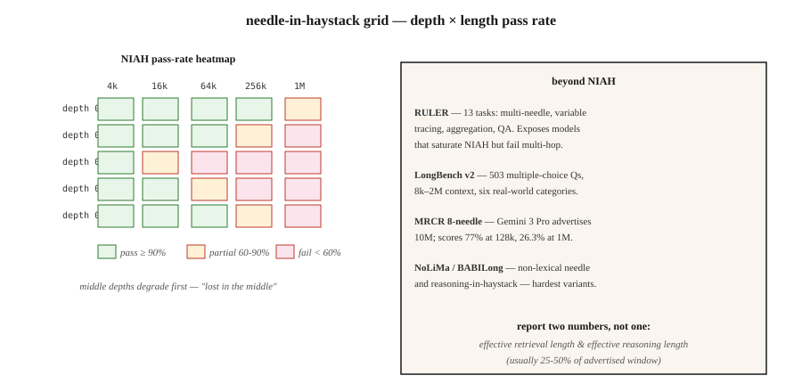

<!-- local-zh-machine-draft: English source is canonical; prose translated automatically, code/math preserved. -->

<a id="long-context-evaluation--niah-ruler-longbench-mrcr"></a>

# 长上下文 Evaluation — NIAH、RULER、LongBench、MRCR

> Gemini 3 Pro 通告 10M tokens 上下文。在 1M tokens 时，8 针 MRCR 下降至 26.3%。广告≠可用。长上下文 evaluation 告诉您所运输型号的实际容量。

**类型：** 了解
**语言：** Python
**先决条件：** 第 5·13 阶段（问答）、第 5·23 阶段（Chunking 策略）
**时间：** ~60 分钟

<a id="the-problem"></a>

## 问题

您有一份 200 页的合同。该模型声明一个 1M-token 上下文。你粘贴合同并询问：“终止条款是什么？”模型回答了——但是从封面页回答，因为终止条款位于 120k tokens 深度，超出了模型实际参与的位置。

这就是 2026 年的背景能力差距。规格表上写着 1M 或 10M。现实表明其中 60-70% 是可用的，而“可用”取决于任务。

- **检索（大海捞针）：**近乎完美，达到前沿模型上广告的最大值。
- ** 多跳/聚合：** 在大多数型号上急剧下降到超过约 128k。
- ** 对分散事实的推理：** 第一个任务失败。

长上下文 evaluation 测量这些轴。本课程列出了基准、每个基准实际测量的内容以及如何为您的域构建自定义针测试。

<a id="the-concept"></a>

## 概念



**大海捞针（NIAH，2023）。** 将一个事实（“神奇的词是菠萝”）放置在长上下文中的受控深度。请模型检索它。扫掠深度×长度。原始的长上下文基准。前沿模型现在已经饱和了这一点；这是一个必要但不充分的基线。

**RULER (Nvidia, 2024).** 跨 4 个类别的 13 个任务类型：检索（单/多键/多值）、多跳跟踪（变量跟踪）、聚合（常见词频）、QA。可配置的上下文长度（4k 到 128k+）。揭示了 NIAH 饱和但多跳失败的模型。在 2024 年版本中，声称 32k+ 上下文的 17 个模型中只有一半保持了 32k 的质量。

**LongBench v2 (2024).** 503道多项选择题，8k-2M单词上下文，六种任务类别：单文档QA、多文档QA、长in-context learning、长对话、代码仓库、长结构化数据。现实世界长上下文行为的生产基准。

**MRCR（多轮共参考分辨率）。** 大规模多轮共参考。 8 针、24 针、100 针型号。揭示在 attention 降级之前模型可以处理多少事实。

**NoLiMa.**“非词汇针。”针和查询没有文字重叠；检索需要一步语义推理。比NIAH还难。

**HELMET.** 连接多个文档，向任何一个文档提出问题。测试选择性 attention。

**BABILong.** 将 bAbI 推理链嵌入到不相关的干草堆中。测试大海捞针推理，而不仅仅是检索。

<a id="what-to-actually-report"></a>

### 实际报告什么

- **通告 context window.** 规格表编号。
- **有效检索长度。** NIAH 在某个阈值（例如 90%）通过。
- **有效推理长度。** 在该阈值处的多跳或聚合通过。
- ** 退化曲线。** 准确性与上下文长度，按任务类型绘制。

规格表有两个数字：检索有效和推理有效。通常推理有效率为广告窗口的 25-50%。

```figure
gx-niah-decay
```

<a id="build-it"></a>

## 动手实现

<a id="step-1-a-custom-niah-for-your-domain"></a>

### 第 1 步：为您的域定制 NIAH

参见 `code/main.py`。骨架：

```python
def build_haystack(filler_text, needle, depth_ratio, total_tokens):
    if not (0.0 <= depth_ratio <= 1.0):
        raise ValueError(f"depth_ratio must be in [0, 1], got {depth_ratio}")
    if total_tokens <= 0:
        raise ValueError(f"total_tokens must be positive, got {total_tokens}")

    filler_tokens = tokenize(filler_text)
    needle_tokens = tokenize(needle)
    if not filler_tokens:
        raise ValueError("filler_text produced no tokens")

    # Repeat filler until long enough to fill the haystack body.
    body_len = max(total_tokens - len(needle_tokens), 0)
    while len(filler_tokens) < body_len:
        filler_tokens = filler_tokens + filler_tokens
    filler_tokens = filler_tokens[:body_len]

    insert_at = min(int(body_len * depth_ratio), body_len)
    haystack = filler_tokens[:insert_at] + needle_tokens + filler_tokens[insert_at:]
    return " ".join(haystack)


def score_niah(model, haystack, question, expected):
    answer = model.complete(f"Context: {haystack}\nQ: {question}\nA:", max_tokens=50)
    return 1 if expected.lower() in answer.lower() else 0
```

扫`depth_ratio` ∈ {0, 0.25, 0.5, 0.75, 1.0} × `total_tokens` ∈ {1k, 4k, 16k, 64k}。绘制热图。这就是您的目标型号的 NIAH 卡。

<a id="step-2-a-multi-needle-variant"></a>

### 第 2 步：多针变体

```python
def build_multi_needle(filler, needles, total_tokens):
    depths = [0.1, 0.4, 0.7]
    chunks = [filler[:int(total_tokens * 0.1)]]
    for depth, needle in zip(depths, needles):
        chunks.append(needle)
        next_chunk = filler[int(total_tokens * depth): int(total_tokens * (depth + 0.3))]
        chunks.append(next_chunk)
    return " ".join(chunks)
```

诸如“三个神奇词是什么？”之类的问题需要检索所有三个。单针成功并不能预示多针成功。

<a id="step-3-multi-hop-variable-tracing-ruler-style"></a>

### 步骤3：多跳变量追踪（RULER-style）

```python
haystack = """X1 = 42. ... (filler) ... X2 = X1 + 10. ... (filler) ... X3 = X2 * 2."""
question = "What is X3?"
```

答案需要链接三个作业。 128k 的前沿模型的准确度通常会下降到 50-70%。

<a id="step-4-longbench-v2-on-your-stack"></a>

### 第 4 步：堆栈上的 LongBench v2

```python
from datasets import load_dataset
longbench = load_dataset("THUDM/LongBench-v2")

def eval_model_on_longbench(model, subset="single-doc-qa"):
    tasks = [x for x in longbench["test"] if x["task"] == subset]
    correct = 0
    for x in tasks:
        answer = model.complete(x["context"] + "\n\nQ: " + x["question"], max_tokens=20)
        if normalize(answer) == normalize(x["answer"]):
            correct += 1
    return correct / len(tasks)
```

报告每个类别的准确性。总分隐藏了任务级别的巨大差异。

<a id="pitfalls"></a>

## 陷阱

- **NIAH-仅 evaluation.** 以 1M 传递 NIAH tokens 没有提及多跳。始终运行 RULER 或自定义多跳测试。
- **统一深度 sampling.** 许多实现仅测试深度=0.5。测试深度=0, 0.25, 0.5, 0.75, 1.0 — “lost in the middle”效果是真实的。
- ** 与填充词的词汇重叠。** 如果针与填充词共享关键字，则检索变得微不足道。使用 NoLiMa 式非重叠针。
- **忽略延迟。** 1M-token prompts 需要 30-120 秒到 prefill。测量首次启动时间 token 和准确性。
- **供应商自我报告的数字。** OpenAI、Google、Anthropic 都发布了自己的分数。始终根据您的用例独立重新运行。

<a id="use-it"></a>

## 实际应用

2026 年堆栈：

| 情况 | 基准测试 |
|-----------|-----------|
| 快速健全性检查 | 定制 NIAH 3 种深度 × 3 种长度 |
| 生产选型 | 目标长度的标尺（13 个任务） |
| 真实世界的质量检查质量 | LongBench v2 单文档 QA 子集 |
| 多跳推理 | BABILong 或自定义变量跟踪 |
| 会话/对话 | MRCR 8 针达到您的目标长度 |
| 模型升级回归 | 修复内部 NIAH + RULER harness，在每个新型号上运行 |

生产的经验法则：永远不要相信 context window，除非您完成了达到预期长度的 NIAH + 1 推理任务。

<a id="ship-it"></a>

## 交付成果

另存为 `outputs/skill-long-context-eval.md`：

```markdown
---
name: long-context-eval
description: Design a long-context evaluation battery for a given model and use case.
version: 1.0.0
phase: 5
lesson: 28
tags: [nlp, long-context, evaluation]
---

Given a target model, target context length, and use case, output:

1. Tests. NIAH depth × length grid; RULER multi-hop; custom domain task.
2. Sampling. Depths 0, 0.25, 0.5, 0.75, 1.0 at each length.
3. Metrics. Retrieval pass rate; reasoning pass rate; time-to-first-token; cost-per-query.
4. Cutoff. Effective retrieval length (90% pass) and effective reasoning length (70% pass). Report both.
5. Regression. Fixed harness, rerun on every model upgrade, surface deltas.

Refuse to trust a context window from the model card alone. Refuse NIAH-only evaluation for any multi-hop workload. Refuse vendor self-reported long-context scores as independent evidence.
```

<a id="exercises"></a>

## 练习

1. **Easy.** 构建一个具有 3 个深度（0.25、0.5、0.75）× 3 个长度（1k、4k、16k）的 NIAH。在任何模型上运行。将通过率绘制为 3×3 热图。
2. **Medium.** 添加 3 针变体。测量每个长度上所有 3 个的恢复情况。与同长度单针通过率比较。
3. **Hard.** 构建嵌入在 64k 填充器中的变量跟踪任务（X1 → X2 → X3，具有 3 跳）。测量 3 个前沿模型的准确性。报告每个模型的有效推理长度。

<a id="key-terms"></a>

## 关键术语

| 术语 | 人们怎么说 | 它实际上意味着什么 |
|------|-----------------|-----------------------|
| NIAH | 大海捞针 | 在填充物中植入一个事实，要求模型检索它。 |
| 尺子 | 类固醇 NIAH | 跨检索/多跳/聚合/QA 的 13 种任务类型。 |
| 有效的背景 | 实际容量 | 精度仍保持在阈值以上的长度。 |
| Lost in the middle | 深度偏差 | 模型对长输入中间的内容关注不足。 |
| 多针 | 许多事实同时发生 | 多种植物；测试 attention 杂耍，而不是单独的检索。 |
| MRCR | 多轮核心 | 8、24 或 100 针共指；公开 attention saturation。 |
| 诺利玛 | 非词汇针 | 针和查询共享无文字 tokens；需要推理。 |

<a id="further-reading"></a>

## 进一步阅读

- [Kamradt (2023)。大海捞针分析](https://github.com/gkamradt/LLMTest_NeedleInAHaystack) — 最初的NIAH 存储库。
- [Hsieh 等人。 （2024）。标尺：长上下文 LM 的真实上下文大小是多少？](https://arxiv.org/abs/2404.06654) — 多任务基准。
- [Bai 等人。 （2024）。 LongBench v2](https://arxiv.org/abs/2412.15204) — 现实世界的长上下文评估。
- [Modarressi 等人。 （2024）。 NoLiMa：非词汇针](https://arxiv.org/abs/2404.06666) — 较硬的针。
- [Kuratov 等人。 （2024）。 BABILong](https://arxiv.org/abs/2406.10149) — 大海捞针推理。
- [Liu 等人。 （2024）。 Lost in the Middle：语言模型如何使用长上下文](https://arxiv.org/abs/2307.03172) - 深度偏差论文。
