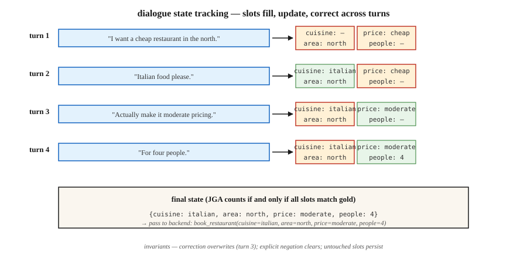

<!-- local-zh-machine-draft: English source is canonical; prose translated automatically, code/math preserved. -->

<a id="dialogue-state-tracking"></a>

# 对话状态跟踪

> “我想要在北部开一家便宜的餐厅……实际上要让它适中……并添加意大利菜。”三回合，三个状态更新。 DST 使槽值字典保持同步，以便预订有效。

**类型：** 构建
**语言：** Python
**先决条件：** 第 5·17 阶段（聊天机器人）、第 5·20 阶段 (Structured Outputs)
**时间：** ~75分钟

<a id="the-problem"></a>

## 问题

在面向任务的对话系统中，用户的目标被编码为一组槽值对：`{cuisine: italian, area: north, price: moderate}`。每个用户回合都可以添加、更改或删除插槽。系统必须读取整个对话并正确输出当前状态。

如果一个时段出错，系统就会预订错误的餐厅、安排错误的航班或收取错误的卡费。 DST 是用户所说和后端执行之间的枢纽。

尽管 LLMs，为什么它在 2026 年仍然很重要：

- 合规性敏感的领域（银行、医疗保健、航空预订）需要确定的槽值，而不是自由形式的生成。
- 工具使用agents在调用APIs之前仍然需要槽解析。
- 多轮修正比看起来更难：“实际上不，周四吧。”

现代管道：经典 DST 概念 + LLM 提取器 + 结构化输出 guardrails。

<a id="the-concept"></a>

## 概念



**任务结构。** 模式定义域（餐厅、酒店、出租车）及其槽位（美食、区域、价格、人员）。每个槽可以是空的，可以填充封闭集中的值（价格：{便宜，中等，昂贵}），或自由形式的值（名称：“铜水壶”）。

**两种DST配方。**

- **Classification.** 对于每个（slot，candidate_value）对，预测是/否。适用于封闭词汇槽。 2020 年之前的标准。
- **Generation.** 根据对话，将槽值生成为自由文本。适用于开放词汇槽。现代的默认设置。

**Metric.** 关节目标精度 (JGA) — *every* 槽正确的匝数分数。全有或全无。 2026 年，MultiWOZ 2.4 排行榜将达到 83% 左右。

**Architectures.**

1. **基于规则（槽正则表达式+关键字）。** 窄域的强大基线。可调试。
2. **TripPy / BERT-DST.** 使用 BERT 编码进行基于复制的生成。预LLM标准。
3. **LDST (LLaMA + LoRA).** 具有域槽提示的指令调整 LLM。在 MultiWOZ 2.4 上达到 ChatGPT 级别质量。
4. **Ontology-free (2024–26).** 跳过模式；直接生成插槽名称和值。处理开放域。
5. **Prompt + structured output (2024–26).** LLM 具有 Pydantic 模式 + 约束解码。 5 行代码，可用于生产。

<a id="the-classic-failure-modes"></a>

### 经典失效模式

- ** 跨匝参考。** “让我们保留第一个选项。”需要解决哪个选项。
- **Over-write 与追加。** 用户说“添加意大利语”。你是替换菜品还是追加菜品？
- **隐式确认。**“好酷”——是否接受了所提供的预订？
- **Correction.**“实际上是晚上7点。”必须在不清除其他插槽的情况下更新时间。
- **参考之前的系统话语。** “是的，就是那个。”哪个“那个”？

```figure
n5-slot-tracker
```

<a id="build-it"></a>

## 动手实现

<a id="step-1-rule-based-slot-extractor"></a>

### 第 1 步：基于规则的槽提取器

参见 `code/main.py`。正则表达式 + 同义词词典涵盖了狭窄领域中 70% 的规范话语：

```python
CUISINE_SYNONYMS = {
    "italian": ["italian", "pasta", "pizza", "italy"],
    "chinese": ["chinese", "chow mein", "noodles"],
}


def extract_cuisine(utterance):
    for canonical, synonyms in CUISINE_SYNONYMS.items():
        if any(syn in utterance.lower() for syn in synonyms):
            return canonical
    return None
```

规范 vocabulary 之外易碎。适用于确定性插槽确认。

<a id="step-2-state-update-loop"></a>

### 步骤2：状态更新循环

```python
def update_state(state, utterance):
    new_state = dict(state)
    for slot, extractor in SLOT_EXTRACTORS.items():
        value = extractor(utterance)
        if value is not None:
            new_state[slot] = value
    for slot in NEGATION_CLEARS:
        if is_negated(utterance, slot):
            new_state[slot] = None
    return new_state
```

三个不变量：

- 切勿重置用户未触及的插槽。
- 明确的否定（“别介意美食”）必须明确。
- 用户更正（“实际上...”）必须覆盖，而不是追加。

<a id="step-3-llm-driven-dst-with-structured-output"></a>

### 步骤3：LLM使用structured output驱动的DST

```python
from pydantic import BaseModel
from typing import Literal, Optional
import instructor

class RestaurantState(BaseModel):
    cuisine: Optional[Literal["italian", "chinese", "indian", "thai", "any"]] = None
    area: Optional[Literal["north", "south", "east", "west", "center"]] = None
    price: Optional[Literal["cheap", "moderate", "expensive"]] = None
    people: Optional[int] = None
    day: Optional[str] = None


def llm_dst(history, llm):
    prompt = f"""You track the slot values of a restaurant booking across turns.
Dialogue so far:
{render(history)}

Update the state based on the latest user turn. Output only the JSON state."""
    return llm(prompt, response_model=RestaurantState)
```

Instructor + Pydantic 保证有效的状态对象。没有正则表达式，没有模式不匹配，没有幻觉的插槽。

<a id="step-4-jga-evaluation"></a>

### 步骤4：JGA evaluation

```python
def joint_goal_accuracy(predicted_states, gold_states):
    correct = sum(1 for p, g in zip(predicted_states, gold_states) if p == g)
    return correct / len(predicted_states)
```

校准：系统在所有槽位上都正确转动了多少圈？对于 MultiWOZ 2.4，2026 个顶级系统：80-83%。您的域内系统应该超过您的狭窄 vocabulary 上的系统，否则 LLM 基线会击败您。

<a id="step-5-handling-correction"></a>

### 第五步：处理修正

```python
CORRECTION_CUES = {"actually", "no wait", "on second thought", "change that to"}


def is_correction(utterance):
    return any(cue in utterance.lower() for cue in CORRECTION_CUES)
```

在检测到更正时，覆盖最后更新的槽而不是追加。如果没有 LLM 的帮助，很难做到这一点。现代模式：始终让 LLM 从历史记录中重新生成整个状态，而不是增量更新 - 这自然会处理更正。

<a id="pitfalls"></a>

## 陷阱

- **全历史再生成本。** 让LLM每轮重新生成状态的成本为O(n²)，总计tokens。限制历史或总结较旧的回合。
- **Schema 漂移。** 事后添加新槽会破坏旧的训练数据。对您的架构进行版本控制。
- **区分大小写。** “Italian” vs “italian” vs “ITALIAN” — 处处标准化。
- **隐式继承。** 如果用户先前指定了“for 4 people”，则不同时间的新请求不应清除人员。始终传递完整的历史。
- **自由形式与封闭集。** 名称、时间和地址需要自由形式槽；美食和区域已关闭。在架构中混合两者。

<a id="use-it"></a>

## 实际应用

2026 年堆栈：

| 情况 | 方法 |
|-----------|----------|
| 狭窄的领域（一个或两个意图） | 基于规则+正则表达式 |
| 领域广泛，可用标记数据 | LDST（MultiWOZ 样式数据上的 LLaMA + LoRA） |
| 广泛的领域，无标签，产品就绪 | LLM + 讲师 + Pydantic 模式 |
| 口语/声音 | ASR + 标准化器 + LLM-DST |
| 多域预订流程 | 具有每个域 Pydantic 模型的模式引导 LLM |
| 合规性敏感 | 基于规则的主要，LLM 回退与确认流程 |

<a id="ship-it"></a>

## 交付成果

另存为 `outputs/skill-dst-designer.md`：

```markdown
---
name: dst-designer
description: Design a dialogue state tracker — schema, extractor, update policy, evaluation.
version: 1.0.0
phase: 5
lesson: 29
tags: [nlp, dialogue, task-oriented]
---

Given a use case (domain, languages, vocab openness, compliance needs), output:

1. Schema. Domain list, slots per domain, open vs closed vocabulary per slot.
2. Extractor. Rule-based / seq2seq / LLM-with-Pydantic. Reason.
3. Update policy. Regenerate-whole-state / incremental; correction handling; negation handling.
4. Evaluation. Joint Goal Accuracy on a held-out dialogue set, slot-level precision/recall, confusion on the hardest slot.
5. Confirmation flow. When to explicitly ask the user to confirm (destructive actions, low-confidence extractions).

Refuse LLM-only DST for compliance-sensitive slots without a rule-based secondary check. Refuse any DST that cannot roll back a slot on user correction. Flag schemas without version tags.
```

<a id="exercises"></a>

## 练习

1. **Easy.** 在 `code/main.py` 中为 3 个槽（菜系、区域、价格）构建基于规则的状态跟踪器。对 10 个手工制作的对话进行测试。测量 JGA。
2. **Medium.** 与 Instructor + Pydantic + 一个小的 LLM 相同的数据集。比较JGA。检查最困难的转弯。
3. **Hard.** 实现和路由：基于规则的主要，LLM 当基于规则自信地发出 <2 个时隙时回退。测量每圈 JGA 和 inference 的组合成本。

<a id="key-terms"></a>

## 关键术语

| 术语 | 人们怎么说 | 它实际上意味着什么 |
|------|-----------------|-----------------------|
| 夏令时 | 对话状态跟踪 | 在对话轮次中维护槽值字典。 |
| 插槽 | 用户意图单位 | 命名为 parameter 后端需求（菜系、日期）。 |
| 域名 | 任务区 | 餐厅、酒店、出租车——老虎机的集合。 |
| 日本GA | 联合目标准确度 | 每个槽都正确的匝数分数。全有或全无。 |
| 多WOZ | 基准 | 多域WOZ数据集；标准 DST evaluation。 |
| 无本体 DST | 无架构 | 直接生成插槽名称和值，没有固定列表。 |
| 修正 | “其实……” | 转动会覆盖先前填充的插槽。 |

<a id="further-reading"></a>

## 进一步阅读

- [Budzianowski 等人。 （2018）。 MultiWOZ — 大规模多域 Wizard-of-Oz](https://arxiv.org/abs/1810.00278) — 规范基准。
- [Feng 等人。 （2023）。针对 LLM 驱动的对话状态跟踪 (LDST)](https://arxiv.org/abs/2310.14970) — LLaMA + LoRA 针对 DST 的指令调整。
- [Heck 等人。 （2020）。 TripPy — 价值独立神经对话状态跟踪的三重复制策略](https://arxiv.org/abs/2005.02877) — 基于复制的 DST 主力。
- [King，弗拉尼根（2024）。与 LLMs](https://arxiv.org/abs/2404.10753) 进行无监督的端到端面向任务的对话 — 基于 EM 的无监督 TOD。
- [MultiWOZ 排行榜](https://github.com/budzianowski/multiwoz) — 规范的 DST 结果。
