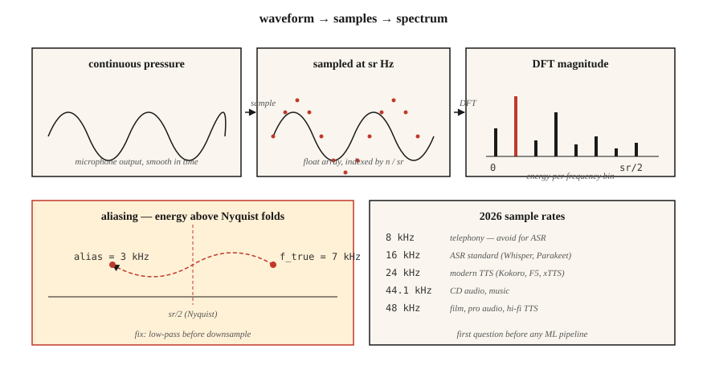

<!-- local-zh-machine-draft: English source is canonical; prose translated automatically, code/math preserved. -->

<a id="audio-fundamentals--waveforms-sampling-fourier-transform"></a>

# 音频基础知识 — 波形、Sampling、傅里叶变换

> 波形是原始信号。频谱图是表示。 Mel features 是 ML 友好的形式。每个现代 ASR 和 TTS 管道都走这个阶梯，第一个梯级是理解 sampling 和傅里叶。

**类型：** 了解
**语言：** Python
**先决条件：** 第 1 阶段·06（向量和矩阵）、第 1 阶段·14（概率分布）
**时间：** ~45分钟

<a id="the-problem"></a>

## 问题

麦克风产生压力与时间的信号。您的神经网络消耗 tensors。它们之间存在着一堆约定，一旦违反，就会产生无声的错误：模型训练得很好，但 WER 翻倍，或者 TTS 发出嘶嘶声，或者语音克隆系统会记住麦克风而不是扬声器。

语音系统中的每个错误 traces 都会回到三个问题之一：

1. 数据记录的采样率是多少？模型期望什么？
2. 信号是否存在混叠？
3. 您是在原始样本上操作还是在频率表示上操作？

做好这些，第 6 阶段的 rest 就很容易处理。如果它们出错，甚至 Whisper-Large-v4 也会产生垃圾。

<a id="the-concept"></a>

## 概念



**Waveform.** `[-1.0, 1.0]` 中的一维浮点数组。按样本编号索引。要转换为秒，请除以采样率：`t = n / sr`。 16 kHz 的 10 秒剪辑是一个包含 160,000 个浮点的数组。

**Sampling 速率 (sr).** 每秒有多少个样本。 2026 年通用费率：

| 率 | 使用 |
|------|-----|
| 8kHz | 电话、传统 VOIP。 4 kHz 的奈奎斯特消除了辅音。避免使用 ASR。 |
| 16kHz | ASR 标准。 Whisper、Parakeet、SeamlessM4T v2 均消耗 16 kHz。 |
| 22.05kHz | 针对旧模型的 TTS 声码器训练。 |
| 24kHz | 现代 TTS（Kokoro、F5-TTS、xTTS v2）。 |
| 44.1 kHz | CD音频、音乐。 |
| 48kHz | 电影、专业音频、高保真 TTS（VALL-E 2、NaturalSpeech 3）。 |

**奈奎斯特-香农。**采样率为`sr`可以明确表示频率高达`sr/2`。 这`sr/2`边界是*奈奎斯特频率*。 高于奈奎斯特的能量得到*别名的*- 折叠成较低频率 - 并破坏信号。 在下采样之前始终进行低通滤波器。

**位深度。** 16位PCM（signed int16，范围±32,767）是通用交换格式。 24 位用于音乐，32 位浮点用于内部 DSP。像 `soundfile` 这样的库读取 int16 但在 `[-1, 1]` 中公开 float32 数组。

**傅里叶变换.** 任何有限信号都是不同频率的正弦波之和。对于 `N` 样本，离散傅立叶变换 (DFT) 计算 `N` 复系数 — 每个频率仓一个。 `bin k` 映射到频率 `k · sr / N` Hz。幅度是该频率下的幅度，角度是相位。

**FFT.** 快速傅里叶变换：当 `N` 是 2 的幂时，用于 DFT 的 `O(N log N)` 算法。每个音频库都在底层使用 FFT。 16 kHz 下的 1024 样本 FFT 提供 512 个可用频率档，跨度为 0-8 kHz，分辨率为 15.6 Hz。

**Framing + window.** 我们不对整个剪辑进行 FFT。我们将其切成重叠的 * 帧 * （通常为 25 毫秒，跳频为 10 毫秒），将每个帧乘以窗口函数（Hann、Hamming）以消除边缘不连续性，然后对每个帧进行 FFT。这就是短时傅立叶变换 (STFT)。第 02 课从这里开始。

```figure
mel-scale
```

<a id="build-it"></a>

## 动手实现

<a id="step-1-read-a-clip-and-plot-the-waveform"></a>

### 第 1 步：读取剪辑并绘制波形

`code/main.py` 仅使用 stdlib `wave` 模块来保持演示不依赖。对于生产，您将使用 `soundfile` 或 `torchaudio.load` （两者都返回 `(waveform, sr)` 元组）：

```python
import soundfile as sf
waveform, sr = sf.read("clip.wav", dtype="float32")  # shape (T,), sr=int
```

<a id="step-2-synthesize-a-sine-wave-from-first-principles"></a>

### 步骤 2：根据第一原理合成正弦波

```python
import math

def sine(freq_hz, sr, seconds, amp=0.5):
    n = int(sr * seconds)
    return [amp * math.sin(2 * math.pi * freq_hz * i / sr) for i in range(n)]
```

16 kHz 下 1 秒的 440 Hz 正弦波（音乐会 A）为 16,000 个浮点数。使用 16 位 PCM 编码，使用 `wave.open(..., "wb")` 进行写入。

<a id="step-3-compute-the-dft-by-hand"></a>

### 第 3 步：手动计算 DFT

```python
def dft(x):
    N = len(x)
    out = []
    for k in range(N):
        re = sum(x[n] * math.cos(-2 * math.pi * k * n / N) for n in range(N))
        im = sum(x[n] * math.sin(-2 * math.pi * k * n / N) for n in range(N))
        out.append((re, im))
    return out
```

`O(N²)` — `N=256` 可以用来确认正确性，但对于真实音频来说没用。真实代码调用 `numpy.fft.rfft` 或 `torch.fft.rfft`。

<a id="step-4-find-the-dominant-frequency"></a>

### 第四步：找到主频率

幅度峰值索引 `k_star` 映射到频率 `k_star * sr / N`。在 440 Hz 正弦上运行此命令应在 bin `440 * N / sr` 处返回峰值。

<a id="step-5-demonstrate-aliasing"></a>

### 第 5 步：演示别名

以 10 kHz（奈奎斯特 = 5 kHz）采样 7 kHz 正弦波。 7 kHz 音调高于奈奎斯特并折叠至 `10 − 7 = 3 kHz`。 FFT 峰值出现在 3 kHz 处。这是经典的混叠演示，也是每个 DAC/ADC 都配备砖墙低通滤波器的原因。

<a id="use-it"></a>

## 实际应用

您将在 2026 年实际交付的堆栈：

| 任务 | 图书馆 | 为什么 |
|------|---------|-----|
| 读/写WAV/FLAC/OGG | `soundfile`（libsndfile 包装器） | 最快、稳定、返回 float32。 |
| 重新取样 | `torchaudio.transforms.Resample` 或 `librosa.resample` | 内置正确的抗锯齿功能。 |
| STFT/梅尔 | `torchaudio` 或 `librosa` | GPU-友好； PyTorch 生态系统。 |
| 实时streaming | `sounddevice` 或 `pyaudio` | 跨平台 PortAudio 绑定。 |
| 检查文件 | `ffprobe` 或 `soxi` | CLI，快速，报告 sr/channels/codec。 |

决策规则：** 在匹配其他任何内容之前先匹配采样率**。 Whisper 期望 16 kHz 单声道 float32。通过 44.1 kHz 立体声，您会得到看起来像模型错误的垃圾。

<a id="ship-it"></a>

## 交付成果

保存为 `outputs/skill-audio-loader.md`。该技能可帮助您检查音频输入是否与下游模型的期望匹配，并在不匹配时正确重新采样。

<a id="exercises"></a>

## 练习

1. **Easy.** 在 16 kHz 下合成 220 Hz + 440 Hz + 880 Hz 的 1 秒混音。运行 DFT。确认预期箱中的三个峰值。
2. **Medium.** 以 48 kHz 录制 3 秒的 WAV 语音。使用 `torchaudio.transforms.Resample`（具有抗锯齿功能）将采样率降低至 16 kHz，然后使用简单抽取（每三个样本）将采样率降低至 16 kHz。对两者进行 FFT。别名出现在哪里？
3. **Hard.** 仅使用 `math` 和步骤 3 中的 DFT 从头开始构建 STFT。帧大小 400，跳数 160，Hann 窗。使用 `matplotlib.pyplot.imshow` 绘制震级。这是第 02 课的频谱图。

<a id="key-terms"></a>

## 关键术语

| 术语 | 人们怎么说 | 它实际上意味着什么 |
|------|-----------------|-----------------------|
| 采样率 | 每秒有多少个样本 | ADC 测量信号的频率（以 Hz 为单位）。 |
| 奈奎斯特 | 您可以表示的最大频率 | `sr/2`；其上方的能量会别名回落。 |
| 位深度 | 每个样品的分辨率 | `int16` = 65,536 级； `float32` = `[-1, 1]` 中的 24 位精度。 |
| 密度泛函理论 | 序列的傅里叶变换 | `N` 样本 → `N` 复频率系数。 |
| 快速傅里叶变换 | 快速 DFT | `O(N log N)` 算法需要 `N` = 2 的幂。 |
| 宾 | 频率栏 | `k · sr / N`赫兹;分辨率 = `sr / N`。 |
| 短时傅里叶变换 | 底层的频谱图 | 随着时间的推移，帧+加窗 FFT。 |
| 混叠 | 奇怪的频率幽灵 | 高于奈奎斯特的能量镜像到较低的垃圾箱。 |

<a id="further-reading"></a>

## 进一步阅读

- [香农（1949）。存在噪声时的通信](https://people.math.harvard.edu/~ctm/home/text/others/shannon/entropy/entropy.pdf) — sampling 定理背后的论文。
- [Smith — 科学家和工程师数字信号处理指南](https://www.dspguide.com/ch8.htm) — 免费、规范的 DSP 教科书。
- [librosa 文档 — 音频入门](https://librosa.org/doc/latest/auto_tutorials/index.html) — 带代码的实用演练。
- [Heinrich Kuttruff — 室内声学（第 6 版）](https://www.taylorfrancis.com/books/mono/10.1201/9781315372150/room-acoustics-heinrich-kuttruff) — 了解为什么现实世界的音频不是干净的正弦曲线。
- [Steve Eddins — FFT 解释笔记本](https://blogs.mathworks.com/steve/2020/03/30/fft-spectrum-and-spectral-densities/) — 频率仓直觉在 10 分钟内清除。
