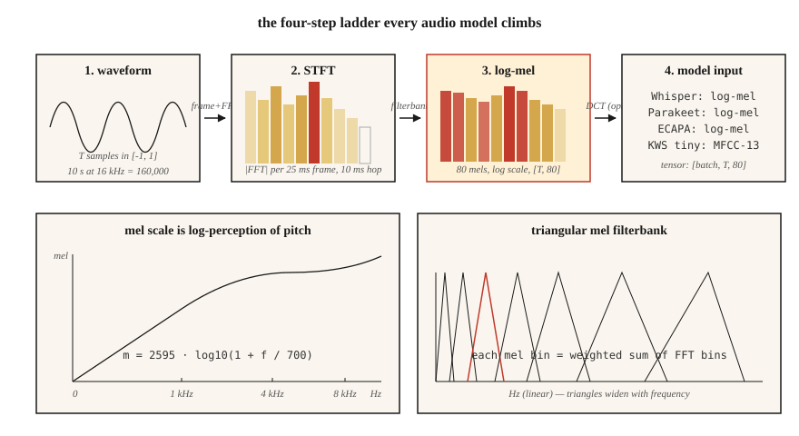

<!-- local-zh-machine-draft: English source is canonical; prose translated automatically, code/math preserved. -->

<a id="spectrograms-mel-scale--audio-features"></a>

# 频谱图、Mel 刻度与音频 Features

> 神经网络不能很好地消耗原始波形。他们消耗频谱图。他们更好地理解梅尔谱图。到 2026 年，每个 ASR、TTS 和音频分类器的生死存亡都取决于这个单一的预处理选择。

**类型：** 构建
**语言：** Python
**先决条件：** 第 6 阶段·01（音频基础知识）
**时间：** ~45分钟

<a id="the-problem"></a>

## 问题

拍摄 10 秒 16 kHz 剪辑。那是 160,000 个浮点数，全部在 `[-1, 1]` 中，几乎与标签“狗叫”或“猫这个词”完全不相关。原始波形包含信息，但其形式是模型无法轻松提取的。相隔 100 毫秒说出的两个相同音素具有完全不同的原始样本。

频谱图可以解决这个问题。它会瓦解人类感知忽略的时间细节（微秒抖动），并保留感知参与的结构（这些频率是充满活力的，在大约 10-25 毫秒的时间窗口内）。

梅尔谱图更进一步。人类以对数方式感知音高：100 Hz 与 200 Hz 听起来与 1000 Hz 与 2000 Hz 的“距离相同”。梅尔刻度扭曲频率轴以匹配。梅尔尺度频谱图是 2010 年到 2026 年语音 ML 中最重要的 feature。

<a id="the-concept"></a>

## 概念



**STFT（短时傅立叶变换）。** 将波形分割为重叠帧（典型：25 ms 窗口，10 ms 跳 = 400 个样本/16 kHz 时的 160 个样本）。将每个帧乘以一个窗口函数（Hann 是默认值；Hamming 略有不同的权衡）。对每一帧进行 FFT。将幅度谱堆叠成形状为 `(n_frames, n_freq_bins)` 的矩阵。那是你的频谱图。

**Log-magnitude.** 原始幅度跨越 5-6 个数量级。采用`log(|X| + 1e-6)`或`20 * log10(|X|)`来压缩动态范围。每个生产管道都使用对数幅度，而不是原始幅度。

**Mel 比例。** 频率 `f`（以 Hz 为单位）通过 `m = 2595 * log10(1 + f / 700)` 映射到梅尔 `m`。映射在 1 kHz 以下大致呈线性，高于 1 kHz 大致呈对数。覆盖 0-8 kHz 的 80 个梅尔箱是标准 ASR 输入。

**Mel 滤波器组。** 一组在梅尔刻度上等间隔的三角形滤波器。每个滤波器都是相邻 FFT bin 的加权和。将 STFT 幅度乘以滤波器组矩阵即可得到一个 matmul 中的梅尔频谱图。

**Log-mel 频谱图。** `log(mel_spec + 1e-10)`。Whisper的输入。鹦鹉的输入。 SeamlessM4T 的输入。通用 2026 音频前端。

**MFCCs.** 获取 log-mel 频谱图，应用 DCT（II 型），保留前 13 个系数。对 features 进行去相关并进一步压缩。 feature 一直占据主导地位，直到 2015 年左右，原始原木上的 CNNs/Transformers 赶上了。仍用于说话人识别（x 向量、ECAPA）。

**分辨率交易。** 更大的FFT =更好的频率分辨率，但更差的时间分辨率。 25 ms / 10 ms 是音频 ML 默认值；音乐为 50 毫秒/12.5 毫秒； 5 ms / 2 ms 用于瞬态检测（鼓声、爆破声）。

```figure
spectrogram-window
```

<a id="build-it"></a>

## 动手实现

<a id="step-1-frame-the-waveform"></a>

### 第 1 步：构建波形

```python
def frame(signal, frame_len, hop):
    n = 1 + (len(signal) - frame_len) // hop
    return [signal[i * hop : i * hop + frame_len] for i in range(n)]
```

使用 `frame_len=400, hop=160` 的 10 秒 16 kHz 剪辑会产生 998 帧。

<a id="step-2-hann-window"></a>

### 第二步：汉恩窗

```python
import math

def hann(N):
    return [0.5 * (1 - math.cos(2 * math.pi * n / (N - 1))) for n in range(N)]
```

在 FFT 之前按元素相乘。消除因在非零端点处截断而导致的频谱泄漏。

<a id="step-3-stft-magnitude"></a>

### 步骤 3：STFT 幅度

```python
def stft_magnitude(signal, frame_len=400, hop=160):
    win = hann(frame_len)
    frames = frame(signal, frame_len, hop)
    return [magnitudes(dft([w * s for w, s in zip(win, f)])) for f in frames]
```

生产使用 `torch.stft` 或 `librosa.stft`（FFT 支持，矢量化）。这里的循环是教学性的；它在 `code/main.py` 中的短片上运行。

<a id="step-4-mel-filterbank"></a>

### 步骤 4：梅尔滤波器组

```python
def hz_to_mel(f):
    return 2595.0 * math.log10(1.0 + f / 700.0)

def mel_to_hz(m):
    return 700.0 * (10 ** (m / 2595.0) - 1)

def mel_filterbank(n_mels, n_fft, sr, fmin=0, fmax=None):
    fmax = fmax or sr / 2
    mels = [hz_to_mel(fmin) + (hz_to_mel(fmax) - hz_to_mel(fmin)) * i / (n_mels + 1)
            for i in range(n_mels + 2)]
    hzs = [mel_to_hz(m) for m in mels]
    bins = [int(h * n_fft / sr) for h in hzs]
    fb = [[0.0] * (n_fft // 2 + 1) for _ in range(n_mels)]
    for m in range(n_mels):
        for k in range(bins[m], bins[m + 1]):
            fb[m][k] = (k - bins[m]) / max(1, bins[m + 1] - bins[m])
        for k in range(bins[m + 1], bins[m + 2]):
            fb[m][k] = (bins[m + 2] - k) / max(1, bins[m + 2] - bins[m + 1])
    return fb
```

使用 `n_fft=400` 覆盖 0–8 kHz 的 80 mel 给出 `(80, 201)` 矩阵。将 `(n_frames, 201)` STFT 幅度乘以转置即可得到 `(n_frames, 80)` 梅尔频谱图。

<a id="step-5-log-mel"></a>

### 第5步：记录梅尔

```python
def log_mel(mel_spec, eps=1e-10):
    return [[math.log(max(v, eps)) for v in frame] for frame in mel_spec]
```

常见替代方案：`librosa.power_to_db`（参考归一化 dB）、`10 * log10(power + eps)`。 Whisper 使用更复杂的剪辑 + 标准化例程（请参阅 Whisper 的 `log_mel_spectrogram`）。

<a id="step-6-mfccs"></a>

### 第 6 步：MFCC

```python
def dct_ii(x, n_coeffs):
    N = len(x)
    return [
        sum(x[n] * math.cos(math.pi * k * (2 * n + 1) / (2 * N)) for n in range(N))
        for k in range(n_coeffs)
    ]
```

对每个 log-mel 帧应用 DCT，保留前 13 个系数。这就是您的 MFCC 矩阵。第一个系数通常被丢弃（它编码整体能量）。

<a id="use-it"></a>

## 实际应用

2026 年堆栈：

| 任务 | Features |
|------|----------|
| ASR（Whisper、Parakeet、SeamlessM4T） | 80 log-mels、10 ms 跳跃、25 ms 窗口 |
| TTS声学模型（VITS、F5-TTS、Kokoro） | 80 梅尔，5–12 毫秒跳跃，用于精细时间控制 |
| 音频分类（AST、PANN、BEAT） | 128 维 log-mels，帧移 10 ms |
| 扬声器 embedding (ECAPA-TDNN, WavLM) | 80 对数梅尔或原始波形 SSL |
| 音乐（MusicGen、稳定音频 2） | EnCodec 离散 tokens（不是梅尔） |
| 关键词发现 | 40 个适用于小型设备的 MFCC |

经验法则：** 如果您不从事音乐工作，请从 80 log-mels 开始。** 举证责任在于任何偏差。

<a id="pitfalls-that-still-ship-in-2026"></a>

## 2026 年仍然存在的陷阱

- **Mel 计数不匹配。** 训练 80 梅尔，inference 训练 128 梅尔。无声的失败。在两端记录 feature 形状。
- ** 上游采样率不匹配。** 在 22.05 kHz 计算的梅尔值看起来与 16 kHz 不同。修复 * 特征化之前的 SR *。
- **dB 与 log.** Whisper 期望 log-mel，而不是 dB-mel。一些高频管道自动检测；您的自定义代码不会。
- **Normalization 漂移。** 训练期间的每句话 normalization，inference 期间的全局 normalization。生产错误使 WER 加倍。
- ** 填充泄漏。** 剪辑末尾的零填充会在尾随帧中产生平坦的频谱。对称垫或复制。

<a id="ship-it"></a>

## 交付成果

保存为 `outputs/skill-feature-extractor.md`。该技能为给定模型目标选择 feature 类型、梅尔计数、帧/跳和 normalization。

<a id="exercises"></a>

## 练习

1. **Easy.** 运行`code/main.py`。它合成一个线性调频脉冲（频率扫描 200 → 4000 Hz）并打印每帧的 argmax mel bin。绘图（可选）并确认其与扫描匹配。
2. **Medium.** 重新运行 `{40, 80, 128}` 中的 `n_mels` 和 `{200, 400, 800}` 中的 `frame_len`。测量时间轴上的尖峰带宽。哪种组合最能解决叽叽喳喳的问题？
3. **Hard.** 实现 `power_to_db` 并使用 (a) 原始 log-mel、(b) dB-mel 与 `ref=max`、(c) MFCC-13 比较 AudioMNIST 上小型 CNN 分类器的 ASR 精度+ 德尔塔 + 德尔塔-德尔塔。报告 top-1 准确度。

<a id="key-terms"></a>

## 关键术语

| 术语 | 人们怎么说 | 它实际上意味着什么 |
|------|-----------------|-----------------------|
| 框架 | 一片 | 25 毫秒的波形块馈送到一个 FFT。 |
| 啤酒花 | 跨步 | 连续帧之间的样本； ASR 默认值为 10 毫秒。 |
| 窗户 | 汉/汉明的事 | 将帧边缘逐渐缩小到零的逐点乘法器。 |
| 短时傅里叶变换 | 频谱图生成器 | 加框+加窗FFT；产生时间×频率矩阵。 |
| 梅尔 | 扭曲频率 | 对数感知量表； `m = 2595·log10(1 + f/700)`。 |
| 滤波器组 | 矩阵 | 将 STFT 投影到梅尔箱上的三角形滤波器。 |
| 对数梅尔 | Whisper的输入 | `log(mel_spec + eps)`； 2026年标准化。 |
| 微流控催化裂化 | 老派 feature | log-mel 的 DCT； 13 个系数，去相关。 |

<a id="further-reading"></a>

## 进一步阅读

- [戴维斯，默梅尔斯坦（1980）。单音节词识别参数表示的比较](https://ieeexplore.ieee.org/document/1163420) — MFCC 论文。
- [史蒂文斯、福克曼、纽曼（1937）。心理量级测量量表 ](https://pubs.aip.org/asa/jasa/article-abstract/8/3/185/735757/) — 原始梅尔量表。
- [OpenAI — Whisper 源，log_mel_spectrogram](https://github.com/openai/whisper/blob/main/whisper/audio.py) — 阅读参考实现。
- [librosa feature 提取文档](https://librosa.org/doc/latest/api/feature.html) — `mfcc`、`melspectrogram` 和跳跃/窗口的参考。
- [NVIDIA NeMo — 音频预处理](https://docs.nvidia.com/deeplearning/nemo/user-guide/docs/en/main/asr/asr_all.html#featurizers) — Parakeet + Canary 模型的生产规模管道。
