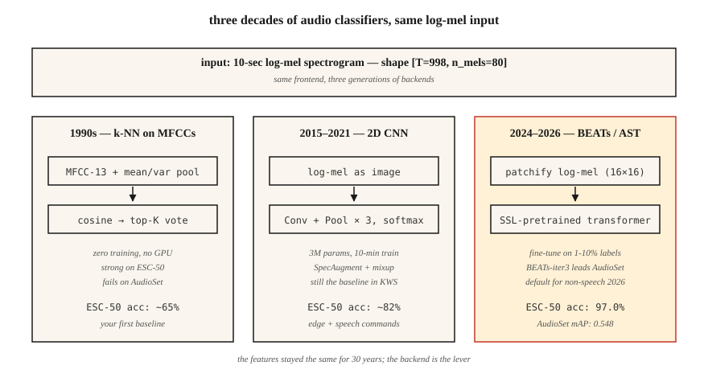

<!-- local-zh-machine-draft: English source is canonical; prose translated automatically, code/math preserved. -->

<a id="audio-classification--from-k-nn-on-mfccs-to-ast-and-beats"></a>

# 音频分类——从 MFCC 上的 k-NN 到 AST 和 BEAT

> 从“狗叫与警报”到“这是什么语言”的一切都是音频分类。 features 是梅尔斯。该架构每十年都会发生变化。 evaluation 保持 AUC、F1 和每类召回率。

**类型：** 构建
**语言：** Python
**先决条件：** 第 6 阶段·02（频谱图和 Mel）、第 3 阶段·06 (CNNs)、第 5 阶段·08（CNNs 和 RNNs 用于文本）
**时间：** ~75分钟

<a id="the-problem"></a>

## 问题

您会得到一个 10 秒的剪辑。你想知道：“这是什么？”城市声音（警笛、钻头、狗）、语音命令（是/否/停止）、语言 ID（en/es/ar）、说话者情绪（愤怒/中性）或环境声音（室内/室外、胡言乱语）。所有这些都是*音频分类*，2026年基线架构成熟：log-mel→CNN或Transformer→softmax。

核心困难不是网络。这是数据。音频数据集具有严重的类别不平衡、强烈的域转移（干净与嘈杂）和标签噪声（谁决定“城市喧嚣”与“餐厅噪音”？）。 80% 的问题是管理、增强和 evaluation，而不是将 CNN 替换为 Transformer。

<a id="the-concept"></a>

## 概念



MFCC 上的 **k-NN（1990 年代基线）。** 压平每个剪辑的 MFCC，将 cosine similarity 计算到标记库，返回前 K 的多数投票。在干净的小型数据集（语音命令，ESC-50）上令人惊讶地强大。无需 GPU 即可运行。

**2D CNN on log-mels (2015-2019).** 将 `(T, n_mels)` log-mel 视为图像。应用 ResNet-18 或 VGG 风格。全局平均池时间轴。 Softmax 过类。仍然是大多数 2026 年 Kaggle 比赛的基准。

**音频频谱图 Transformer, AST (2021-2024).** 修补 log-mel (例如 16×16 patches)，添加位置embeddings，馈送到 ViT。用于监督学习的 AudioSet (mAP 0.485) 的最新技术。

**BEATs 和 WavLM-base (2024-2026).** 自我监督 pretraining 数百万小时。使用您需要的 1-10% 的监督数据微调您的任务。 2026 年，这是非语音音频的默认起点。 BEATs-iter3 在 AudioSet 上以 1-2 mAP 击败 AST，同时使用 1/4 的计算量。

**Whisper-encoder 作为冻结主干（2024）。** 采用 Whisper 的 encoder，删除 decoder，附加线性分类器。语言 ID 和简单事件分类接近 SOTA，且零音频增强。 “免费午餐”的底线。

<a id="class-imbalance-is-the-real-challenge"></a>

### 阶级不平衡是真正的挑战

ESC-50：50 个类别，每个类别 40 个剪辑 — 平衡、简单。 UrbanSound8K：10 个类别，不平衡 10:1。 AudioSet：632 个类，具有 100,000:1 长尾。有效的技术：

- 训练期间平衡 sampling（不在 evaluation 中）。
- 混合：线性插入两个剪辑（及其标签）作为增强。
- SpecAugment：屏蔽随机时间和频段。简单的;批判的。

<a id="evaluation"></a>

### Evaluation

- 多类别独有（语音命令）：top-1 准确度、top-5 准确度。
- 多类多标签（AudioSet、UrbanSound 风格）：平均精度 (mAP)。
- 严重不平衡：每类召回+宏F1。

2026年你应该知道的数字：

| 基准测试 | 基线 | 2026年索塔 | 来源 |
|-----------|----------|-----------|--------|
| ESC-50 | 82%（谷草转氨酶） | 97.0% (BEATs-iter3) | BEAT 论文 (2024) |
| 音频集地图 | 0.485（天冬氨酸） | 0.548（BEATs-iter3） | HEAR 排行榜 2026 |
| 语音命令 v2 | 98% (CNN) | 99.0%（音频-MAE） | 听到 v2 结果 |

```figure
mfcc-pipeline
```

<a id="build-it"></a>

## 动手实现

<a id="step-1-featurize"></a>

### 第一步：特征化

```python
def featurize_mfcc(signal, sr, n_mfcc=13, n_mels=40, frame_len=400, hop=160):
    mag = stft_magnitude(signal, frame_len, hop)
    fb = mel_filterbank(n_mels, frame_len, sr)
    mels = apply_filterbank(mag, fb)
    log = log_transform(mels)
    return [dct_ii(frame, n_mfcc) for frame in log]
```

<a id="step-2-fixed-length-summary"></a>

### 第二步：定长摘要

```python
def summarize(mfcc_frames):
    n = len(mfcc_frames[0])
    mean = [sum(f[i] for f in mfcc_frames) / len(mfcc_frames) for i in range(n)]
    var = [
        sum((f[i] - mean[i]) ** 2 for f in mfcc_frames) / len(mfcc_frames) for i in range(n)
    ]
    return mean + var
```

简单但强大：随时间变化的平均值 + 方差为 13-coef MFCC 提供了 26 维固定 embedding。立即运行。就在 2017 年，就在 ESC-50 上击败了最先进的神经网络基线。

<a id="step-3-k-nn"></a>

### 步骤3：k-NN

```python
def cosine(a, b):
    dot = sum(x * y for x, y in zip(a, b))
    na = math.sqrt(sum(x * x for x in a)) or 1e-12
    nb = math.sqrt(sum(x * x for x in b)) or 1e-12
    return dot / (na * nb)

def knn_classify(q, bank, labels, k=5):
    sims = sorted(range(len(bank)), key=lambda i: -cosine(q, bank[i]))[:k]
    votes = Counter(labels[i] for i in sims)
    return votes.most_common(1)[0][0]
```

<a id="step-4-upgrade-to-cnn-on-log-mels"></a>

### 步骤4：在log-mels上升级到CNN

在PyTorch中：

```python
import torch.nn as nn

class AudioCNN(nn.Module):
    def __init__(self, n_mels=80, n_classes=50):
        super().__init__()
        self.body = nn.Sequential(
            nn.Conv2d(1, 32, 3, padding=1), nn.ReLU(), nn.MaxPool2d(2),
            nn.Conv2d(32, 64, 3, padding=1), nn.ReLU(), nn.MaxPool2d(2),
            nn.Conv2d(64, 128, 3, padding=1), nn.ReLU(),
            nn.AdaptiveAvgPool2d(1),
        )
        self.head = nn.Linear(128, n_classes)

    def forward(self, x):  # x: (B, 1, T, n_mels)
        return self.head(self.body(x).flatten(1))
```

3M parameters。使用单个 RTX 4090 在 ESC-50 上进行约 10 分钟的训练。准确率超过 80%。

<a id="step-5-fine-tune-a-pretrained-audio-transformer-ast-shown"></a>

### 第 5 步：微调预训练音频 transformer（显示 AST）

```python
from transformers import ASTFeatureExtractor, ASTForAudioClassification

ext = ASTFeatureExtractor.from_pretrained("MIT/ast-finetuned-audioset-10-10-0.4593")
model = ASTForAudioClassification.from_pretrained(
    "MIT/ast-finetuned-audioset-10-10-0.4593",
    num_labels=50,
    ignore_mismatched_sizes=True,
)

inputs = ext(audio, sampling_rate=16000, return_tensors="pt")
logits = model(**inputs).logits
```

该示例从 Hub 微调 AST。 BEATs（2026 年默认值）不在 Hugging Face Hub 上：从 microsoft/unilm](https://github.com/microsoft/unilm/tree/master/beats) 中的 [BEATs 版本下载 checkpoint 并使用该存储库加载它`BEATs` 和 `BEATsConfig` 类； fine-tuning 环保持相同的形状。

<a id="use-it"></a>

## 实际应用

2026 年堆栈：

| 情况 | 开始于 |
|-----------|-----------|
| 小型数据集（<1000 个剪辑） | MFCC 上的 k-NN 意味着（您的基线）+ 音频增强 |
| 中等数据集 (1K–100K) | BEAT 或 AST 微调 |
| 大型数据集（>100K） | 从头开始训练或微调 Whisper-encoder |
| 实时、边缘 | 40-MFCC CNN，量化为 int8（KWS 样式） |
| 多标签（音频集） | BEATs-iter3 具有 BCE 损失 + mixup + SpecAugment |
| 语言ID | MMS-LID、SpeechBrain VoxLingua107 基线 |

决策规则：** 从冻结的骨干开始，而不是新鲜的模型**。 Fine-tuning BEATs 头部可在数小时内（而不是数周）让您达到 95% 的 SOTA。

<a id="ship-it"></a>

## 交付成果

保存为 `outputs/skill-classifier-designer.md`。为给定的音频分类任务选择架构、增强、类平衡策略和评估指标。

<a id="exercises"></a>

## 练习

1. **Easy.** 运行`code/main.py`。它在 4 类合成数据集（不同音高的纯音）上训练 k-NN MFCC 基线。报告混淆矩阵。
2. **Medium.** 将 `summarize` 替换为 [mean、var、skew、峰度]。 4 矩池化是否在同一合成数据集上击败了mean+var？
3. **Hard.** 使用 `torchaudio`，在 ESC-50 折叠 1 上训练 2D CNN。报告 5 倍交叉验证精度。添加 SpecAugment（时间掩码 = 20，频率掩码 = 10）并报告增量。

<a id="key-terms"></a>

## 关键术语

| 术语 | 人们怎么说 | 它实际上意味着什么 |
|------|-----------------|-----------------------|
| 音频集 | 音频的 ImageNet | Google 的 2M 剪辑、632 类弱标记 YouTube 数据集。 |
| ESC-50 | 小分类基准 | 50 个类别 × 40 个环境声音片段。 |
| 谷草转氨酶 | 音频频谱图 Transformer | Log-mel ViT patches； 2021 年索塔。 |
| 节拍 | 自监督音频 | 截至 2026 年，Microsoft 模型 iter3 领先 AudioSet。 |
| 混合 | 配对增强 | `x = λ·x1 + (1-λ)·x2; y = λ·y1 + (1-λ)·y2`. |
| 规格增强 | 基于掩模的增强 | 将频谱图的随机时间和频带清零。 |
| 平均AP | 主要多标签指标 | 跨类别和阈值的平均精度。 |

<a id="further-reading"></a>

## 进一步阅读

- [Gong, Chung, Glass (2021)。 AST：音频频谱图 Transformer](https://arxiv.org/abs/2104.01778) — 2021 年至 2024 年的记录架构。
- [Chen 等人。 （2022 年，2024 年修订版）。 BEAT：使用 Acoustic Tokenizers](https://arxiv.org/abs/2212.09058) 进行音频预训练 — 2024 年以上默认设置。
- [Park 等人。 （2019）。 SpecAugment](https://arxiv.org/abs/1904.08779) — 主要的音频增强。
- [Piczak（2015）。 ESC-50 数据集](https://github.com/karolpiczak/ESC-50) — 持续存在的 50 级基准。
- [Gemmeke 等人。 （2017）。 AudioSet](https://research.google.com/audioset/) — 632 级 YouTube 分类法；仍然是黄金标准。
