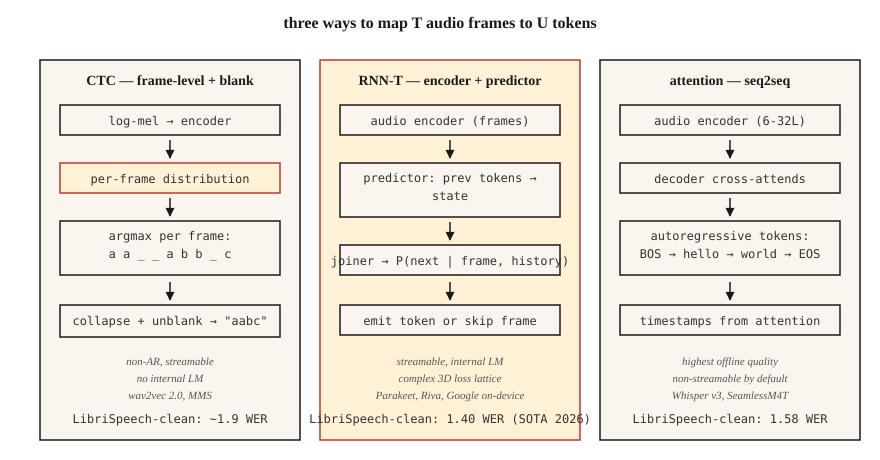

<!-- local-zh-machine-draft: English source is canonical; prose translated automatically, code/math preserved. -->

<a id="speech-recognition-asr--ctc-rnn-t-attention"></a>

# 语音识别 (ASR) — CTC、RNN-T、Attention

> 语音识别是每个时间步长的音频分类，由了解英语和静音的序列模型粘合在一起。 CTC、RNN-T 和 attention 是三种实现方式。选择一个并了解原因。

**类型：** 构建
**语言：** Python
**先决条件：** 第 6 阶段·02（频谱图和梅尔），第 5 阶段·08（CNNs 和 RNNs 用于文本），第 5 阶段·10 (Attention)
**时间：** ~45分钟

<a id="the-problem"></a>

## 问题

您有一个 10 秒 16 kHz 剪辑。您需要一个字符串：“打开厨房灯”。挑战是结构性的：音频帧不与字符一对一对齐。 “好的”这个词可能需要 200 毫秒或 1200 毫秒。沉默打断了话语。有些音素比其他音素长。输出的数量 tokens 事先未知。

三个公式解决了这个问题：

1. **CTC（连接主义时间分类）。** 发出每帧 token 概率，包括特殊的 *blank*。在解码时折叠重复和空白。非autoregressive，速度快。由 wav2vec 2.0、彩信使用。
2. **RNN-T（循环神经网络传感器）。** 联合网络根据 encoder 帧和前一个 tokens 预测下一个 token。可流式传输。由 Google 的设备上 ASR、NVIDIA Parakeet 使用。
3. **Attention encoder-decoder.** Encoder 将音频压缩到隐藏状态，decoder交叉参与自回归生成 tokens。由 Whisper、SeamlessM4T 使用。

2026 年，LibriSpeech 测试清理的 SOTA WER 为 1.4%（Parakeet-TDT-1.1B、NVIDIA）和 1.58%（Whisper-Large-v3-turbo）。差异很小；部署差异巨大。

<a id="the-concept"></a>

## 概念



**CTC 直觉。** 让 encoder 在 `V+1` tokens 上输出 `T` 帧级分布（V 字符 + 空白）。对于长度为 `U < T` 的目标字符串 `y`，任何折叠到 `y` 的帧 alignment 都会计入。 CTC 损失总计为 alignments。 Inference：每帧argmax，折叠重复，删除空白。

优点：非 autoregressive、可流式传输、零前瞻。缺点：*条件独立假设* - 每个帧预测都是独立于其他帧的，因此没有内部语言模型。通过波束搜索或浅层融合使用外部 LM 进行修复。

**RNN-T intuition.** 添加嵌入 token 历史记录的 *predictor* 网络*joiner* 将预测器状态与 encoder 框架组合成 `V+1` 上的联合分布（`+1` 是空/无发射）。对 CTC 忽略的条件依赖性进行显式建模。可流式传输，因为每个步骤仅以过去的帧和过去的 tokens 为条件。

优点：可流式传输+内部LM。缺点：训练更复杂且消耗内存（3D损失格）； RNN-T 损失内核本身就是一个完整的库类别。

**Attention encoder-decoder.** Encoder（6-32层transformer）以上对数梅尔帧。 Decoder（6-32 transformer 层）交叉参与 encoder 输出以自回归生成 tokens。没有 alignment 约束 — attention 可以查看音频中的任何位置。除非您限制 attention（分块 Whisper-Streaming，2024），否则不可流式传输。

优点：离线 ASR 质量最高，易于使用标准 seq2seq 工具进行训练。缺点：autoregressive延迟与输出长度成正比；没有工程就无法进行流式传输。

<a id="wer-the-one-number"></a>

### WER：唯一的数字

**字错误率** = `(S + D + I) / N`，其中S=替换，D=删除，I=插入，N=参考字数。匹配单词级别的 Levenshtein 编辑距离。越低越好。 WER超过20%一般是无法使用的；低于 5% 的阅读语音与人类相当。 2026 年标准基准数据：

| 模型 | LibriSpeech 测试清理 | LibriSpeech测试-其他 | 尺寸 |
|-------|------------------------|------------------------|------|
| 鹦鹉-TDT-1.1B | 1.40% | 2.78% | 1.1B 参数 |
| Whisper-Large-v3-turbo | 1.58% | 3.03% | 809M |
| Canary-1B 闪存 | 1.48% | 2.87% | 1B |
| 无缝 M4T v2 | 1.7% | 3.5% | 2.3B |

所有这些都是基于 encoder-decoder 或 RNN-T 的。纯 CTC 系统 (wav2vec 2.0) 在测试清洁中的效率约为 1.8-2.1%。

```figure
ctc-collapse
```

<a id="build-it"></a>

## 动手实现

<a id="step-1-greedy-ctc-decode"></a>

### 步骤1：贪心CTC解码

```python
def ctc_greedy(frame_logits, blank=0, vocab=None):
    # frame_logits: list of per-frame probability vectors
    preds = [max(range(len(p)), key=lambda i: p[i]) for p in frame_logits]
    out = []
    prev = -1
    for p in preds:
        if p != prev and p != blank:
            out.append(p)
        prev = p
    return "".join(vocab[i] for i in out) if vocab else out
```

两条规则：折叠连续重复、删除空格。示例：`a a _ _ a b b _ c` → `a a b c`。

<a id="step-2-beam-search-ctc"></a>

### 步骤 2：波束搜索 CTC

```python
def ctc_beam(frame_logits, beam=8, blank=0):
    import math
    beams = [([], 0.0)]  # (tokens, log_prob)
    for p in frame_logits:
        log_p = [math.log(max(pi, 1e-10)) for pi in p]
        candidates = []
        for seq, lp in beams:
            for t, lpt in enumerate(log_p):
                new = seq[:] if t == blank else (seq + [t] if not seq or seq[-1] != t else seq)
                candidates.append((new, lp + lpt))
        candidates.sort(key=lambda x: -x[1])
        beams = candidates[:beam]
    return beams[0][0]
```

生产使用带有 LM 融合的前缀树波束搜索；这是概念框架。

<a id="step-3-wer"></a>

### 第 3 步：错误报告

```python
def wer(ref, hyp):
    r, h = ref.split(), hyp.split()
    dp = [[0] * (len(h) + 1) for _ in range(len(r) + 1)]
    for i in range(len(r) + 1):
        dp[i][0] = i
    for j in range(len(h) + 1):
        dp[0][j] = j
    for i in range(1, len(r) + 1):
        for j in range(1, len(h) + 1):
            cost = 0 if r[i - 1] == h[j - 1] else 1
            dp[i][j] = min(
                dp[i - 1][j] + 1,
                dp[i][j - 1] + 1,
                dp[i - 1][j - 1] + cost,
            )
    return dp[len(r)][len(h)] / max(1, len(r))
```

<a id="step-4-inference-against-whisper"></a>

### 步骤4：inference对抗Whisper

```python
import whisper
model = whisper.load_model("large-v3-turbo")
result = model.transcribe("clip.wav")
print(result["text"])
```

2026 年最强通用 ASR 的单行代码。在 24 GB GPU 上以约 20 倍实时速度运行。

<a id="step-5-streaming-with-parakeet-or-wav2vec-20"></a>

### 步骤5：streaming与Parakeet或wav2vec 2.0

```python
from transformers import pipeline
asr = pipeline("automatic-speech-recognition", model="nvidia/parakeet-tdt-1.1b")
for chunk in streaming_audio():
    print(asr(chunk, return_timestamps=True))
```

Streaming ASR 需要分块 encoder attention 和结转状态；使用支持它的库（NeMo for Parakeet、`transformers` 管道和 `chunk_length_s`）。

<a id="use-it"></a>

## 实际应用

2026 年堆栈：

| 情况 | 挑选 |
|-----------|------|
| 英语，离线，最高质量 | 低语-大型-v3-涡轮增压 |
| 多语言、稳健 | 无缝M4T v2 |
| Streaming，低延迟 | 鹦鹉-TDT-1.1B 或 Riva |
| 边缘、移动、<500 毫秒延迟 | Whisper-Tiny 量化或 Moonshine (2024) |
| 长篇 | 基于 VAD 的 Whisper chunking (WhisperX) |
| 特定领域（医学、法律） | 微调 wav2vec 2.0 + 域 LM 融合 |

<a id="pitfalls-that-still-ship-in-2026"></a>

## 2026 年仍然存在的陷阱

- **No VAD.** 在静音中运行 Whisper 会生成 hallucinations（“感谢观看！”）。始终使用 VAD 进行门控。
- **字符 vs 单词 vs 子单词 WER.** 报告字级 WER *after* normalization（小写，去掉标点符号）。
- **语言 ID 漂移。** Whisper 的自动 LID 将嘈杂的剪辑错误路由到日语或威尔士语；当你知道的时候强制`language="en"`。
- ** 没有 chunking 的长剪辑。** Whisper 有 30 秒的窗口。使用 `chunk_length_s=30, stride=5` 更长时间。

<a id="ship-it"></a>

## 交付成果

保存为 `outputs/skill-asr-picker.md`。针对给定的部署目标选择模型、decoding strategy、chunking 和 LM fusion。

<a id="exercises"></a>

## 练习

1. **Easy.** 运行`code/main.py`。它贪婪地解码手工制作的 CTC 输出并根据参考计算 WER。
2. **Medium.** 正确实现步骤2中的前缀树波束搜索（考虑空白合并规则）。在包含 10 个示例的合成数据集上与贪婪法进行比较。
3. **Hard.** 在 [LibriSpeech 测试-clean](https://www.openslr.org/12) 上使用 `whisper-large-v3-turbo`。计算前 100 个话语的 WER。与公布的数字进行比较。

<a id="key-terms"></a>

## 关键术语

| 术语 | 人们怎么说 | 它实际上意味着什么 |
|------|-----------------|-----------------------|
| CTC | 空白-token 损失 | 所有边际帧到token alignments；非 AR。 |
| RNN-T | streaming 损失 | CTC + next-token 预测器；处理词序。 |
| Attention 编码-解码 | Whisper式 | Encoder + 交叉参与 decoder；最好的离线质量。 |
| 世界教育联盟 | 您举报的号码 | `(S+D+I)/N` 在字级。 |
| 空白 | 空虚 | CTC 中的特殊 token 信号“此帧无发射”。 |
| LM融合 | 外部语言模型 | 在波束搜索期间添加加权 LM 对数概率。 |
| 虚拟AD | 寂静之门 | 语音活动检测器；修剪非言语。 |

<a id="further-reading"></a>

## 进一步阅读

- [Graves 等人。 （2006）。联结主义时间分类](https://www.cs.toronto.edu/~graves/icml_2006.pdf) — CTC 论文。
- [格雷夫斯（2012）。使用 RNNs](https://arxiv.org/abs/1211.3711) 进行序列转导 — RNN-T 论文。
- [Radford 等人。 / OpenAI (2022)。 Whisper: Robust Speech Recognition via Large-Scale Weak Supervision](https://arxiv.org/abs/2212.04356) — 2022 年规范论文； 2024 年 v3-turbo 扩展。
- [NVIDIA NeMo — Parakeet-TDT 卡](https://huggingface.co/nvidia/parakeet-tdt-1.1b) — 2026 年开放 ASR 排行榜领先者。
- [Hugging Face — 打开 ASR 排行榜](https://huggingface.co/spaces/hf-audio/open_asr_leaderboard) — 超过 25 个模型的实时基准测试。
