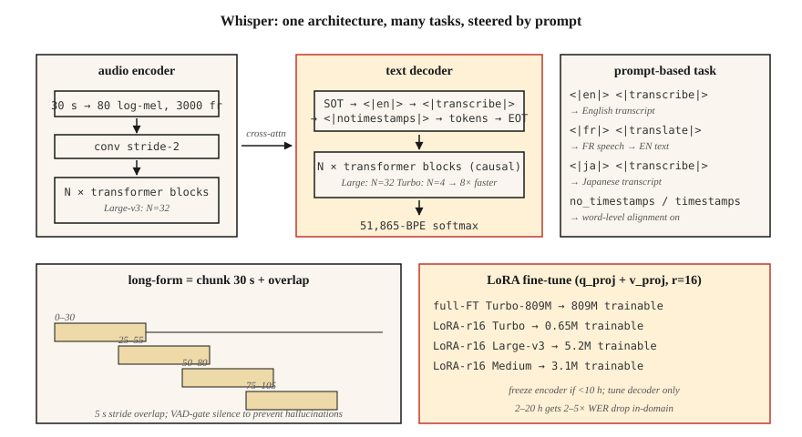

<!-- local-zh-machine-draft: English source is canonical; prose translated automatically, code/math preserved. -->

<a id="whisper--architecture--fine-tuning"></a>

# Whisper——架构与 Fine-Tuning

> Whisper 是一个 30 秒窗口 transformer encoder-decoder，经过 68 万小时的多语言弱监督音频文本对的训练。一种架构、多种任务、跨 99 种语言的稳健性。 2026 年参考 ASR。

**类型：** 构建
**语言：** Python
**先决条件：** 第6·04期（ASR）、第5·10期（Attention）、第7·05期（完整Transformer）
**时间：** ~75分钟

<a id="the-problem"></a>

## 问题

Whisper 由 OpenAI 于 2022 年 9 月发布，是第一个作为商品发布的 ASR 模型：粘贴音频、获取文本、99 种语言、抗噪音、在笔记本电脑上运行。到 2024 年，OpenAI 已发货 Large-v3 和 Turbo 变体；到 2026 年，Whisper 将成为从播客转录到语音助手再到 YouTube 字幕等所有内容的默认基准。

但 Whisper 并不是一个可以永远视为黑匣子的管道。领域转移会杀死它——技术术语、说话者口音、专有名词、短片、沉默。您需要知道：

1. 里面到底是什么。
2. 如何正确为其提供分块、streaming 或长格式音频。
3. 何时进行微调以及如何进行微调。

<a id="the-concept"></a>

## 概念



**Architecture.** 标准 transformer encoder-decoder。

- 输入：30 秒对数梅尔谱图，80 梅尔，10 毫秒跳跃 → 3000 帧。较短的剪辑是零填充的，较长的剪辑是分块的。
- Encoder：转换下采样（步长2）+ `N` transformer 块。对于 Large-v3：32 层、1280 暗淡、20 个头。
- Decoder：`N` transformer 块，具有因果自属性 + 交叉属性到 encoder 输出。与 encoder 尺寸相同。
- 输出：BPE tokens 超过 51,865-token 词汇。

Large-v3 有 1.55B 个参数。 Turbo 使用 4 层 decoder（从 32 层开始），将延迟减少 8 倍，WER 命中率 <1%。

**prompt 格式。** Whisper 是由 decoder prompt 中的特殊 tokens 引导的多任务模型：

```
<|startoftranscript|><|en|><|transcribe|><|notimestamps|> Hello world.<|endoftext|>
```

- `<|en|>` — 语言标签；强制翻译与转录行为。
- `<|transcribe|>` 或 `<|translate|>` — 翻译任何语言输入的英语输出或逐字翻译。
- `<|notimestamps|>` — 跳过字级时间戳（更快）。

prompt 可以让一个模型执行多项任务。将 `<|en|>` 更改为 `<|fr|>`，它就会转录法语。

**30秒窗口。** 一切都固定为30秒。较长的夹子需要chunking；较短的剪辑被填充。 Windows 本身并不进行流式传输 - 这就是 WhisperX、Whisper-Streaming 和 Faster-Whisper 存在的原因。

**Log-mel normalization.** `(log_mel - mean) / std` 其中统计数据来自 Whisper 自己的训练语料库。您*必须*使用Whisper的预处理（`whisper.audio.log_mel_spectrogram`），而不是`librosa.feature.melspectrogram`。

<a id="variants-in-2026"></a>

### 2026年的变种

| 变体 | 参数 | 延迟 (A100) | WER（LibriSpeech-clean） |
|---------|--------|----------------|------------------------|
| 微小的 | 39M | 1×实时 | 5.4% |
| 基地 | 74M | 1× | 4.1% |
| 小号 | 244M | 1× | 3.0% |
| 中等 | 769M | 1× | 2.7% |
| 大v3 | 1.55B | 2× | 1.8% |
| 大型 v3 涡轮增压 | 809M | 8× | 1.58% |
| 悄悄话-Streaming (2024) | 1.55B | streaming | 2.0% |

<a id="fine-tuning"></a>

### Fine-tuning

2026 年的规范工作流程：

1. 收集 10-100 小时的目标域音频以及对齐的转录本。
2. 使用 `generate_with_loss` 回调运行 `transformers.Seq2SeqTrainer`。
3. Parameter高效：`q_proj`、`k_proj`、attention层的`v_proj`上的LoRA减少了GPU内存4×，WER 成本 <0.3。
4. 如果您的时间少于 10 小时，请冻结 encoder。仅调整 decoder。
5. 使用 Whisper 自己的tokenizer和prompt格式; 从不交换tokenizers。

社区结果：fine-tuning Medium 在 20 小时的医疗听写中将 WER 从医疗 vocabulary 的 12% 降至 4.5%。 Fine-tuning Turbo 在 4 小时的冰岛语上将 WER 从 18% 降低到 6%。

```figure
sp-asr-attention
```

<a id="build-it"></a>

## 动手实现

<a id="step-1-run-whisper-out-of-the-box"></a>

### 第 1 步：开箱即用运行 Whisper

```python
import whisper
model = whisper.load_model("large-v3-turbo")
result = model.transcribe(
    "clip.wav",
    language="en",
    task="transcribe",
    temperature=0.0,
    condition_on_previous_text=False,  # prevents runaway repetition
)
print(result["text"])
for seg in result["segments"]:
    print(f"[{seg['start']:.2f}–{seg['end']:.2f}] {seg['text']}")
```

您应该始终覆盖的关键默认值：`temperature=0.0`（sampling 默认为 0.0 → 0.2 → 0.4 … 后备链）、`condition_on_previous_text=False`（防止级联 hallucination 问题）和`no_speech_threshold=0.6`（静音检测）。

<a id="step-2-chunked-long-form"></a>

### 步骤 2：分块长格式

```python
# whisperx is the 2026 reference for long-form with word-level timestamps
import whisperx
model = whisperx.load_model("large-v3-turbo", device="cuda", compute_type="float16")
segments = model.transcribe("1hour.mp3", batch_size=16, chunk_size=30)
```

WhisperX 添加了 (1) Silero VAD 门控，(2) 通过 wav2vec 2.0 进行字级 alignment，(3) 通过 `pyannote.audio` 进行二值化。 2026 年生产转录的主力。

<a id="step-3-fine-tune-with-lora"></a>

### 步骤3：使用LoRA进行微调

```python
from transformers import WhisperForConditionalGeneration, WhisperProcessor
from peft import LoraConfig, get_peft_model

model = WhisperForConditionalGeneration.from_pretrained("openai/whisper-large-v3-turbo")
lora = LoraConfig(
    r=16, lora_alpha=32, target_modules=["q_proj", "v_proj"],
    lora_dropout=0.1, bias="none", task_type="SEQ_2_SEQ_LM",
)
model = get_peft_model(model, lora)
# model.print_trainable_parameters()  -> ~3M trainable / 809M total
```

然后是标准训练器循环。 Checkpoint 每 1000 步。使用 WER 对保留的内容进行评估。

<a id="step-4-inspect-what-each-layer-learns"></a>

### 第四步：检查每一层学到了什么

```python
# Grab cross-attention weights during decode to see what the decoder attends to.
with torch.inference_mode():
    out = model.generate(
        input_features=features,
        return_dict_in_generate=True,
        output_attentions=True,
    )
# out.cross_attentions: layer × head × step × src_len
```

使用热图进行可视化 - 当 decoder 步骤扫描 encoder 帧时，您将看到对角线 alignment。这条对角线就是 Whisper 的单词时间戳概念。

<a id="use-it"></a>

## 实际应用

2026 年堆栈：

| 情况 | 挑选 |
|-----------|------|
| 通用英语，离线 | 大型 v3 涡轮增压，来自 `whisperx` |
| 移动/边缘 | Whisper-Tiny 量化 (int8) 或 Moonshine |
| 多语言长格式 | Large-v3 通过 `whisperx` + 二值化 |
| 低资源语言 | 使用 LoRA 微调 Medium 或 Turbo |
| Streaming（2秒延迟） | Whisper-Streaming 或 Parakeet-TDT |
| 字级时间戳 | WhisperX（通过 wav2vec 2.0 强制 alignment） |

`faster-whisper`（CTranslate2 后端）是 2026 年最快的 CPU+GPU inference 运行时间 — 比具有相同输出的普通版快 4 倍。

<a id="pitfalls-that-still-ship-in-2026"></a>

## 2026 年仍然存在的陷阱

- **H 沉默中的幻觉文本。** 经过字幕训练的 Whisper 包括“感谢观看！”、“订阅！”、歌词。呼叫前务必进行 VAD 选通。
- **`condition_on_previous_text` 级联。** 一个 hallucination 污染后续窗口。设置 `False` 除非您需要跨块的流畅性。
- **短剪辑填充。** 2秒的剪辑填充到30秒可以在拖尾的沉默中产生幻觉。使用 `pad=False` 或 VAD 门。
- **Wrong mel stats.** 使用 librosa 的 mels 而不是 Whisper 的 mels 会产生近乎随机的输出。使用`whisper.audio.log_mel_spectrogram`。

<a id="ship-it"></a>

## 交付成果

保存为 `outputs/skill-whisper-tuner.md`。为给定域设计 Whisper 微调或 inference 管道。

<a id="exercises"></a>

## 练习

1. **Easy.** 运行`code/main.py`。它标记 Whisper 风格的 prompt，计算解码的形状预算，并打印 10 分钟剪辑的块时间表。
2. **Medium.** 安装 `faster-whisper`，转录 10 分钟的播客，将 WER 与人工转录进行比较。尝试 `language="auto"` 与强制 `language="en"`。
3. **Hard.** 使用 HF `datasets`，选择 Whisper 难以使用的语言（例如乌尔都语），使用 LoRA 在 2 小时内微调 Medium 2 epoch，并报告 WER 增量。

<a id="key-terms"></a>

## 关键术语

| 术语 | 人们怎么说 | 它实际上意味着什么 |
|------|-----------------|-----------------------|
| 30 秒窗口 | Whisper的极限 | 硬输入上限；分块更长的音频。 |
| 索特 | 转录起始 | `<\|startoftranscript\|>` 启动 decoder prompt。 |
| 时间戳 token | 时间 alignment | 每 0.02 秒的偏移量是 51k 词汇中的一个特殊的 token。 |
| 涡轮 | 快速变体 | 4-decoder 层，速度提高 8 倍，WER 回归 <1%。 |
| 耳语X | 长形包装纸 | VAD + Whisper + wav2vec alignment + 二值化。 |
| LoRA 微调 | 高效调优 | 添加低等级适配器到attention；训练约 0.3% 的参数。 |
| Hallucination | 无声的失败 | Whisper 从噪音/沉默中产生流利的英语。 |

<a id="further-reading"></a>

## 进一步阅读

- [Radford 等人。 （2022）。 Whisper paper](https://arxiv.org/abs/2212.04356) — 原始架构和训练配方。
- [OpenAI（2024）。 Whisper Large-v3-turbo 版本](https://github.com/openai/whisper/discussions/2363) — 4 层 decoder，8 倍加速。
- [Bain 等人。 （2023）。 WhisperX](https://arxiv.org/abs/2303.00747) — 长格式、字对齐、日记化。
- [Systran — 更快的 Whisper 存储库](https://github.com/SYSTRAN/faster-whisper) — CTranslate2 支持，速度提高 4 倍。
- [HuggingFace — Whisper 微调教程](https://huggingface.co/blog/fine-tune-whisper) — 规范的 LoRA / 全 FT 演练。
