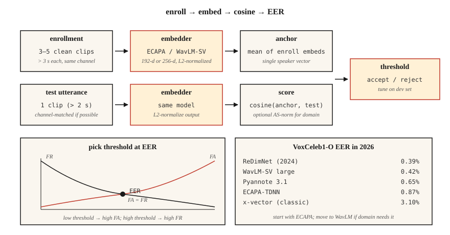

<!-- local-zh-machine-draft: English source is canonical; prose translated automatically, code/math preserved. -->

<a id="speaker-recognition--verification"></a>

# 说话人识别与验证

> ASR 询问“他们说什么？”说话人识别会询问“谁说的？”数学看起来是一样的——embeddings 加上余弦——但每个生产决策都取决于一个 EER 数字。

**类型：** 构建
**语言：** Python
**先决条件：** 第 6 阶段·02（频谱图和 Mel），第 5 阶段·22（Embedding 型号）
**时间：** ~45分钟

<a id="the-problem"></a>

## 问题

用户说出密码。您想知道：这是他们声称的人（*verification*，1：1），还是您注册库中的第一个人（*identification*，1：N）？或者两者都不是——这是一个未知的扬声器（*open-set*）吗？

2018 年之前：GMM-UBM + i-向量。 EER 合理，但容易受到渠道转移（手机与笔记本电脑）和情绪的影响。 2018–2022：x 向量（用角边距训练的 TDNN 主干网）。 2022+：ECAPA-TDNN 和 WavLM-large embeddings。到 2026 年，该领域将由三种模型和一种指标主导。

指标为 **EER** — 相等错误率。设置您的决策阈值，使错误接受率 = 错误拒绝率。交叉是EER。用于每份报纸、每份排行榜、每一次采购电话。

<a id="the-concept"></a>

## 概念



**管道。** 注册：录制目标说话者的5-30秒；计算固定维度 embedding（ECAPA-TDNN 为 192 维，WavLM-large 为 256 维）。验证：得到测试话语embedding；计算cosine similarity；与阈值进行比较。

**ECAPA-TDNN（2020年，2026年仍占主导地位）。**强调通道Attention，传播和聚合-时延神经网络。具有挤压激励、多头 attention 池化的 1D 转换块，后面是 192 维的线性层。在 VoxCeleb 1+2（2,700 个发言者，110 万条话语）上进行训练，并带有附加角裕度损失 (AAM-softmax)。

**WavLM-SV (2022+).** 微调具有 AAM 损失的预训练 WavLM-large SSL 主干网。质量更高，但速度更慢 — 300+ MB 与 15 MB。

**x-向量（基线）。** TDNN + 统计池。经典的;在 CPU/edge 上仍然有用。

**AAM-softmax.** 标准 softmax，在角度空间中添加边距 `m`：`cos(θ + m)` 表示正确的类别。强制类间角分离。典型值`m=0.2`，刻度`s=30`。

<a id="scoring"></a>

### 评分

- **Cosine** 注册和测试 embeddings 之间。基于阈值的决策。
- **PLDA（概率LDA）。** 将 embeddings 项目转换为 latent space，其中同一说话者与不同说话者具有封闭形式的似然比。添加到余弦之上可减少 +10–20% EER。 2020年之前的标准；现在仅在封闭设置中使用。
- **Score normalization.** `S-norm` 或 `AS-norm`：根据一组冒名顶替者平均值和标准差标准化每个分数。对于跨域评估至关重要。

<a id="numbers-you-should-know-2026"></a>

### 你应该知道的数字 (2026)

| 模型 | VoxCeleb1-O EER | 参数 | 吞吐量 (A100) |
|-------|-----------------|--------|-------------------|
| x 向量（经典） | 3.10% | 5M | 400× RT |
| ECAPA-TDNN | 0.87% | 15米 | 200× RT |
| WavLM-SV 大号 | 0.42% | 316米 | 20× RT |
| Pyannote 3.1分割+embedding | 0.65% | 6M | 100× RT |
| 雷迪姆网络 (2024) | 0.39% | 24米 | 100× RT |

<a id="diarization"></a>

### 分类

多发言者剪辑中的“谁在何时发言”。管道：VAD → 分段 → 嵌入每个分段 → 聚类（凝聚或谱）→ 平滑边界。现代堆栈：`pyannote.audio` 3.1，将说话者分段 + embedding + 集群捆绑在一个呼叫后面。 2026 年 AMI 上的 SOTA DER 约为 15%（低于 2022 年的 23%）。

```figure
sp-eer-crossover
```

<a id="build-it"></a>

## 动手实现

<a id="step-1-toy-embedding-from-mfcc-statistics"></a>

### 第1步：从MFCC统计中玩具embedding

```python
def embed_mfcc_stats(signal, sr):
    frames = featurize_mfcc(signal, sr, n_mfcc=13)
    mean = [sum(f[i] for f in frames) / len(frames) for i in range(13)]
    std = [
        math.sqrt(sum((f[i] - mean[i]) ** 2 for f in frames) / len(frames))
        for i in range(13)
    ]
    return mean + std  # 26-d
```

远非 SOTA——仅用于教学。 `code/main.py` 将此用作合成说话人数据的概念验证。

<a id="step-2-cosine-similarity--threshold"></a>

### 步骤2：cosine similarity + 阈值

```python
def cosine(a, b):
    dot = sum(x * y for x, y in zip(a, b))
    na = math.sqrt(sum(x * x for x in a))
    nb = math.sqrt(sum(x * x for x in b))
    return dot / (na * nb) if na and nb else 0.0

def verify(enroll, test, threshold=0.75):
    return cosine(enroll, test) >= threshold
```

<a id="step-3-eer-from-similarity-pairs"></a>

### 步骤 3：相似对的 EER

```python
def eer(same_scores, diff_scores):
    thresholds = sorted(set(same_scores + diff_scores))
    best = (1.0, 1.0, 0.0)  # (fa, fr, threshold)
    for t in thresholds:
        fr = sum(1 for s in same_scores if s < t) / len(same_scores)
        fa = sum(1 for s in diff_scores if s >= t) / len(diff_scores)
        if abs(fa - fr) < abs(best[0] - best[1]):
            best = (fa, fr, t)
    return (best[0] + best[1]) / 2, best[2]
```

返回（eer，阈值_at_eer）。两者都报告。

<a id="step-4-production-with-speechbrain"></a>

### 第四步：用SpeechBrain制作

```python
from speechbrain.pretrained import EncoderClassifier

clf = EncoderClassifier.from_hparams(source="speechbrain/spkrec-ecapa-voxceleb")

# enroll: average the embeddings of 3-5 clean samples
enroll = torch.stack([clf.encode_batch(load(x)) for x in enrollment_clips]).mean(0)
# verify
score = clf.similarity(enroll, clf.encode_batch(load("test.wav"))).item()
verdict = score > 0.25   # ECAPA typical threshold; tune on your data
```

<a id="step-5-diarize-with-pyannote"></a>

### 第 5 步：用 pyannote 记日记

```python
from pyannote.audio import Pipeline

pipe = Pipeline.from_pretrained("pyannote/speaker-diarization-3.1")
diarization = pipe("meeting.wav", num_speakers=None)
for turn, _, speaker in diarization.itertracks(yield_label=True):
    print(f"{turn.start:.1f}–{turn.end:.1f}  {speaker}")
```

<a id="use-it"></a>

## 实际应用

2026 年堆栈：

| 情况 | 挑选 |
|-----------|------|
| 闭集1:1验证，边缘 | ECAPA-TDNN + 余弦阈值 |
| 开集验证、云 | WavLM-SV + AS-范数 |
| 日记化（会议、播客） | `pyannote/speaker-diarization-3.1` |
| 反欺骗（重放/深度伪造检测） | AASIST 或 RawNet2 |
| 微型嵌入式（KWS + 注册） | Titanet-小型 (NeMo) |

<a id="pitfalls"></a>

## 陷阱

- **频道不匹配。** 在 VoxCeleb（网络视频）上训练的模型 ≠ 电话音频。始终在目标渠道上进行评估。
- **简短的话语。** EER 在测试音频的 3 秒以下急剧下降。
- **带有噪音的注册。** 一个噪音注册会毒害主播。使用 ≥3 个干净样本并取平均值。
- **跨条件固定阈值。** 始终调整目标域中保留的开发集的阈值。
- **非归一化embeddings.** L2-先归一化上的余弦；否则大小占主导地位。

<a id="ship-it"></a>

## 交付成果

保存为 `outputs/skill-speaker-verifier.md`。选择模型、注册协议、阈值调整计划和欺诈保护措施。

<a id="exercises"></a>

## 练习

1. **Easy.** 运行`code/main.py`。构建合成“扬声器”（不同的音调配置文件）、注册、计算 100 对试用列表上的 EER。
2. **Medium.** 对 30 个 VoxCeleb1 话语（5 个发言者 × 6 个）使用 SpeechBrain ECAPA。使用余弦与 PLDA 计算 EER。
3. **Hard.** 使用 `pyannote.audio` 构建完整的注册→分类→验证管道。在 AMI 开发集上评估 DER。

<a id="key-terms"></a>

## 关键术语

| 术语 | 人们怎么说 | 它实际上意味着什么 |
|------|-----------------|-----------------------|
| 能效比 | 标题指标 | 错误接受 = 错误拒绝的阈值。 |
| 验证 | 1:1 | “这是爱丽丝吗？” |
| 鉴定 | 1:N | “谁在说话？” |
| 开集 | 未知可能 | 测试装置可以包含未注册的发言者。 |
| 招生 | 注册中 | 计算扬声器的参考号 embedding。 |
| AAM-softmax | 损失 | Softmax 具有附加角裕度；迫使簇分离。 |
| 聚乳酸 | 经典得分 | 概率LDA； embeddings 之上的似然比评分。 |
| 德 | 二值化度量 | 分类错误率——漏报+误报+混乱。 |

<a id="further-reading"></a>

## 进一步阅读

- [Snyder 等人。 （2018）。 X-Vectors：用于说话人识别的鲁棒 DNN Embeddings](https://www.danielpovey.com/files/2018_icassp_xvectors.pdf) — 经典的深度 embedding 论文。
- [Desplanques 等人。 （2020）。 ECAPA-TDNN](https://arxiv.org/abs/2005.07143) — 2020-2026 年主导架构。
- [Chen 等人。 （2022）。 WavLM：用于全栈语音处理的大规模自监督预训练](https://arxiv.org/abs/2110.13900) - 用于 SV 和二值化的 SSL 主干。
- [Bredin 等人。 （2023）。 pyannote.audio 3.1](https://github.com/pyannote/pyannote-audio) — 生产二值化 + embedding 堆栈。
- [VoxCeleb 排行榜（2026 年更新）](https://www.robots.ox.ac.uk/~vgg/data/voxceleb/) — 当前各型号的 EER 排名。
