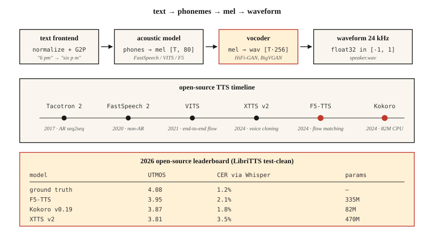

<!-- local-zh-machine-draft: English source is canonical; prose translated automatically, code/math preserved. -->

<a id="text-to-speech-tts--from-tacotron-to-f5-and-kokoro"></a>

# 文本转语音 (TTS) — 从 Tacotron 到 F5 和 Kokoro

> ASR 将语音转换为文本； TTS 将文本转换为语音。 2026堆栈分为三部分：文本→tokens，tokens→mel，mel→波形。每个部件都有一个适合笔记本电脑的默认模型。

**类型：** 构建
**语言：** Python
**先决条件：** 第 6 阶段·02（频谱图和 Mel）、第 5 阶段·09 (Seq2Seq)、第 7 阶段·05（完整 Transformer）
**时间：** ~75 分钟

<a id="the-problem"></a>

## 问题

你有一个字符串：“请提醒我下午 6 点给植物浇水。”您需要一个听起来自然、具有正确韵律（停顿、重音）、用正确元音发音“植物”并且在 CPU 上运行时间低于 300 毫秒的 3 秒音频剪辑作为实时语音助手。你还需要交换声音，处理代码切换输入（“下午 6 点提醒我，daijoubu？”），并且不要在名字上让自己感到尴尬。

现代 TTS 管道如下所示：

1. **文本前端。** 规范化文本（日期、数字、电子邮件），转换为音素或子词 tokens，预测韵律 features。
2. **声学模型。** 文本 → 梅尔频谱图。 Tacotron 2 (2017)、FastSpeech 2 (2020)、VITS (2021)、F5-TTS (2024)、Kokoro (2024)。
3. **Vocoder.** Mel → 波形。 WaveNet (2016)、WaveRNN、HiFi-GAN (2020)、BigVGAN (2022)、2024 年以上的神经编解码器声码器。

到 2026 年，声学 + 声码器通过端到端扩散和流量匹配模型来分割模糊。但三部分的思维模型仍然适用于调试。

<a id="the-concept"></a>

## 概念



**Tacotron 2 (2017).** Seq2seq: char-embedding → BiLSTM encoder → 位置敏感 attention → autoregressive LSTM decoder 发出梅尔帧。缓慢（AR），在长文本上不稳定。仍被引用作为基线。

**FastSpeech 2 (2020).** 非autoregressive。持续时间预测器输出每个音素获得的梅尔帧数。 1-pass，比 Tacotron 快 10 倍。失去了一些自然性（单调的 alignment），但随处可见。

**VITS (2021).** 联合训练 encoder + 基于流的持续时间 + HiFi-GAN 声码器端到端与变分inference。高品质，单一型号。 2022-2024 年开源 TTS 占据主导地位。变体：YourTTS（多扬声器 zero-shot）、XTTS v2（2024，Coqui）。

**F5-TTS (2024).** 扩散 transformer 过流匹配。自然韵律，zero-shot 语音克隆，带有 5 秒参考音频。 2026 年开源 TTS 排行榜名列前茅。 335M 参数。

**Kokoro (2024).** 小 (82M)、CPU - 可运行、一流的实时英语 TTS。已关闭-vocabulary 仅英语，apache-2.0。

**OpenAI TTS-1-HD、ElevenLabs v2.5、Google Chirp-3.** 商业最先进的技术。 ElevenLabs v2.5 情感标签（“[whispered]”、“[laughing]”）和角色声音在 2026 年有声读物制作中占主导地位。

<a id="vocoder-evolution"></a>

### 声码器的演变

| 时代 | 声码器 | 延迟 | 品质 |
|-----|---------|---------|---------|
| 2016 | 波网 | 仅限离线 | 发布时的 SOTA |
| 2018 | 波RNN | ~实时 | 好 |
| 2020 | 高保真-GAN | 100×实时 | 近乎人类 |
| 2022 | 大VGAN | 50×实时 | 概括所有说话者/语言 |
| 2024 | SNAC、DAC（神经编解码器） | 与AR模型集成 | 离散 tokens，位高效 |

到 2026 年，大多数“TTS”模型都是从文本到波形的端到端；梅尔谱图是一种内部表示。

<a id="evaluation"></a>

### Evaluation

- **MOS（平均意见得分）。** 1-5 量表，众包。仍然是黄金标准；缓慢得令人痛苦。
- **CMOS（比较MOS）。** A-vs-B 偏好。每个注释的置信区间更严格。
- **UTMOS、DNSMOS.** 无参考神经 MOS 预测器。用于排行榜。
- **CER（字符错误率）通过 ASR。** 通过 Whisper 运行 TTS 输出，根据输入文本计算 CER。可理解性的代理。
- **SECS（扬声器Embedding Cosine Similarity）.** 语音克隆质量。

LibriTTS 测试清理上的 2026 个数字：

| 模型 | UTMOS | CER（通过 Whisper） | 尺寸 |
|-------|-------|-------------------|------|
| 地面真相 | 4.08 | 1.2% | — |
| F5语音合成 | 3.95 | 2.1% | 335M |
| XTTS v2 | 3.81 | 3.5% | 470M |
| VITS | 3.62 | 3.1% | 25M |
| 心 v0.19 | 3.87 | 1.8% | 82M |
| Parler-TTS 大号 | 3.76 | 2.8% | 2.3B |

```figure
sp-tts-stack
```

<a id="build-it"></a>

## 动手实现

<a id="step-1-phonemize-input"></a>

### 第 1 步：音素化输入

```python
from phonemizer import phonemize
ph = phonemize("Hello world", language="en-us", backend="espeak")
# 'həloʊ wɜːld'
```

音素是通用桥梁。避免将原始文本提供给低于 VITS 级别质量的任何内容。

<a id="step-2-run-kokoro-2026-cpu-default"></a>

### 第二步：运行Kokoro（默认2026 CPU）

```python
from kokoro import KPipeline
tts = KPipeline(lang_code="a")  # "a" = American English
audio, sr = tts("Please remind me to water the plants at 6 pm.", voice="af_bella")
# audio: float32 tensor, sr=24000
```

离线运行，单个文件，82M 参数。

<a id="step-3-run-f5-tts-with-voice-cloning"></a>

### 第 3 步：运行带有语音克隆的 F5-TTS

```python
from f5_tts.api import F5TTS
tts = F5TTS()
wav = tts.infer(
    ref_file="my_voice_5s.wav",
    ref_text="The quick brown fox jumps over the lazy dog.",
    gen_text="Please remind me to water the plants.",
)
```

传递 5 秒参考剪辑 + 其文字记录； F5 克隆了韵律和音色。

<a id="step-4-hifi-gan-vocoder-from-scratch"></a>

### 步骤 4：从头开始制作 HiFi-GAN 声码器

太大了，无法放入教程脚本中，但形状是：

```python
class HiFiGAN(nn.Module):
    def __init__(self, mel_channels=80, upsample_rates=[8, 8, 2, 2]):
        super().__init__()
        # 4 upsample blocks, total 256x to go from mel-rate to audio-rate
        ...
    def forward(self, mel):
        return self.blocks(mel)  # -> waveform
```

训练：对抗性（短窗口上的鉴别器）+梅尔谱图重建损失+ feature 匹配损失。商品化 — 使用来自 `hifi-gan` 存储库或 nvidia-NeMo 的预训练 checkpoints。

<a id="step-5-the-full-pipeline-pseudocode"></a>

### 第5步：完整的管道（伪代码）

```python
text = "Please remind me at 6 pm."
phones = phonemize(text)
mel = acoustic_model(phones, speaker=alice)      # [T, 80]
wav = vocoder(mel)                                # [T * 256]
soundfile.write("out.wav", wav, 24000)
```

<a id="use-it"></a>

## 实际应用

2026 年堆栈：

| 情况 | 挑选 |
|-----------|------|
| 实时英文语音助手 | Kokoro (CPU) 或 XTTS v2 (GPU) |
| 从 5 秒参考克隆声音 | F5语音合成 |
| 商业角色声音 | 十一实验室 v2.5 |
| 有声读物旁白 | ElevenLabs v2.5 或 XTTS v2 + 微调 |
| 低资源语言 | 在 5-20 小时目标语言数据上训练 VITS |
| 表达/情感标签 | ElevenLabs v2.5 或 StyleTTS 2 微调 |

截至 2026 年的开源领导者：**F5-TTS 代表质量，Kokoro 代表效率**。除非您是历史学家，否则不要使用 Tacotron。

<a id="pitfalls"></a>

## 陷阱

- **没有文本规范化器。**“史密斯博士”读作“医生”或“驱动器”？ “2026”是“二二十六”还是“二零二六”？在音位器之前标准化。
- **OOV 专有名词。** “Ghumare” → “ghyu-mair”？为未知的 tokens 提供后备字素到音素模型。
- **Clipping.** 声码器输出很少削波，但 inference 处的梅尔缩放不匹配可能会超出 ±1.0。始终为 `np.clip(wav, -1, 1)`。
- **采样率不匹配。** Kokoro 输出 24 kHz；您的下游管道期望 16 kHz → 重新采样或出现混叠。

<a id="ship-it"></a>

## 交付成果

保存为 `outputs/skill-tts-designer.md`。为给定的语音、延迟和语言目标设计 TTS 管道。

<a id="exercises"></a>

## 练习

1. **Easy.** 运行`code/main.py`。从玩具词汇构建音素字典，估计每个音素的持续时间，并打印假的“mel”时间表。
2. **Medium.** 安装Kokoro，在语音`af_bella`和`am_adam`处合成相同的句子。比较音频持续时间和主观质量。
3. **Hard.** 录制您自己的 5 秒参考剪辑。使用 F5-TTS 克隆它。报告参考输出和克隆输出之间的 SECS。

<a id="key-terms"></a>

## 关键术语

| 术语 | 人们怎么说 | 它实际上意味着什么 |
|------|-----------------|-----------------------|
| 音素 | 发声单元 | 抽象声音类； 39 英语 (ARPABet)。 |
| 持续时间预测器 | 每个音素持续多长时间 | 非AR模型输出；每个音素的整数帧。 |
| 声码器 | 梅尔 → 波形 | 将梅尔规格映射到原始样本的神经网络。 |
| 高保真-GAN | 标准声码器 | 基于GAN； 2020-2024 年占主导地位。 |
| 金属氧化物半导体 | 主观素质 | 人类评分者的平均意见得分为 1-5。 |
| SECS | 语音克隆指标 | Cosine similarity 目标和输出扬声器之间 embedding。 |
| F5语音合成 | 2024 开源 SOTA | 流量匹配扩散； zero-shot克隆。 |
| 心 | CPU 英文领队 | 82M 参数模型，Apache 2.0。 |

<a id="further-reading"></a>

## 进一步阅读

- [Shen 等人。 （2017）。 Tacotron 2](https://arxiv.org/abs/1712.05884) — seq2seq 基线。
- [Kim Kong, Son (2021)。 VITS](https://arxiv.org/abs/2106.06103) — 基于端到端流。
- [Chen 等人。 （2024）。 F5-TTS](https://arxiv.org/abs/2410.06885) — 当前开源 SOTA。
- [Kong, Kim, Bae (2020)。 HiFi-GAN](https://arxiv.org/abs/2010.05646) — 2026 年仍在发货的声码器。
- HuggingFace 上的 [Kokoro-82M](https://huggingface.co/hexgrad/Kokoro-82M) — 2024 CPU 友好的英语 TTS。
