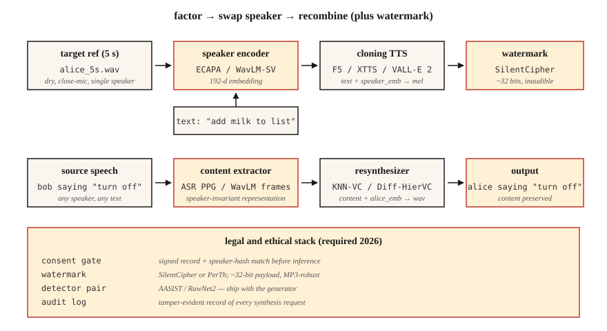

<!-- local-zh-machine-draft: English source is canonical; prose translated automatically, code/math preserved. -->

<a id="voice-cloning--voice-conversion"></a>

# 语音克隆和语音转换

> 语音克隆会用别人的声音朗读您的文本。语音转换将您的声音重写为其他人的声音，同时保留您所说的内容。两者都遵循相同的分解：将说话者身份与内容分开。

**类型：** 构建
**语言：** Python
**先决条件：** 第 6·06 阶段（说话人识别）、第 6·07 阶段（TTS）
**时间：** ~75分钟

<a id="the-problem"></a>

## 问题

到 2026 年，5 秒的音频剪辑足以通过消费者 GPU 生成任何人声音的高质量克隆。 ElevenLabs、F5-TTS、OpenVoice v2、VoiceBox 均附带 zero-shot 或 few-shot 克隆。该技术是一种祝福（无障碍 TTS、配音、辅助语音），也是一种武器（诈骗电话、政治深度伪造、知识产权盗窃）。

两个密切相关的任务：

- **语音克隆（TTS端）：**文本+5秒参考语音→该语音中的音频。
- **语音转换（语音端）：**源音频（A说X）+B人参考语音→B说X的音频。

两者都将波形分解为（内容、说话者、韵律）并将一个来源的内容与另一个来源的说话者重新组合。

您现在在 2026 年发货时面临的关键约束：** 欧盟（AI 法案，2026 年 8 月强制执行）和加利福尼亚州（AB 2905，2025 年生效）** 法律要求使用水印和同意门。您的管道必须发出听不见的水印并拒绝未经同意的克隆。

<a id="the-concept"></a>

## 概念



**Zero-shot 克隆。** 将 5 秒剪辑传递给已在数千个扬声器上进行过训练的模型。扬声器 encoder 将剪辑映射到扬声器 embedding； TTS decoder 条件为 embedding 加上文本。

使用者：F5-TTS (2024)、YourTTS (2022)、XTTS v2 (2024)、OpenVoice v2 (2024)。

**Few-shot fine-tuning.** 录制 5-30 分钟的目标语音。 LoRA - 微调基础模型一小时。质量从“还可以”跃升至“无法区分”。 Coqui 和 ElevenLabs 都支持这种模式；社区将其与 F5-TTS 一起使用。

**语音转换(VC).** 两个系列：

- **Recognition-synthesis.** 运行类似 ASR 的模型来提取内容表示（例如，软音素后部、PPG），然后与目标说话人 embedding 重新合成。对语言和口音有很强的抵抗力。由 KNN-VC (2023)、Diff-HierVC (2023) 使用。
- **Disentanglement.** 训练一个自动编码器，在 latent space 的瓶颈处分离内容、说话者和韵律。将扬声器 embedding 更换为 inference。质量较低但速度更快。由 AutoVC (2019)、VITS-VC 变体使用。

**基于神经编解码器的克隆（2024+）。** VALL-E、VALL-E 2、NaturalSpeech 3、VoiceBox — 将音频视为来自 SoundStream / EnCodec 的离散 tokens，训练大型 autoregressive 或通过编解码器 tokens 的流匹配模型。质量与 ElevenLabs 的短号 prompts 相当。

<a id="the-ethics-bit-not-a-bolt-on"></a>

### 道德方面，而不是附加的

**Watermarking.** PerTh (Perth) 和 SilentCipher (2024) 在音频中不知不觉地嵌入了约 16-32 位 ID。经受重新编码、streaming 和常见编辑的影响。生产就绪的开源。

**同意门。** 必须将每个克隆的输出与可验证的同意记录配对。 “我，Rohit，于 2026 年 4 月 22 日授权此声音用于 X 目的。”存储在防篡改日志中。

**Detection.** AASIST、RawNet2 和 Wav2Vec2-AASIST 作为检测器提供。 ASVspoof 2025 挑战赛发布了针对 ElevenLabs、VALL-E 2 和 Bark 输出的最先进探测器的 EER 为 0.8-2.3%。

<a id="numbers-2026"></a>

### 数字 (2026)

| 模型 | Zero-shot? | SECS（目标模拟） | WER（英特尔） | 参数 |
|-------|-----------|--------------------|--------------|--------|
| F5语音合成 | 是的 | 0.72 | 2.1% | 335M |
| XTTS v2 | 是的 | 0.65 | 3.5% | 470M |
| 开放语音 v2 | 是的 | 0.70 | 2.8% | 220M |
| 谷-E 2 | 是的 | 0.77 | 2.4% | 370M |
| 语音盒 | 是的 | 0.78 | 2.1% | 330M |

对于大多数听众来说，SECS > 0.70 通常与目标无法区分。

```figure
sp-voice-factorize
```

<a id="build-it"></a>

## 动手实现

<a id="step-1-decompose-with-recognition-synthesis-code-only-demo-in-mainpy"></a>

### 第 1 步：通过识别合成进行分解（main.py 中的纯代码演示）

```python
def clone_pipeline(ref_audio, text, target_embedder, tts_model):
    speaker_emb = target_embedder.encode(ref_audio)
    mel = tts_model(text, speaker=speaker_emb)
    return vocoder(mel)
```

概念简单；实现质量在`tts_model`和扬声器encoder中。

<a id="step-2-zero-shot-clone-with-f5-tts"></a>

### 步骤2：使用F5-TTS克隆zero-shot

```python
from f5_tts.api import F5TTS
tts = F5TTS()
wav = tts.infer(
    ref_file="rohit_5s.wav",
    ref_text="The quick brown fox jumps over the lazy dog.",
    gen_text="Please add milk and bread to my list.",
)
```

参考文字记录必须与音频完全匹配；不匹配会破坏 alignment。

<a id="step-3-voice-conversion-with-knn-vc"></a>

### 步骤 3：使用 KNN-VC 进行语音转换

```python
import torch
from knnvc import KNNVC  # 2023 model, https://github.com/bshall/knn-vc
vc = KNNVC.load("wavlm-base-plus")
out_wav = vc.convert(source="my_voice.wav", target_pool=["alice_1.wav", "alice_2.wav"])
```

KNN-VC 运行 WavLM 来提取源池和目标池的每帧 embeddings，然后将每个源帧替换为池中最近的邻居帧。非参数，适用于一分钟的目标语音。

<a id="step-4-embed-a-watermark"></a>

### 第四步：嵌入水印

```python
from silentcipher import SilentCipher
sc = SilentCipher(model="2024-06-01")
payload = b"consent_id:abc123;ts:1745353200"
watermarked = sc.embed(wav, sr=24000, message=payload)
detected = sc.detect(watermarked, sr=24000)   # returns payload bytes
```

~32 位有效负载，在 MP3 重新编码和轻噪声后可检测到。

<a id="step-5-consent-gate"></a>

### 第 5 步：同意门

```python
def cloned_inference(text, ref_audio, consent_record):
    assert verify_signature(consent_record), "Signed consent required"
    assert consent_record["speaker_id"] == hash_speaker(ref_audio)
    wav = tts.infer(ref_file=ref_audio, gen_text=text)
    wav = watermark(wav, payload=consent_record["id"])
    return wav
```

<a id="use-it"></a>

## 实际应用

2026 年堆栈：

| 情况 | 挑选 |
|-----------|------|
| 5秒zero-shot克隆，开源 | F5-TTS 或 OpenVoice v2 |
| 商业化生产克隆 | ElevenLabs 即时语音克隆 v2.5 |
| 语音转换（重写） | KNN-VC 或 Diff-HierVC |
| 多扬声器微调 | StyleTTS 2 + 扬声器适配器 |
| 跨语言克隆 | XTTS v2 或 VALL-E X |
| 深度换脸检测 | Wav2Vec2-AASIST |

<a id="pitfalls"></a>

## 陷阱

- **未对齐的参考转录。** F5-TTS 和类似要求参考文本与参考音频完全匹配，包括标点符号。
- **Reverberant 参考。** Echo 杀死克隆体。录制干燥、近距离麦克风。
- **E情感不匹配。** 训练参考“快乐”产生一切快乐的克隆。将参考情绪与目标使用相匹配。
- **语言泄漏。** 克隆一个说英语的人，然后要求模型说法语，无论如何，通常都会带有口音；使用跨语言模型（XTTS、VALL-E X）。
- **无水印。** 从 2026 年 8 月起在欧盟合法不可发货。

<a id="ship-it"></a>

## 交付成果

保存为 `outputs/skill-voice-cloner.md`。设计带有同意门+水印+质量目标的克隆或转换管道。

<a id="exercises"></a>

## 练习

1. **Easy.** 运行`code/main.py`。通过计算交换前后两个“扬声器”之间的余弦来演示扬声器-embedding 交换。
2. **Medium.** 使用 OpenVoice v2 克隆您自己的声音。测量参考和克隆之间的 SECS。通过 Whisper 测量 CER。
3. **Hard.** 对20个克隆应用SilentCipher水印，通过128 kbps MP3编码+解码运行它们，检测有效负载。报告位精度。

<a id="key-terms"></a>

## 关键术语

| 术语 | 人们怎么说 | 它实际上意味着什么 |
|------|-----------------|-----------------------|
| Zero-shot克隆 | 5秒就够了 | 预训练模型+扬声器embedding；没有培训。 |
| PPG | 语音后图 | 每帧 ASR 后验用作与语言无关的内容代表。 |
| KNN-VC | 最近邻转换 | 将每个源帧替换为最近的目标池帧。 |
| 神经编解码器 TTS | VALL-E风格 | 基于 EnCodec/SoundStream tokens 的 AR 模型。 |
| 水印 | 签名听不见 | 嵌入音频中的比特可以在重新编码后幸存下来。 |
| SECS | 克隆保真度 | 目标和克隆扬声器 embeddings 之间的余弦。 |
| 亚洲科学学会 | 深伪探测器 | 防欺骗模型；检测合成语音。 |

<a id="further-reading"></a>

## 进一步阅读

- [Chen 等人。 （2024）。 F5-TTS](https://arxiv.org/abs/2410.06885) — 开源 SOTA zero-shot 克隆。
- [Baevski 等人。 /微软（2023）。 VALL-E](https://arxiv.org/abs/2301.02111) 和 [VALL-E 2 (2024)](https://arxiv.org/abs/2406.05370) — 神经编解码器 TTS。
- [Qian 等人。 （2019）。 AutoVC](https://arxiv.org/abs/1905.05879) — 基于解缠结的语音转换。
- [Baas、Waubert de Puiseau、坎珀 (2023)。 KNN-VC](https://arxiv.org/abs/2305.18975) — 基于检索的 VC。
- [SilentCipher (2024) — 音频水印](https://github.com/sony/silentcipher) — 生产就绪的 32 位音频水印。
- [ASVspoof 2025 结果](https://www.asvspoof.org/) — 探测器与合成器军备竞赛，2026 年更新。
