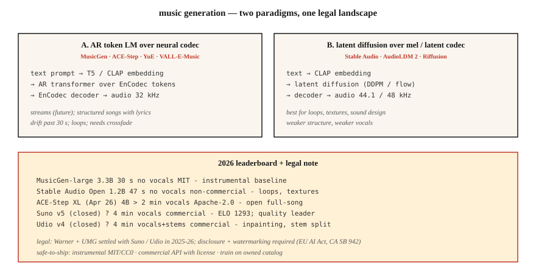

<!-- local-zh-machine-draft: English source is canonical; prose translated automatically, code/math preserved. -->

<a id="music-generation--musicgen-stable-audio-suno-and-the-licensing-earthquake"></a>

# 音乐生成——MusicGen、Stable Audio、Suno 与许可制度的剧变

> 2026年音乐一代：Suno v5和Udio v4主导商业； MusicGen、Stable Audio Open 和 ACE-Step 是领先的开源软件。技术问题基本解决了。法律问题（华纳音乐 5 亿美元和解、UMG 和解）在 2025 年至 2026 年重塑了这一领域。

**类型：** 构建
**语言：** Python
**先决条件：** 第 6 阶段·02（频谱图）、第 4 阶段·10 (Diffusion Models)
**时间：** ~75分钟

<a id="the-problem"></a>

## 问题

文本 → 30 秒到 4 分钟的音乐剪辑，包含歌词、声音和结构。三个子问题：

1. **乐器生成。** 文本如“带有温暖键的低保真嘻哈鼓”→音频。 MusicGen、稳定音频、AudioLDM。
2. **歌曲生成（带人声+歌词）。**“关于德克萨斯雨夜的乡村歌曲”→完整歌曲。 Suno、Udio、YuE、ACE-Step。
3. **有条件/可控。** 扩展现有剪辑、重新生成桥接、交换流派、干分离或修复。 Udio 的修复 + 茎分离是 2026 feature 相匹配的。

<a id="the-concept"></a>

## 概念



<a id="token-lm-over-neural-codec-tokens"></a>

### Token 神经编解码器上的 LM tokens

Meta 的 **MusicGen** （2023，MIT）和许多衍生品：文本/旋律 embeddings 条件，自回归预测 EnCodec tokens （32 kHz，4 个码本），使用 EnCodec 解码。 300M - 3.3B 参数。底线强；挣扎了30秒。

**ACE-Step**（开源，2026 年 4 月发布的 4B XL）将其扩展为全歌曲歌词调节生成。开放社区最接近Suno。

<a id="diffusion-over-mels-or-latents"></a>

### 梅尔或潜伏扩散

**Stable Audio (2023)** 和 **Stable Audio Open (2024)**：压缩音频上的潜在扩散。擅长循环、声音设计、环境纹理。不擅长结构化完整歌曲。

**AudioLDM / AudioLDM2**：通过T2I风格的潜在扩散进行文本到音频，推广到音乐、音效、语音。

<a id="hybrid-production--suno-udio-lyria"></a>

### 混合动力（制作）——Suno、Udio、Lyria

已关闭 weights。可能是 AR 编解码器 LM + 基于扩散的声码器，具有专门的语音/鼓/旋律头。 Suno v5 (2026) 是 ELO 1293 质量领导者。 Udio v4 添加了修复+主干分离（贝斯、鼓、人声单独下载）。

<a id="evaluation"></a>

### Evaluation

- **FAD（Fréchet音频距离）。** Embedding使用VGGish或PANN生成的音频分布与真实音频分布之间的水平距离features。越低越好。 MusicGen 小：MusicCaps 上 4.5 FAD；索塔〜3.0。
- **音乐性（主观）。** 人类偏好。 Suno v5 ELO 1293 领先。
- ** 文本音频 alignment.** prompt 和输出之间的 CLAP 分数。
- **音乐性伪影。** 不合拍的过渡、声乐短语漂移、过去 30 秒的结构丢失。

<a id="2026-model-map"></a>

## 2026年模型图

| 模型 | 参数 | 长度 | 人声 | 许可证 |
|-------|--------|--------|--------|---------|
| MusicGen-大型 | 3.3B | 30秒 | 不 | 麻省理工学院 |
| 稳定的音频打开 | 1.2B | 47秒 | 不 | 非商业稳定性 |
| ACE-Step XL（2026 年 4 月） | 4B | > 2 分钟 | 是的 | 阿帕奇-2.0 |
| 于鄂 | 7B | > 2 分钟 | 是的，多语言 | 阿帕奇-2.0 |
| Suno v5（已关闭） | ? | 4分钟 | 是的，ELO 1293 | 商业 |
| Udio v4（已关闭） | ? | 4分钟 | 是+茎 | 商业 |
| 谷歌 Lyria 3（已关闭） | ? | 实时 | 是的 | 商业 |
| 极简音乐2.5 | ? | 4分钟 | 是的 | 商用 API |

<a id="the-legal-landscape-2025-2026"></a>

## 法律格局（2025-2026）

- **华纳音乐与Suno和解。** 5亿美元。 WMG 现在对 Suno 上的人工智能相似性、音乐版权和用户生成的曲目进行监督。 Udio 上有类似的 UMG 和解。
- **EU AI Act** + **California SB 942**：人工智能生成的音乐必须公开。
- MIT 旗下的 **Riffusion / MusicGen** 没有合规包袱，也没有商业声音。

安全发货模式：

1. 仅生成乐器（MusicGen、Stable Audio Open、MIT/CC0 输出）。
2. 使用具有每代许可证的商业 APIs（Suno、Udio、ElevenLabs Music）。
3. 在拥有或许可的目录上进行培训（大多数企业最终都在这里）。
4. 使用水印+元数据标记世代。

```figure
sp-codec-tokens
```

<a id="build-it"></a>

## 动手实现

<a id="step-1-generate-with-musicgen"></a>

### 第1步：使用MusicGen生成

```python
from audiocraft.models import MusicGen
import torchaudio

model = MusicGen.get_pretrained("facebook/musicgen-small")
model.set_generation_params(duration=10)
wav = model.generate(["upbeat synthwave with driving drums, 128 BPM"])
torchaudio.save("out.wav", wav[0].cpu(), 32000)
```

三种尺寸：`small`（300M，快速）、`medium`（1.5B）、`large`（3.3B）。对于“想法是否落地”而言，小就足够了。

<a id="step-2-melody-conditioning"></a>

### 第二步：旋律调理

```python
melody, sr = torchaudio.load("humming.wav")
wav = model.generate_with_chroma(
    ["jazz piano cover"],
    melody.squeeze(),
    sr,
)
```

MusicGen-melody 获取色谱图并在交换音色时保留曲调。对于“给我这个旋律作为弦乐四重奏”很有用。

<a id="step-3-fad-evaluation"></a>

### 步骤3：FAD evaluation

```python
from frechet_audio_distance import FrechetAudioDistance
fad = FrechetAudioDistance()

fad.get_fad_score("generated_folder/", "reference_folder/")
```

计算 VGGish-embedding 距离。适用于流派级别 regression tests；不能替代人类听众。

<a id="step-4-adding-to-the-llm-music-workflow"></a>

### 步骤4：添加到LLM-music工作流程

结合第 7-8 课的想法：

```python
prompt = "Write a 30-second jazz loop. Describe the drums, bass, and piano voicing."
description = llm.complete(prompt)
music = musicgen.generate([description], duration=30)
```

<a id="use-it"></a>

## 实际应用

| 目标 | 堆栈 |
|------|-------|
| 器乐声音设计 | 稳定的音频打开 |
| 游戏/自适应音乐 | 谷歌 Lyria RealTime（已关闭） |
| 带人声的完整歌曲（广告） | 具有明确许可的 Suno v5 或 Udio v4 |
| 带人声的完整歌曲（开放） | ACE-Step XL 或 YuE |
| 短广告顺口溜 | MusicGen 旋律以哼唱参考为条件 |
| 音乐视频背景 | MusicGen + 稳定的视频扩散 |

<a id="pitfalls-that-still-ship-in-2026"></a>

## 2026 年仍然存在的陷阱

- ** 洗版权 prompts.** “泰勒·斯威夫特风格的歌曲” - 商业 Suno/Udio 现在过滤这些，开放模型不会。添加您自己的过滤器列表。
- **重复/漂移过去30秒。** AR模型循环。交叉淡入淡出多代，或使用 ACE-Step 实现结构连贯性。
- **节奏漂移。** 模型偏离 BPM。在 prompt 中使用 BPM 标签，并使用 librosa 的 `beat_track` 进行后过滤。
- **声音清晰度。** Suno 非常好；开放模型往往言辞晦涩。如果歌词很重要，请使用商业 API 或进行微调。
- **单声道输出。** 开放模型生成单声道或假立体声。通过适当的立体重建（ezst，Cartesia 的立体扩散）进行升级。

<a id="ship-it"></a>

## 交付成果

保存为 `outputs/skill-music-designer.md`。为音乐生成部署选择模型、许可策略、长度/结构计划和披露元数据。

<a id="exercises"></a>

## 练习

1. **Easy.** 运行`code/main.py`。它产生“生成”和弦进行+鼓模式作为 ASCII 符号 - 音乐生成卡通。如果需要，可以通过任何 MIDI 渲染器播放它。
2. **Medium.** 安装 `audiocraft`，使用 MusicGen-small 生成 4 个流派 prompts 的 10 秒剪辑，根据参考流派集测量 FAD。
3. **Hard.** 使用 ACE-Step（或 MusicGen-melody），生成具有不同音色的同一曲子的三个变体 prompts。计算与 prompt 的 CLAP 相似度以验证 alignment。

<a id="key-terms"></a>

## 关键术语

| 术语 | 人们怎么说 | 它实际上意味着什么 |
|------|-----------------|-----------------------|
| FAD | 音频FID | embedding 真实分布与生成分布之间的 Fréchet 距离。 |
| 色谱图 | 旋律作为音高 | 12 维每帧矢量；输入到旋律调节。 |
| 茎 | 乐器轨道 | 分离的低音/鼓/人声/旋律为WAV。 |
| 修复 | 重新生成一个部分 | 屏蔽时间窗口；模型就是这样重新生成的。 |
| 拍拍 | 文本音频剪辑 | 音文对比 embedding；评估文本音频 alignment。 |
| 编解码器 | 音乐编解码器 | MusicGen 使用的 Meta 神经编解码器； 32 kHz，4 个码本。 |

<a id="further-reading"></a>

## 进一步阅读

- [Copet 等人。 （2023）。 MusicGen](https://arxiv.org/abs/2306.05284) — 开放的 autoregressive 基准。
- [Evans 等人。 （2024）。稳定音频 Open](https://arxiv.org/abs/2407.14358) — 声音设计默认值。
- [ACE-Step](https://github.com/ace-step/ACE-Step) — 开放 4B 全歌曲生成器，2026 年 4 月。
- [Suno v5 平台文档](https://suno.com) — 商业质量领导者。
- [AudioLDM2](https://arxiv.org/abs/2308.05734) — 音乐+音效的潜在扩散。
- [WMG-Suno 结算覆盖范围](https://www.musicbusinessworldwide.com/warner-music-group-settles-with-suno-strikes-first-of-its-kind-deal-with-ai-song-generator/) — 2025 年 11 月先例。
