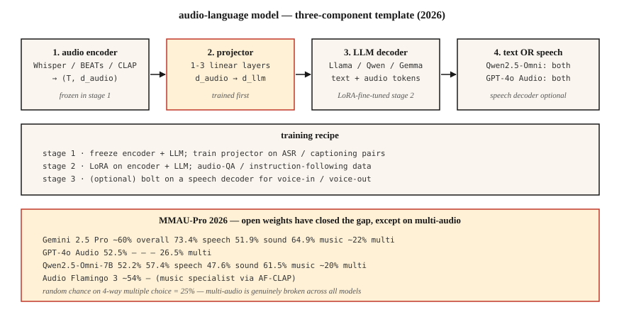

<!-- local-zh-machine-draft: English source is canonical; prose translated automatically, code/math preserved. -->

<a id="audio-language-models--qwen25-omni-audio-flamingo-gpt-4o-audio"></a>

# 音频语言模型 — Qwen2.5-Omni、Audio Flamingo、GPT-4o Audio

> 2026 个音频语言模型通过语音 + 环境声音 + 音乐进行推理。 Qwen2.5-Omni-7B 与 MMAU-Pro 上的 GPT-4o 音频匹配。 Audio Flamingo Next 在 LongAudioBench 上击败了 Gemini 2.5 Pro。开放和封闭之间的差距本质上是封闭的——除了多音频任务，其中每个人都接近随机。

**类型：** 了解
**语言：** Python
**先决条件：** 第 6·04 阶段（ASR）、第 12·03 阶段（Vision-Language Models）、第 7·10 阶段（音频 Transformers）
**时间：** ~45分钟

<a id="the-problem"></a>

## 问题

您有 5 秒的音频：狗叫，有人大喊“停下！”，然后一片寂静。有用的问题跨越多个轴：

- **Transcription.** “说什么？” — ASR 领土。
- **语义推理。**“人有危险吗？” ——需要对吠叫+叫喊+沉默的共同理解。
- **音乐推理。**“什么乐器演奏旋律？”
- **长音频检索。**“在这个90分钟的讲座中，讲师在哪里解释了gradient descent？”

用一个 prompt 回答所有这些问题的单一模型是 ** 音频语言模型 ** (LALM / ALM)。与纯 ASR 不同：LALM 生成自由形式的自然语言答案，而不仅仅是文字记录。

<a id="the-concept"></a>

## 概念



<a id="the-three-component-template"></a>

### 三部分模板

每个 2026 LALM 都有相同的骨架：

1. **Audio encoder.** Whisper encoder · BEATs · CLAP · WavLM · 或每个模型的自定义 encoder。
2. **Projector.** 线性或 MLP 桥接音频 - encoder features 插入 LLM 的 token embedding 空间。
3. **LLM.** Llama / Qwen / 基于 Gemma 的 decoder。采取交错文本+audio tokens；生成文本。

培训：

- **阶段1.**冻结encoder + LLM;列车投影仪仅显示 ASR/字幕数据。
- **Stage 2.** Full / LoRA 对遵循指令的音频任务（QA、推理、音乐理解）进行微调。
- **Stage 3（可选）。** 语音输入/语音输出添加语音 decoder。 Qwen2.5-Omni 和 AF3-Chat 可以做到这一点。

<a id="the-2026-model-map"></a>

### 2026年模型图

| 模型 | 骨干网 | 音频 encoder | 输出 modality | 访问 |
|-------|----------|---------------|-----------------|--------|
| Qwen2.5-Omni-7B | Qwen2.5-7B | 定制+Whisper | 文字+语音 | 阿帕奇-2.0 |
| Qwen3-Omni | Q文3 | 定制 | 文字+语音 | 阿帕奇-2.0 |
| 音频火烈鸟 3 | Qwen2 | 拍拍拍 | 文本 | NVIDIA 非商业 |
| 音频火烈鸟下一个 | Qwen2 | AF-CLAP v2 | 文本 | NVIDIA 非商业 |
| 鲑鱼 | 骆驼毛 | Whisper+节拍 | 文本 | 阿帕奇-2.0 |
| LTU / LTU-AS | Llama | CAV-MAE | 文本 | 阿帕奇-2.0 |
| 伽玛 | Llama | AST + Q-前体 | 文本 | 阿帕奇-2.0 |
| Gemini 2.5 Flash/Pro（已关闭） | Gemini | 专有的 | 文字+语音 | API |
| GPT-4o音频（已关闭） | GPT-4o | 专有的 | 文字+语音 | API |

<a id="benchmark-reality-check-2026"></a>

### 基准现实检查（2026）

**MMAU-Pro.** 1800 个 QA 对，涵盖语音/声音/音乐/混合。包括多音频子集。

| 模型 | 整体 | 演讲 | 声音 | 音乐 | 多音频 |
|-------|---------|--------|-------|-------|-------------|
| Gemini 2.5 Pro | ~60% | 73.4% | 51.9% | 64.9% | ~22% |
| Gemini 2.5 Flash | ~57% | 73.4% | 50.5% | 64.9% | 21.2% |
| GPT-4o音频 | 52.5% | — | — | — | 26.5% |
| Qwen2.5-Omni-7B | 52.2% | 57.4% | 47.6% | 61.5% | ~20% |
| 音频火烈鸟 3 | ~54% | — | — | — | — |
| 音频火烈鸟下一个 | LongAudioBench 上的 SOTA | — | — | — | — |

**多音频专栏对每个人来说都是该死的。** 4选项多项选择的随机机会= 25％；大多数模型的得分都在这附近。 LALM 仍然难以比较两个剪辑。

<a id="where-lalms-are-useful-in-2026"></a>

### 2026 年 LALM 的用途

- **呼叫中心录音合规审核。**“agent是否提到了所需的披露？”
- **Accessibility.** 向聋哑用户描述声音事件（不仅仅是转录）。
- **内容审核。** 检测暴力语言+威胁语气+背景上下文。
- **播客/会议章节。** 语义摘要，不仅仅是演讲者轮流。
- **音乐目录分析。**“查找所有具有 B 部分调性变化的曲目。”

<a id="where-they-are-not-yet-useful"></a>

### 它们（尚未）有用的地方

- 细粒度的音乐理论（低于和弦级别）。
- 长时间对话中的说话人归因推理（超过 10 分钟后性能下降）。
- 多音频比较（22-26% 略高于随机）。
- 实时streaming推理（大部分是离线批量inference）。

```figure
v4-alm-tokens
```

<a id="build-it"></a>

## 动手实现

<a id="step-1-query-qwen25-omni"></a>

### 第一步：查询Qwen2.5-Omni

```python
from transformers import AutoModelForCausalLM, AutoProcessor

processor = AutoProcessor.from_pretrained("Qwen/Qwen2.5-Omni-7B")
model = AutoModelForCausalLM.from_pretrained("Qwen/Qwen2.5-Omni-7B", torch_dtype="auto")

audio, sr = load_wav("clip.wav", sr=16000)
messages = [{
    "role": "user",
    "content": [
        {"type": "audio", "audio": audio},
        {"type": "text", "text": "What sounds do you hear, and what's happening?"},
    ],
}]
inputs = processor.apply_chat_template(messages, tokenize=True, return_tensors="pt")
output = model.generate(**inputs, max_new_tokens=200)
print(processor.decode(output[0], skip_special_tokens=True))
```

<a id="step-2-the-projector-pattern"></a>

### 第二步：投影仪图案

```python
import torch.nn as nn

class AudioProjector(nn.Module):
    def __init__(self, audio_dim=1280, llm_dim=4096):
        super().__init__()
        self.down = nn.Linear(audio_dim, llm_dim)
        self.act = nn.GELU()
        self.up = nn.Linear(llm_dim, llm_dim)

    def forward(self, audio_features):
        return self.up(self.act(self.down(audio_features)))
```

就是这样。投影机通常是1-3个线性层。在 ASR 对（音频 → 文字记录）上对其进行训练是第一阶段的借口任务。

<a id="step-3-benchmarking-mmau--longaudiobench"></a>

### 第 3 步：对 MMAU / LongAudioBench 进行基准测试

```python
from datasets import load_dataset
mmau = load_dataset("gamma-lab-umd/MMAU-Pro", split="test")
mcq = mmau.filter(lambda item: len(item["choices"] or []) > 1)

correct = 0
for item in mcq:
    answer = call_model(item["audio_path"], item["question"], item["choices"])
    if answer == item["answer"]:
        correct += 1
print(f"Accuracy: {correct / len(mcq):.3f}")
```

`audio_path` 指向数据集存储库的 `data.zip`（约 47 GB），因此在评分之前下载并解压它。此精确匹配循环是健全性检查，而不是基准评分器，因此其数量与已发布的 MMAU-Pro 结果不可比较。官方评估器通过 embedding 相似性 (NV-Embed-v2) 匹配多项选择答案，使用 LLM 法官对开放式答案进行评分，并使用正则表达式规则检查遵循指令的答案：将预测写入 `model_output` 列并从以下位置运行 `evaluate_mmau_pro_comprehensive.py` [MMAU-Pro 存储库](https://github.com/sonalkum/MMAUPro)。分别报告每个 `category`（语音、声音、音乐、多重和 rest）。汇总数字隐藏了模型失败的地方。

<a id="use-it"></a>

## 实际应用

| 任务 | 2026年选秀 |
|------|-----------|
| 自由格式音频 QA（开放） | Qwen2.5-Omni-7B |
| 最好在长音频上打开 | 音频火烈鸟下一个 |
| 最好关闭 | Gemini 2.5 Pro |
| 语音输入/语音输出 agent | Qwen2.5-Omni 或 GPT-4o 音频 |
| 音乐推理 | Audio Flamingo 3 或 2（音乐专用 AF-CLAP） |
| 呼叫中心审核 | Gemini 2.5 Pro 通过 API，并在您的策略文档上使用 RAG |

<a id="pitfalls"></a>

## 陷阱

- ** 对多音频的过度信任。** 如果您的任务需要“哪个剪辑有 X”，则随机机会级性能是真实的。
- **长时间音频降级。** 过去10分钟，大多数型号的扬声器归属中断。首先进行日记（第 6 课），然后进行总结。
- **Hallucinations 关于沉默。** 使用 Whisper encoder 的 LALM 继承了相同的 Whisper 风格问题。 VAD 门。
- **Benchmark 挑选。** 供应商博客文章突出显示最佳案例类别。自己运行 MMAU-Pro 多音频子集。

<a id="ship-it"></a>

## 交付成果

保存为 `outputs/skill-alm-picker.md`。对于给定的音频理解任务，选择 LALM + 基准子集 + 输出 modality（文本与语音）。

<a id="exercises"></a>

## 练习

1. **Easy.** 运行 `code/main.py` 查看玩具投影仪图案 + 假 LALM 路由（音频-embedding，文本-tokens）→ 输出tokens。
2. **Medium.** 在 100 个 MMAU-Pro 语音项目上对 Qwen2.5-Omni-7B 进行评分。与论文报道的数字进行比较。
3. **Hard.** 构建最小的音频字幕基线：BEATs encoder + 2 层投影仪 + 冻结的 Llama-3.2-1B。仅微调 AudioCaps 上的投影仪。与 Clotho-AQA 上的 SALMONN 进行比较。

<a id="key-terms"></a>

## 关键术语

| 术语 | 人们怎么说 | 它实际上意味着什么 |
|------|-----------------|-----------------------|
| 拉曼 | 音频ChatGPT | 音频encoder+投影仪+LLM decoder。 |
| 投影仪 | 适配器 | 小MLP将音频features映射到LLM embedding空间。 |
| MMAU | 基准 | 10k 个音频-QA 对，涵盖语音、声音、音乐。 |
| MMAU-Pro | 更难的MMAU | 1800 道多音频/推理题。 |
| 长音频凳 | 长格式评估 | 带有语义查询的多分钟剪辑。 |
| 语音输入/语音输出 | 语音母语 | 模型摄取语音并发出语音，无需绕行文本。 |

<a id="further-reading"></a>

## 进一步阅读

- [Chu 等人。 （2024）。 Qwen2-Audio](https://arxiv.org/abs/2407.10759) — 参考架构。
- [阿里巴巴（2025）。 Qwen2.5-Omni](https://huggingface.co/Qwen/Qwen2.5-Omni-7B) — 语音输入语音输出。
- [NVIDIA (2025)。 Audio Flamingo 3](https://arxiv.org/abs/2507.08128) — 开放式长音频领导者。
- [NVIDIA (2026)。 Audio Flamingo Next](https://arxiv.org/abs/2604.10905) — LongAudioBench SOTA。
- [Tang 等人。 （2023）。 SALMONN](https://arxiv.org/abs/2310.13289) — 双 encoder 先锋。
- [MMAU-Pro 排行榜](https://sonalkum.github.io/mmau-pro/) — 2026 年实时排名。
