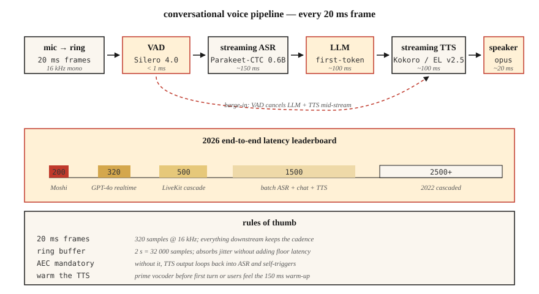

<!-- local-zh-machine-draft: English source is canonical; prose translated automatically, code/math preserved. -->

<a id="real-time-audio-processing"></a>

# 实时音频处理

> 批处理管道处理文件。实时管道在接下来的 20 毫秒到达之前处理接下来的 20 毫秒。每个对话式人工智能、广播工作室和电话机器人的生死都取决于这个延迟预算。

**类型：** 构建
**语言：** Python
**先决条件：** 阶段 6·02（频谱图）、阶段 6·04（ASR）、阶段 6·07（TTS）
**时间：** ~75分钟

<a id="the-problem"></a>

## 问题

您想要一个充满活力的语音助手。人类对话轮流延迟约为 230 毫秒（沉默到响应）。任何超过 500 毫秒的时间都会让人感觉机械化；超过 1500 毫秒感觉就坏了。 2026 年完整 **hear→理解→响应→speak** 循环的预算为：

| 舞台 | 预算 |
|-------|--------|
| 麦克风 → 缓冲器 | 20毫秒 |
| 虚拟AD | 10毫秒 |
| ASR (streaming) | 150毫秒 |
| LLM（第一个token） | 100毫秒 |
| TTS（第一个块） | 100毫秒 |
| 渲染 → 扬声器 | 20毫秒 |
| **总计** | **~400 ms** |

Moshi（Kyutai，2024）时钟为 200 毫秒全双工。 GPT-4o-实时 (2024) 时钟 ~320 毫秒。 2022 年级联管道发货速度为 2500 毫秒。 10 倍的改进来自三种技术：(1) streaming 无处不在，(2) 具有部分结果的异步流水线，(3) 可中断生成。

<a id="the-concept"></a>

## 概念



**Frame / chunk / window.** 实时音频流作为固定大小的块。常见选择：20 ms（16 kHz 下 320 个样本）。下游的一切都必须跟上这个节奏。

**Ring buffer.** 固定大小的循环缓冲区。生产者线程写入新帧，消费者线程读取。防止在热路径中进行分配。大小 ≈ 最大延迟 × 采样率； 2 秒 16 kHz 振铃 = 32,000 个样本。

**VAD（语音活动检测）。** 当无人说话时控制下游工作。 Silero VAD 4.0 (2024) 在 CPU 上每 30 毫秒帧运行 <1 毫秒。 `webrtcvad` 是较旧的替代方案。

**Streaming ASR.** 在音频到达时发出部分转录的模型。 streaming 模式下的 Parakeet-CTC-0.6B (NeMo, 2024) 在 320 毫秒延迟下实现了 2–5% 的 WER。 Whisper-Streaming（Macháček et al., 2023）以大约 2 秒的延迟对接近 streaming 的 Whisper 进行分块。

**Interruption.** 当用户在助理说话时说话时，您必须 (a) 检测打断，(b) 停止 TTS，(c) 丢弃剩余的 LLM 输出。全部在 100 毫秒内完成，否则用户将感知到聋哑助理。

**WebRTC Opus 传输。** 20 ms 帧，48 kHz，自适应比特率 8–128 kbps。浏览器和移动设备的标准。 LiveKit、Daily.co、Pion 是 2026 年构建语音应用程序的堆栈。

**抖动缓冲区。** 网络数据包无序/延迟到达。抖动缓冲器重新排序并平滑；太小 → 可听见的间隙，太大 → 延迟。通常为 60–80 毫秒。

<a id="common-gotchas"></a>

### 常见问题

- **线程争用。** Python 的 GIL + 重型模型可能会导致音频线程挨饿。使用 C 回调音频库（sounddevice、PortAudio）并使 Python 远离热路径。
- **采样率转换延迟。** 管道内重新采样会增加 5–20 毫秒。预先重新采样或使用零延迟重新采样器（PolyPhase、`soxr_hq`）。
- **TTS priming.** 即使像 Kokoro 这样的快速 TTS 在第一次请求时也会有 100–200 毫秒的预热。缓存模型+在第一个真正的转弯之前通过虚拟运行对其进行预热。
- **Echo 取消。** 如果没有 AEC，TTS 输出会重新进入麦克风并触发机器人自己的声音上的 ASR。 WebRTC AEC3 是默认的开源。

```figure
nyquist-aliasing
```

<a id="build-it"></a>

## 动手实现

<a id="step-1-ring-buffer"></a>

### 步骤1：环形缓冲区

```python
import collections

class RingBuffer:
    def __init__(self, capacity):
        self.buf = collections.deque(maxlen=capacity)
    def write(self, frame):
        self.buf.extend(frame)
    def read(self, n):
        return [self.buf.popleft() for _ in range(min(n, len(self.buf)))]
    def level(self):
        return len(self.buf)
```

容量决定最大缓冲延迟。 16 kHz = 2 秒时 32,000 个样本。

<a id="step-2-vad-gate"></a>

### 步骤2：VAD门

```python
def simple_energy_vad(frame, threshold=0.01):
    return sum(x * x for x in frame) / len(frame) > threshold ** 2
```

在生产中替换为 Silero VAD：

```python
import torch
vad, _ = torch.hub.load("snakers4/silero-vad", "silero_vad")
is_speech = vad(torch.tensor(frame), 16000).item() > 0.5
```

<a id="step-3-streaming-asr"></a>

### 步骤3：streaming ASR

```python
# Parakeet-CTC-0.6B streaming via NeMo
from nemo.collections.asr.models import EncDecCTCModelBPE
asr = EncDecCTCModelBPE.from_pretrained("nvidia/parakeet-ctc-0.6b")
# chunk_ms=320 ms, look_ahead_ms=80 ms
for chunk in audio_stream():
    partial_text = asr.transcribe_streaming(chunk)
    print(partial_text, end="\r")
```

<a id="step-4-interruption-handler"></a>

### 第四步：中断处理程序

```python
class Dialog:
    def __init__(self):
        self.tts_task = None

    def on_user_speech(self, frame):
        if self.tts_task and not self.tts_task.done():
            self.tts_task.cancel()   # barge-in
        # then feed to streaming ASR

    def on_final_user_utterance(self, text):
        self.tts_task = asyncio.create_task(self.reply(text))

    async def reply(self, text):
        async for tts_chunk in llm_then_tts(text):
            speaker.write(tts_chunk)
```

取决于异步 I/O 和可取消的 TTS streaming。音轨上的 WebRTC peerconnection.stop() 是规范的方式。

<a id="use-it"></a>

## 实际应用

2026 年堆栈：

| 图层 | 挑选 |
|-------|------|
| 交通 | LiveKit (WebRTC) 或 Pion (Go) |
| 虚拟AD | 西莱罗VAD 4.0 |
| Streaming ASR | 鹦鹉-CTC-0.6B 或 Whisper-Streaming |
| LLM 第一-token | Groq，大脑，vLLM-streaming |
| Streaming TTS | Kokoro 或 ElevenLabs Turbo v2.5 |
| 回声消除 | WebRTC AEC3 |
| 端到端原生 | OpenAI 实时 API 或 Moshi |

<a id="pitfalls"></a>

## 陷阱

- **缓冲 500 ms 以保证安全。** 缓冲区 *is* 您的延迟底限。缩小它。
- **未固定线程。** 优先级低于 UI 线程上的音频回调 = 负载下出现故障。
- **TTS 块太小。** 低于 200 毫秒的块使声码器伪像可听见。 320 毫秒的块是最佳位置。
- **没有抖动缓冲。** 真实网络是抖动的；如果没有平滑，你会得到流行音乐。
- **单次错误处理。** 音频管道必须防崩溃。一个异常会终止会话。

<a id="ship-it"></a>

## 交付成果

保存为 `outputs/skill-realtime-designer.md`。设计一个实时音频管道，每个阶段都有具体的延迟预算。

<a id="exercises"></a>

## 练习

1. **Easy.** 运行`code/main.py`。模拟环形缓冲区+能量VAD；打印假 10 秒流的阶段延迟。
2. **Medium.** 使用 `sounddevice`，构建一个直通循环，以 20 毫秒帧处理麦克风并在每一帧打印 VAD 状态。
3. **Hard.** 使用 `aiortc` 构建全双工回声测试：浏览器 → WebRTC → Python → WebRTC → 浏览器。使用 1 kHz 脉冲测量玻璃到玻璃的延迟。

<a id="key-terms"></a>

## 关键术语

| 术语 | 人们怎么说 | 它实际上意味着什么 |
|------|-----------------|-----------------------|
| 环形缓冲区 | 循环队列 | 用于音频帧的固定大小、无锁（或 SPSC 锁定）的 FIFO。 |
| 虚拟AD | 寂静门 | 模型或启发式标记语音与非语音。 |
| Streaming ASR | 实时STT | 当音频到达时发出部分文本；有界前瞻。 |
| 抖动缓冲器 | 网络更顺畅 | 队列重新排序乱序数据包；通常为 60–80 毫秒。 |
| 原子能委员会 | 回声消除 | 减少扬声器到麦克风的反馈路径。 |
| 打断 | 用户中断 | 系统检测用户语音中TTS；必须取消播放。 |
| 全双工 | 双向同时进行 | 用户和机器人可以同时通话； Moshi 是全双工的。 |

<a id="further-reading"></a>

## 进一步阅读

- [Macháček 等人。 （2023）。Whisper-Streaming](https://arxiv.org/abs/2307.14743) — 在 streaming Whisper附近分块。
- [九台（2024）。 Moshi](https://kyutai.org/Moshi.pdf) — 全双工 200 毫秒延迟。
- [LiveKit Agents 框架 (2024)](https://docs.livekit.io/agents/) — 制作音频 agent orchestration。
- [Silero VAD repo](https://github.com/snakers4/silero-vad) — 低于 1 毫秒的 VAD，Apache 2.0。
- [WebRTC AEC3论文](https://webrtc.googlesource.com/src/+/main/modules/audio_processing/aec3/) — 开源下的回声消除。
