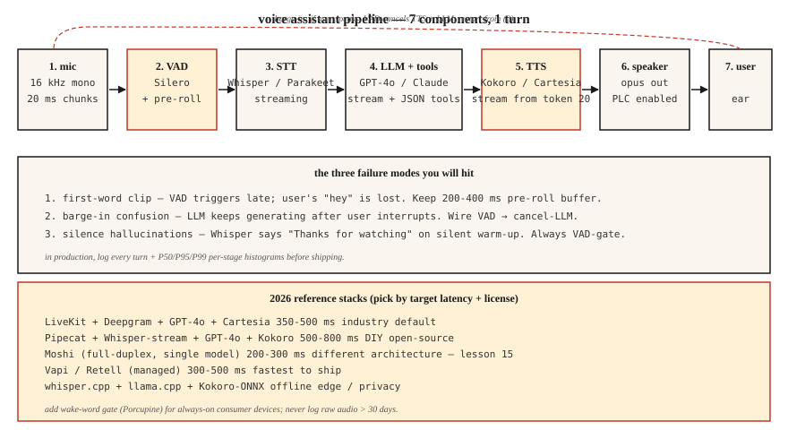

<!-- local-zh-machine-draft: English source is canonical; prose translated automatically, code/math preserved. -->

<a id="build-a-voice-assistant-pipeline--the-phase-6-capstone"></a>

# 构建语音助手管道——第 6 阶段综合项目

> 01-11 课的所有内容都缝合在一起。构建一个能够倾听、推理和回复的语音助手。到 2026 年，这是一个已解决的工程问题，而不是一个研究问题，但集成细节决定了它是否可以发布。

**类型：** 构建
**语言：** Python
**先决条件：** 第6期·04、05、06、07、11； 11·09期（Function Calling）；第14期·01期（Agent Loop）
**时间：** ~120 分钟

<a id="the-problem"></a>

## 问题

构建端到端助手：

1. 捕获麦克风输入（16 kHz 单声道）。
2. 检测用户语音的开始/结束。
3. 转录 streaming。
4. 将成绩单传递给可以调用工具（计时器、天气、日历）的 LLM。
5. 将 LLM 文本流式传输到 TTS。
6. 向用户播放音频。
7. 如果用户中断中间响应，则停止。

延迟目标：用户在笔记本电脑上完成讲话后 800 毫秒内的第一个 TTS 音频字节 CPU。质量目标：无漏词、无静音幻觉字幕、无语音克隆泄露、无prompt injection成功。

<a id="the-concept"></a>

## 概念



<a id="the-seven-components"></a>

### 七个组成部分

1. **音频捕获。** 麦克风 → 16 kHz 单声道 → 20 ms 块。通常是 `sounddevice` 中的 Python 或生产中的原生 AudioUnit/ALSA/WASAPI。
2. **VAD（第 11 课）.** Silero VAD @ 阈值 0.5，最小语音 250 毫秒，静音拖尾 500 毫秒。信号“开始”和“结束”。
3. **Streaming STT（第 4-5 课）。** Whisper-streaming、Parakeet-TDT 或 Deepgram Nova-3 (API)。部分+最终成绩单。
4. **LLM 与 tool calling.** GPT-4o / Claude 3.5 / Gemini 2.5 Flash。 JSON 工具架构。流tokens。
5. **Streaming TTS（第7课）。** Kokoro-82M（最快打开）或Cartesia Sonic（商业）。 20 LLM tokens 后开始 TTS。
6. **Playback.** 扬声器输出；用于低带宽网络的 opus 编码。
7. **中断处理程序。** 如果VAD在TTS播放期间触发，则停止播放，取消LLM，重新启动STT。

<a id="the-three-failure-modes-you-will-hit"></a>

### 您将遇到的三种故障模式

1. **First-word 剪辑。** VAD 开始节拍太晚。缺少用户的“嘿”。起始阈值为 0.3，而不是 0.5。
2. **中响应中断混乱。** LLM在用户中断后不断产生；助理与用户交谈。接线VAD→取消-LLM。
3. **Silence hallucination.** Whisper 在静音预热帧上输出“感谢观看”。始终是 VAD 门。

<a id="2026-production-reference-stacks"></a>

### 2026 量产参考堆栈

| 堆栈 | 延迟 | 许可证 | 注释 |
|-------|---------|---------|-------|
| LiveKit + Deepgram + GPT-4o + 笛卡尔 | 350-500毫秒 | 商用 API | 行业默认2026 |
| Pipecat + Whisper-streaming + GPT-4o + Kokoro | 500-800毫秒 | 大部分开放 | 适合DIY |
| Moshi（全双工） | 200-300毫秒 | CC-BY 4.0 | 单一型号；不同的建筑，第 15 课 |
| Vapi / Retell（托管） | 300-500毫秒 | 商业 | 最快启动；有限的定制 |
| Whisper.cpp + llama.cpp + Kokoro-ONNX | 离线 | 打开 | 隐私/边缘 |

```figure
v4-voice-latency
```

<a id="build-it"></a>

## 动手实现

<a id="step-1-mic-capture-with-chunking-pseudocode"></a>

### 步骤1：使用chunking进行麦克风捕获（伪代码）

```python
import sounddevice as sd

def mic_stream(chunk_ms=20, sr=16000):
    q = queue.Queue()
    def cb(indata, frames, time, status):
        q.put(indata.copy().flatten())
    with sd.InputStream(channels=1, samplerate=sr, blocksize=int(sr * chunk_ms/1000), callback=cb):
        while True:
            yield q.get()
```

<a id="step-2-vad-gated-turn-capture"></a>

### 第 2 步：VAD 门控回合捕获

```python
def capture_turn(stream, vad, pre_roll_ms=300, silence_ms=500):
    buf, pre, triggered = [], collections.deque(maxlen=pre_roll_ms // 20), False
    silent = 0
    for chunk in stream:
        pre.append(chunk)
        if vad(chunk):
            if not triggered:
                buf = list(pre)
                triggered = True
            buf.append(chunk)
            silent = 0
        elif triggered:
            silent += 20
            buf.append(chunk)
            if silent >= silence_ms:
                return b"".join(buf)
```

<a id="step-3-streaming-stt--llm--tts"></a>

### 步骤3：streaming STT → LLM → TTS

```python
async def turn(audio_bytes):
    transcript = await stt.transcribe(audio_bytes)
    async for token in llm.stream(transcript):
        async for audio in tts.stream(token):
            await speaker.play(audio)
```

<a id="step-4-tool-calling-inside-the-llm-loop"></a>

### 步骤4：LLM循环内的tool calling

```python
tools = [
    {"name": "get_weather", "parameters": {"location": "string"}},
    {"name": "set_timer", "parameters": {"seconds": "int"}},
]

async for chunk in llm.stream(user_text, tools=tools):
    if chunk.type == "tool_call":
        result = dispatch(chunk.name, chunk.args)
        continue_streaming(result)
    if chunk.type == "text":
        await tts.stream(chunk.text)
```

<a id="step-5-interruption-handling"></a>

### 第五步：中断处理

```python
tts_task = asyncio.create_task(tts_loop())
while True:
    chunk = await mic.get()
    if vad(chunk):
        tts_task.cancel()
        await speaker.stop()
        await new_turn()
        break
```

<a id="use-it"></a>

## 实际应用

请参阅 `code/main.py`，了解可运行的模拟，该模拟将所有七个组件与存根模型连接起来，因此即使没有硬件，您也可以看到管道形状。对于真正的实现，请将存根交换为：

- `silero-vad` (`pip install silero-vad`)
- `deepgram-sdk` 或 `openai-whisper`
- `openai` (`gpt-4o`) 或 `anthropic`
- `kokoro` 或 `cartesia`
- `sounddevice` 用于 I/O

<a id="pitfalls"></a>

## 陷阱

- ** 永远记录 PII。** 在大多数司法管辖区，全轮音频是 PII。保留 30 天，加密为 rest。
- **无打断。** 用户将中断。你的助理必须停止说话。
- **TTS 阻止。** 同步 TTS 阻止事件循环。使用异步或单独的线程。
- ** 无工具调用错误处理。** 工具失败。 LLM 必须返回错误+重试一次，然后优雅降级。
- ** 过度热心 hallucination 过滤器。** 过度过滤，助手重复“我对此无能为力。”过滤器下方，它说了什么。在保留的集合上进行校准。
- **没有唤醒词选项。** 始终监听是一种隐私责任。添加唤醒词门（Porcupine 或 openWakeWord）。

<a id="ship-it"></a>

## 交付成果

保存为 `outputs/skill-voice-assistant-architect.md`。给定预算+规模+语言+合规性约束，生成完整的堆栈规范。

<a id="exercises"></a>

## 练习

1. **Easy.** 运行`code/main.py`。它使用存根模块端到端地模拟一整圈，并打印每个阶段的延迟。
2. **Medium.** 将 STT 存根替换为预先录制的 `.wav` 上的真实 Whisper 模型。测量 WER 和端到端延迟。
3. **Hard.** 添加tool calling：实现`get_weather`（任何API）和`set_timer`。通过工具路由 LLM 并验证当用户说“设置 5 分钟计时器”时，正确的功能会触发并且语音回复会确认这一点。

<a id="key-terms"></a>

## 关键术语

| 术语 | 人们怎么说 | 它实际上意味着什么 |
|------|-----------------|-----------------------|
| 转 | 用户+助手往返 | 一份 VAD 范围内的用户语音 + 一份 LLM-TTS 响应。 |
| 打断 | 中断 | 用户说话，助理说话；助理停了下来。 |
| 唤醒词 | “嘿助理” | 短关键词检测器；豪猪、雪童、openWakeWord。 |
| 端点指向 | 回合结局 | VAD + 用户已完成的最小静音决策。 |
| 前贴片 | 预语音缓冲区 | 在 VAD 触发之前保留 200-400 毫秒的音频，以避免首词剪辑。 |
| Tool call | 函数调用 | LLM 发出 JSON；运行时调度；结果在循环中反馈。 |

<a id="further-reading"></a>

## 进一步阅读

- [LiveKit — 语音 agent 快速入门](https://docs.livekit.io/agents/) — 生产级参考。
- [Pipecat — 语音 agent 示例](https://github.com/pipecat-ai/pipecat) — DIY 友好的框架。
- [OpenAI 实时 API](https://platform.openai.com/docs/guides/realtime) — 托管语音本机路径。
- [Kyutai Moshi](https://github.com/kyutai-labs/moshi) — 全双工参考（第 15 课）。
- [Porcupine 唤醒词](https://picovoice.ai/products/porcupine/) — 唤醒词门控。
- [Anthropic — 工具使用指南](https://docs.anthropic.com/en/docs/build-with-claude/tool-use) — LLM function calling。
