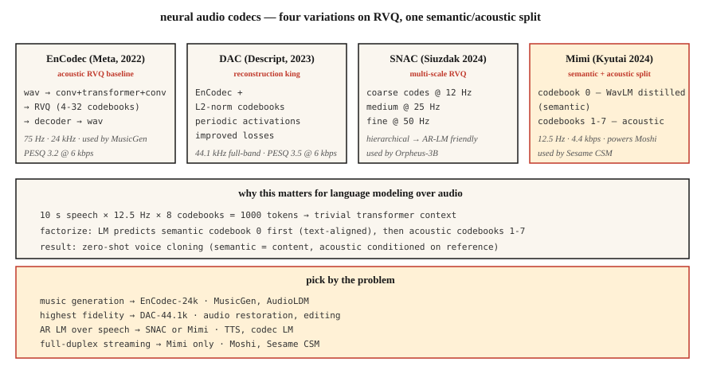

<!-- local-zh-machine-draft: English source is canonical; prose translated automatically, code/math preserved. -->

<a id="neural-audio-codecs--encodec-snac-mimi-dac-and-the-semantic-acoustic-split"></a>

# 神经音频编解码器 — EnCodec、SNAC、Mimi、DAC 和语义声学分离

> 2026年音频生成几乎都是tokens。 EnCodec、SNAC、Mimi 和 DAC 将连续波形转换为 transformer 可以预测的离散序列。语义与声学 token 的分离——第一个密码本作为语义，rest 作为声学——是自 Transformer 音频以来最重要的架构转变。

**类型：**学习
**语言：** Python
**先决条件：** 第 6·02 阶段（频谱图）、第 10·11 阶段 (Quantization)、第 5·19 阶段（子字 Tokenization）
**时间：** ~60 分钟

<a id="the-problem"></a>

## 问题

语言模型适用于离散 tokens。音频是连续的。如果你想要一个 LLM 风格的语音/音乐模型——MusicGen、Moshi、Sesame CSM、VibeVoice、Orpheus——你首先需要一个 ** 神经音频编解码器**：一个学习的 encoder，它将音频离散化为一个小的tokens 的 vocabulary，以及重构波形的匹配 decoder。

两个家庭出现了：

1. **重构优先编解码器** — 编码解码器、DAC。优化感知音频质量。 Tokens 是“声学”的——它们捕捉一切，包括说话者身份、音色、背景噪音。
2. **语义优先编解码器** — Mimi (Kyutai)，SpeechTokenizer。强制第一个密码本对语言/语音内容进行编码（通常通过从 WavLM 中提取）。随后的码本是声学细节。

2024-2026 年见解：**a 纯重建编解码器在您尝试从文本生成时会产生模糊的语音。** 编解码器 tokens 上的 LLM 必须在同一码本中学习语言结构和声学结构，这是不可扩展的。将它们分开——语义码本 0，声学码本 1-N——是 Moshi 和 Sesame CSM 发挥作用的原因。

<a id="the-concept"></a>

## 概念



<a id="the-core-trick-residual-vector-quantization-rvq"></a>

### 核心技巧：残差向量Quantization（RVQ）

所有现代音频编解码器都使用 **RVQ**，而不是一个大密码本（需要数百万个代码才能获得良好的质量）：一系列小密码本。第一个码本量化 encoder 输出；第二个量化残差；每个码本有1024个码。 8个码本=1024^8=10^24的有效vocabulary。

在 inference 时间，decoder 将每帧所有选择的代码相加以进行重建。

<a id="the-four-codecs-that-matter-in-2026"></a>

### 2026 年重要的四种编解码器

**EnCodec（元，2022）.** 基线。 Encoder-decoder 过波形，RVQ 瓶颈。 24 kHz，可能有 32 个码本，默认 4 个码本 @ 1.5 kbps。采用`1D conv + transformer + 1D conv`架构。由 MusicGen 使用。

**DAC（描述，2023）。** RVQ，具有 L2 归一化码本，周期性 activation functions，改善了损耗。任何开放编解码器中最高的重建保真度——有时与具有 12 个码本的原始语音无法区分。 44.1 kHz 全频段。

**SNAC（Hubert Siuzdak，2024）。** 多尺度 RVQ - 粗略码本的运行帧速率低于精细码本。有效地对音频进行分层建模：约 12 Hz 的粗略“草图”加上 50 Hz 的细节。被 Orpheus-3B 使用是因为层次结构很好地映射到基于 LM 的生成。

**Mimi（Kyutai，2024）。** 2026 年游戏规则改变者。 12.5 Hz 帧速率（极低），8 个码本 @ 4.4 kbps。密码本 0 是从 WavLM** 中提取的 ** — 经过训练以预测 WavLM 的语音内容 features。密码本 1-7 是声学残差。这种分裂赋予了 Moshi（第 15 课）和 Sesame CSM 权力。

<a id="frame-rates-matter-for-language-modeling"></a>

### 帧速率对于语言建模很重要

较低的帧速率 = 较短的序列 = 更快的 LM。

| 编解码器 | 帧率 | 1 秒 = N 帧 | 适合 |
|-------|-----------|----------------|---------|
| 编码解码器-24k | 75赫兹 | 75 | 音乐、一般音频 |
| DAC-44.1k | 86赫兹 | 86 | 高保真音乐 |
| SNAC-24k（粗） | 〜12赫兹 | 12 | AR-LM高效 |
| 咪咪 | 12.5赫兹 | 12.5 | streaming演讲 |

在 12.5 Hz 下，10 秒的话语仅包含 125 个编解码器帧 - transformer 可以轻松预测它们。

<a id="semantic-vs-acoustic-tokens"></a>

### 语义与声学 tokens

```
frame_t → [semantic_token_t, acoustic_token_0_t, acoustic_token_1_t, ..., acoustic_token_6_t]
```

- **语义 token（Mimi 中的密码本 0）。** 对所说内容进行编码 - 音素、单词、内容。通过辅助预测损失从 WavLM 中提取。
- **Acoustic tokens（密码本 1-7）.** 编码音色、说话者身份、韵律、背景噪声、精细细节。

AR LM 首先预测语义 token（以文本为条件），然后预测声学 tokens（以语义 + 说话者参考为条件）。这种分解就是现代 TTS 可以 zero-shot 克隆语音的原因：语义模型处理内容；声学模型处理音色。

<a id="2026-reconstruction-quality-bits-per-sec-lower-bitrate-is-better"></a>

### 2026 重建质量（每秒位数，比特率越低越好）

| 编解码器 | 比特率 | PESQ | 健康生活质量 |
|-------|---------|------|--------|
| Opus-20kbps | 20kbps | 4.0 | 4.3 |
| 编码解码器-6kbps | 6kbps | 3.2 | 3.8 |
| DAC-6kbps | 6kbps | 3.5 | 4.0 |
| SNAC-3kbps | 3kbps | 3.3 | 3.8 |
| 咪咪-4.4kbps | 4.4kbps | 3.1 | 3.7 |

Opus 等传统编解码器仍然在感知质量方面胜出。神经编解码器在 **discrete tokens**（Opus 不生产）和 ** 生成模型质量 **（LM 可以用这些做些什么）上获胜tokens）。

```figure
rvq-codec-cascade
```

<a id="build-it"></a>

## 动手实现

<a id="step-1-encode-with-encodec"></a>

### 步骤1：使用EnCodec进行编码

```python
from encodec import EncodecModel
import torch

model = EncodecModel.encodec_model_24khz()
model.set_target_bandwidth(6.0)  # kbps

wav = torch.randn(1, 1, 24000)
with torch.no_grad():
    encoded = model.encode(wav)
codes, scale = encoded[0]
# codes: (1, n_codebooks, n_frames), dtype=int64
```

`n_codebooks=8`，速率为 6 kbps。每个代码为 0-1023（10 位）。

<a id="step-2-decode-and-measure-reconstruction"></a>

### 步骤 2：解码和测量重建

```python
with torch.no_grad():
    wav_recon = model.decode([(codes, scale)])

from torchaudio.functional import compute_deltas
import torch.nn.functional as F

mse = F.mse_loss(wav_recon[:, :, :wav.shape[-1]], wav).item()
```

<a id="step-3-the-semantic-acoustic-split-mimi-style"></a>

### 步骤 3：语义-声学分割（Mimi 式）

```python
from moshi.models import loaders
mimi = loaders.get_mimi()

with torch.no_grad():
    codes = mimi.encode(wav)  # shape (1, 8, frames@12.5Hz)

semantic = codes[:, 0]
acoustic = codes[:, 1:]
```

语义码本 0 是 WavLM 对齐的。您可以训练文本到语义的 transformer — 比直接到音频的 vocabulary 小得多。然后在扬声器参考上使用单独的声学波形 decoder 条件。

<a id="step-4-why-ar-lm-over-codec-tokens-works"></a>

### 第 4 步：为什么 AR LM 通过编解码器 tokens 有效

对于 Mimi 的 12.5 Hz × 8 码本的 10 秒语音片段：

```
N_tokens = 10 * 12.5 * 8 = 1000 tokens
```

1000 tokens 是 transformer 的一个简单上下文。 256M-parameter transformer 在现代 GPU 上可以在几毫秒内生成 10 秒的语音。

<a id="use-it"></a>

## 实际应用

地图问题→编解码器：

| 任务 | 编解码器 |
|------|-------|
| 一般音乐一代 | 编码解码器-24k |
| 最高保真度重建 | DAC-44.1k |
| AR LM 语音 (TTS) | SNAC 或 咪咪 |
| Streaming 全双工语音 | 咪咪 (12.5 赫兹) |
| 带文字的音效库 | EnCodec+T5条件 |
| 细粒度的音频编辑 | DAC+修复 |

经验法则：**如果您正在构建生成模型，请从 Mimi 或 SNAC 开始。如果您正在构建压缩管道，请使用 Opus.**

<a id="pitfalls"></a>

## 陷阱

- ** 码本太多。** 添加码本会线性增加保真度，但 LM 序列长度也会线性增加。停在8-12点。
- **帧速率不匹配。** 在 12.5 Hz Mimi 上训练 LM，然后在 50 Hz 上训练 fine-tuning EnCodec 会失败。
- ** 假设所有码本相等。** 在Mimi中，码本0携带内容；失去它会破坏可理解性。丢失密码本 7 几乎不会被注意到。
- **使用重建质量作为唯一的度量。** 如果语义结构不好，编解码器可以进行很好的重建，但对于基于LM的生成来说是无用的。

<a id="ship-it"></a>

## 交付成果

保存为 `outputs/skill-codec-picker.md`。为给定的生成或压缩任务选择编解码器。

<a id="exercises"></a>

## 练习

1. **Easy.** 运行`code/main.py`。它实现了一个玩具标量+残差量化器，并在添加码本时测量重建误差。
2. **Medium.** 安装 `encodec` 并比较保留的语音剪辑上的 1、4、8、32 个码本。绘制 PESQ 或 MSE 与比特率的关系图。
3. **Hard.** 加载咪咪。对剪辑进行编码。将码本0替换为随机整数；解码。然后同样替换码本7。比较这两种损坏 — 密码本 0 损坏应该会破坏清晰度； Codebook 7 的损坏几乎不会改变任何东西。

<a id="key-terms"></a>

## 关键术语

| 术语 | 人们怎么说 | 它实际上意味着什么 |
|------|-----------------|-----------------------|
| RVQ | 剩余quantization | 小密码本级联；每个都量化先前的残差。 |
| 帧率 | 编解码器速度 | 每秒有多少个 token 帧。更低=更快的LM。 |
| 语义码本 | 密码本 0（咪咪） | 从 SSL features 中提取的密码本；对内容进行编码。 |
| 声学密码本 | 其他一切 | 音色、韵律、噪音、细节。 |
| PESQ / ViSQOL | 感知质量 | 与 MOS 相关的客观指标。 |
| 编解码器 | 元编解码器 | RVQ 基线；由 MusicGen 使用。 |
| 咪咪 | 九台编解码器 | 12.5赫兹帧率；语义-声学分裂；赋予莫西力量。 |

<a id="further-reading"></a>

## 进一步阅读

- [Défossez 等人。 （2023）。 EnCodec](https://arxiv.org/abs/2210.13438) — RVQ 基线。
- [Kumar 等人。 （2023）。描述音频编解码器 (DAC)](https://arxiv.org/abs/2306.06546) — 最高保真度打开。
- [Siuzdak (2024)。 SNAC](https://arxiv.org/abs/2410.14411) — 多尺度 RVQ。
- [九台（2024）。 Mimi 编解码器](https://kyutai.org/codec-explainer) — 语义声学分割，WavLM 蒸馏。
- [Borsos 等人。 （2023）。 AudioLM](https://arxiv.org/abs/2209.03143) — 两阶段语义/声学范例。
- [Zeghidour 等人。 （2021）。 SoundStream](https://arxiv.org/abs/2107.03312) — 原始的流式 RVQ 编解码器。
