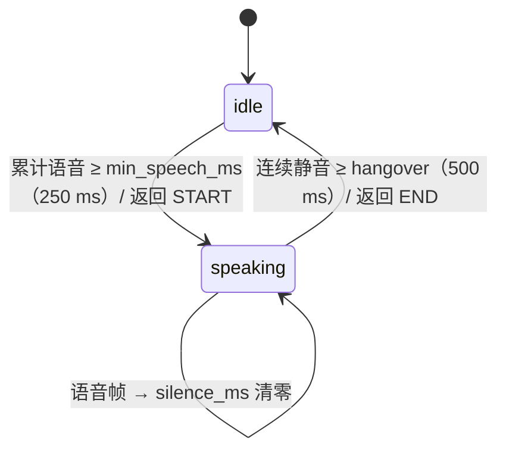

# 代码讲解 · main.py

> **所属小节**：阶段 06 · 语音与音频 · 第 14 节 语音活动检测与对话轮次交接——Silero、Cobra 与 Flush Trick ｜ 讲义：[../docs/zh.md](../docs/zh.md) ｜ 测验：[../quiz/quiz.md](../quiz/quiz.md)
>
> **运行方式**：`python3 main.py`（无命令行参数） ｜ **依赖**：仅 Python 标准库（`math`、`random`），不需要 torch / silero-vad

---

## 1. 这份代码在考察什么

语音 agent 的体验好坏，很大程度取决于两个判断："用户现在在说话吗？""用户说完了吗？"。这份脚本用纯 Python 搭了一个最小可运行的"VAD + 轮次检测"流水线，让你看清：

1. **能量门 VAD** 怎么从一段 PCM 样本算出 RMS、再换算成 dBFS 并与阈值比较。
2. **"Silero 风格" VAD** 的接口形状：输入一个 chunk，输出一个语音概率，再用 0.5 阈值二值化（这里用手写规则冒充神经网络）。
3. **turn-end 状态机**：`idle ↔ speaking` 两状态，`min_speech_ms` 决定何时宣布 START，`silence_hangover_ms` 决定何时宣布 END。
4. **合成测试流**：用"静音 / 讲话 / 咳嗽"三种 20 ms chunk 拼出 3 秒音频，检查事件发生的时刻是否合理。
5. **读结果要带着批判性**：本脚本里两种 VAD 输出的事件完全一致——真正挡住咳嗽的是状态机的最短语音时长，而不是 VAD 本身（见 3.3、第 6 节）。

> 一句话：**VAD 管"每一帧"，状态机管"每一轮"**；把两层分开思考，才能分别调参、分别排错。

---

## 2. 整体结构一览

| 组成部分 | 类型 | 作用 | 对应概念 |
|---------|------|------|---------|
| `synth_chunk(kind, rng, sr, chunk_ms)` | 函数 | 生成一个 20 ms（320 样本）的 speech / cough / silence chunk | 测试数据 |
| `energy_vad(chunk, threshold_dbfs)` | 函数 | RMS → dBFS → 与 -40 dBFS 比较 | Tier 1 能量门 |
| `fake_silero_vad(chunk, prev_state, threshold)` | 函数 | 用 RMS 和峰峰值规则返回 0.92 / 0.55 / 0.02 的"概率" | Tier 2 Silero 的接口替身 |
| `TurnDetector` | 类 | `update(is_speech)` 逐 chunk 推进状态，返回 `"START"` / `"END"` / `None` | 轮次检测状态机 |
| `main()` | 演示入口 | 拼合成流 → 两套 VAD 各驱动一个状态机 → 打印事件与 VAD 对比表 | — |

数据流：`synth_chunk` 生成 151 个 chunk → 每个 chunk 同时送入 `energy_vad` 和 `fake_silero_vad` → 布尔结果分别喂给两个 `TurnDetector` → 收集事件 `(时间 ms, 事件名, 真实标签)` 并打印。

---

## 3. 逐段精讲

### 3.1 合成三种 chunk

```python
def synth_chunk(kind, rng, sr=16000, chunk_ms=20):
    n = int(sr * chunk_ms / 1000)
    if kind == "speech":
        return [0.2 * rng.gauss(0, 1.0) for _ in range(n)]
    if kind == "cough":
        return [0.8 * rng.gauss(0, 1.0) if i < n // 5 else 0.001 * rng.gauss(0, 1.0) for i in range(n)]
    return [0.002 * rng.gauss(0, 1.0) for _ in range(n)]
```

- `n = 16000 × 20 / 1000 = 320` 个样本，对应讲义"每个 20 ms chunk 上做三个决策"。
- **speech**：标准差 0.2 的高斯噪声，RMS ≈ 0.2（约 -14 dBFS）。
- **cough**：前 1/5（64 个样本，4 ms）是 0.8 倍的强脉冲，后面几乎为零——模拟"短促、高能量的瞬态"。整个 chunk 的 RMS ≈ 0.36。
- **silence**：标准差 0.002，RMS ≈ 0.002（约 -54 dBFS）。
- 用 `if ... return` 连续判断代替 `elif` 链：前面的分支一旦命中就直接返回，最后一个 `return` 就是默认分支（silence）。
- ⚠️ 简化：真实语音不是白噪声，它有基频、共振峰、音节节奏；真实咳嗽也远不止 4 ms。这里只是为了让"能量"和"瞬态"两个特征可控。

### 3.2 Tier 1：能量门

```python
def energy_vad(chunk, threshold_dbfs=-40.0):
    rms = (sum(x * x for x in chunk) / len(chunk)) ** 0.5
    return 20.0 * math.log10(max(rms, 1e-10)) > threshold_dbfs
```

- RMS（均方根）= `√(Σx² / N)`，衡量这一段的平均能量。
- dBFS（相对满刻度的分贝）= `20·log10(RMS)`。样本范围为 [-1, 1] 时，满刻度 1.0 → 0 dBFS；0.01 → -40 dBFS。
- `max(rms, 1e-10)`：防止全零 chunk 时 `log10(0)` 抛 `ValueError: math domain error`。这和讲义 Step 1 的写法一致。
- 对应讲义："Cheapest. Threshold RMS at -40 dBFS. Filters obvious silence but fires on any noise above the threshold." 咳嗽 RMS 0.36 ≫ 0.01，必然被判为"语音"。

### 3.3 Tier 2："伪 Silero"——以及它为什么没有区分出咳嗽

```python
def fake_silero_vad(chunk, prev_state, threshold=0.5):
    rms = (sum(x * x for x in chunk) / len(chunk)) ** 0.5
    duration = len(chunk) / 16000.0
    transient = max(chunk) - min(chunk) > 0.6 and duration < 0.03
    if rms > 0.08 and not transient:
        return 0.92
    if rms > 0.05:
        return 0.55
    return 0.02
```

设计意图：真实 Silero 是一个约 1M 参数的神经网络，输出 0–1 的语音概率。这里用三档规则模拟：

| 条件 | 返回 | 意图 |
|------|------|------|
| 能量够大且**不是瞬态** | 0.92 | 很确定是语音 |
| 能量中等 | 0.55 | 勉强过阈值 |
| 其他 | 0.02 | 静音 |

`transient`（瞬态）用"峰峰值 > 0.6 且 chunk 时长 < 30 ms"来刻画咳嗽。但仔细推敲会发现：

- `duration = 320 / 16000 = 0.02`，对**每一个** 20 ms chunk 都 < 0.03，这个条件恒为真；
- 讲话 chunk 有 320 个 `0.2σ` 高斯样本，峰峰值实测最小也约 0.95，同样 > 0.6；
- 所以讲话和咳嗽**都被判为 transient**，都落到第二个分支返回 **0.55**，而 0.55 ≥ 0.5，二者都算"语音"。`0.92` 分支在本脚本中永远走不到（实测 200 个讲话 chunk 和 200 个咳嗽 chunk 全部返回 0.55）。

⚠️ 这意味着"伪 Silero"在帧级别**并没有**拒绝咳嗽，运行结果中两套 VAD 的事件完全相同。挡住咳嗽的其实是 3.4 中的 `min_speech_ms`。若想让这个替身真的区分二者，可以改用"能量集中度"之类的特征，例如比较 chunk 前 1/5 与后 4/5 的能量比（咳嗽能量集中在前 4 ms）。

另外几处签名上的"摆设"：`prev_state` 和 `threshold` 两个参数都没有被使用（阈值比较写在 `main()` 里的 `silero_prob >= 0.5`）。真实 Silero 是有状态的（内部有 RNN 隐状态），`prev_state` 参数是在暗示这一点，但这里没有实现。

### 3.4 turn-end 状态机

```python
class TurnDetector:
    def __init__(self, silence_hangover_ms=500, min_speech_ms=250, pre_roll_ms=300):
        self.state = "idle"
        self.speech_ms = 0
        self.silence_ms = 0
        self.silence_hangover_ms = silence_hangover_ms
        self.min_speech_ms = min_speech_ms
        self.pre_roll_ms = pre_roll_ms

    def update(self, is_speech, chunk_ms=20):
        if is_speech:
            self.speech_ms += chunk_ms
            self.silence_ms = 0
            if self.state == "idle" and self.speech_ms >= self.min_speech_ms:
                self.state = "speaking"
                return "START"
        else:
            if self.state == "speaking":
                self.silence_ms += chunk_ms
                if self.silence_ms >= self.silence_hangover_ms:
                    self.state = "idle"
                    self.speech_ms = 0
                    self.silence_ms = 0
                    return "END"
        return None
```

状态转移图：



- 默认值与讲义"Key parameters"一一对应：最短语音 250 ms、hangover 500 ms、pre-roll 300 ms。
- **一帧语音就把 `silence_ms` 清零**：在 speaking 状态里，只要中途出现一个语音帧，静音计时就重来——这保证了只有"**连续**"的 500 ms 静音才算说完。
- **返回事件而不是打印**：`update` 只返回 `"START"` / `"END"` / `None`，由调用方决定做什么（触发 STT flush、打断 TTS 等）。这是把"决策逻辑"与"副作用"分开的好习惯，也便于单元测试。
- 与讲义 Step 3 的差异：讲义版本在 idle 状态下也累加 `silence_ms`，END 时也不清零 `silence_ms`；这份代码只在 speaking 状态计静音、END 时清零，更干净。
- ⚠️ **潜在 bug**：idle 状态下遇到静音时什么都不做，`speech_ms` 不会清零。于是零星的短噪声会**跨静音累积**：每隔 1 秒一次 20 ms 的咳嗽，到第 13 次时 `speech_ms` 达到 260 ≥ 250，就会凭空触发 START（实测约 12.2 s 处）。在本脚本的数据里它的影响是：咳嗽的 20 ms 被"借"给了第二段语音，START 提前了一个 chunk（2040 ms 而不是 2060 ms）。修复方法是在 idle 分支加 `self.speech_ms = 0`（见测验 Q10）。讲义 Step 3 的版本同样存在这个问题。
- ⚠️ **`pre_roll_ms` 只存不用**：pre-roll 是讲义强调的参数（防首字截断），但这里没有实现缓冲。真实实现需要一个 `deque(maxlen=pre_roll_ms // chunk_ms)` 环形缓冲，在 START 时把缓冲的音频拼到话语开头（见测验 Q11）。
- ⚠️ 没有语义 turn detector（Tier 3），也没有 flush trick——这两者都需要真实的语言模型 / STT 服务，脚本只在 takeaways 里提及。

### 3.5 主流程：合成流 + 双轨对比

```python
    random.seed(42)
    rng = random.Random(42)

    sequence = (
        [("silence", 10)] +
        [("speech", 40)] +
        [("silence", 30)] +
        [("cough",   1)]  +
        [("silence", 10)] +
        [("speech", 25)] +
        [("silence", 35)]
    )

    chunks = []
    for kind, count in sequence:
        for _ in range(count):
            chunks.append((kind, synth_chunk(kind, rng)))
```

- 用"(类型, 个数)"的游程编码描述测试流，展开后得到 151 个 chunk = 3020 ms。时间线如下：

| chunk 下标 | 时间 (ms) | 内容 |
|-----------|----------|------|
| 0–9 | 0–199 | 静音 |
| 10–49 | 200–999 | 讲话 800 ms |
| 50–79 | 1000–1599 | 静音 600 ms |
| 80 | 1600–1619 | 咳嗽 20 ms |
| 81–90 | 1620–1819 | 静音 200 ms |
| 91–115 | 1820–2319 | 讲话 500 ms |
| 116–150 | 2320–3019 | 静音 700 ms |

- 括号包住多行的 `+` 拼接：Python 允许在括号内自由换行，不需要反斜杠续行。
- ⚠️ `random.seed(42)` 设置的是全局随机状态，但后面所有随机数都来自独立实例 `rng`，所以这行其实没有作用（不影响结果，属于冗余代码）。

```python
    for i, (truth, chunk) in enumerate(chunks):
        e_active = energy_vad(chunk)
        silero_prob = fake_silero_vad(chunk, None)
        s_active = silero_prob >= 0.5

        e_event = td_energy.update(e_active)
        s_event = td_silero.update(s_active)
        if e_event:
            events_energy.append((i * 20, e_event, truth))
        if s_event:
            events_silero.append((i * 20, s_event, truth))
```

- `for i, (truth, chunk) in enumerate(chunks)`：嵌套解包——`enumerate` 给出 `(下标, 元素)`，元素本身又是 `(kind, samples)` 二元组。
- 两个 `TurnDetector` 实例互不干扰，同一份输入喂给两条流水线，是做 A/B 对比的标准写法。
- 事件时间 `i * 20` 是该 chunk 的**起始**时刻；记录 `truth`（真实标签）可以检查事件是不是发生在合理的位置。

### 3.6 VAD 对照表与 takeaways

```python
    rows = [
        ("WebRTC VAD (Google, 2013)", "50.0% TPR @ 5% FPR", "BSD"),
        ("Silero VAD (2020-2026)",    "87.7% TPR @ 5% FPR", "MIT — default open"),
        ("Cobra VAD (Picovoice)",     "98.9% TPR @ 5% FPR", "commercial"),
        ("pyannote segmentation",     "~95% TPR @ 5% FPR",  "MIT-ish — diarization-grade"),
    ]
```

- 这是讲义"2026 VAD comparison"表的硬编码，不涉及计算。
- `{lic:<21}` 规定宽度 21，但 `"MIT-ish — diarization-grade"` 有 27 个字符，超出宽度时 Python 不会截断，于是那一行的右边框会错位（见第 6 节输出）——f-string 的宽度是"最小宽度"。

---

## 4. 为什么这样设计（设计取舍总结）

| 设计选择 | 原因 | 代价 / 生产中会怎么做 |
|---------|------|---------------------|
| 用规则函数冒充 Silero | 零依赖、可在任何机器上秒跑 | 规则特征没能区分咳嗽与讲话；生产用 `silero_vad` / ONNX 模型 |
| VAD 与状态机分层 | 两层可分别替换、分别调参 | —— 这是生产系统的标准分层 |
| `update` 返回事件而不直接执行动作 | 决策与副作用解耦，易测试 | 生产中事件会触发 STT flush、打断 TTS 等回调 |
| 用累计毫秒数而非 chunk 个数计时 | chunk 时长改变时参数含义不变 | 需保证 `chunk_ms` 与真实帧长一致 |
| 只在 speaking 时计静音 | 逻辑更清晰，END 后状态完全复位 | idle 时 `speech_ms` 没复位，零星噪声会累积（应修复） |
| 未实现 pre-roll、语义端点、flush | 保持脚本短小 | 生产必须有 pre-roll；按需加 LiveKit turn-detector 与支持 flush 的 STT |
| 合成白噪声当"语音" | 能量可控 | 真实评估应使用带人工标注的录音，计算 precision / recall |

---

## 5. Python 语法小课堂

| 语法 | 本文件中的例子 | 说明 |
|------|--------------|------|
| 默认参数 | `def energy_vad(chunk, threshold_dbfs=-40.0)` | 不传就用默认值 |
| `int()` 截断 | `n = int(sr * chunk_ms / 1000)` | `/` 总是得到 float，`int()` 转回整数 |
| 整除 `//` | `n // 5` | 向下取整的除法 |
| 列表推导式 + 条件表达式 | `[0.8 * ... if i < n // 5 else 0.001 * ... for i in range(n)]` | `A if 条件 else B` 写在推导式里，逐元素二选一 |
| 生成器表达式 | `sum(x * x for x in chunk)` | 不建中间列表 |
| `**` 幂运算 | `... ** 0.5` | 开平方 |
| `math.log10` + 防护 | `math.log10(max(rms, 1e-10))` | 避免对 0 取对数 |
| 布尔表达式 | `max(chunk) - min(chunk) > 0.6 and duration < 0.03` | `and` 两边都为真才为真 |
| 类与实例属性 | `self.state = "idle"` | 每个 `TurnDetector` 实例有自己的状态 |
| 字符串当状态 | `"idle"` / `"speaking"` | 简单直观；大型项目常改用 `enum.Enum` 防拼写错误 |
| `None` 作为"无事件" | `return None`；`if e_event:` | `None` 为假，可直接用于 `if` 判断 |
| 列表拼接 | `[("silence", 10)] + [("speech", 40)] + ...` | `+` 连接列表；括号内可跨行 |
| 嵌套解包 | `for i, (truth, chunk) in enumerate(chunks)` | 一次拆开两层结构 |
| `random.Random(seed)` | `rng = random.Random(42)` | 独立随机数生成器；`rng.gauss(μ, σ)` 生成正态样本 |
| f-string 格式符 | `{ms:>4}`、`{ev:<5}`、`{len(chunks)*20}` | 右/左对齐与宽度；花括号里可以写表达式 |
| `if __name__ == "__main__":` | 文件末尾 | 直接运行时才执行 `main()` |

---

## 6. 运行结果解读

实际运行 `python3 main.py`（约 0.04 秒）的输出：

```text
=== stream: 151 chunks of 20 ms = 3020 ms total ===

=== energy-only VAD turn events (many false positives on cough) ===
  t= 440 ms  START  (at speech)
  t=1480 ms  END    (at silence)
  t=2040 ms  START  (at speech)
  t=2800 ms  END    (at silence)

=== Silero-style VAD turn events (rejects cough) ===
  t= 440 ms  START  (at speech)
  t=1480 ms  END    (at silence)
  t=2040 ms  START  (at speech)
  t=2800 ms  END    (at silence)

=== 2026 VAD cheatsheet ===
  | VAD                       | accuracy            | license               |
  | WebRTC VAD (Google, 2013) | 50.0% TPR @ 5% FPR  | BSD                   |
  | Silero VAD (2020-2026)    | 87.7% TPR @ 5% FPR  | MIT — default open    |
  | Cobra VAD (Picovoice)     | 98.9% TPR @ 5% FPR  | commercial            |
  | pyannote segmentation     | ~95% TPR @ 5% FPR   | MIT-ish — diarization-grade |
```

逐条解读（对照 3.5 的时间线）：

- **START @ 440 ms**：讲话从 200 ms（下标 10）开始，`speech_ms` 每 chunk 加 20，到第 13 个讲话 chunk（下标 22）累计 260 ≥ 250 才触发。**START 天生比真实开口晚约 `min_speech_ms`**，这段音频必须靠 pre-roll 找回。
- **END @ 1480 ms**：静音从 1000 ms（下标 50）开始，累计 25 个 chunk = 500 ms 达到 hangover，在下标 74 触发。从用户闭嘴到判定结束，固有延迟就是 hangover 的 500 ms。
- **咳嗽 @ 1600 ms 没有触发 START**：两种 VAD 都把它判成了语音（能量门：RMS 0.36 远超阈值；伪 Silero：返回 0.55 ≥ 0.5），但只有 20 ms，远不到 250 ms 的最短语音时长。
- **START @ 2040 ms**：第二段讲话从 1820 ms（下标 91）开始，本应在下标 103（2060 ms）触发；因为 idle 状态下咳嗽的 20 ms 没被清零，只需 12 个讲话 chunk 就凑够了 260 ms，于是提前到下标 102。这正是 3.4 指出的累积 bug 的可见痕迹。
- **END @ 2800 ms**：静音从 2320 ms 开始，500 ms 后触发。
- **两组事件逐条相同**：标题里"many false positives on cough"和 takeaway"Silero VAD handles the cough"在这次运行中并没有体现——把咳嗽挡在门外的是状态机，不是 VAD。如果把 `min_speech_ms` 改成 20，能量门那一组会在 1600 ms 处对咳嗽触发一次 START（实测如此），伪 Silero 也一样。
- **对照表最后一行右边框错位**：`{lic:<21}` 只是最小宽度，27 个字符的许可证文本把列撑宽了。

---

## 7. 动手改一改

1. **修复累积 bug**：在 `update` 的 idle 分支加 `self.speech_ms = 0`，确认第二个 START 变为 2060 ms；再构造"每秒一次咳嗽、共 15 次"的输入，确认修复前会误触发、修复后不会。
2. **让伪 Silero 真的拒绝咳嗽**：去掉恒为真的 `duration < 0.03`，改用"前 1/5 能量占全部能量的比例 > 0.9 视为瞬态"，让讲话返回 0.92、咳嗽返回 0.02，然后把 `min_speech_ms` 设成 20，对比两组事件的差异。
3. **实现 pre-roll**：用 `collections.deque(maxlen=self.pre_roll_ms // chunk_ms)` 缓冲最近的 chunk，在 START 时输出"缓冲 + 当前 chunk"，检查第一段话语是否从下标 10 之前开始。
4. **扫描 hangover**：分别用 200、500、800 ms 运行，记录 END 时间（参考：200 ms 时第一次 END 在 1180 ms），体会"太短打断、太长迟钝"。
5. **加入句中停顿**：在第一段讲话中间插入 15 个静音 chunk（300 ms），观察 hangover 为 200 ms 和 500 ms 时是否被错误切成两句；思考语义 turn detector 应该在这里提供什么信号。
6. **（进阶）接真实 Silero**：在装有 `silero-vad` 的环境里，用讲义 Step 2 的 `get_speech_timestamps` 处理一段真实录音，把每个 chunk 的概率（记得传入对应的 `chunk_ms`）喂给本文件的 `TurnDetector`，比较两者给出的语音段。

---

## 8. 常见坑

- **看输出标题而不看数据**：本脚本的标题声称两种 VAD 表现不同，实际事件一模一样。读任何 demo 都要核对数字。
- **idle 状态不清零 `speech_ms`**：短噪声会跨静音累积，最终误触发 START。
- **`log10(0)`**：全零音频（静音设备、数字静音）会让对数报错，必须加下限。
- **把 START 时刻当作语音起点**：START 已经晚了约 `min_speech_ms`；没有 pre-roll 就会丢首字。
- **chunk 时长与参数不一致**：`update(is_speech, chunk_ms=20)` 默认 20 ms；如果改用讲义中 Silero 的 30 ms chunk 而忘了传 `chunk_ms`，所有毫秒参数都会偏差 1.5 倍。
- **只在安静环境调参**：固定能量阈值在安静环境下表现很好，一到嘈杂环境就失效（讲义 Pitfalls 第一条）。
