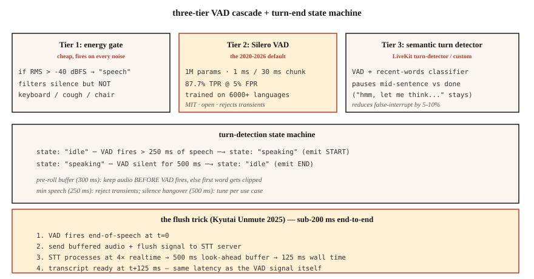

<!-- local-zh-machine-draft: English source is canonical; prose translated automatically, code/math preserved. -->

<a id="voice-activity-detection--turn-taking--silero-cobra-and-the-flush-trick"></a>

# 语音活动检测与对话轮次交接——Silero、Cobra 与 Flush Trick

> 每个声音 agent 的生死取决于两个决定：用户现在正在说话吗？他们已经完成了吗？ VAD 回答第一个。转弯检测（VAD + 沉默宿醉 + 语义端点模型）回答了第二个问题。如果出现任何错误，你的助手要么会打断用户，要么永远不会闭嘴。

**类型：** 构建
**语言：** Python
**先决条件：** 第 6·11 阶段（实时音频）、第 6·12 阶段（语音助手）
**时间：** ~45分钟

<a id="the-problem"></a>

## 问题

声音 agent 每 20 毫秒块做出三个不同的决定：

1. ** 此帧是语音吗？** — VAD。二进制，每帧。
2. **H 当用户开始新的话语时？** — 起始检测。
3. **H 用户完成了吗？** — 指向终点（转弯结束）。

天真的答案（能量阈值）在任何噪音上都失败了——交通、键盘、人群的喋喋不休。 2026 年的答案：Silero VAD（开放、深度学习）+ 转弯检测模型（语义端点）+ VAD 校准的静音宿醉。

<a id="the-concept"></a>

## 概念



<a id="the-three-tier-vad-cascade"></a>

### 三层VAD级联

**Tier 1：能量门。** 最便宜。 -40 dBFS 的阈值 RMS。过滤明显的静音，但对任何高于阈值的噪音进行触发。

**Tier 2：Silero VAD**（2020-2026，麻省理工学院）。 1M parameters。接受过 6000 多种语言的培训。在单个 CPU 线程上每 30 毫秒块运行约 1 毫秒。 TPR 为 87.7%，FPR 为 5%。开源默认。

**Tier 3：语义转向检测器。** LiveKit 的转向检测模型（2024-2026）或您自己的小型分类器。区分“句子中间停顿”和“说完”。使用语言环境（语调+最近的单词），而不仅仅是沉默。

<a id="key-parameters-and-their-defaults"></a>

### 密钥 parameters 及其默认值

- **Threshold.** Silero输出概率；将语音分类为 > 0.5（默认）或 > 0.3（敏感）。阈值越低=首词剪辑越少，误报越多。
- **最短语音持续时间。** 拒绝短于 250 毫秒的语音 — 通常是咳嗽或椅子噪音。
- **Silence Hangover (end-pointing).** VAD 返回到 0 后，等待 500-800 ms，然后再声明回合结束。太短→打断用户。太长→感觉迟钝。
- **预滚动缓冲区。** 在 VAD 触发之前保留 300-500 毫秒的音频。防止“嘿”被剪辑。

<a id="the-flush-trick-kyutai-2025"></a>

### 同花技巧（Kyutai 2025）

Streaming STT 型号具有前瞻延迟（Kyutai STT-1B 为 500 毫秒，STT-2.6B 为 2.5 秒）。通常情况下，您会在演讲结束后等待很长时间才能收到文字记录。 Flush技巧：当VAD触发语音结束时，**向STT**发送一个flush信号，强制立即输出。 STT 处理速度约为 4 倍实时，因此 500 毫秒的缓冲区在约 125 毫秒内完成。

端到端：125 毫秒 VAD + 刷新 STT = 会话延迟。

<a id="2026-vad-comparison"></a>

### 2026 VAD 比较

| 虚拟AD | TPR @ 5% FPR | 延迟 | 许可证 |
|-----|--------------|---------|---------|
| WebRTC VAD（谷歌，2013） | 50.0% | 30毫秒 | BSD |
| 西莱罗 VAD (2020-2026) | 87.7% | 〜1毫秒 | 麻省理工学院 |
| Cobra VAD（Picovoice） | 98.9% | 〜1毫秒 | 商业 |
| pyannote分割 | 95% | 〜10毫秒 | 麻省理工学院风格 |

Silero 是正确的默认值。 Cobra 是合规性/准确性的升级。纯能源 VAD 在 2026 年生产中不占有一席之地。

```figure
sp-vad-cascade
```

<a id="build-it"></a>

## 动手实现

<a id="step-1-the-energy-gate"></a>

### 第一步：能量门

```python
def energy_vad(chunk, threshold_dbfs=-40.0):
    rms = (sum(x * x for x in chunk) / len(chunk)) ** 0.5
    dbfs = 20.0 * math.log10(max(rms, 1e-10))
    return dbfs > threshold_dbfs
```

<a id="step-2-silero-vad-in-python"></a>

### 步骤2：Python中的Silero VAD

```python
from silero_vad import load_silero_vad, get_speech_timestamps

vad = load_silero_vad()
audio = torch.tensor(waveform_16k, dtype=torch.float32)
segments = get_speech_timestamps(
    audio, vad, sampling_rate=16000,
    threshold=0.5,
    min_speech_duration_ms=250,
    min_silence_duration_ms=500,
    speech_pad_ms=300,
)
for s in segments:
    print(f"{s['start']/16000:.2f}s - {s['end']/16000:.2f}s")
```

<a id="step-3-turn-end-state-machine"></a>

### 步骤3：回合结束状态机

```python
class TurnDetector:
    def __init__(self, silence_hangover_ms=500, min_speech_ms=250):
        self.state = "idle"
        self.speech_ms = 0
        self.silence_ms = 0
        self.silence_hangover_ms = silence_hangover_ms
        self.min_speech_ms = min_speech_ms

    def update(self, is_speech, chunk_ms=20):
        if is_speech:
            self.speech_ms += chunk_ms
            self.silence_ms = 0
            if self.state == "idle" and self.speech_ms >= self.min_speech_ms:
                self.state = "speaking"
                return "START"
        else:
            self.silence_ms += chunk_ms
            if self.state == "speaking" and self.silence_ms >= self.silence_hangover_ms:
                self.state = "idle"
                self.speech_ms = 0
                return "END"
        return None
```

<a id="step-4-the-flush-trick-skeleton"></a>

### 第四步：同花技巧骨架

```python
def flush_on_end(stt_client, audio_buffer):
    stt_client.send_audio(audio_buffer)
    stt_client.send_flush()
    return stt_client.recv_transcript(timeout_ms=150)
```

STT（Kyutai、Deepgram、AssemblyAI）必须支持刷新才能正常工作。 Whisper streaming 则不然——它是基于块的并且总是等待块。

<a id="use-it"></a>

## 实际应用

| 情况 | VAD选择 |
|-----------|-----------|
| 开放、快速、通用 | 西莱罗VAD |
| 商业呼叫中心 | 眼镜蛇VAD |
| 设备上（电话） | 西莱罗 VAD ONNX |
| 研究/分类 | pyannote分割 |
| 零依赖回退 | WebRTC VAD（旧版） |
| 需要转弯质量 | Silero + LiveKit 分层转向检测器 |

经验法则：除非您确实别无选择，否则切勿运输纯能源 VAD。

<a id="pitfalls"></a>

## 陷阱

- **固定阈值。** 安静时工作，嘈杂时失败。在设备上校准或切换到 Silero。
- ** 沉默太短。** Agent 中断了句子。 500-800 毫秒是对话式演讲的最佳时间。
- ** 宿醉时间太长。** 感觉呆滞。对目标用户进行 A/B 测试。
- **无预卷缓冲区。** 前 200-300 毫秒的用户音频丢失。始终保持滚动的前贴片。
- **忽略语义端点。**“嗯，让我想想......”包含长时间的停顿。用户讨厌在思考中被打断。使用 LiveKit 的转弯检测器或类似的。

<a id="ship-it"></a>

## 交付成果

保存为 `outputs/skill-vad-tuner.md`。为工作负载选择 VAD 模型、阈值、宿醉、预滚动和转弯检测策略。

<a id="exercises"></a>

## 练习

1. **Easy.** 运行`code/main.py`。它模拟语音 + 沉默 + 语音 + 咳嗽序列并测试三个 VAD 层。
2. **Medium.** 安装 `silero-vad`，处理 5 分钟的录音，调整阈值以最大限度地减少第一个单词剪辑和错误触发。报告精确度/召回率。
3. **Hard.** 构建一个迷你转弯检测器：Silero VAD + 最后 10 个单词 embeddings 上的 3 层 MLP（使用句子 - transformers）。在手工标记的回合结束数据集上进行训练。仅击败 Silero-10% F1。

<a id="key-terms"></a>

## 关键术语

| 术语 | 人们怎么说 | 它实际上意味着什么 |
|------|-----------------|-----------------------|
| 虚拟AD | 语音检测器 | 每帧二进制：这是演讲吗？ |
| 转弯检测 | 端点指向 | VAD + 沉默宿醉 + 语义端点。 |
| 沉默宿醉 | 发言后等待 | 宣布回合结束前等待的时间； 500-800 毫秒。 |
| 前贴片 | 预语音缓冲区 | VAD 触发前保留 300-500 毫秒的音频。 |
| 同花技巧 | 九太黑客 | VAD → 刷新 STT → 125 毫秒而不是 500 毫秒延迟。 |
| 语义端点 | “他们是想停下来吗？” | 机器学习分类器关注的是单词，而不仅仅是沉默。 |
| TPR@FPR 5% | 中华民国点 | 标准VAD基准； Silero 为 87.7%，WebRTC 为 50%。 |

<a id="further-reading"></a>

## 进一步阅读

- [Silero VAD](https://github.com/snakers4/silero-vad) — 参考打开 VAD。
- [Picovoice Cobra VAD](https://picovoice.ai/products/voice/voice-activity-detection/) — 商业精度领导者。
- [Kyutai — 取消静音 + 刷新技巧](https://kyutai.org/stt) — 低于 200 毫秒的工程技巧。
- [LiveKit — 转弯检测](https://docs.livekit.io/agents/logic/turns/) — 生产中的语义端点。
- [WebRTC VAD](https://webrtc.googlesource.com/src/) — 旧基线。
- [pyannote分段](https://github.com/pyannote/pyannote-audio) —二值化级分段。
