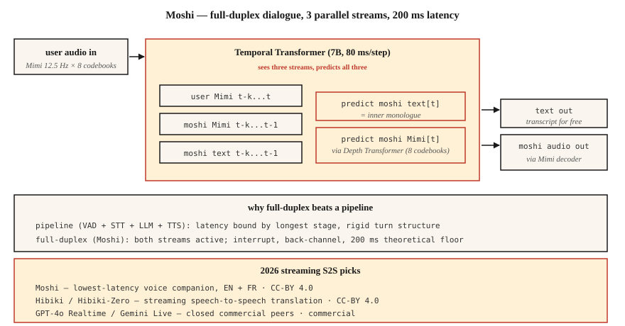

<!-- local-zh-machine-draft: English source is canonical; prose translated automatically, code/math preserved. -->

<a id="streaming-speech-to-speech--moshi-hibiki-and-full-duplex-dialogue"></a>

# Streaming 语音到语音 — Moshi、Hibiki 和全双工对话

> 2024-2026年重新定义语音AI。 Moshi 推出了一个可以同时听和说的模型，延迟时间为 200 毫秒。 Hibiki 逐块进行语音到语音的翻译。两者都放弃了 ASR → LLM → TTS 管道，转而采用 Mimi 编解码器 tokens 上的统一全双工架构。这是新的参考设计。

**类型：** 了解
**语言：** Python
**先决条件：** 第 6·13 阶段（神经音频编解码器）、第 6·11 阶段（实时音频）、第 7·05 阶段（完整 Transformer）
**时间：** ~75分钟

<a id="the-problem"></a>

## 问题

从第 11 + 12 课构建的每个语音 agent 的基本延迟底限约为 300-500 毫秒：VAD 触发、STT 过程、LLM 原因、TTS 生成。每个阶段都有自己的最小延迟。您可以调整和并行化，但管道形状限制了您。

Moshi（Kyutai，2024-2026）提出了一个不同的问题：如果没有管道怎么办？如果一个模型直接、连续地输入音频并发出音频，并以文本作为中间的“内心独白”而不是必需的阶段，会怎么样？

答案是**全双工语音到语音**。理论延迟 160 毫秒（80 毫秒 Mimi 帧 + 80 毫秒声学延迟）。单个 L4 GPU 上的实际延迟为 200 毫秒。这是一流的管道语音 agent 所实现的一半。

<a id="the-concept"></a>

## 概念



<a id="the-moshi-architecture"></a>

### 莫西架构

**Inputs.** 两个 Mimi 编解码器流，均为 12.5 Hz × 8 码本：

- 流 1：用户音频（Mimi 编码，不断到达）
- 流 2：Moshi 自己的音频（由 Moshi 生成）

**transformer.** A 7B-parameter 临时 Transformer 处理流和文本“内部独白”流。每 80 毫秒一步，它：

1. 消耗最新用户Mimi tokens（8个码本）。
2. 使用最新的 Moshi Mimi tokens（8 个密码本，已生成）。
3. 生成下一个 Moshi 文本 token（内心独白）。
4. 生成下一个 Moshi Mimi tokens（通过小深度 Transformer 生成 8 个密码本）。

所有三个流——用户音频、Moshi 音频、Moshi 文本——并行运行。 Moshi 可以听到用户讲话；当用户中断时可以自行中断；可以在不破坏其主要话语的情况下进行反向引导（“mhm”）。

**深度 transformer.** 在一个帧内，8个码本不是并行预测的——它们具有码本间的依赖性。一个小的 2 层“深度 transformer”在 80 毫秒内顺序预测它们。这是 AR 编解码器 LM 的标准分解（VALL-E、VibeVoice 也使用）。

<a id="why-inner-monologue-text-helps"></a>

### 为什么内心独白文本有帮助

如果没有明确的文本，模型必须在其声学流中隐式地建模语言。 Moshi 的见解：强制它在音频旁边发出文本 tokens。文本流本质上是 Moshi 所说内容的转录。这提高了语义一致性，使更换语言模型头变得更容易，并免费为您提供转录本。

<a id="hibiki-streaming-speech-to-speech-translation"></a>

### Hibiki：streaming 语音转语音翻译

相同的架构，在翻译对上进行训练。源音频输入，目标语言音频输出，连续不断。 Hibiki-Zero（2026 年 2 月）消除了对单词级对齐训练数据的需求 - 使用句子级数据 + GRPO reinforcement learning 进行延迟优化。

最初支持四种语言对；可以用约1000小时适应新语言。

<a id="the-broader-kyutai-stack-2026"></a>

### 更广泛的 Kyutai 堆栈 (2026)

- **Moshi** — 全双工对话（法语优先，英语良好支持）
- **Hibiki / Hibiki-Zero** — 同步语音翻译
- **Kyutai STT** — streaming ASR（500 ms 或 2.5 s 前瞻）
- **Kyutai Pocket TTS** — 100M 参数 TTS 在 CPU 上运行（2026 年 1 月）
- **Unmute** — 在公共服务器上结合这些的完整管道

L40S GPU 上的吞吐量：3 倍实时的 64 个并发会话。

<a id="sesame-csm--the-cousin"></a>

### 芝麻 CSM——表弟

Sesame CSM (2025) 使用类似的想法——带有 Mimi 编解码器头的 Llama-3 主干网。但 CSM 是单向的（获取上下文 + 文本，产生语音）而不是全双工。它是市场上最好的“语音呈现”TTS；与 Moshi 的全双工能力不太一样。

<a id="2026-performance-numbers"></a>

### 2026 年业绩数据

| 模型 | 延迟 | 应用场景 | 许可证 |
|-------|---------|----------|---------|
| 莫希 | 200 毫秒（L4） | 全双工英语/法语对话 | CC-BY 4.0 |
| 响 | 12.5 赫兹帧率 | 法语 ↔ 英语 streaming 翻译 | CC-BY 4.0 |
| 响零 | 一样 | 5 个语言对，没有对齐数据 | CC-BY 4.0 |
| 芝麻CSM-1B | 200 毫秒 TTFA | 上下文条件 TTS | 阿帕奇-2.0 |
| GPT-4o 实时 | 约 300 毫秒 | 已关闭，OpenAI API | 商业 |
| Gemini 2.5直播 | 约 350 毫秒 | 已关闭，谷歌 API | 商业 |

```figure
sp-fullduplex
```

<a id="build-it"></a>

## 动手实现

<a id="step-1-the-interface"></a>

### 第一步：界面

Moshi 公开了一个 WebSocket 服务器，该服务器获取 80 毫秒的 Mimi 编码音频块并返回 80 毫秒的 Mimi 编码音频块。两种方式。不断地。

```python
import asyncio
import websockets
from moshi.client_utils import encode_audio_mimi, decode_audio_mimi

async def moshi_chat():
    async with websockets.connect("ws://localhost:8998/api/chat") as ws:
        mic_task = asyncio.create_task(stream_mic_to(ws))
        spk_task = asyncio.create_task(stream_from_to_speaker(ws))
        await asyncio.gather(mic_task, spk_task)
```

<a id="step-2-the-full-duplex-loop"></a>

### 步骤2：全双工环路

```python
async def stream_mic_to(ws):
    async for chunk_80ms in mic_stream_at_12_5_hz():
        mimi_tokens = encode_audio_mimi(chunk_80ms)
        await ws.send(serialize(mimi_tokens))

async def stream_from_to_speaker(ws):
    async for msg in ws:
        mimi_tokens, text_token = deserialize(msg)
        audio = decode_audio_mimi(mimi_tokens)
        await play(audio)
```

两个方向同时运行。 Python asyncio 或 Rust 期货是标准传输。

<a id="step-3-the-training-objective-conceptual"></a>

### 步骤 3：培训目标（概念）

对于每 80 ms 帧 `t`：

- 输入：`user_mimi[0..t]`、`moshi_mimi[0..t-1]`、`moshi_text[0..t-1]`
- 预测：`moshi_text[t]`，则`moshi_mimi[t, codebook_0..7]`

在音频之前预测文本（内心独白）；音频在深度 transformer 内按码本顺序预测。

<a id="step-4-where-moshi-wins-and-where-it-doesnt"></a>

### 第 4 步：Moshi 的优势和劣势

莫西获胜：

- 在廉价硬件上端到端的时间不到 250 毫秒。
- 自然的秘密渠道和干扰。
- 无管道胶水代码。

莫西没有获胜：

- Tool calling（未接受过培训；您需要单独的 LLM 路径）。
- 长推理（Moshi 是一个 8B 左右的对话模型，而不是 Claude/GPT-4）。
- 小众主题的事实准确性。
- 大多数生产企业用例（2026 年仍使用管道）。

<a id="use-it"></a>

## 实际应用

| 情况 | 挑选 |
|-----------|------|
| 最低延迟的语音伴侣 | 莫希 |
| 实时翻译通话 | 响 |
| 语音演示/研究 | 莫希，CSM |
| 企业agent带工具 | 管道（第 12 课），而不是 Moshi |
| 上下文中的自定义语音 TTS | 芝麻CSM |
| 语音转语音，任何语言 | GPT-4o 实时或 Gemini 2.5 直播（商业） |

<a id="pitfalls"></a>

## 陷阱

- **Limited tool calling.** Moshi 是一个对话模型，而不是 agent 框架。与工具管道结合。
- **特定语音调节。** Moshi 使用单一经过训练的角色；克隆是一个单独的训练运行。
- **语言覆盖率。** 法语+英语优秀；其他有限。 Hibiki-Zero 有帮助，但您仍然需要训练数据。
- **资源成本。** 一个完整的Moshi会话持有一个GPU槽；这不是一种廉价的共享租户部署模式。

<a id="ship-it"></a>

## 交付成果

保存为 `outputs/skill-duplex-pipeline.md`。对于语音 agent 工作负载，选择管道与全双工架构是有道理的。

<a id="exercises"></a>

## 练习

1. **Easy.** 运行`code/main.py`。它象征性地模拟了双流+内心独白的架构。
2. **Medium.** 从 HuggingFace 拉取 Moshi，运行服务器，测试一个对话。测量从用户语音结束到 Moshi 响应开始的挂钟延迟。
3. **Hard.** 学习第 12 课管道 agent 并在 20 个匹配的测试话语上比较 P50 延迟与 Moshi。无论如何，当管道在架构上获胜时，请写下来。

<a id="key-terms"></a>

## 关键术语

| 术语 | 人们怎么说 | 它实际上意味着什么 |
|------|-----------------|-----------------------|
| 全双工 | 既听又说 | 同一型号上有两个音频流同时活动。 |
| 内心独白 | 模型的文本流 | Moshi 在音频输出的同时发出文本 tokens。 |
| 深度 transformer | 码本间预测器 | 小型 transformer，可在 80 ms 帧内预测 8 个码本。 |
| 咪咪 | 久泰的编解码器 | 12.5 Hz × 8 个码本；语义+声学；赋予莫西力量。 |
| Streaming S2S | 音频 → 音频现场 | 逐块翻译/对话，无管道阶段。 |
| 反向引导 | “嗯”反应 | Moshi 可以在不中断其轮流的情况下发出小致谢。 |

<a id="further-reading"></a>

## 进一步阅读

- [Défossez 等人。 （2024）。 Moshi — 语音文本基础模型](https://arxiv.org/html/2410.00037v2) — 论文。
- [九泰实验室（2026）。 Hibiki-Zero](https://arxiv.org/abs/2602.12345) — streaming 没有对齐数据的翻译。
- [芝麻（2025）。穿越声音的恐怖谷](https://www.sesame.com/research/crossing_the_uncanny_valley_of_voice) — CSM 规范。
- [Kyutai — Moshi 存储库](https://github.com/kyutai-labs/moshi) — 安装 + 服务器。
- [OpenAI — 实时 API](https://platform.openai.com/docs/guides/realtime) — 封闭的商业对等点。
- [Kyutai — 延迟流建模](https://github.com/kyutai-labs/delayed-streams-modeling) — 底层的 STT/TTS 框架。
