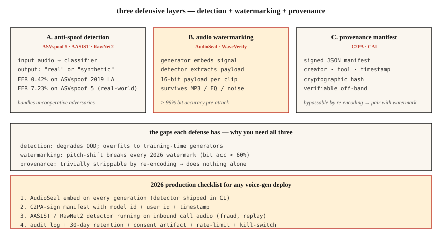

<!-- local-zh-machine-draft: English source is canonical; prose translated automatically, code/math preserved. -->

<a id="voice-anti-spoofing--audio-watermarking--asvspoof-5-audioseal-waveverify"></a>

# 语音反欺骗和音频水印 — ASVspoof 5、AudioSeal、WaveVerify

> 语音克隆的发展速度比防御更快。 2026 年生产的语音系统需要两件事：一个对真语音和假语音进行分类的检测器（AASIST、RawNet2），以及一个能够经受住压缩和编辑的水印（AudioSeal）。发送两者或不发送语音克隆。

**类型：** 构建
**语言：** Python
**先决条件：** 第 6·06 阶段（说话人识别）、第 6·08 阶段（语音克隆）
**时间：** ~75分钟

<a id="the-problem"></a>

## 问题

三个相关的防御：

1. **反欺骗/深度伪造检测。** 给定一个音频剪辑，它是合成的还是真实的？ ASVspoof 基准（ASVspoof 2019 → 2021 → 5）是黄金标准。
2. **音频水印。** 在生成的音频中嵌入难以察觉的信号，检测器稍后可以提取该信号。 AudioSeal (Meta) 和 WavMark 是开放选项。
3. **经过身份验证的出处。** 音频文件+元数据的加密签名。 C2PA/内容真实性倡议。

检测会处理不合作的对手。水印处理合规性——人工智能生成的音频应该是可识别的。到 2026 年，两者都需要。

<a id="the-concept"></a>

## 概念



<a id="asvspoof-5--the-2024-2025-benchmark"></a>

### ASVspoof 5 — 2024-2025 年基准

与之前版本相比最大的变化：

- **众包数据**（工作室不干净）—现实条件。
- **~2000 个扬声器**（对比之前的~100 个）。
- **32攻击算法。** TTS +语音转换+对抗性扰动。
- **双轨。** 对抗（CM）独立探测；用于生物识别系统的防欺骗 ASV (SASV)。

ASVspoof 5 的最新技术：~7.23% EER。在较旧的 ASVspoof 2019 LA 上：0.42% EER。实际部署：预计野外剪辑的 EER 为 5-10%。

<a id="aasist-and-rawnet2--detection-model-families"></a>

### AASIST 和 RawNet2 — 检测模型系列

**AASIST**（2021 年，更新至 2026 年）。光谱 features 上的图 attention。 ASVspoof 5 对策任务的当前 SOTA。

**RawNet2.** 基于原始波形 + TDNN 主干的卷积前端。更简单的基线；仍与 fine-tuning 竞争。

**NeXt-TDNN + SSL features.** 2025 变体：ECAPA 式 + WavLM features + 焦损。在 ASVspoof 2019 LA 上实现 0.42% EER。

<a id="audioseal--the-2024-watermark-default"></a>

### AudioSeal — 2024 年默认水印

Meta 的 **AudioSeal**（2024 年 1 月，2024 年 12 月 v0.2）。按键设计：

- **Localized.** 以 16 kHz 采样分辨率（1/16000 秒）检测每帧水印。
- **生成器+检测器联合训练。**生成器学习嵌入听不见的信号；检测器学会通过增强来找到它。
- **Robust.** 不受 MP3 / AAC 压缩、EQ、速度偏移 ±10%、噪声混合 +10 dB SNR 的影响。
- **Fast.** 检测器以 485× 实时运行；比 WavMark 快 1000 倍。
- **Capacity.** 16位有效负载（可以编码模型ID、生成时间戳、用户ID）可嵌入在每个话语中。

<a id="wavmark"></a>

### 波形标记

AudioSeal 之前的开放基线。可逆神经网络，32 位/秒。问题：

- 暴力同步很慢。
- 可以通过高斯噪声或MP3压缩来消除。
- 不实时友好。

<a id="waveverify-july-2025"></a>

### WaveVerify（2025 年 7 月）

解决了 AudioSeal 的弱点——特别是时间操作（反转、速度）。使用基于 FiLM 的生成器 + Mixture-of-Experts 检测器。在标准攻击上与 AudioSeal 竞争；处理临时编辑。

<a id="the-gap-adversaries-exploit"></a>

### 对手利用的差距

来自 AudioMarkBench：“在音调变换下，所有水印显示位恢复精度低于 0.6，表明接近完全去除。” **变调是通用攻击。** No 2026水印对于激进的音调修改完全稳健。这就是为什么您需要检测 (AASIST) 和水印。

<a id="c2pa--content-authenticity-initiative"></a>

### C2PA/内容真实性倡议

不是一种机器学习技术——一种清单格式。音频文件携带有关创建工具、作者、日期的加密签名元数据。 Audobox / 无缝使用它。有利于出处；如果错误的 actor 重新编码并删除元数据，则不会执行任何操作。

```figure
v4-audio-watermark
```

<a id="build-it"></a>

## 动手实现

<a id="step-1-a-simple-spectral-feature-detector-toy"></a>

### 步骤1：一个简单的光谱-feature探测器（玩具）

```python
def spectral_rolloff(spec, percentile=0.85):
    cum = 0
    total = sum(spec)
    if total == 0:
        return 0
    threshold = total * percentile
    for k, v in enumerate(spec):
        cum += v
        if cum >= threshold:
            return k
    return len(spec) - 1

def is_suspicious(audio):
    spec = magnitude_spectrum(audio)
    rolloff = spectral_rolloff(spec)
    return rolloff / len(spec) > 0.92
```

合成语音通常具有异常平坦的高频能量。生产探测器使用 AASIST，而不是这个。但直觉是成立的。

<a id="step-2-audioseal-embed--detect"></a>

### 第 2 步：AudioSeal 嵌入 + 检测

```python
from audioseal import AudioSeal
import torch

generator = AudioSeal.load_generator("audioseal_wm_16bits")
detector = AudioSeal.load_detector("audioseal_detector_16bits")

audio = load_wav("generated.wav", sr=16000)[None, None, :]
payload = torch.tensor([[1, 0, 1, 1, 0, 1, 0, 0, 1, 1, 0, 1, 0, 1, 1, 0]])
watermark = generator.get_watermark(audio, sample_rate=16000, message=payload)
watermarked = audio + watermark

result, decoded_payload = detector.detect_watermark(watermarked, sample_rate=16000)
# result: float in [0, 1] — probability of watermark presence
# decoded_payload: 16 bits; match against embedded payload
```

<a id="step-3-evaluation--eer"></a>

### 步骤3：evaluation — EER

```python
def eer(real_scores, fake_scores):
    thresholds = sorted(set(real_scores + fake_scores))
    best = (1.0, 0.0)
    for t in thresholds:
        far = sum(1 for s in fake_scores if s >= t) / len(fake_scores)
        frr = sum(1 for s in real_scores if s < t) / len(real_scores)
        if abs(far - frr) < best[0]:
            best = (abs(far - frr), (far + frr) / 2)
    return best[1]
```

<a id="step-4-the-production-integration"></a>

### 第四步：生产集成

```python
def safe_tts(text, voice, clone_reference=None):
    if clone_reference is not None:
        verify_consent(user_id, clone_reference)
    audio = tts_model.synthesize(text, voice)
    audio_with_wm = audioseal_embed(audio, payload=build_payload(user_id, model_id))
    manifest = c2pa_sign(audio_with_wm, user_id, timestamp=now())
    return audio_with_wm, manifest
```

每一代都附带：(1) 水印，(2) 签名清单，(3) 符合保留策略的 audit log。

<a id="use-it"></a>

## 实际应用

| 应用场景 | 防御 |
|----------|---------|
| 运送 TTS/语音克隆 | AudioSeal 嵌入每个输出（不可协商） |
| 生物识别语音解锁 | AASIST + ECAPA 合奏；活力挑战 |
| 呼叫中心欺诈检测 | AASIST 基于 20% 来电样本 |
| 播客真实性 | C2PA 上传签名，AudioSeal（如果 AI 生成） |
| 研究/培训探测器 | ASVspoof 5 火车/dev/eval sets |

<a id="pitfalls"></a>

## 陷阱

- **没有检测器运行过的水印。** 无意义。将检测器运送到您的 CI 中。
- **Detection without calibration.** AASIST 经过 ASVspoof LA 过拟合训练；现实世界的准确性下降。在您的域上进行校准。
- **变调间隙。** 积极的变调可消除大多数水印。有一个检测后备。
- **Metadata strip-and-rehost.** C2PA 可以通过重新编码轻松绕过。始终将加密+感知（水印）防御结合在一起。
- **Liveness 作为检测。** 要求用户说出随机短语。防止重放攻击，但不能防止实时克隆。

<a id="ship-it"></a>

## 交付成果

保存为 `outputs/skill-spoof-defender.md`。选择用于语音生成部署的检测模型、水印、出处清单和操作手册。

<a id="exercises"></a>

## 练习

1. **Easy.** 运行`code/main.py`。玩具检测器 + 玩具水印在合成音频上嵌入/检测。
2. **Medium.** 安装`audioseal`，在TTS输出中嵌入16位有效负载，重新解码。用噪声破坏音频并测量位恢复精度。
3. **Hard.** 在 ASVspoof 2019 LA 上微调 RawNet2 或 AASIST。测量能效比。对一组保留的 F5-TTS 生成的剪辑进行测试 — 查看 OOD 检测性能如何下降。

<a id="key-terms"></a>

## 关键术语

| 术语 | 人们怎么说 | 它实际上意味着什么 |
|------|-----------------|-----------------------|
| ASV欺骗 | 基准 | 两年一次的挑战； 2024 = ASV 欺骗 5。 |
| CM（对策） | 探测器 | 分类器：真实语音与合成/转换的语音。 |
| SASV | 扬声器验证 + CM | 集成生物识别+欺骗检测。 |
| 音频密封 | 元水印 | 本地化、16 位有效负载，比 WavMark 快 485 倍。 |
| 位恢复精度 | 水印生存 | 攻击后恢复的有效负载比特的一部分。 |
| C2PA | 出处清单 | 有关创作/作者身份的加密元数据。 |
| 亚洲科学学会 | 探测器家族 | 图-attention基于反欺骗SOTA。 |

<a id="further-reading"></a>

## 进一步阅读

- [托迪斯科等人。 （2024）。 ASV欺骗5](https://dl.acm.org/doi/10.1016/j.csl.2025.101825)— 当前基准。
- [Defossez 等人。 （2024）。 AudioSeal](https://arxiv.org/abs/2401.17264) — 默认水印。
- [Chen 等人。 （2025）。 WaveVerify](https://arxiv.org/abs/2507.21150) — 用于时间攻击的 MoE 检测器。
- [Jung 等人。 （2022）。 AASIST](https://arxiv.org/abs/2110.01200) — SOTA 检测主干。
- [AudioMarkBench (2024)](https://proceedings.neurips.cc/paper_files/paper/2024/file/5d9b7775296a641a1913ab6b4425d5e8-Paper-Datasets_and_Benchmarks_Track.pdf) — 稳健性 evaluation。
- [C2PA 规范](https://spec.c2pa.org/specifications/specifications/2.4/index.html) — 出处清单格式。
