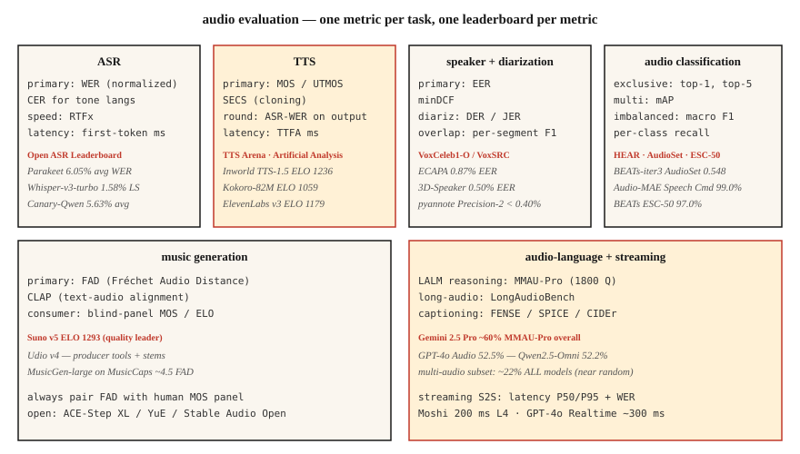

<!-- local-zh-machine-draft: English source is canonical; prose translated automatically, code/math preserved. -->

<a id="audio-evaluation--wer-mos-utmos-mmau-fad-and-the-open-leaderboards"></a>

# 音频 Evaluation — WER、MOS、UTMOS、MMAU、FAD 和开放排行榜

> 您无法运送无法测量的东西。本课程列出了每个音频任务的 2026 年指标：ASR（WER、CER、RTFx）、TTS（MOS、UTMOS、SECS、WER-on-ASR 往返）、音频语言（MMAU、LongAudioBench）、音乐（FAD、CLAP）和扬声器（EER）。加上您进行比较的排行榜。

**类型：** 了解
**语言：** Python
**先决条件：** 第6期·04、06、07、09、10；二期·09（型号Evaluation）
**时间：** ~60 分钟

<a id="the-problem"></a>

## 问题

每个音频任务都有多个指标，每个指标测量不同的轴。使用错误的指标会导致你发布的模型在仪表板上看起来很棒，但在生产中却很糟糕。 2026 年规范列表：

| 任务 | 小学 | 中学 |
|------|---------|-----------|
| 自动语音识别 | 世界教育联盟 | CER·RTFx·first-token 延迟 |
| 语音合成 | MOS/UTMOS | SECS · WER-on-ASR 往返 · CER · TTFA |
| 语音克隆 | SECS（ECAPA 余弦） | MOS·CER |
| 说话人验证 | 能效比 | minDCF · 工作点的 FAR / FRR |
| 分类 | 德 | JER·说话者混乱 |
| 音频分类 | top-1 · 地图 | 宏 F1·每类召回 |
| 音乐一代 | FAD | CLAP·听音板MOS |
| 音频语言模型 | MMAU-Pro | LongAudioBench · AudioCaps FENSE |
| Streaming S2S | 延迟 P50/P95 | WER·MOS |

<a id="the-concept"></a>

## 概念



<a id="asr-metrics"></a>

### ASR 指标

**WER（字错误率）.** `(S + D + I) / N`。小写、去掉标点符号、在评分前标准化数字。使用`jiwer`或OpenAI的`whisper_normalizer`。 < 5% = 与人类同等的阅读语音。

**CER（字符错误率）。** 相同的公式，字符级。用于分词不明确的声调语言（普通话、粤语）。

**RTFx（逆实时系数）。** 每挂钟秒处理的音频秒数。越高越好。 Parakeet-TDT 达到 3380×。 Whisper-large-v3 约为 30 倍。

**First-token 延迟。** 从音频输入到第一个文字记录的挂钟 token。对于 streaming 至关重要。 Deepgram Nova-3：约 150 毫秒。

<a id="tts-metrics"></a>

### TTS 指标

**MOS（平均意见分数）。** 1-5 人类评级。黄金标准但速度慢。每个样本收集 20 多个听众，每个模型收集 100 多个样本。

**UTMOS (2022-2026).** 学习了 MOS 预测器。在标准基准上与人类 MOS 相关性约为 0.9。 F5-TTS：UTMOS 3.95；基本事实：4.08。

**SECS（扬声器 Encoder Cosine Similarity）.** 用于语音克隆。 ECAPA embedding 参考输出和克隆输出之间的余弦。 > 0.75 = 可识别的克隆。

**WER-on-ASR-round-trip.** 通过 TTS 输出运行 Whisper，根据输入文本计算 WER。捕捉清晰度回归。 2026 年 SOTA：< 2% CER。

**TTFA（首次音频时间）。** 挂钟延迟。 Kokoro-82M：~100 毫秒； F5-TTS：~1 秒。

<a id="voice-cloning-specific"></a>

### 语音克隆专用

**SECS + MOS + CER** 作为三元组。 SECS高但MOS低的克隆意味着音色正确但不自然；相反的意思是自然的声音，但说话者是错误的。

<a id="speaker-verification"></a>

### 说话人验证

**EER（相等错误率）。** 错误接受率等于错误拒绝率的阈值。 VoxCeleb1-O 上的 ECAPA：0.87%。

**minDCF（最小检测成本）。** 选定工作点的加权成本（通常 FAR=0.01）。比 EER 更与生产相关。

<a id="diarization"></a>

### 分类

**DER（二值化错误率）。** `(FA + Miss + Confusion) / total_speaker_time`。漏话+虚警语音+说话者混乱，每一个都是分数。 AMI 会议：DER ~10-20% 是现实的。 pyannote 3.1 + Precision-2 商业广告：录制良好的音频时 DER <10%。

**JER（杰卡德错误率）。** DER 的替代方案，对短段偏差具有鲁棒性。

<a id="audio-classification"></a>

### 音频分类

多标签：所有类别的 **mAP（平均平均精度）**。 AudioSet：BEATs-iter3 的 mAP 为 0.548。

多级独家：**top-1，top-5精度**。语音命令 v2：99.0% top-1（音频-MAE）。

不平衡：**宏F1** + **每类召回**。按类别报告 - 聚合准确性隐藏了哪些类别失败。

<a id="music-generation"></a>

### 音乐一代

**FAD（Fréchet 音频距离）。** 真实音频与生成音频的 VGGish-embedding 分布之间的距离。 MusicCaps 上的 MusicGen-small：4.5。音乐LM：4.0。越低越好。

**CLAP 分数。** 文本音频 alignment 使用 CLAP embeddings 进行分数。 > 0.3 = 合理 alignment。

**听音面板MOS.** 仍然是消费级音乐的硬道理。 TTS Arena 上的 Suno v5 ELO 1293（来自配对的人类偏好）。

<a id="audio-language-benchmarks"></a>

### 音频语言基准

**MMAU（大规模多音频理解）。** 10k 音频-QA 对。

**MMAU-Pro.** 1800个硬项，四大类：语音/声音/音乐/多音频。 4 路随机概率为 25%。 Gemini 2.5 Pro总体~60%；所有型号的多音频约占 22%。

**LongAudioBench.** 带有语义查询的多分钟剪辑。 Audio Flamingo Next 击败了 Gemini 2.5 Pro。

**AudioCaps / Clotho.** 字幕基准。 SPICE、CIDEr、FENSE 指标。

<a id="streaming-speech-to-speech"></a>

### Streaming 语音转语音

**Latency P50 / P95 / P99.** 从用户语音结束到第一次声音响应的挂钟。莫希：200 毫秒； GPT-4o 实时：300 毫秒。

输出上为 **WER / MOS**。

** 插入响应能力。** 从用户中断到助理静音的时间。目标 < 150 毫秒。

<a id="the-2026-leaderboards"></a>

### 2026 年排行榜

| 排行榜 | 曲目 | 网址 |
|------------|--------|-----|
| 开放 ASR 排行榜 (HF) | 英语+多语言+长篇 | `huggingface.co/spaces/hf-audio/open_asr_leaderboard` |
| TTS 竞技场 (HF) | 英语语音合成 | `huggingface.co/spaces/TTS-AGI/TTS-Arena` |
| 人工分析演讲 | TTS + STT、配对投票中的 ELO | `artificialanalysis.ai/speech` |
| MMAU-Pro | LALM推理 | `sonalkum.github.io/mmau-pro` |
| 扬声器工作台 / VoxSRC | 说话人识别 | `voxsrc.github.io` |
| MMAU 音乐子集 | 音乐 LALM | （MMAU 内） |
| HEAR 基准测试 | 自监督音频 | `hearbenchmark.com` |

```figure
sp-wer-align
```

<a id="build-it"></a>

## 动手实现

<a id="step-1-wer-with-normalization"></a>

### 第 1 步：使用 normalization 进行 WER

```python
from jiwer import wer, Compose, ToLowerCase, RemovePunctuation, Strip

transform = Compose([ToLowerCase(), RemovePunctuation(), Strip()])
score = wer(
    truth="Please turn on the lights.",
    hypothesis="please turn on the light",
    truth_transform=transform,
    hypothesis_transform=transform,
)
# ~0.17
```

<a id="step-2-tts-round-trip-wer"></a>

### 第 2 步：TTS 往返 WER

```python
def ttr_wer(tts_model, asr_model, texts):
    errors = []
    for txt in texts:
        audio = tts_model.synthesize(txt)
        recog = asr_model.transcribe(audio)
        errors.append(wer(truth=txt, hypothesis=recog))
    return sum(errors) / len(errors)
```

<a id="step-3-secs-for-voice-cloning"></a>

### 步骤 3：用于语音克隆的 SECS

```python
from speechbrain.inference.speaker import EncoderClassifier
sv = EncoderClassifier.from_hparams("speechbrain/spkrec-ecapa-voxceleb")

emb_ref = sv.encode_batch(load_wav("reference.wav"))
emb_clone = sv.encode_batch(load_wav("cloned.wav"))
secs = torch.nn.functional.cosine_similarity(emb_ref, emb_clone, dim=-1).item()
```

<a id="step-4-fad-for-music-generation"></a>

### 第 4 步：音乐生成的流行

```python
from frechet_audio_distance import FrechetAudioDistance
fad = FrechetAudioDistance()
score = fad.get_fad_score("generated_folder/", "reference_folder/")
```

<a id="step-5-eer-for-speaker-verification-same-code-as-lesson-6"></a>

### 第 5 步：用于说话者验证的 EER（与第 6 课相同的代码）

```python
def eer(same_scores, diff_scores):
    thresholds = sorted(set(same_scores + diff_scores))
    best = (1.0, 0.0)
    for t in thresholds:
        far = sum(1 for s in diff_scores if s >= t) / len(diff_scores)
        frr = sum(1 for s in same_scores if s < t) / len(same_scores)
        if abs(far - frr) < best[0]:
            best = (abs(far - frr), (far + frr) / 2)
    return best[1]
```

<a id="use-it"></a>

## 实际应用

将每个部署与在每个模型更新上运行的固定评估 harness 配对。三个基本规则：

1. ** 评分前标准化。** 小写、标点符号、数字扩展。上报normalization规则。
2. **报告分布，而不是平均值。** P50/P95/P99 用于延迟。用于分类的每类召回。 MMAU 的每个类别。
3. ** 运行一个规范的公共基准测试。** 即使您的生产数据有所不同，Open ASR / TTS Arena / MMAU 上的报告也可以让审阅者进行同类比较。

<a id="pitfalls"></a>

## 陷阱

- **UTMOS 外推。** 接受过 VCTK 风格的干净语音训练；嘈杂/克隆/情感音频的得分很差。
- **MOS 面板偏差。** 20 个 Amazon Mechanical Turk 工人 ≠ 20 个目标用户。如果风险很高，请支付域名面板费用。
- **FAD 取决于参考集。** 与模型之间的相同参考分布进行比较。
- **聚合 WER.** 总体上 5% 的 WER 可以隐藏口音语音中 30% 的 WER。按人口统计切片报告。
- **公共基准 saturation.** 大多数前沿模型在标准基准上都接近上限。建立一个反映您的流量的内部保留集。

<a id="ship-it"></a>

## 交付成果

保存为 `outputs/skill-audio-evaluator.md`。为任何音频模型版本选择指标、基准和报告格式。

<a id="exercises"></a>

## 练习

1. **Easy.** 运行`code/main.py`。计算玩具输入上的 WER / CER / EER / SECS / FAD-ish / MMAU-ish。
2. **Medium.** 构建 TTS 往返 WER harness。通过 Whisper 运行 Kokoro 或 F5-TTS 输出。计算超过 50 个 prompts 的 WER。标记 WER > 10% 的 prompts。
3. **Hard.** 在 MMAU-Pro 语音 + 多音频子集（每个 50 个项目）上对第 10 课 LALM 选择进行评分。报告每个类别的准确性并与发布的数字进行比较。

<a id="key-terms"></a>

## 关键术语

| 术语 | 人们怎么说 | 它实际上意味着什么 |
|------|-----------------|-----------------------|
| 世界教育联盟 | ASR 分数 | `(S+D+I)/N` 在 normalization 之后的字级。 |
| 核证减排量 | 角色WER | 用于声调语言或字符级系统。 |
| 金属氧化物半导体 | 人的意见 | 1-5级； 20+ 听众 × 100 个样本。 |
| UTMOS | ML MOS 预测器 | 学习模型；与人类 MOS 相关性约为 0.9。 |
| SECS | 语音克隆相似度 | 参考和克隆之间的 ECAPA 余弦。 |
| 能效比 | 说话者验证分数 | 阈值，其中 FAR = FRR。 |
| 德 | 分类评分 | (FA + Miss + Confusion) / total. |
| FAD | 音乐品质 | VGGish embeddings 上的 Fréchet 距离。 |
| 实时格式 | 吞吐量 | 每挂钟秒的音频秒数。 |

<a id="further-reading"></a>

## 进一步阅读

- [jiwer](https://github.com/jitsi/jiwer) — 带有 normalization 实用程序的 WER/CER 库。
- [UTMOS (Saeki et al. 2022)](https://arxiv.org/abs/2204.02152) — 学习的 MOS 预测器。
- [Fréchet 音频距离（Kilgour 等人，2019）](https://arxiv.org/abs/1812.08466) — 音乐生成标准。
- [打开 ASR 排行榜](https://huggingface.co/spaces/hf-audio/open_asr_leaderboard) — 2026 年实时排名。
- [TTS Arena](https://huggingface.co/spaces/TTS-AGI/TTS-Arena) — 人类投票 TTS 排行榜。
- [MMAU-Pro 基准测试](https://sonalkum.github.io/mmau-pro/) — LALM 推理排行榜。
- [HEAR 基准](https://hearbenchmark.com/) — 音频 SSL 基准。
