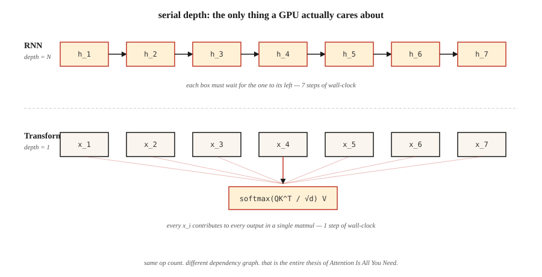

<!-- local-zh-machine-draft: English source is canonical; prose translated automatically, code/math preserved. -->

<a id="why-transformers--the-problems-with-rnns"></a>

# 为什么选择 Transformers — RNNs 的问题

> RNNs 一次处理一个 tokens。 Transformers 一次处理所有 tokens。这个单一的架构赌注改变了 2017 年之后深度学习的每一条扩展曲线。

**类型：** 了解
**语言：** Python
**先决条件：** 第3阶段（深度学习核心）、第5·09阶段（序列到序列）、第5·10阶段（Attention机制）
**时间：** ~45分钟

<a id="the-problem"></a>

## 问题

2017 年之前，地球上每一个最先进的序列模型——语言、翻译、语音——都是循环神经网络。 LSTM 和 GRU 连续五年赢得了与 ImageNet 相当的翻译基准。它们是任何人拥有的唯一工具。

他们有三个致命的弱点。顺序计算意味着您无法沿时间轴并行化：token `t+1` 需要来自 token `t` 的隐藏状态。 1,024-token 序列意味着 GPU 上有 1,024 个串行步骤，每个周期可以执行 1,000,000 次浮点运算。在专为并行性设计的硬件上训练挂钟时间与序列长度线性缩放。

gradients的消失意味着50个tokens后面的信息已经被50个非线性压缩了。门控循环单元（LSTM、GRU）减轻了挤压，但从未消除它。远程依赖——“去年夏天我在飞往京都的飞机上读到的书是……”——通常会失败。

固定宽度隐藏状态意味着 encoder 在 decoder 看到任何内容之前将整个源序列压缩到单个向量中。来源是 5 tokens 还是 500 都没有关系；瓶颈形状相同。

2017 年的论文“Attention Is All You Need”提出了一些激进的建议：完全放弃重复。让每个位置并行地处理其他位置。训练一个大矩阵乘法而不是 1,024 个连续矩阵乘法。

到 2026 年，该结果将主导每个 modality。语言（GPT-5、Claude 4、Llama 4）、视觉（ViT、DINOv2、SAM 3）、音频（Whisper）、生物学（AlphaFold 3）、机器人学（RT-2）。相同的块，不同的输入。

<a id="the-concept"></a>

## 概念



** 重复作为瓶颈。** RNN 计算 `h_t = f(h_{t-1}, x_t)`。每一步都取决于前一步。您无法在 `h_4` 之前计算 `h_5`。在具有 10,000 多个并行内核的现代 GPUs 上，这会在长序列上浪费 99% 的硅。

**Attention 作为广播。** Self-attention 同时计算每对 `(i, j)` 的 `output_i = sum_j(a_ij * v_j)`。整个 N×N attention 矩阵填充一个批次的 matmul。没有一步依赖于另一步。 GPUs 喜欢它。

**加速比不是一个常数。** 它是`O(N)`串行深度和`O(1)`串行深度之间的差异。实际上，在 N=512 的匹配硬件上，transformers 的训练速度比 epoch 快 5-10 倍，并且差距随着序列长度的增加而扩大，直到遇到 attention 的 `O(N²)` 内存墙（闪存 Attention 后来修复了） ——见第 12 课）。

**transformers 的成本是多少。** Attention 内存缩放为 `O(N²)`。对于 2K 环境来说，没问题。对于 128K 上下文，您需要滑动窗口、RoPE 外推、Flash Attention 平铺或线性 attention 变体。时间和记忆上的重复都是`O(N)`； transformers 用时间换取内存，然后通过并行性赢回时间。

**inductive bias 移位。** RNNs 假设位置和新近度。 Transformers 不做任何假设——每一对都是 attention 的候选者。这就是为什么 transformers 需要更多的数据来进行良好的训练，但一旦获得，就可以进一步扩展。 Chinchilla (2022) 形式化了这一点：只要有足够的 tokens，transformer 总是击败具有相同 parameter 计数的 RNN。

```figure
rnn-vs-parallel
```

<a id="build-it"></a>

## 动手实现

这里没有神经网络 - 我们以数字方式模拟核心瓶颈，以便您在笔记本电脑上感受到差距。

<a id="step-1-measure-serial-depth"></a>

### 第 1 步：测量序列深度

参见 `code/main.py`。我们构建两个函数。一个将序列编码为附加链（串行，如 RNN）。一种将其编码为并行缩减（广播，如 attention）。相同的数学，不同的依赖图。

```python
def rnn_style(xs):
    h = 0.0
    for x in xs:
        h = 0.9 * h + x   # can't parallelize: h depends on previous h
    return h

def attention_style(xs):
    return sum(xs) / len(xs)  # every x is independent
```

我们对最多 100,000 个元素的序列进行计时。 RNN 版本是 O(N) 和单个 CPU 管道。即使在纯 Python 中，attention 式的缩减在长度 ≥ 1,000 时也能击败它，因为 Python 的 `sum()` 是用 C 实现的，并且每步迭代时没有解释器开销。

<a id="step-2-count-theoretical-operations"></a>

### 第二步：统计理论运算

两种算法都进行 N 次加法。区别在于*依赖深度*：在下一个操作开始之前必须顺序发生多少个操作。 RNN 深度 = N。 Attention 深度 = log(N)（树缩减），或 1（并行扫描）。深度（而不是操作数）决定了 GPU 时间。

<a id="step-3-empirical-scaling-on-long-sequences"></a>

### 步骤 3：长序列的经验缩放

我们打印一个时序表，使 O(N) 间隙可见。在 2026 Mac 笔记本电脑上，少于 1,000 个元素的序列太快而无法测量。 100,000 个序列显示出干净的线性扫描。将其扩展到具有 12 层 LSTM 等效项的 16,384-token transformer，您就会明白为什么训练挂钟在 2016 年是一个障碍。

<a id="use-it"></a>

## 实际应用

2026 年何时仍选择 RNN：

| 情况 | 挑选 |
|-----------|------|
| Streaming inference，一次一个token，常量记忆 | RNN 或状态空间模型（Mamba、RWKV） |
| 非常长的序列（>1M tokens），其中 attention 内存爆炸 | 线性 attention、曼巴 2、鬣狗 |
| 没有 matmul 加速器的边缘设备 | 深度可分离 RNN 仍然在 FLOPs/watt 上获胜 |
| 其他任何内容（训练、批处理 inference、上下文高达 128K） | Transformer |

像 Mamba 这样的状态空间模型 (SSM) 本质上是具有结构化参数化的 RNNs，这使它们能够兼具两者的优点：`O(N)` 扫描内存，通过选择性扫描进行并行训练。他们恢复了 transformer 90% 的质量，并具有更好的长上下文缩放。到 2026 年，大多数前沿实验室都会训练混合 SSM+transformer 模型（例如 Jamba、Samba）——复发并没有消失，它只是一个组成部分。

<a id="ship-it"></a>

## 交付成果

参见 `outputs/skill-architecture-picker.md`。该技能在给定长度、吞吐量和训练预算约束的情况下为新的序列问题选择一种架构。它应该始终拒绝推荐纯 RNN 用于 1B tokens 以上的训练运行，而不说明权衡。

<a id="exercises"></a>

## 练习

1. **Easy.** 从 `code/main.py` 中获取 `rnn_style` 并将标量隐藏状态替换为长度为 64 的隐藏状态向量。重新测量。串行开销随隐藏状态维度增长多少？
2. **Medium.** 在纯 Python 中实现并行前缀和（Hillis-Steele 扫描）。验证它产生的数字输出与长度为 1024 的串行扫描相同。计算深度。
3. **Hard.** 在 GPU 上将 attention 式简化移植为 PyTorch。当您扫描序列长度从 64 到 65,536 时，对两者进行计时。绘制并解释曲线形状。

<a id="key-terms"></a>

## 关键术语

| 术语 | 人们怎么说 | 它实际上意味着什么 |
|------|-----------------|-----------------------|
| 复发 | “RNNs 是连续的” | 步骤 `t` 取决于步骤 `t-1` 的计算，强制沿时间轴串行执行。 |
| 串行深度 | “图表有多深” | 最长的依赖操作链；即使在无限的硬件上也可以限制挂钟。 |
| Attention | “让tokens互相看看” | 加权和 `sum_j a_ij v_j`，其中 `a_ij` 来自位置 i 和 j 之间的相似度得分。 |
| Context window | “模型看到了多少” | attention 层可以作为输入的位置数；这里的内存成本是二次方的。 |
| Inductive bias | “融入架构的假设” | 事先了解数据的样子； CNNs 假设平移不变性，RNNs 假设新近度。 |
| 状态空间模型 | “RNN 后面有代数” | 通过结构化状态空间矩阵对并行训练进行参数化循环。 |
| 二次瓶颈 | “为什么上下文成本如此之高” | Attention 内存 = `O(N²)` 序列长度； Flash Attention 隐藏常量，而不是缩放。 |

<a id="further-reading"></a>

## 进一步阅读

- [Vaswani 等人。 （2017）。 Attention Is All You Need](https://arxiv.org/abs/1706.03762)——这篇论文消除了主流 NLP 中的复发。
- [Bahdanau，Cho，Bengio (2014)。通过联合学习对齐和翻译进行神经机器翻译](https://arxiv.org/abs/1409.0473) — attention 在此诞生，并固定在 RNN 上。
- [Hochreiter, Schmidhuber (1997)。长短期记忆](https://www.bioinf.jku.at/publications/older/2604.pdf) — 原始 LSTM 论文，供记录。
- [Gu, Dao (2023)。 Mamba：具有选择性状态空间的线性时间序列建模](https://arxiv.org/abs/2312.00752) — transformers 的现代循环答案。
