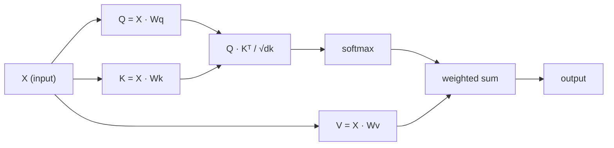

<!-- local-zh-machine-draft: English source is canonical; prose translated automatically, code/math preserved. -->

<a id="self-attention-from-scratch"></a>

# Self-Attention 从头开始

> Attention 是一个查找表，其中每个单词都询问“谁对我重要？” - 并学习答案。

**类型：** 构建
**语言：** Python
**先决条件：** 第 3 阶段（深度学习核心）、第 5 阶段第 10 课（序列到序列）
**时间：** ~90 分钟

<a id="learning-objectives"></a>

## 学习目标

- 仅使用 NumPy 从头开始实现缩放点积 self-attention，包括查询/键/值投影和 softmax 加权和
- 构建多头 attention 层，用于分割头、计算并行 attention 并连接结果
- Trace attention 矩阵如何捕获 token 关系，并解释为什么通过 sqrt(d_k) 进行缩放会阻止 softmax saturation
- 应用因果掩蔽将双向 attention 转换为 autoregressive （decoder 样式） attention

<a id="the-problem"></a>

## 问题

RNNs 一次处理一个 token。当达到 token 50 时，来自 token 1 的信息已通过 50 个压缩步骤进行压缩。长程依赖被压缩成固定大小的隐藏状态——无论多少 LSTM 门控都无法完全解决这个瓶颈。

2014 年 Bahdanau attention 论文展示了修复方法：让 decoder 回顾每个 encoder 位置并决定哪些位置对当前步骤重要。但它仍然固定在 RNN 上。 2017年的《Attention Is All You Need》论文提出了一个更尖锐的问题：如果attention是*only*机制怎么办？没有复发。没有卷积。只是attention。

Self-attention 让序列中的每个位置在单个并行步骤中处理所有其他位置。这就是 transformers 快速、可扩展且占主导地位的原因。

<a id="the-concept"></a>

## 概念

<a id="the-database-lookup-analogy"></a>

### 数据库查找类比

将 attention 视为软数据库查找：

```
Traditional database:
  Query: "capital of France"  -->  exact match  -->  "Paris"

Attention:
  Query: "capital of France"  -->  similarity to ALL keys  -->  weighted blend of ALL values
```

每个 token 生成三个向量：
- **Query (Q)**：“我在寻找什么？”
- **Key (K)**：“我包含什么？”
- **Value (V)**：“如果被选中，我需要提供什么信息？”

查询和所有键之间的点积产生 attention 分数。高分意味着“这个键与我的查询匹配”。这些分数为 weight 的值。输出是值的加权和。

<a id="q-k-v-computation"></a>

### Q、K、V 计算

每个 token embedding 通过三个学习的 weight 矩阵进行投影：

```
Input embeddings (sequence of n tokens, each d-dimensional):

  X = [x1, x2, x3, ..., xn]       shape: (n, d)

Three weight matrices:

  Wq  shape: (d, dk)
  Wk  shape: (d, dk)
  Wv  shape: (d, dv)

Projections:

  Q = X @ Wq    shape: (n, dk)      each token's query
  K = X @ Wk    shape: (n, dk)      each token's key
  V = X @ Wv    shape: (n, dv)      each token's value
```

从视觉上看，对于一个 token：

```
             Wq
  x_i ------[*]------> q_i    "What am I looking for?"
       |
       |     Wk
       +----[*]------> k_i    "What do I contain?"
       |
       |     Wv
       +----[*]------> v_i    "What do I offer?"
```

<a id="the-attention-matrix"></a>

### Attention 矩阵

一旦你有了所有 tokens 的 Q、K、V，attention 分数就形成了一个矩阵：

```
Scores = Q @ K^T    shape: (n, n)

              k1    k2    k3    k4    k5
        +-----+-----+-----+-----+-----+
   q1   | 2.1 | 0.3 | 0.1 | 0.8 | 0.2 |   <- how much q1 attends to each key
        +-----+-----+-----+-----+-----+
   q2   | 0.4 | 1.9 | 0.7 | 0.1 | 0.3 |
        +-----+-----+-----+-----+-----+
   q3   | 0.2 | 0.6 | 2.3 | 0.5 | 0.1 |
        +-----+-----+-----+-----+-----+
   q4   | 0.9 | 0.1 | 0.4 | 1.7 | 0.6 |
        +-----+-----+-----+-----+-----+
   q5   | 0.1 | 0.3 | 0.2 | 0.5 | 2.0 |
        +-----+-----+-----+-----+-----+

Each row: one token's attention over the entire sequence
```

一次观察一个查询扫描键：每一行对每个 token 进行评分，softmax 将分数转换为 weights，上下文向量是值的加权混合。

```figure
attention-matrix
```

<a id="why-scale"></a>

### 为什么要规模化？

点积随着维度 dk 增长。如果 dk = 64，点积可以在数十范围内，将 softmax 推入 gradients 消失的区域。解决方法：除以 sqrt(dk)。

```
Scaled scores = (Q @ K^T) / sqrt(dk)
```

这将值保持在 softmax 产生有用的 gradients 的范围内。

<a id="softmax-turns-scores-into-weights"></a>

### Softmax 将分数转化为Weights

Softmax 将原始分数转换为每行的概率分布：

```
Raw scores for q1:   [2.1, 0.3, 0.1, 0.8, 0.2]
                            |
                         softmax
                            |
Attention weights:   [0.52, 0.09, 0.07, 0.14, 0.08]   (sums to ~1.0)
```

现在，每个 token 都有一组 weights，表示要关注每个其他 token 的数量。

<a id="weighted-sum-of-values"></a>

### 值的加权和

每个 token 的最终输出是所有值向量的加权和：

```
output_i = sum( attention_weight[i][j] * v_j  for all j )

For token 1:
  output_1 = 0.52 * v1 + 0.09 * v2 + 0.07 * v3 + 0.14 * v4 + 0.08 * v5
```

<a id="full-pipeline"></a>

### 完整产品线



一行公式：

```
Attention(Q, K, V) = softmax( Q @ K^T / sqrt(dk) ) @ V
```

```figure
softmax-attention-scaling
```

<a id="build-it"></a>

## 动手实现

<a id="step-1-softmax-from-scratch"></a>

### 步骤1：从头开始Softmax

Softmax 将原始 logits 转换为概率。减去数值稳定性的最大值。

```python
import numpy as np

def softmax(x):
    shifted = x - np.max(x, axis=-1, keepdims=True)
    exp_x = np.exp(shifted)
    return exp_x / np.sum(exp_x, axis=-1, keepdims=True)

logits = np.array([2.0, 1.0, 0.1])
print(f"logits:  {logits}")
print(f"softmax: {softmax(logits)}")
print(f"sum:     {softmax(logits).sum():.4f}")
```

<a id="step-2-scaled-dot-product-attention"></a>

### 步骤 2：缩放点积 attention

核心功能。获取 Q、K、V 矩阵并返回 attention 输出加上 weight 矩阵。

```python
def scaled_dot_product_attention(Q, K, V):
    dk = Q.shape[-1]
    scores = Q @ K.T / np.sqrt(dk)
    weights = softmax(scores)
    output = weights @ V
    return output, weights
```

<a id="step-3-self-attention-class-with-learned-projections"></a>

### 第 3 步：带有学习投影的 Self-attention 类

完整的 self-attention 模块，带有 Wq、Wk、Wv weight 矩阵，通过类似 Xavier 的缩放进行初始化。

```python
class SelfAttention:
    def __init__(self, d_model, dk, dv, seed=42):
        rng = np.random.default_rng(seed)
        scale = np.sqrt(2.0 / (d_model + dk))
        self.Wq = rng.normal(0, scale, (d_model, dk))
        self.Wk = rng.normal(0, scale, (d_model, dk))
        scale_v = np.sqrt(2.0 / (d_model + dv))
        self.Wv = rng.normal(0, scale_v, (d_model, dv))
        self.dk = dk

    def forward(self, X):
        Q = X @ self.Wq
        K = X @ self.Wk
        V = X @ self.Wv
        output, weights = scaled_dot_product_attention(Q, K, V)
        return output, weights
```

<a id="step-4-run-it-on-a-sentence"></a>

### 第四步：在一个句子上运行它

创建假 embeddings 句子并观看 attention weights。

```python
sentence = ["The", "cat", "sat", "on", "the", "mat"]
n_tokens = len(sentence)
d_model = 8
dk = 4
dv = 4

rng = np.random.default_rng(42)
X = rng.normal(0, 1, (n_tokens, d_model))

attn = SelfAttention(d_model, dk, dv, seed=42)
output, weights = attn.forward(X)

print("Attention weights (each row: where that token looks):\n")
print(f"{'':>6}", end="")
for token in sentence:
    print(f"{token:>6}", end="")
print()

for i, token in enumerate(sentence):
    print(f"{token:>6}", end="")
    for j in range(n_tokens):
        w = weights[i][j]
        print(f"{w:6.3f}", end="")
    print()
```

<a id="step-5-visualize-attention-with-ascii-heatmap"></a>

### 步骤 5：使用 ASCII 热图可视化 attention

将 attention weights 映射到字符以便快速查看。

```python
def ascii_heatmap(weights, tokens, chars=" ░▒▓█"):
    n = len(tokens)
    print(f"\n{'':>6}", end="")
    for t in tokens:
        print(f"{t:>6}", end="")
    print()

    for i in range(n):
        print(f"{tokens[i]:>6}", end="")
        for j in range(n):
            level = int(weights[i][j] * (len(chars) - 1) / weights.max())
            level = min(level, len(chars) - 1)
            print(f"{'  ' + chars[level] + '   '}", end="")
        print()

ascii_heatmap(weights, sentence)
```

<a id="use-it"></a>

## 实际应用

PyTorch 的 `nn.MultiheadAttention` 正是我们构建的，加上多头分割和输出投影：

```python
import torch
import torch.nn as nn

d_model = 8
n_heads = 2
seq_len = 6

mha = nn.MultiheadAttention(embed_dim=d_model, num_heads=n_heads, batch_first=True)

X_torch = torch.randn(1, seq_len, d_model)

output, attn_weights = mha(X_torch, X_torch, X_torch)

print(f"Input shape:            {X_torch.shape}")
print(f"Output shape:           {output.shape}")
print(f"Attention weight shape: {attn_weights.shape}")
print(f"\nAttn weights (averaged over heads):")
print(attn_weights[0].detach().numpy().round(3))
```

主要区别：多头 attention 并行运行多个 attention 函数，每个函数都有自己的 Q、K、V 投影，大小为 dk = d_model / n_heads，然后连接结果。这使得模型可以同时处理不同的关系类型。

<a id="ship-it"></a>

## 交付成果

本课产生：
- `outputs/prompt-attention-explainer.md` - 一个prompt，用于通过数据库查找类比解释attention

<a id="exercises"></a>

## 练习

1. 修改 `scaled_dot_product_attention` 以接受可选的掩码矩阵，该矩阵在 softmax 之前将某些位置设置为负无穷大（这就是因果/decoder 掩码的工作原理）
2. 从头开始实现多头 attention：将 Q、K、V 拆分为 `n_heads` 块，在每个块上运行 attention，连接并通过最终的 weight 矩阵进行投影
3. 取两个相同长度的不同句子，将它们输入相同的 SelfAttention 实例，并比较它们的 attention 模式。有什么变化？什么保持不变？

<a id="key-terms"></a>

## 关键术语

| 术语 | 人们怎么说 | 它实际上意味着什么 |
|------|----------------|----------------------|
| 查询（问） | “问题向量” | 输入的学习投影，表示 token 正在寻找什么信息 |
| 键 (K) | “标签向量” | 一个学习投影，表示 token 包含哪些信息，与查询进行匹配 |
| 值（V） | “内容向量” | 学习投影携带基于 attention 分数聚合的实际信息 |
| 缩放点积 attention | “attention 公式” | softmax(QK^T / sqrt(dk)) @ V - 缩放可防止 softmax saturation 在高维度中 |
| Self-attention | “token 审视自己和他人” | Attention 其中Q、K、V都来自相同的序列，让每个位置都参与其他每个位置 |
| Attention weights | 《关注多少》 | 位置上的概率分布，由 softmax 通过缩放点积生成 |
| 多头 attention | “并行attention” | 使用不同的投影运行多个 attention 函数，然后连接结果以获得更丰富的表示 |

<a id="further-reading"></a>

## 进一步阅读

- [Attention Is All You Need (Vaswani et al., 2017)](https://arxiv.org/abs/1706.03762) - 原始 transformer 论文
- [插图 Transformer (Jay Alammar)](https://jalammar.github.io/illustrated-transformer/) - 完整架构的最佳视觉演练
- [带注释的 Transformer (Harvard NLP)](https://nlp.seas.harvard.edu/annotated-transformer/) - 逐行 PyTorch 实现及解释
