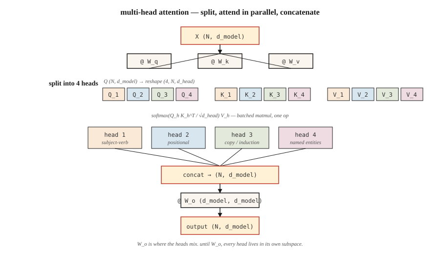

<!-- local-zh-machine-draft: English source is canonical; prose translated automatically, code/math preserved. -->

<a id="multi-head-attention"></a>

# 多头 Attention

> 一个 attention 头一次学习一种关系。八个头学八个。头是免费的。多拿一些。

**类型：** 构建
**语言：** Python
**先决条件：** 第 7 阶段·02（Self-Attention 从头开始）
**时间：** ~75分钟

<a id="the-problem"></a>

## 问题

单个 self-attention 头计算一个 attention 矩阵。该矩阵捕获了一种关系——通常是最小化训练信号损失的关系。如果您的数据主谓一致、共指、远程话语和句法 chunking 全部纠缠在一起，则单个头会将它们涂抹到单个软最大分布中并丢失一半信号。

2017 年 Vaswani 论文中的修复：并行运行多个 attention 函数，每个函数都有自己的 Q、K、V 投影，然后连接输出。每个头在尺寸为 `d_model / n_heads` 的较小子空间中运行。总计 parameters 保持不变。表现力上升。

多头 attention 是 2026 年每个 transformer 出厂时的默认配置。唯一的争论是关于 * 有多少个 * 头以及键和值是否共享投影（分组查询 Attention、多查询 Attention、多头潜在 Attention）。

<a id="the-concept"></a>

## 概念



**Split.** 取形状 `(N, d_model)` 的 `X`。投影到 Q、K、V 形状 `(N, d_model)`。重塑为 `(N, n_heads, d_head)`，其中 `d_head = d_model / n_heads`。转置为 `(n_heads, N, d_head)`。

** 并行参加。** 在每个头内运行缩放点积 attention。每个头产生`(N, d_head)`。这些头在 embedding 的不同子空间上运行，并且在 attention 计算本身期间从不说话。

**连接并投影。**堆栈返回`(N, d_model)`并乘以形状为`(d_model, d_model)`的学习输出矩阵`W_o`。 `W_o` 是头脑混合的地方。

**为什么有效。** 每个负责人都可以专业化，而无需与其他人竞争代表预算。 2019-2024年的探索研究显示了不同的头部角色：位置头部、关注先前token的头部、复制头部、命名实体头部、归纳头部（其在in-context learning的基础上）。

**2026年谱系变异：**

| 变体 | Q头 | K/V 头 | 使用者 |
|---------|---------|-----------|---------|
| 多头 (MHA) | 氮 | 氮 | GPT-2，BERT，T5 |
| 多查询（MQA） | 氮 | 1 | 帕尔姆、猎鹰 |
| 分组查询 (GQA) | 氮 | G（例如N/8） | Llama 2 70B、Llama 3+、Qwen 2+、Mistral |
| 多头潜伏 (MLA) | 氮 | 压缩到低等级 | DeepSeek-V2、V3 |

GQA 是现代默认设置，因为它将 KV 缓存内存减少了 `N/G` 倍，同时保持几乎完整的质量。 MLA 更进一步，将 K/V 压缩到 latent space 中，然后在计算时投影回来——花费 FLOPs，节省更多内存。

```figure
multihead-split
```

<a id="build-it"></a>

## 动手实现

<a id="step-1-split-heads-from-the-single-head-attention-we-already-have"></a>

### 步骤1：从我们已有的单头attention中分割出头

取第 02 课中的 `SelfAttention` 并用 split/concat 对包装它。请参阅 `code/main.py` 了解 numpy 实现；逻辑是：

```python
def split_heads(X, n_heads):
    n, d = X.shape
    d_head = d // n_heads
    return X.reshape(n, n_heads, d_head).transpose(1, 0, 2)  # (heads, n, d_head)

def combine_heads(H):
    h, n, d_head = H.shape
    return H.transpose(1, 0, 2).reshape(n, h * d_head)
```

一种重塑，一种转置。没有循环。这正是 PyTorch 在 `nn.MultiheadAttention` 下所做的事情。

<a id="step-2-run-scaled-dot-product-attention-per-head"></a>

### 步骤 2：每头运行缩放点积 attention

每个头都有自己的 Q、K、V 切片。 Attention 成为批量 matmul：

```python
def mha_forward(X, W_q, W_k, W_v, W_o, n_heads):
    Q = X @ W_q
    K = X @ W_k
    V = X @ W_v
    Qh = split_heads(Q, n_heads)         # (heads, n, d_head)
    Kh = split_heads(K, n_heads)
    Vh = split_heads(V, n_heads)
    scores = Qh @ Kh.transpose(0, 2, 1) / np.sqrt(Qh.shape[-1])
    weights = softmax(scores, axis=-1)
    out = weights @ Vh                    # (heads, n, d_head)
    concat = combine_heads(out)
    return concat @ W_o, weights
```

在真实硬件上，`Qh @ Kh.transpose(...)` 是一个 `bmm`。 GPU 看到形状为 `(heads, N, d_head) × (heads, d_head, N) -> (heads, N, N)` 的单个批量 matmul。添加头是免费的。

<a id="step-3-grouped-query-attention-variant"></a>

### 步骤3：分组查询Attention变体

只有键和值预测发生变化。 Q获取`n_heads`组； K 和 V 得到 `n_kv_heads < n_heads` 组并重复匹配：

```python
def gqa_project(X, W, n_kv_heads, n_heads):
    kv = split_heads(X @ W, n_kv_heads)       # (kv_heads, n, d_head)
    repeat = n_heads // n_kv_heads
    return np.repeat(kv, repeat, axis=0)      # (n_heads, n, d_head)
```

在 inference 中，这可以节省内存，因为只有 `n_kv_heads` 复制到 KV cache 中，而不是 `n_heads` 中。 Llama 3 70B 使用 64 个查询头和 8 个 KV 头 — 8 倍缓存收缩。

<a id="step-4-probe-what-each-head-learned"></a>

### 第四步：探究每个头学到了什么

对包含 4 个中心词的短句运行 MHA。对于每个头，打印 `(N, N)` attention 矩阵。你会看到不同的头即使在随机初始化的情况下也会挑选出不同的结构——这部分是信号，部分是子空间中的旋转对称。

<a id="use-it"></a>

## 实际应用

在PyTorch中，一行版本：

```python
import torch.nn as nn

mha = nn.MultiheadAttention(embed_dim=512, num_heads=8, batch_first=True)
```

自 PyTorch 2.5+ 起的 GQA：

```python
from torch.nn.functional import scaled_dot_product_attention

# scaled_dot_product_attention auto-dispatches Flash Attention on CUDA.
# For GQA, pass Q of shape (B, n_heads, N, d_head) and K,V of shape
# (B, n_kv_heads, N, d_head). PyTorch handles the repeat.
out = scaled_dot_product_attention(q, k, v, is_causal=True, enable_gqa=True)
```

** 有多少个头？** 2026 年量产车型的经验法则：

| 型号尺寸 | d_model | n_heads | d_head |
|------------|---------|---------|--------|
| 小（~125M） | 768 | 12 | 64 |
| 基地（~350M） | 1024 | 16 | 64 |
| 大 (~1B) | 2048 | 16 | 128 |
| 边境（~70B） | 8192 | 64 | 128 |

`d_head` 几乎总是落在 64 或 128。它是一个头可以“看到”多少的单位。降到 32 以下，头部开始与比例因子 `sqrt(d_head)` 作斗争；超过 256，您就会失去“许多小专家”的好处。

<a id="ship-it"></a>

## 交付成果

参见 `outputs/skill-mha-configurator.md`。该技能会在给定 parameter 预算、序列长度和部署目标的情况下，为新的 transformer 推荐人员数量、kv 人员数量和预测策略。

<a id="exercises"></a>

## 练习

1. **Easy.** 从`code/main.py`中取出MHA，并将`n_heads`从1更改为16，并固定`d_model=64`。绘制一个小型单层模型在合成复制任务上的损失。更多的头脑是有帮助、稳定还是有害？
2. **中等的。**实施 MQA（所有查询头共享一个 KV 头）。 测量多少parameter与完整 MHA 相比，计数下降。 计算 KV 缓存大小缩小了多少inference对于 N=2048。
3. **Hard.** 实现多头潜在Attention的微型版本：将K，V压缩到一个等级-`r`潜在，将潜在存储在KV cache中，解压在attention 时间。在 `r` 的情况下，缓存内存是否会跨越完整 MHA 的 1/8，同时质量保持在验证 ppl 的 1 位以内？

<a id="key-terms"></a>

## 关键术语

| 术语 | 人们怎么说 | 它实际上意味着什么 |
|------|-----------------|-----------------------|
| 头 | “单个 attention 电路” | 维度 `d_head = d_model / n_heads` 的 Q/K/V 投影及其自己的 attention 矩阵。 |
| d_head | 「头部尺寸」 | 每头隐藏宽度；生产中几乎总是 64 或 128。 |
| 分割/合并 | 《重塑技巧》 | `(N, d_model) ↔ (n_heads, N, d_head)` 围绕 attention 重塑+转置。 |
| W_o | “输出预测” | `(d_model, d_model)` 矩阵在连接头后应用；头脑混合的地方。 |
| 质量保证 | 《一KV头》 | 多查询 Attention：单个共享 K/V 投影。最小的KV cache，有一些质量损失。 |
| 质量保证局 | “自 Llama 2 以来的默认值” | 分组查询 Attention 和 `n_kv_heads < n_heads`；重复匹配 Q。 |
| MLA | “DeepSeek的伎俩” | 多头潜在 Attention：K,V 压缩为低阶潜在，在出席时解压缩。 |
| 感应头 | 《in-context learning背后的电路》 | 一对检测先前发生的事件并复制随后发生的事件的头。 |

<a id="further-reading"></a>

## 进一步阅读

- [Vaswani 等人。 （2017）。 Attention 是您所需要的 §3.2.2](https://arxiv.org/abs/1706.03762) — 原始多头规格。
- [Shazeer (2019)。快速 Transformer 解码：一个写头即可满足您的需求](https://arxiv.org/abs/1911.02150) — MQA 论文。
- [Ainslie 等人。 （2023）。 GQA：从多头 Checkpoints](https://arxiv.org/abs/2305.13245) 训练广义多查询 Transformer 模型 — 如何在训练后将 MHA 转换为 GQA。
- [DeepSeek-AI (2024)。 DeepSeek-V2 技术报告](https://arxiv.org/abs/2405.04434) — MLA 以及为什么它在高速缓存上击败 MHA/GQA。
- [Olsson 等人。 （2022）。 In-context Learning 和感应头](https://transformer-circuits.pub/2022/in-context-learning-and-induction-heads/index.html) — 机械地观察感应头的实际作用。
