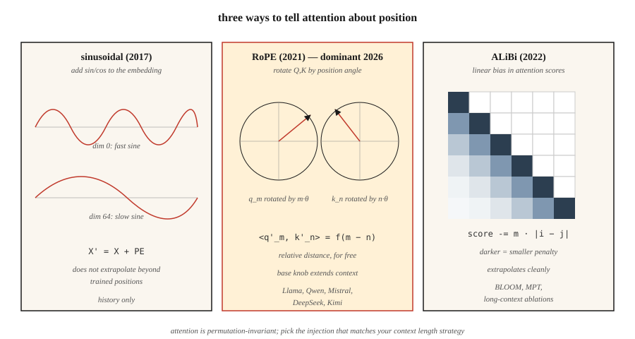

<!-- local-zh-machine-draft: English source is canonical; prose translated automatically, code/math preserved. -->

<a id="positional-encoding--sinusoidal-rope-alibi"></a>

# 位置编码 — 正弦、RoPE、ALiBi

> Attention 是排列不变的。 “The cat sat on the mat”和“mat the on sat cat the”产生相同的输出，但没有位置信号。三种算法解决了这个问题——每种算法对“位置”的含义都有不同的押注。

**类型：** 构建
**语言：** Python
**先决条件：** 第 7 阶段·02 (Self-Attention)、第 7 阶段·03 (多头 Attention)
**时间：** ~45分钟

<a id="the-problem"></a>

## 问题

缩放点积 attention 是订单盲的。 attention 矩阵 `softmax(Q K^T / √d) V` 是根据成对相似度计算得出的。对 `X` 的行进行打乱，以同样的方式得到打乱后的输出行。 attention 内部没有任何内容关心位置。

这不是词袋模型中的错误。对于语言、代码、音频、视频——任何秩序具有意义的东西——都是致命的。

修复方法是以某种方式将位置注入 embeddings 中。三个时代的答案：

1. **绝对正弦**（Vaswani 2017）。将持仓 `sin/cos` 添加到 embedding 中。简单，无需学习，超出训练长度的推断效果很差。
2. **RoPE — 旋转位置 Embeddings** (Su 2021)。将 Q 和 K 向量旋转与位置成比例的角度。直接在点积中编码 *relative* 位置。 2026年占据主导地位。
3. **ALiBi — Attention 具有线性偏置**（按 2022 年）。完全跳过embeddings；根据距离向 attention 分数添加每头线性惩罚。出色的长度外推。

截至 2026 年，基本上每个前沿开放模型都使用 RoPE：Llama 2/3/4、Qwen 2/3、Mistral、Mixtral、DeepSeek-V3、Kimi。少数长上下文模型使用 ALiBi 或其现代变体。绝对正弦曲线是历史的。

<a id="the-concept"></a>

## 概念



<a id="absolute-sinusoidal"></a>

### 绝对正弦波

预先计算形状为 `(max_len, d_model)` 的固定矩阵 `PE`：

```
PE[pos, 2i]   = sin(pos / 10000^(2i / d_model))
PE[pos, 2i+1] = cos(pos / 10000^(2i / d_model))
```

然后 `X' = X + PE[:N]` 在 attention 之前。每个维度都是不同频率的正弦曲线。该模型学习从相位模式中读取位置。失败超出 `max_len`：当模型只看到位置 0-2047 时，没有任何信息告诉模型在位置 2048 发生了什么。

<a id="rope"></a>

### RoPE

旋转 Q 和 K 向量（不是 embeddings）。对于一对尺寸 `(2i, 2i+1)`：

```
[q'_2i    ]   [ cos(pos·θ_i)  -sin(pos·θ_i) ] [q_2i   ]
[q'_2i+1  ] = [ sin(pos·θ_i)   cos(pos·θ_i) ] [q_2i+1 ]

θ_i = base^(-2i / d_head),  base = 10000 by default
```

对位置为 `pos_k` 的键应用相同的旋转。点积 `q'_m · k'_n` 单独成为 `(m - n)` 的函数。即：**，attention 得分仅取决于相对距离**，即使旋转已关闭绝对位置。漂亮的把戏。

扩展 RoPE：`base` 可以扩展（NTK 感知、YaRN、LongRoPE）以推断到更长的上下文，而无需重新训练。 Llama 3通过这种方式从8K扩展到128K上下文。

<a id="alibi"></a>

### 铝锂

跳过 embedding 技巧。直接偏置 attention 分数：

```
attn_score[i, j] = (q_i · k_j) / √d  -  m_h · |i - j|
```

其中 `m_h` 是头部特定的斜率（例如 `1 / 2^(8·h/H)`）。接近tokens得到提升；目前tokens受到处罚。无培训时间成本。该论文显示长度外推法优于正弦曲线，并在其原始训练长度上匹配 RoPE。

<a id="what-to-pick-in-2026"></a>

### 2026年该选择什么

| 变体 | 外推法 | 培训费用 | 使用者 |
|---------|---------------|---------------|---------|
| 绝对正弦波 | 穷 | 免费 | 原版transformer，早期BERT |
| 学到绝对 | 无 | 微小的 | GPT-2, GPT-3 |
| RoPE | 缩放效果好 | 免费 | Llama 2/3/4、Qwen 2/3、Mistral、DeepSeek-V3、基米 |
| RoPE + YaRN | 优秀的 | 微调阶段 | Qwen2-1M，Llama 3.1 128K |
| 铝锂 | 优秀的 | 免费 | BLOOM、MPT、百川 |

RoPE 获胜是因为它在不改变架构的情况下插入 attention，编码相对位置，并且它的 `base` hyperparameter 为长上下文 fine-tuning 提供了一个干净的旋钮。

```figure
rope-explorer
```

<a id="build-it"></a>

## 动手实现

<a id="step-1-sinusoidal-encoding"></a>

### 步骤一：正弦编码

参见 `code/main.py`。 4 行计算：

```python
def sinusoidal(N, d):
    pe = [[0.0] * d for _ in range(N)]
    for pos in range(N):
        for i in range(d // 2):
            theta = pos / (10000 ** (2 * i / d))
            pe[pos][2 * i]     = math.sin(theta)
            pe[pos][2 * i + 1] = math.cos(theta)
    return pe
```

将其添加到第一个 attention 层之前的 embedding 矩阵中。

<a id="step-2-rope-applied-to-q-k"></a>

### 步骤2：RoPE应用于Q、K

RoPE 在 Q 和 K 上就地操作。对于每对暗淡：

```python
def apply_rope(x, pos, base=10000):
    d = len(x)
    out = list(x)
    for i in range(d // 2):
        theta = pos / (base ** (2 * i / d))
        c, s = math.cos(theta), math.sin(theta)
        a, b = x[2 * i], x[2 * i + 1]
        out[2 * i]     = a * c - b * s
        out[2 * i + 1] = a * s + b * c
    return out
```

关键：对 `m` 位置的 Q 和 `n` 位置的 K 应用相同的函数。他们的点积在每个坐标对上获取 `cos((m-n)·θ_i)` 因子。 Attention 免费学习相对位置。

<a id="step-3-alibi-slopes-and-bias"></a>

### 步骤 3：ALiBi 斜率和偏差

```python
def alibi_bias(n_heads, seq_len):
    # slope_h = 2 ** (-8 * h / n_heads) for h = 1..n_heads
    slopes = [2 ** (-8 * (h + 1) / n_heads) for h in range(n_heads)]
    bias = []
    for m in slopes:
        row = [[-m * abs(i - j) for j in range(seq_len)] for i in range(seq_len)]
        bias.append(row)
    return bias  # add to attention scores before softmax
```

将`bias[h]`添加到头`h`的`(seq_len, seq_len)` attention分数矩阵中，然后添加softmax。

<a id="step-4-verify-relative-distance-property-of-rope"></a>

### 步骤4：验证RoPE的相对距离属性

选择两个随机向量 `a, b`。按 `(pos_a, pos_b)` 旋转。然后通过`(pos_a + k, pos_b + k)`。两个点积必须在浮点误差范围内匹配。该属性是 RoPE 的全部要点——它对于绝对偏移量是不变的，只有相对间隙很重要。

<a id="use-it"></a>

## 实际应用

PyTorch 2.5+ 在 `torch.nn.functional` 中提供 RoPE 实用程序。大多数生产代码使用 `flash_attn` 或 `xformers`，其中 RoPE 在 attention 内核中应用。

```python
from transformers import AutoModel
model = AutoModel.from_pretrained("meta-llama/Llama-3.2-3B")
# model.config.rope_scaling → {"type": "yarn", "factor": 32.0, "original_max_position_embeddings": 8192}
```

**2026年的长上下文技巧：**

- **NTK 感知插值。** 当从 4K 扩展到 16K+ 时，将 `base` 重新缩放为 `base * (scale_factor)^(d/(d-2))`。
- **YaRN.** 更智能的插值，在长上下文中保留 attention 熵。 Llama 3.1 128K使用它。
- **LongRoPE.** Microsoft 的 2024 年方法，使用进化搜索来选择每个维度的比例因子。 Phi-3-Long 使用它。
- **位置插值 + fine-tuning.** 只需通过扩展因子缩小位置并微调 1–5B tokens。出奇的有效。

<a id="ship-it"></a>

## 交付成果

参见 `outputs/skill-positional-encoding-picker.md`。该技能为给定目标上下文长度、外推需求和训练预算的新模型选择编码策略。

<a id="exercises"></a>

## 练习

1. **Easy.** 将正弦 `PE` 矩阵绘制为 `max_len=512, d=128` 的热图。确认“随着维度索引的增长，条纹变宽”模式。
2. **Medium.** 实现 NTK 感知的 RoPE 缩放。在长度为 256 的序列上训练一个微型 LM，然后在缩放和不缩放的情况下在长度 1024 上进行测试。测量perplexity。
3. **Hard.** 在同一个 attention 模块中实现 ALiBi 和 RoPE。在长度为 512 的序列的复制任务上训练 4 层 transformer。在测试时外推到 2048。比较退化。

<a id="key-terms"></a>

## 关键术语

| 术语 | 人们怎么说 | 它实际上意味着什么 |
|------|-----------------|-----------------------|
| 位置编码 | “告诉 attention 有关订单的信息” | 添加到 embeddings 或 attention 的任何编码位置的信号。 |
| 正弦曲线 | “原来的那个” | `sin/cos`以几何频率添加到embeddings；不推断。 |
| RoPE | “旋转embeddings” | 将 Q、K 旋转与位置相关的角度；点积编码相对距离。 |
| 铝锂 | “线性偏置技巧” | 将`-m·\|i-j\|`添加到attention分数中；不需要 embedding，很好的推断。 |
| 基地 | “RoPE的旋钮” | RoPE中的频率缩放器；增加以扩展 inference 的上下文。 |
| NTK感知 | “RoPE 缩放技巧” | 重新缩放 `base`，以便在上下文扩展时高频调暗不会受到挤压。 |
| 雅然 | “奇特的一个” | 每维插值+外推，保留 attention 熵。 |
| 外推法 | “工作超出训练长度” | 位置方案能否提供训练中看到的 `max_len` 之外的正确输出？ |

<a id="further-reading"></a>

## 进一步阅读

- [Vaswani 等人。 （2017）。 Attention 是您所需要的 §3.5](https://arxiv.org/abs/1706.03762) — 原始正弦曲线。
- [Su 等人。 （2021）。 RoFormer：增强型 Transformer，带旋转位置 Embedding](https://arxiv.org/abs/2104.09864) — RoPE 纸张。
- [Press，史密斯，刘易斯（2021）。训练短，测试长：Attention 具有线性偏置，可实现输入长度外推](https://arxiv.org/abs/2108.12409) — ALiBi。
- [Peng 等人。 （2023）。 YaRN：大型语言模型的高效 Context Window 扩展](https://arxiv.org/abs/2309.00071) — 最先进的 RoPE 缩放。
- [Chen 等人。 （2023）。通过位置插值扩展大型语言模型的 Context Window](https://arxiv.org/abs/2306.15595) — Meta 的 Llama 2 长上下文论文。
- [Ding 等人。 （2024）。 LongRoPE：扩展 LLM Context Window 超过 200 万 Tokens](https://arxiv.org/abs/2402.13753) — Phi-3-Long 使用的 Microsoft 方法，并在“使用它”部分中引用。
- [HuggingFace Transformers — `modeling_rope_utils.py`](https://github.com/huggingface/transformers/blob/main/src/transformers/modeling_rope_utils.py) — 每个 RoPE 缩放方案的生产级实现（默认、线性、动态、YaRN、 LongRoPE，Llama-3）。
