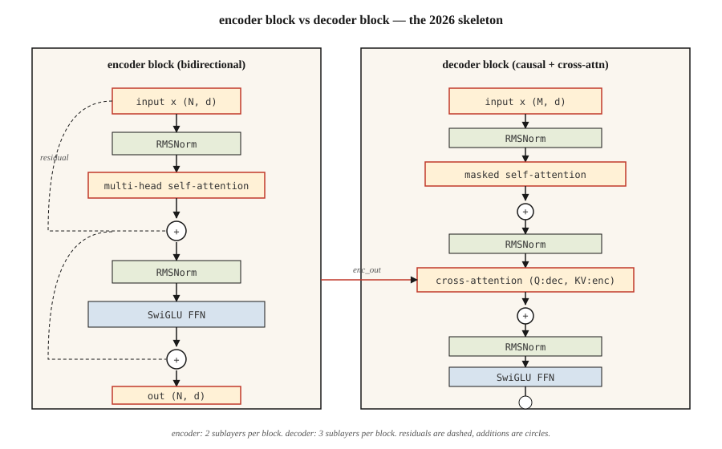

<!-- local-zh-machine-draft: English source is canonical; prose translated automatically, code/math preserved. -->

<a id="the-full-transformer--encoder--decoder"></a>

# 完整的 Transformer — Encoder + Decoder

> Attention 是明星。其他所有内容 - 残差，normalization，前馈，cross-attention - 都是让您将其堆叠得很深的脚手架。

**类型：** 构建
**语言：** Python
**先决条件：** 第 7 相·02 (Self-Attention)、第 7·03 相（多头 Attention）、第 7·04 相（位置编码）
**时间：** ~75分钟

<a id="the-problem"></a>

## 问题

单个 attention 层是 feature 提取器，而不是模型。每层一个 matmul 对于语言来说容量不够。你需要深度——而深度断裂却没有正确的管道。

2017 年 Vaswani 论文打包了六项设计决策，将 attention 层转变为可堆叠块。自 transformer 起 — 仅 encoder (BERT)、仅 decoder (GPT)， encoder-decoder (T5) — 继承相同的骨架。 2026 年，这些块已得到细化（RMSNorm、SwiGLU、预规范、RoPE），但骨架是相同的。

本课是骨架。接下来的课程将专门介绍它 - 06 为 encoders，07 为 decoders，08 为 encoder-decoder。

<a id="the-concept"></a>

## 概念



<a id="the-six-pieces"></a>

### 六块

1. **Embedding + 位置信号。** Tokens → 向量。通过 RoPE（现代）或正弦曲线（经典）注入位置。
2. **Self-attention.** 每个位置都互相照顾。屏蔽为 decoders。
3. **前馈网络（FFN）。** 位置两层 MLP：`W_2 · activation(W_1 · x)`。扩展倍率默认4倍。
4. **剩余连接。** `x + sublayer(x)`。如果没有这个，gradients 就会消失超过~6层。
5. **Layer normalization.** `LayerNorm` 或 `RMSNorm`（现代）。稳定残余流。
6. **Cross-attention（仅限 decoder）。** 查询来自 decoder，键和值来自 encoder 输出。

观察通过一个块的矢量流：attention 跨位置混合，残差将其向前推进，FFN 对其进行变换，范数保持流稳定。

```figure
transformer-block
```

<a id="encoder-block-used-by-bert-t5-encoder"></a>

### Encoder 块（由 BERT、T5 encoder 使用）

```
x → LN → MHA(self) → + → LN → FFN → + → out
                     ^              ^
                     |              |
                     └── residual ──┘
```

Encoder 是双向的。没有掩蔽。所有职位查看所有职位。

<a id="decoder-block-used-by-gpt-t5-decoder"></a>

### Decoder 块（由 GPT、T5 decoder 使用）

```
x → LN → MHA(masked self) → + → LN → MHA(cross to encoder) → + → LN → FFN → + → out
```

Decoder 每个块有三个子层。中间的 cross-attention 是信息从 encoder 流向 decoder 的唯一地方。在纯 decoder 架构 (GPT) 中，cross-attention 被省略，您只需屏蔽 self-attention + FFN。

<a id="pre-norm-vs-post-norm"></a>

### 规范前与规范后

原论文：`x + sublayer(LN(x))` vs `LN(x + sublayer(x))`。后规范在 2019 年左右失去了青睐——如果不小心 warmup 就很难进行深度训练。预规范（`LN` *before*子层）是2026年的默认值：Llama、Qwen、GPT-3+、 Mistral都用它。

<a id="the-2026-modernized-block"></a>

### 2026年现代化街区

Vaswani 2017 年发货 LayerNorm + ReLU。现代堆栈取代了两者。生产块实际上是什么样子的：

| 组件 | 2017 | 2026 |
|-----------|------|------|
| Normalization | LayerNorm | RMSNorm |
| FFN 激活 | ReLU | SwiGLU |
| FFN扩展 | 4× | 2.6×（SwiGLU使用三个矩阵，总参数匹配） |
| 职位 | 正弦绝对值 | RoPE |
| Attention | 完整的MHA | GQA（或 MLA） |
| 偏差项 | 是的 | 否 |

RMSNorm 放弃了 LayerNorm 的均值中心化（少一个减法），这节省了计算量，并且在经验上至少是稳定的。在 Llama、PaLM 和 Qwen 论文中，SwiGLU (`Swish(W1 x) ⊙ W3 x`) 始终优于 ReLU/GELU FFN 约 0.5 个百分点。

<a id="parameter-count"></a>

### Parameter计数

对于具有 `d_model = d` 和 FFN 扩展 `r` 的一个块：

- MHA：`4 · d²`（Q、K、V、O 投影）
- FFN（SwiGLU）：`3 · d · (r · d)` ≈ `3rd²`
- 标准：可忽略不计

在`d = 4096, r = 2.6, layers = 32`（大致为Llama 3 8B），总计：`32 · (4·4096² + 3·2.6·4096²) ≈ 32 · (16 + 32) M = ~1.5B parameters per layer × 32 ≈ 7B`（加上embeddings和头）。匹配已发布的计数。

<a id="build-it"></a>

## 动手实现

<a id="step-1-the-building-blocks"></a>

### 第 1 步：构建块

使用第 03 课中的小型 `Matrix` 类（为了独立而复制到此文件）：

- `layer_norm(x, eps=1e-5)` — 减去平均值，除以标准差。
- `rms_norm(x, eps=1e-6)` — 除以 RMS。没有平均减法。
- `gelu(x)` 和 `silu(x) * W3 x` (SwiGLU)。
- `ffn_swiglu(x, W1, W2, W3)`.
- `encoder_block(x, params)` 和 `decoder_block(x, enc_out, params)`。

完整接线请参见 `code/main.py`。

<a id="step-2-wire-a-2-layer-encoder-and-a-2-layer-decoder"></a>

### 步骤2：连接2层encoder和2层decoder

将它们堆叠起来。将 encoder 输出传递到每个 decoder cross-attention 中。在输出投影之前添加最终 LN。

```python
def encode(tokens, params):
    x = embed(tokens, params.emb) + sinusoidal(len(tokens), params.d)
    for block in params.encoder_blocks:
        x = encoder_block(x, block)
    return x

def decode(target_tokens, encoder_out, params):
    x = embed(target_tokens, params.emb) + sinusoidal(len(target_tokens), params.d)
    for block in params.decoder_blocks:
        x = decoder_block(x, encoder_out, block)
    return x
```

<a id="step-3-run-forward-on-a-toy-example"></a>

### 第 3 步：在玩具示例上继续运行

将 6-token 源和 5-token 目标馈送通过。验证输出形状为 `(5, vocab)`。没有培训——本课是关于架构的，而不是关于损失的。

<a id="step-4-swap-in-rmsnorm--swiglu"></a>

### 第四步：换入RMSNorm + SwiGLU

将 LayerNorm 和 ReLU-FFN 替换为 RMSNorm 和 SwiGLU。确认形状仍然匹配。这就是2026年的现代化，只有一种功能替代。

<a id="use-it"></a>

## 实际应用

PyTorch/TF 参考实现：`nn.TransformerEncoderLayer`、`nn.TransformerDecoderLayer`。但大多数 2026 年生产代码都会滚动自己的块，因为：

- Flash Attention 在 attention 内部调用，而不是通过 `nn.MultiheadAttention` 调用。
- GQA / MLA 不在 stdlib 参考中。
- RoPE、RMSNorm、SwiGLU 不是 PyTorch 默认值。

HF `transformers` 有干净的参考块，您应该阅读：`modeling_llama.py` 是规范的 2026 decoder-only 块。大约 500 行，值得走一遍。

**Encoder vs decoder vs encoder-decoder — 何时选择：**

| 需要 | 挑选 | 示例 |
|------|------|---------|
| 分类，embeddings，通过文本进行QA | Encoder-仅限 | BERT，DeBERTa，ModernBERT |
| 文本生成、聊天、代码、推理 | Decoder-仅限 | GPT, Llama, Claude, Qwen |
| 结构化输入→structured output（翻译、摘要） | Encoder-decoder | T5、BART、Whisper |

Decoder-only 语言获胜，因为它的扩展最干净，并且可以处理理解和生成。当输入具有明确的“源序列”标识（翻译、语音识别、结构化任务）时，Encoder-decoder 仍然是最好的。

<a id="ship-it"></a>

## 交付成果

参见 `outputs/skill-transformer-block-reviewer.md`。该技能根据 2026 年默认值审查新的 transformer 块实现，并标记缺失的部分（预规范、RoPE、RMSNorm、GQA、FFN 扩展比）。

<a id="exercises"></a>

## 练习

1. **Easy.** 在编码器 _ 块中计算 `d_model=512, n_heads=8, ffn_expansion=4, swiglu=True` 处的 parameters。通过实现该块并使用 `sum(p.numel() for p in block.parameters())` 进行验证。
2. **Medium.** 从后规范切换到前规范。初始化两者并测量随机输入的 12 个堆叠层后的激活范数。后规范的激活应该会爆炸；预范数应该保持有界。
3. **Hard.** 在玩具复制任务上实现 4 层 encoder-decoder（复制 `x` 反转）。训练 100 步。报失。交换 RMSNorm + SwiGLU + RoPE — 损失会下降吗？

<a id="key-terms"></a>

## 关键术语

| 术语 | 人们怎么说 | 它实际上意味着什么 |
|------|-----------------|-----------------------|
| 块 | “一层 transformer 层” | 范数+attention+范数+FFN的堆栈，包裹在剩余连接中。 |
| 残差 | “跳过连接” | `x + f(x)` 输出；使 gradient 流能够穿过深堆栈。 |
| 预规范 | “在之前正常化，而不是在之后正常化” | 现代：`x + sublayer(LN(x))`。无需 warmup 体操即可进行更深层次的训练。 |
| RMSNorm | “LayerNorm 无意思” | 除以有效值；少一个操作，相同的经验稳定性。 |
| SwiGLU | “大家都转向了 FFN” | `Swish(W1 x) ⊙ W3 x → W2`。在 LM 上击败 ReLU/GELU。 |
| Cross-attention | 《decoder 如何看待 encoder》 | MHA 的 Q 来自 decoder，K/V 来自 encoder 输出。 |
| FFN扩展 | “中间 MLP 有多宽” | 隐藏大小与 d_ 模型的比率，通常为 4 (LayerNorm) 或 2.6 (SwiGLU)。 |
| 无偏差 | “删除 +b 项” | 现代堆栈忽略了线性层中的偏差； ppl 略有改善，模型更小。 |

<a id="further-reading"></a>

## 进一步阅读

- [Vaswani 等人。 （2017）。 Attention 就是您所需要的](https://arxiv.org/abs/1706.03762) — 原始块规格。
- [Xiong 等人。 （2020）。在Transformer架构中的Normalization层上](https://arxiv.org/abs/2002.04745)——为什么前规范深深击败后规范。
- [Zhang，森里奇（2019）。均方根层 Normalization](https://arxiv.org/abs/1910.07467) — RMSNorm。
- [Shazeer (2020)。 GLU 变体改进了 Transformer](https://arxiv.org/abs/2002.05202) — SwiGLU 论文。
- [HuggingFace `modeling_llama.py`](https://github.com/huggingface/transformers/blob/main/src/transformers/models/llama/modeling_llama.py) — 规范 2026 decoder 专用块。
