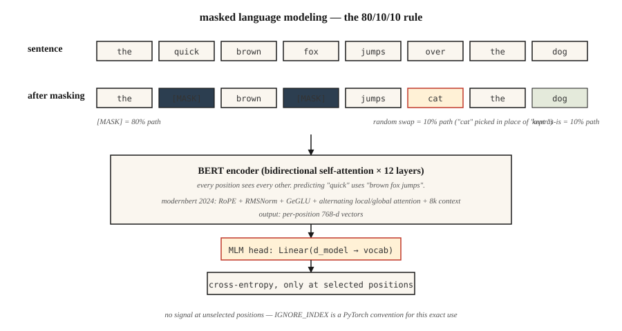

<!-- local-zh-machine-draft: English source is canonical; prose translated automatically, code/math preserved. -->

<a id="bert--masked-language-modeling"></a>

# BERT——掩码语言建模

> GPT 预测下一个单词。 BERT 预测丢失的单词。一句话的区别——五年来一切都是 embedding 形状的。

**类型：** 构建
**语言：** Python
**先决条件：** 第 7 阶段·05（完整 Transformer）、第 5 阶段·02（文本表示）
**时间：** ~45分钟

<a id="the-problem"></a>

## 问题

2018 年，每项 NLP 任务（情感、NER、QA、蕴含）都使用自己的标记数据从头开始训练自己的模型。没有可以微调的预训练“理解英语”checkpoint。 ELMo (2018) 表明您可以使用双向 LSTM 预训练上下文 embeddings；它有所帮助，但没有概括。

BERT（Devlin et al. 2018）问：如果我们使用 transformer encoder，对互联网上的每个句子进行训练，并强制它根据两侧的上下文来预测缺失的单词，会怎么样？然后，您可以对下游任务进行微调。 Parameter 的效率是一个启示。

结果：在 18 个月内，BERT 及其变体（RoBERTa、ALBERT、ELECTRA）统治了现有的所有 NLP 排行榜。到 2020 年，地球上的每个搜索引擎、内容审核管道和语义搜索系统都内部有一个 BERT。

到 2026 年，仅 encoder 的模型仍然是分类、检索和结构化提取的正确工具——它们在每个 token 上的运行速度比 decoders 快 5-10 倍，并且它们的 embeddings 是每个现代检索堆栈的支柱。 ModernBERT（2024 年 12 月）使用 Flash Attention + RoPE + GeGLU 将架构推向 8K 环境。

<a id="the-concept"></a>

## 概念



<a id="the-training-signal"></a>

### 训练信号

取一句话：`the quick brown fox jumps over the lazy dog`。

随机屏蔽 tokens 的 15%：

```
input:  the [MASK] brown fox jumps [MASK] the lazy dog
target: the  quick brown fox jumps  over  the lazy dog
```

训练模型以预测屏蔽位置处的原始 tokens。由于 encoder 是双向的，因此在位置 1 处预测 `[MASK]` 可以在位置 2+ 处使用 `brown fox jumps`。这是 GPT 做不到的。

<a id="the-bert-mask-rules"></a>

### BERT掩码规则

在选择进行预测的 tokens 的 15% 中：

- 80%被替换为`[MASK]`。
- 10% 被替换为随机 token。
- 10% 保持不变。

为什么不总是`[MASK]`？因为`[MASK]`从来没有出现在inference时间。训练模型期望 `[MASK]` 处于 100% 的屏蔽位置，这将在 pretraining 和 fine-tuning 之间创建 distribution shift。 10% 随机 + 10% 不变使模型保持诚实。

<a id="next-sentence-prediction-nsp--and-why-it-was-dropped"></a>

### 下一句话预测（NSP）——以及它被放弃的原因

原始 BERT 也在 NSP 上进行了训练：给定两个句子 A 和 B，预测 B 是否遵循 A。RoBERTa (2019) 消融了它并显示 NSP 受到伤害，而不是帮助。现代 encoders 跳过它。

<a id="what-changed-in-2026-modernbert"></a>

### 2026 年发生了什么变化：ModernBERT

2024 年的 ModernBERT 论文用 2026 个原语重建了该块：

| 组件 | 原版 BERT (2018) | 现代BERT (2024) |
|-----------|----------------------|-------------------|
| 位置性 | 学到绝对 | RoPE |
| 激活 | GELU | 谷胱甘肽 |
| Normalization | LayerNorm | 预范RMSNorm |
| Attention | 全密 | 交替本地 (128) + 全局 |
| 上下文长度 | 512 | 8192 |
| Tokenizer | WordPiece | BPE |

与 2018 年堆栈不同的是，它是 Flash-Attention 原生的。 Inference 在序列长度 8K 时比 DeBERTa-v3 快 2-3 倍，并且具有更好的 GLUE 分数。

<a id="use-cases-that-still-pick-an-encoder-in-2026"></a>

### 2026 年仍选择 encoder 的用例

| 任务 | 为什么 encoder 击败 decoder |
|------|---------------------------|
| 检索 / semantic search embeddings | 双向上下文 = 每个 token 更好的 embedding 质量 |
| 分类（情感、意图、毒性） | 1个forward pass；无生成开销 |
| NER / token 标签 | 每个位置输出，本机双向 |
| Zero-shot蕴涵（NLI） | 分类器头位于 encoder 顶部 |
| Reranker 为 RAG | 跨encoder评分，比LLM快10倍 rerankers |

```figure
transformer-residual
```

<a id="build-it"></a>

## 动手实现

<a id="step-1-masking-logic"></a>

### 第1步：屏蔽逻辑

参见 `code/main.py`。函数 `create_mlm_batch` 获取 token ID 列表、词汇大小和掩码概率。返回输入 ID（应用了掩码）和标签（仅在掩码位置，其他地方为 -100 — PyTorch 的忽略索引约定）。

```python
def create_mlm_batch(tokens, vocab_size, mask_prob=0.15, rng=None):
    input_ids = list(tokens)
    labels = [-100] * len(tokens)
    for i, t in enumerate(tokens):
        if rng.random() < mask_prob:
            labels[i] = t
            r = rng.random()
            if r < 0.8:
                input_ids[i] = MASK_ID
            elif r < 0.9:
                input_ids[i] = rng.randrange(vocab_size)
            # else: keep original
    return input_ids, labels
```

<a id="step-2-run-mlm-prediction-on-a-tiny-corpus"></a>

### 第 2 步：在小型语料库上运行 MLM 预测

在包含 20 个单词、200 个句子的 vocabulary 上训练 2 层 encoder + MLM 头。否 gradient — 我们进行前向传递健全性检查。全程培训需要PyTorch。

<a id="step-3-compare-mask-types"></a>

### 第三步：比较口罩类型

展示三向规则如何在没有 `[MASK]` 的情况下保持模型可用。预测未屏蔽的句子和屏蔽的句子。两者都应该产生合理的 token 分布，因为模型在训练中看到了这两种模式。

<a id="step-4-fine-tune-head"></a>

### 第四步：微调头部

将 MLM 头替换为玩具情感数据集上的分类头。只有头车； encoder 被冻结。这是每个 BERT 应用程序都遵循的模式。

<a id="use-it"></a>

## 实际应用

```python
from transformers import AutoModel, AutoTokenizer

tok = AutoTokenizer.from_pretrained("answerdotai/ModernBERT-base")
model = AutoModel.from_pretrained("answerdotai/ModernBERT-base")

text = "Attention is all you need."
inputs = tok(text, return_tensors="pt")
out = model(**inputs).last_hidden_state   # (1, N, 768)
```

**Embedding 模型经过微调 BERT.** `sentence-transformers` 模型（如 `all-MiniLM-L6-v2`）经过 BERTs 训练对比损失。 encoder 是一样的。损失发生了变化。

**Cross-encoder rerankers 也在 `[CLS] query [SEP] doc [SEP]` 上微调 BERT.** 配对分类。查询和文档之间的双向 attention 正是交叉 encoders 相对于双编码器的质量优势。

** 2026年什么时候不选择BERT。** 任何生成的东西。 encoder 没有明智的方法来自回归生成 tokens。另外：任何低于 1B 参数的情况，小型 decoder 都可以以更高的灵活性来匹配质量（Phi-3-Mini、Qwen2-1.5B）。

<a id="ship-it"></a>

## 交付成果

参见 `outputs/skill-bert-finetuner.md`。该技能范围为新的分类或提取任务进行 BERT 微调（主干选择、头部规格、数据、评估、停止）。

<a id="exercises"></a>

## 练习

1. **Easy.** 运行 `code/main.py` 并打印 10,000 个 tokens 上的掩模分布。确认~15%被选中，其中~80%变成`[MASK]`。
2. **Medium.** 实现全字屏蔽：如果一个单词被标记为子词，则将所有子词一起屏蔽或不屏蔽。衡量这是否可以提高 500 个句子的语料库上的传销准确性。
3. **Hard.** 在公共数据集中的 10,000 个句子上训练一个小型（2 层，d=64）BERT。针对 SST-2 情绪微调 `[CLS]` token。与匹配参数处的仅 decoder 基线进行比较 - 哪个获胜？

<a id="key-terms"></a>

## 关键术语

| 术语 | 人们怎么说 | 它实际上意味着什么 |
|------|-----------------|-----------------------|
| 传销 | 《掩码语言建模》 | 训练信号：随机用`[MASK]`替换tokens的15%，预测原始信号。 |
| 双向 | “看起来是双向的” | Encoder attention 没有因果掩码——每个位置都可以看到其他位置。 |
| `[CLS]` | “池子token” | 每个序列前面都有一个特殊的 token；其最终的 embedding 用作句子级表示。 |
| `[SEP]` | “段分隔符” | 分隔配对序列（例如查询/文档、句子 A/B）。 |
| 国家标准计划 | “下一句话预测” | BERT的第二个pretraining任务；在 RoBERTa 中被证明毫无用处，2019 年之后被删除。 |
| Fine-tuning | “适应任务” | 保持 encoder 大部分冻结；在顶部训练一个小头来完成下游任务。 |
| 交叉-encoder | “reranker” | BERT 将查询和文档作为输入，输出相关性分数。 |
| 现代BERT | 《2024年刷新》 | Encoder 使用 RoPE、RMSNorm、GeGLU、交替本地/全局 attention、8K 上下文进行重建。 |

<a id="further-reading"></a>

## 进一步阅读

- [Devlin 等人。 （2018）。 BERT：用​​于语言理解的深度双向 Transformers 的预训练](https://arxiv.org/abs/1810.04805) — 原始论文。
- [Liu 等人。 （2019）。 RoBERTa：稳健优化的 BERT Pretraining 方法](https://arxiv.org/abs/1907.11692) — 如何训练 BERT 正确；杀死 NSP。
- [Clark 等人。 （2020）。 ELECTRA：预训练文本 Encoders 作为判别器而不是生成器](https://arxiv.org/abs/2003.10555) — 替换 token 检测在匹配计算上击败了 MLM。
- [Warner 等人。 （2024）。更智能、更好、更快、更长：现代双向 Encoder](https://arxiv.org/abs/2412.13663) — ModernBERT 论文。
- [HuggingFace `modeling_bert.py`](https://github.com/huggingface/transformers/blob/main/src/transformers/models/bert/modeling_bert.py) — 规范的 encoder 参考。
